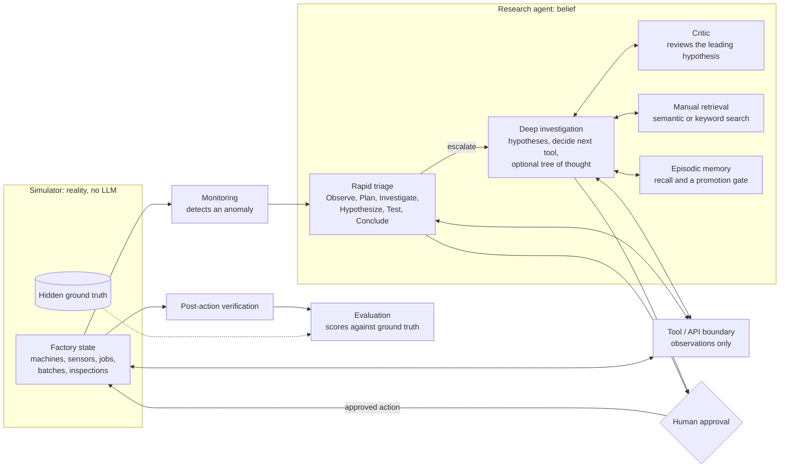

# Manufacturing Research Agent (CMU capstone)

An AI agent that investigates faults on a simulated CNC production line the
way a reliability engineer would. It reads sensors, jobs, inspections and
maintenance records through tools, forms competing hypotheses, recommends a
repair for a human to approve, and checks afterwards that the repair worked.
A deterministic factory simulator supplies the faults, and keeps the true
answer hidden from the agent so every investigation can be scored.

## The problem

When a machine alarms or parts start failing inspection, the obvious
explanation is often wrong. A vibration alarm can come from a wearing
bearing, a wrong spindle-speed setting, a bad material batch upstream, or a
sensor glitch. Each needs a different response, and the wrong repair costs
downtime and money. The evidence that tells these apart is spread across
sensor histories, job and batch records, inspections and maintenance logs.

This project asks whether an LLM agent can gather that evidence within a
budget, tell the causes apart, and act safely. "Act safely" means:

- recommend only what the evidence supports;
- leave the final decision to a human;
- verify the result.

The simulator makes this measurable. Every case has a known root cause that
only the evaluator can see.

## Architecture



The diagram keeps three things apart:

- **Reality:** the simulator's true state, including the fault it injected.
- **Observation:** what the tools return.
- **Belief:** what the agent concludes.

The agent never reads the ground truth. Only the evaluator reads it, after the run, and tests check that it never crosses the tool boundary.

| Part | What it does | Code |
|---|---|---|
| Simulator | A seeded factory of 3–8 CNC machines with causal fault models (bearing wear, wrong setting, bad material batch, false alarm, servo-drive wear, hydraulic leak), noise and distractors. The same seed gives the same run. | `capstone/simulator/` |
| Tools | About 15 read-only factory tools (readings, trends, events, jobs, inspections, maintenance, line screening), optional injected tool failures, and the action tools behind approval. | `capstone/tools/`, `capstone/providers/` |
| Rapid triage | A bounded first pass (about 90 s). In deterministic mode, Python plans and runs the reads, compiles candidate cause families (TC1..TCn), and tests them; only Conclude asks a model, which can rank its two most plausible candidates. | `capstone/agent/triage_*.py` |
| Deep investigation | A loop that proposes hypotheses, chooses the next tool, and stops when evidence suffices or a budget runs out. Tree of thought is optional. | `capstone/agent/investigation.py`, `loop.py`, `tree_of_thought.py` |
| Critic | A second model that reviews the leading hypothesis and can request one follow-up check. | `capstone/agent/critic.py` |
| Manual retrieval | Searches a synthetic machine manual by meaning (Chroma), shared words, or a Neon store. | `capstone/manual/` |
| Episodic memory | Lessons from past investigations, recalled by similarity and admitted through a promotion gate (PostgreSQL/Neon). | `capstone/memory/` |
| Approval and verification | A human approves or rejects each recommended action; after an action, the agent checks whether the symptom cleared. | `capstone/episode.py`, `capstone/agent/` |
| Evaluation | Scores root cause, target, action, resolution, evidence collected and calibration against hidden truth, plus an evaluator framework and inventories. | `capstone/evaluation/`, `evaluation/` |
| Console and API | A React console and FastAPI service for runs, investigations, evidence and review, deployed as an API on Render, a worker on Northflank and a frontend on Vercel. | `frontend/`, `capstone/api/`, `capstone/worker/` |

Code paths are under `capstone-code/`. Model providers are Mistral, Google Gemini, Groq, NVIDIA, Cohere and Cloudflare, plus the routers listed in `AGENTS.md` §9. The simulator, the tools and the whole test suite run offline with no model and no keys.

## Quickstart

Install [uv](https://docs.astral.sh/uv/getting-started/installation/). Then
set up the environment exactly as CI does: all extras, plus the web
service's packages, which are kept out of `uv.lock` on purpose.

```sh
uv sync --locked --all-extras
uv pip install -r frontend/requirements-api.txt
uv run pytest
```

The tests run offline. CI runs them on Python 3.14 (from
`.python-version`).

**Offline demo (no model, no keys):** the rule-based baseline investigates
the 13 known-answer cases and prints a scored line per case.

```sh
uv run python -m capstone.baseline --known
```

**Live investigation (needs model keys):** copy `.env.example` to `.env`,
fill in at least one provider key, then run the 13 cases as rapid triage:

```sh
uv run python -m capstone.experiment run --name demo --known --triage --out runs/demo.records.jsonl
uv run python -m capstone.experiment report --results runs/demo.records.jsonl
```

To start the console locally, see [`frontend/README.md`](frontend/README.md).

## Results

All rows use the 13 known-answer cases (`capstone/evaluation/known_answers.py`). There are two cases per fault and one compound challenge, scored against hidden truth. The samples are small, so these are functionality checks, not accuracy estimates.

| Run | What ran | Result | Source |
|---|---|---|---|
| Rule baseline, offline | Hand-written rules, no model | 9/13 root causes right; 8/13 resolved; 4/13 unnecessary interventions. It has no rules for servo or hydraulic faults. | `python -m capstone.baseline --known` on current `main` |
| Triage ranking, live, 2026-11-21/22 | Deterministic triage, Lightning 30B conclusion, three batches of 13 cases; the conclusion's two most plausible causes ranked (prompt versions 2, 4 and 5) | Best arm (R0): top-1 77% / 62% / 69% (v5, 2 × 13), top-2 85% / 92% / 92% against chance 36% / 72%; v5 had no rejected ranking; Super 120B instead of Lightning 30B did worse (38% / 62%, 8 of 26 rankings rejected); every other setting ranked worse; conclusions unchanged by the ranking (4/13 right recommendations in every arm) | [benchmark note](docs/benchmarks/2026-11-21-triage-ranking.md) |
| Rapid triage, live, 2026-11-15 | Lightning 30B (thinking off), 2 × 13 cases, all triage blocks on, compared with the A0 control | 8/26 right recommendations and 6/26 resolved in both arms; 0 unnecessary interventions; 46–51% of relevant evidence collected against 23–28% for the control; p50 52 s against 68 s | [benchmark note](docs/benchmarks/2026-11-15-triage-lightning-model.md) |
| Deep agent, live, 2026-10-30/31 | Tree of thought with the manual, critic off and on, 5 cases each | Critic off 1/5 right; critic on 1/4 judged, with 1 awaiting review. Both concluded "transient sensor" on the compound challenge. | [master results](docs/benchmarks/2026-10-31-master-results/README.md) |
| Candidate coverage, offline | Deterministic triage with a scripted conclusion | 12/13 cases offer a candidate naming the true cause. The gap is KA-09, whose alarm comes from the distractor machine. | [ranking evaluation](docs/TRIAGE_RANKING_EVALUATION.md) |

The evaluation audit's summary is that the system works end to end against real models, but that its reasoning quality is not yet proven ([`evaluation/FINAL_REPORT.md`](evaluation/FINAL_REPORT.md), question 7):

- Budgets, timeouts, fallbacks, approval and verification all hold in live runs.
- The model agent often diagnoses bearing wear and false alarms.
- It did not diagnose the batch or setting faults in the master runs.
- It rarely asks for a fix.

## Limitations

- **Reasoning quality is unproven.** Live runs are few, configurations changed between batches, and most cases ran once. No comparison yet shows the critic, the manual or memory improving accuracy.
- **Batch and setting faults remain hard for the model agent.** Its triage recommendations are right about a third of the time, and the rule baseline still beats the model on the four original faults.
- **Simulated data only.** The faults are causal models, not physics. A read-only pilot on real CNC machines is planned (see the [pilot runbook](docs/PRESTIGE_PILOT_RUNBOOK.md)). No real machine data is committed, and the console cannot act on a physical machine.
- **Confidence is uncalibrated.** It is the model's own assessment, not a measured probability.
- **Memory** is implemented and tested offline, but no live comparison has shown that it improves results.

## Repository map

- `capstone-code/capstone/`: the code, imported as `capstone`. Paths such as `capstone/simulator/` in these docs are inside `capstone-code/`.
- `tests/`: the pytest suite. It runs offline; CI groups are in `.github/test_groups.py`.
- `evaluation/`: the evaluator framework, inventories, rubric and audit. Start at [`evaluation/EVALUATION_README.md`](evaluation/EVALUATION_README.md).
- `frontend/`: the React console and the FastAPI service's requirements.
- `docs/`: the scope ([`MVP_SCOPE.md`](docs/MVP_SCOPE.md)), progress log ([`PROGRESS.md`](docs/PROGRESS.md)), benchmarks, design notes and future work. Older working notes are in [`docs/archive/`](docs/archive/).
- `AGENTS.md`: the development rules and architecture principles used to build the project with coding agents. `CLAUDE.md` imports it.

---

# Developer reference

The sections below are for working on the code.

## Documentation index

- `AGENTS.md` — development rules, architecture principles, and the
  gated teaching workflow used to build this project, for any coding
  agent (`CLAUDE.md` imports it for Claude Code).
- `docs/MVP_SCOPE.md` — what the MVP includes, what it excludes, and the
  post-MVP roadmap.
  [Future Work 2](docs/MVP_SCOPE.md#future-work-2--mcp-architecture-observability-and-response-verification)
  covers the minimal MCP slice, deferred server-count decision,
  OpenTelemetry/LangSmith, and response verification, with a readiness checklist.
- `docs/PROGRESS.md` — which components are implemented and which are
  understood (tracked separately).
- [Prestige pilot runbook](docs/PRESTIGE_PILOT_RUNBOOK.md) — controller-agnostic
  visit discovery, permission checks, source/time/channel validation and a
  private, offline acceptance gate; no controller type or visit date is known.
- [Future Work reevaluation register](docs/FUTURE_WORK_REEVALUATION.md) —
  reviewed implementation conditions, adoption checks and reasons to defer or
  reject candidates, including the Datum/Ratchet prompt evaluation.
- [Multi-agent survey future work](docs/MULTI_AGENT_SURVEY_FUTURE_WORK.md):
  completed blind-critic experiment, remaining operator-feedback design and
  partially documented survey-framework write-up.
- [Run-2 findings](docs/RUN2_FINDINGS_FUTURE_WORK.md): historical ToT/critic
  failure modes, the completed critic-follow-up fix and still-open reasoning
  checks. `docs/MVP_SCOPE.md` remains the active roadmap.
- [Course notebooks future work](docs/COURSE_NOTEBOOKS_FUTURE_WORK.md):
  six planned items from the course lab notebooks (audit by default,
  aggregation tools, three-times ToT rating, separate uncertainty labels,
  MMR for memory recall, cost per correct diagnosis), plus a refined plan
  (A1 to A7) for evidence coverage, question resolution, a line snapshot and
  a failure funnel.
- [Manufacturing-agent papers future work](docs/MANUFACTURING_AGENT_PAPERS_FUTURE_WORK.md):
  five planned items from three 2026 manufacturing-agent papers.
- `evaluation/` — the evaluation framework (added 2026-11-01): inventories of
  every function, test and tool with their verification status, run evidence
  packets, the Snap 1.1 decision questions, the rubric, and the audit of what
  the master runs prove. Start at
  [`evaluation/EVALUATION_README.md`](evaluation/EVALUATION_README.md).

## Frameworks and technology stack

| Area | Technology | Role |
|---|---|---|
| Language and simulator | Python 3.11+ and the standard library | Runs the deterministic factory simulator and investigation tools locally, without an LLM. |
| Data and configuration | Pydantic v2 and pydantic-settings | Validate shared contracts and load typed application settings. |
| Agent orchestration | Pydantic Graph (`agent` extra) | Coordinates the investigation's stages and transitions. |
| Model integrations | HTTP clients using Python's `urllib` | Connect to configured model providers; TypeSafe Jev supplies optional evaluator judgments. |
| Database and migrations | PostgreSQL / Neon, SQLAlchemy, psycopg and Alembic (`database` extra) | Provide optional persistent episodic memory and schema migrations. |
| Semantic memory | ChromaDB (`semantic` extra), with optional NVIDIA embeddings | Supports similarity search over stored lessons. |
| Development and CI | uv, setuptools, pytest, pytest-cov, Ruff, pre-commit and GitHub Actions | Manage dependencies, package, test, lint, format and check changes. |

The optional extras are declared in `pyproject.toml`; the simulator and offline
tests do not require a database or model-provider credentials. See the setup
sections below for the database extra and development commands.

## Opt-in investigation challenge

```python
from capstone.simulator.challenge import build_challenge
from capstone.tools.observation import ObservationTools

sim = build_challenge(seed=42, machines=3)
for _ in range(300):
    sim.step()
observations = ObservationTools(sim)
readings = observations.get_readings("CNC-01", "temperature", 0, 300)
```

`build_challenge()` combines bearing wear and excessive speed on one machine,
a harmless vibration spike on another, and temperature drift with a temporary
signal loss on a third. Target machines and onset are seed-selected. The same
seed and actions replay the same observations. Existing `build_line()` behavior
and investigation tool formats are unchanged. No LLM or delayed maintenance
records are involved. See the [difficulty guide](docs/SIMULATOR_DIFFICULTY_COMPATIBILITY.md)
for timing, limitations, and the component walkthrough.

## Developer setup

Install [uv](https://docs.astral.sh/uv/getting-started/installation/), then run:

```sh
uv sync --locked --all-extras
uv pip install -r frontend/requirements-api.txt
uv run --locked pytest
```

`--all-extras` installs the optional groups the tests import (Pydantic Graph
for the agent, the database, semantic and Siemens extras). The FastAPI,
uvicorn and httpx packages for the web service come from
`frontend/requirements-api.txt`, outside `uv.lock`; without them the API tests
fail with `ModuleNotFoundError: fastapi`. CI installs both the same way.

`pyproject.toml` declares dependencies, `uv.lock` records their resolved
versions, and `.python-version` selects Python 3.14.7, the interpreter used
for this migration. The package still supports Python 3.11 and later.
`uv` manages the local `.venv`; commit the lockfile when dependencies change.
The existing simulator dependency versions are preserved by migration
constraints in `pyproject.toml`; review those constraints before deliberately
upgrading them. Use `uv add PACKAGE` for runtime dependencies or
`uv add --group dev PACKAGE` for development tools.

The existing pip setup remains available: `pip install -e ".[dev,agent,database,semantic,siemens]"` and `pip install -r frontend/requirements-api.txt`, then
`pytest`. To reproduce the locked versions with pip, export them with
`uv export --locked --no-emit-project --output-file requirements-export.txt`,
install that file with pip, then install the local package using
`pip install --no-deps -e .`.

## Formatting and linting

Ruff is included in the development dependencies. Run:

```sh
uv run --locked ruff check .
uv run --locked ruff format --check .
```

The rules check basic Python correctness, unused imports, and import sorting
(`E4`, `E7`, `E9`, `F`, `I`), with Python 3.11 as the minimum target.
Formatting uses 88-character lines. To sort imports and then format:

```sh
uv run --locked ruff check --select I --fix .
uv run --locked ruff format .
```

Install the optional local Git hooks after syncing development dependencies:

```sh
uv run --locked pre-commit install
uv run --locked pre-commit run --all-files
```

The hooks run Ruff fixes before formatting. Their pinned Ruff version matches
`uv.lock`; update both together when upgrading Ruff. Hook environments need
network access on first setup. Hook installation is a per-checkout developer
choice; committing the configuration does not install hooks automatically.

## CI and informational coverage

`.github/workflows/ci.yml` runs on pull requests and pushes to `main` with
read-only repository permissions. It installs uv with caching, selects Python
from `.python-version`, syncs the locked dependencies with every extra (and
the web service's packages for the test jobs), checks Ruff lint and
formatting, and runs the offline test suite once with terminal coverage and a
GitHub Actions Markdown summary. It uses no service credentials or live Neon,
LLM, or MCP calls. Dependency setup downloads packages; the tests run offline.
Optional database-extra tests remain available through the commands below.

For local coverage, run this single-line command in PowerShell or a POSIX shell:

```sh
uv run --locked pytest --cov=capstone --cov-report=term-missing
```

Coverage is informational, with no failure threshold or 100% target. Use it
to find unexercised paths; the semantic and invariant tests establish behavior.

## Optional Neon connection check

Install the database extra, copy `.env.example` to `.env` if you do not
already have one, and put the Neon connection string in that local file
(ignored by Git):

```sh
uv sync --locked --extra database
```

```dotenv
DATABASE_URL="your Neon connection string"
```

Keep the SSL options supplied by Neon in the connection string. An existing
`DATABASE_URL` environment variable takes precedence over `.env`.

`capstone/settings.py` is the typed configuration entry point. `get_settings()`
reads current environment variables and the repository's `.env` on demand,
without mutating environment variables or loading configuration on import.
The database URL uses Pydantic's `SecretStr`, which masks it in representations
and JSON serialization. Blank values mean unconfigured; only the database
check requires a URL. The simulator keeps its explicit seed inputs and does
not load these settings. Add configuration fields when their integrations
are implemented, rather than requiring credentials for future components.

```sh
uv run --locked --extra database python test_db_connection.py
uv run --locked --extra database pytest
```

The first command prints `True` on success and exits unsuccessfully on
failure without printing connection details. It executes only `SELECT 1`,
creates no tables, and closes its connections. The simulator does not load
database configuration or require a database. Database tests run offline;
without the database extra, they are skipped.

## Shared contracts and provider boundaries

`capstone/contracts/` defines observable records, sourced evidence, hypotheses,
investigation records, and the common `ToolRequest` / `ToolResult` envelope.
Unknown fields are rejected. These models keep observations and agent beliefs
separate from the simulator's internal ground truth.

`capstone/providers/factory.py` defines the `FactoryProvider` interface and
`SimulatorFactoryProvider`, a working adapter over the existing tools. Its
explicit tool list includes observations, bounded waits, and action proposals;
it never exposes approval or ground-truth calls. Existing direct tool methods
remain available. Results include source, simulation tick/time, optional
correlation IDs, and a structured error instead of raw exception details.
A refused request says what to correct: which arguments were wrong and why,
or the tool's own explanation (a `ToolInputError`, such as an unknown machine
or action). Any other failure, and an answer that breaks its contract
(`invalid_result`), is reported without detail. Sensor names are checked:
`vibration`, `temperature` and `load` on a machine, `air_temperature` for
the factory.

```python
from capstone.contracts.investigations import investigation_id_for, run_id_for
from capstone.contracts.tools import ToolRequest
from capstone.providers.factory import SimulatorFactoryProvider
from capstone.simulator.line import build_line
from capstone.tools.actions import ActionTools, ApprovalDesk
from capstone.tools.observation import ObservationTools

sim = build_line(seed=42)
desk = ApprovalDesk(sim)  # keep this on the human side
factory = SimulatorFactoryProvider(ObservationTools(sim), ActionTools(sim, desk))
run = run_id_for("experiment-42-repeat-1")
investigation = investigation_id_for(run, 1)
result = factory.call(
    ToolRequest(name="list_machines"),
    run_id=run,
    investigation_id=investigation,
)
```

Run keys must uniquely identify an execution, including repeated experiments
with the same seed. Reusing a key intentionally reproduces its UUID; investigation
IDs are derived from that run and a positive sequence number. ID generation
consumes no simulator random stream and uses no wall clock. There is no durable
storage or automatic agent loop yet.

### Deterministic sensor summaries

`ObservationTools.get_sensor_summary(machine_id, sensor, from_tick, to_tick)`
and the provider tool of the same name calculate statistics from observable
readings in an inclusive tick window. Pass `machine_id=None` for factory
sensors. No time advances, random draws, or hidden state are involved.

```python
for _ in range(10):
    sim.step()
summary = factory.call(
    ToolRequest(
        name="get_sensor_summary",
        arguments={
            "machine_id": "CNC-01",
            "sensor": "temperature",
            "from_tick": 1,
            "to_tick": 10,
        },
    )
)
```

Results include requested window, actual first/last sample ticks, sample count,
sensor unit, start/end values, minimum, maximum, sample-weighted mean, delta,
and `rate_of_change`. Rate is `(end_value - start_value) / (last_tick -
first_tick)` in sensor units per simulation tick, not a regression slope.
Missing ticks are not interpolated. Empty windows return zero samples and
null units/statistics, as does an unknown sensor name in a direct call (the
provider refuses one); a single sample has zero delta and a null rate. Mixed
units and nonfinite readings are rejected.
Tick bounds must be ordered, nonnegative integers; unknown machines are
rejected. The result uses `SensorSummaryObservation`; MCP remains deferred.

## Structured logging

`create_event_logger(stream)` in `capstone/observability.py` creates an opt-in
JSON logger. Pass it as `logger=` to `SimulatorFactoryProvider` to record tool
name, success, simulation tick, and correlation IDs. It accepts identifier
metadata only, masks secret wrappers, and rejects arbitrary payloads, reasons,
and exception text. It adds no wall-clock time, changes no root logger, and
does not enable an external tracing service.

## Scenario evaluations

`evals/scenarios.json` lists fixed seeds and injected faults for repeatable
single-agent and future multi-agent comparisons. Run the same file and settings
before and after an architecture change:

```sh
uv run python -m capstone.evals --config evals/scenarios.json --name single-baseline --out eval-report.json --auto-label --watch
```

The command writes a JSON report and a neighboring `eval-report.records.jsonl`
file containing the full evaluator-side episodes. Each case reports the injected
fault, the agent's final words, diagnosis correctness, target correctness, tool
calls, wall time, and steps attributed to each agent. The summary reports
overall and per-fault accuracy. Hidden truth in these files must never be used
as agent input. The agent's conclusion is free text, so `--auto-label` uses the
existing TypeSafe evaluator to propose a diagnosis; unclear proposals are
marked for review and excluded from accuracy. `--labels labels.jsonl` uses
reviewed labels instead. Without labels, accuracy stays unjudged. Use
`--watch` to show the existing live progress view for each investigation; it
shows the agent's observable steps, not hidden truth. Use
`--records eval-report.records.jsonl` to rescore saved runs without making
another model call or advancing a factory. On the later run,
`--compare-before baseline-report.json` writes a neighboring comparison JSON
with accuracy, calls and runtime differences for the same scenarios. If a long
run stops, rerun its command with `--resume` to continue the saved prefix in
the raw JSONL file. The scenario order and run name must still match.

## Database migrations and episodic memory

Alembic is included in the optional database extra. `alembic.ini` points to
`migrations/`; `migrations/env.py` reads the typed settings without storing the
URL in configuration files. You can inspect the revision history with:

```sh
uv run --locked --extra database alembic heads
uv run --locked --extra database alembic history
```

Revision `0001_episodic_memory` creates the accepted-memory table, unique
investigation/lesson constraints, and category index. The promotion policy,
service, SQL repository, and schema are implemented. Migration tests exercise
temporary SQLite databases and render PostgreSQL SQL offline; this increment
has not applied a migration to Neon. See [episodic memory](docs/EPISODIC_MEMORY.md)
for the lifecycle, explicit migration command, generated SQL, and remaining
runtime/evaluation integration. Autogeneration is still refused if metadata is
empty; reviewed revisions remain the mechanism for schema changes.

The existing `capstone/` layout (in `capstone-code/`) is retained: `settings.py` for configuration,
`contracts/` for shared data, `providers/` for adapters, `tools/` for observable
operations, `simulator/` for reality, `memory/` for durable lessons, and
`database/` for connectivity. Agent,
evaluation, and ingestion modules will be added when they have working behavior.

## Acknowledgments

Thank you to Brandon Reff for helping improve the simulator's realism
through manufacturing feedback.

## Research basis

Parts of this work were based on these papers. Each line names the change
and the paper it came from.

- **Research plan only, not implemented:** simulator-first deterministic evidence
  gathering and fault-discriminating selection
  (`docs/DETERMINISTIC_TRIAGE_EVIDENCE_RESEARCH_20261111.md`), drawing on
  [sequential information-gain inspection in multistage manufacturing](https://doi.org/10.3390/s21227524)
  (Moliner-Heredia et al., 2021),
  [fault isolability from symptom relations](https://doi.org/10.1515/amcs-2016-0058)
  (Kościelny et al., 2016), and
  [mRMR feature selection](https://doi.org/10.1109/TPAMI.2005.159)
  (Peng et al., 2005). This adds documentation to the future-work list,
  **not** a new detector, optional triage setting or empirically verified benefit.

- The opt-in blind critic, which judges the agent's hypotheses without its
  ranking, confidence or leading mark (`CRITIC_BLIND`, `capstone/agent/critic.py`):
  from the error-propagation concern in
  [Large Language Model based Multi-Agents: A Survey of Progress and Challenges](https://arxiv.org/abs/2402.01680)
  (Guo et al., 2024). The two archived 13-case anchored/blind pairs
  did not establish an accuracy improvement; see the
  [paired-run results](docs/benchmarks/2026-11-01-tot13-pairs/README.md).

- Bounded factual evidence briefs with space reserved for routes, inspections
  and measurements (`capstone/agent/evidence_brief.py`): informed by
  [Lost in the Middle: How Language Models Use Long Contexts](https://arxiv.org/abs/2307.03172)
  (Liu et al., 2023). This motivates testing evidence presentation; it does not
  establish an accuracy gain in this simulator.
- Critic correction grounded in a bounded new observation rather than confidence
  alone (`capstone/agent/investigation.py`): informed by
  [Large Language Models Cannot Self-Correct Reasoning Yet](https://arxiv.org/abs/2310.01798)
  (Huang et al., 2024), which studies the limitations of intrinsic correction
  without external feedback. Our deterministic checks verify mechanical facts,
  not the truth of a causal explanation.

- Scoring-integrity tests (`tests/test_scoring_integrity.py`): scoring
  never changes the simulator, gives the same score twice, and stays right
  as time moves on. Based on [When Agent Evaluation Becomes Unreliable](https://arxiv.org/abs/2610.16067)
  (Chen, 2026).
- Evidence-vs-reasoning miss label (`Score.miss_kind` in
  `capstone/evaluation/scoring.py`): each wrong diagnosis is marked as a
  run that never looked at all the relevant evidence, or one that looked
  and misread it. Based on [How Far Can Root Cause Analysis Go on Real-World Telemetry Data?](https://arxiv.org/abs/2607.13548)
  (Gopal & Krishnan, 2026).
- Rule-based diagnostic baseline (`capstone/baseline.py`, run with
  `uv run python -m capstone.baseline --known`): fixed rules over the
  agent's own tools, scored the same way as the agent, as the yardstick the
  LLM agent must beat. Based on [When LLMs Sit Above Diagnostic Tools: Unrealized Complementarity in Industrial Fault Diagnosis](https://arxiv.org/abs/2610.05031)
  (Kim, 2026) and [Exploring LLM-based Frameworks for Fault Diagnosis](https://arxiv.org/abs/2509.23113),
  both of which found simple or specialist methods matching or beating the LLM.
- Unreliable tools (`capstone/providers/hazards.py`, `--hazards` on
  `python -m capstone.experiment run`): on a fixed schedule the agent's
  tools time out, drop rows from part of a range, and show one stale
  maintenance record, each with a way to recover. Based on [Beyond Function Calling: Benchmarking Tool-Using Agents under Tool-Environment Unreliability](https://arxiv.org/abs/2606.25819)
  (Tian et al., 2026, ToolBench-X).
- Evidence-completeness stop (`diagnosis_supported` in
  `capstone/agent/loop.py`): research does not stop on confidence alone
  while a question the agent opened to test one of its explanations is
  still unanswered. Based on [AgentLoop: Runtime Control of Slot-closed Execution Loops for Tool-augmented LLM Agents](https://arxiv.org/abs/2609.33315)
  (Zheng et al., 2026).
- Tree-of-thought hypotheses (`capstone/agent/tree_of_thought.py`,
  `--tree-of-thought` on `python -m capstone.experiment run`, off by
  default): the hypothesize step generates several candidate explanations,
  has each rated sure / likely / impossible against the evidence, and keeps
  the best few, pruned in code. Based on [Tree of Thoughts: Deliberate Problem Solving with Large Language Models](https://arxiv.org/abs/2305.10601)
  (Yao et al., 2023).
- The planned Line Sentinel, a third agent that decides where and when an
  investigation starts (`docs/THIRD_AGENT_LINE_SENTINEL_FUTURE_WORK.md`, design
  only, not built): placed before the investigation chain rather than as another
  step inside it, following [Towards a Science of Scaling Agent Systems](https://arxiv.org/abs/2512.08296)
  (arXiv, 2025), where coordination helps work that splits into parts and hurts
  long sequential chains; and aimed at the premature commitment to a wrong
  hypothesis described in [LLM-as-an-Investigator](https://arxiv.org/abs/2606.13220)
  (arXiv, 2026), which the first-alarm handover causes here.
