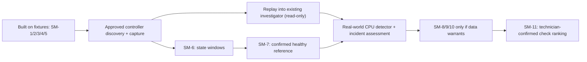

# MVP Scope

The MVP is deliberately narrower than the full vision. Its job is to prove
the agent loop works end-to-end; later modules add sophistication on top
of a proven architecture.

## The MVP boundary

> The MVP will model a single simulated production line containing a small
> number of machines and intentionally injected failure scenarios. The agent
> will autonomously investigate detected anomalies by gathering evidence,
> maintaining competing hypotheses, selecting additional observations,
> recommending a bounded intervention, and evaluating the resulting state
> change. Actions that alter the production environment will require human
> approval. The simulator will retain hidden causal ground truth, allowing
> the accuracy and efficiency of the agent's investigations to be
> quantitatively evaluated.

## The one question the MVP answers

Can an autonomous research agent investigate a manufacturing anomaly,
gather evidence from a stateful environment, form and test hypotheses,
recommend an action, and verify whether that action solved the problem?

That is enough to demonstrate a real agent. The entire smart factory is
not required.

## Guiding principle

**Do not build a weak version of every feature. Build one complete
vertical slice:**

```
simulated problem → anomaly → agent research → diagnosis → action
  → environmental change → verification → memory
```

Once that works, each subsequent course module adds a layer of
sophistication instead of the whole course being spent getting the basic
system running.

---

## 1. Simulator: one small production environment

- 1 production line
- 3–8 machines, chosen per run (default 3), named CNC-01 upward in line order
- 1 product type
- 5–8 important sensor values: temperature, vibration, pressure,
  throughput, defect rate, machine state
- production jobs / batches
- a small maintenance history
- a small quality-inspection history

The simulator **evolves over time**; it is not a static dataset.

It contains **hidden ground truth**. Example:

```
bearing degradation → increasing vibration → temperature increase → defect rate rises
```

The agent sees the symptoms but does not initially know the cause.

## 2. Only 3–4 failure scenarios

1. **Machine degradation** — vibration rises, temperature rises, eventual
   quality problems.
2. **Material / batch problem** — sensors look mostly normal; one material
   batch produces increased defects.
3. **Machine configuration problem** — incorrect pressure/speed setting
   causes reduced quality.
4. **False alarm / transient anomaly** — temporary sensor spike that does
   not require intervention.

Scenario 4 matters: the agent should not always conclude that something
is broken.

**Simulator difficulty extension authorized 2026-10-18:** instrument drift,
missing samples, and temporary sensor anomalies are implemented as composable
hidden instrument conditions. The opt-in `build_challenge()` combines these
with bearing and speed faults without changing investigation tool formats or
the ordinary line builder. This supplies harder environments, not a completed
multi-fault evaluator or solver integration. Delayed information/maintenance
records are explicitly excluded by the developer. See the
[difficulty guide](SIMULATOR_DIFFICULTY_COMPATIBILITY.md) for implemented behavior,
tests, limits, and the assessment of Kanika's feedback.

## 3. One investigation agent

No multi-agent system in the MVP. One orchestrating research agent that
does:

```
Observe → Investigate → Hypothesize → Test → Decide → Act/Recommend → Verify → Remember
```

The macro investigation loop runs on Pydantic Graph (`agent/investigation.py`).
The later multi-agent extension (Future Work 3) adds its roles to this same
graph and calls models through the existing chat client; no multi-agent
framework (CrewAI or another) is used (developer's decision, 2026-10-26).

Internally its reasoning is staged:

```
Anomaly detected
      ↓
Collect initial evidence
      ↓
Generate candidate hypotheses
      ↓
Determine missing information
      ↓
Query environment
      ↓
Compare evidence against hypotheses
      ↓
Select most-supported explanation
      ↓
Recommend intervention
      ↓
Human approves
      ↓
Simulator applies intervention
      ↓
Observe new state
      ↓
Determine whether intervention worked
```

The planned single-agent implementation must enforce configurable output-token,
timeout, retry, tool-call, and investigation-iteration limits. Provider-specific
reasoning controls are optional; global execution limits remain enforced by
the agent loop. See Future Work 7 for the later per-role extension.

## 4. The agent's tools (as implemented)

Revised 2026-10-19 to match the code. The original plan listed eight tools
(`get_machine_state`, `get_sensor_history`, `get_production_batch`,
`get_quality_results`, `get_maintenance_history`, `search_incident_history`,
`propose_action`, `observe_after_action`); the implementation covers the same
ground with smaller, more specific tools, all behind the one
`FactoryProvider` boundary (`capstone/providers/factory.py`) with typed
arguments and results.

Research tools a policy may choose (`research_tools()`):

```
get_time()                 current tick and clock time
list_machines()            machine state: status (running / idle / down), current job
get_settings()             each machine's spindle speed
get_readings()             raw machine sensor readings in a tick range (max 300 rows)
get_sensor_trend()         per-block mean/min/max/count of one machine sensor
get_sensor_summary()       count, mean, min, max, first/last, rate in a window
get_factory_readings()     the factory air thermometer
get_events()               event log: alarms, stops, jobs, material batches, maintenance
get_job_history()          everything the log says about one job
get_inspections()          pass/fail quality results, with material batch
get_maintenance_history()  service records from before the run, then this run's
wait()                     let time pass (the only way it does)
recall_memories()          past lessons, offered only when memory is given
```

The fixed procedure after a conclusion, never chosen by a policy
(`PROCEDURE_TOOLS`): `propose_action()` (asks a human), `get_proposals()`
(reads the decision), `execute_action()` (starts approved work). Looking
again after the work is the `verify` stage of the investigation, using the
research tools above, not a separate tool.

Mapping from the original list: machine state → `list_machines`,
`get_settings`; sensor history → `get_readings`, `get_sensor_trend`,
`get_sensor_summary`, `get_factory_readings`; production batch →
`get_events` and `get_inspections` (both carry batch numbers) and
`get_job_history`; quality results → `get_inspections`; maintenance history →
`get_maintenance_history`; incident history → `recall_memories`;
observe after action → the `verify` stage.

MCP may expose these later; MCP itself is not a core simulator/agent MVP
objective. Future Work 2 defines a minimal first MCP slice and its planned
observability, after the core investigation loop works. What
matters is that the agent must decide **"what information do I need
next?"** rather than having everything dumped into the prompt.

`get_sensor_summary()` and `get_sensor_trend()` compute exact statistics in
Python for the agent to interpret. See Future Work 7 for calculation details.

## 5. Hypothesis-driven research (keep in MVP)

This is what distinguishes the project from a chatbot. The agent maintains
a table like:

| Hypothesis          | Supporting evidence       | Contradicting evidence   | Confidence |
|---------------------|---------------------------|--------------------------|-----------:|
| Bearing degradation | vibration ↑, temperature ↑ | none yet                 | 0.72 |
| Bad material batch  | defect rate ↑             | other batches affected   | 0.18 |
| Sensor failure      | abnormal reading          | multiple sensors correlate | 0.10 |

Probabilities need not be mathematically rigorous. The process is the
point:

```
hypothesis → evidence request → evidence → revision
```

## 6. Human approval for consequential actions

The agent may not freely alter the factory.

```
Agent: "I recommend pausing Machine 3 and scheduling inspection."
        ↓
Human approval
        ↓
Simulator executes action
```

- Read-only research happens automatically.
- Actions that change the environment require approval.

## 7. Verification after intervention (mandatory)

The loop does not stop at "here is my recommendation." After the
intervention, simulator time advances, and the agent must ask: *did what I
predicted actually happen?*

```
Prediction:
  If Machine 3 is the cause, vibration and defect rates
  should fall after maintenance.
Observed:
  Vibration:   8.4 → 3.1 mm/s
  Defect rate: 11.2% → 2.3%
Conclusion:
  Intervention successfully addressed the anomaly.
```

## 8. Basic memory

Store per investigation: anomaly, evidence collected, hypotheses
considered, conclusion, action, outcome. A later incident can retrieve
similar prior investigations:

> "A similar vibration/temperature pattern occurred in Investigation #14
> and was caused by bearing degradation."

Enough to demonstrate persistent learning without building a full
organizational knowledge system.

## 9. Evaluation (in the MVP, not deferred)

Because the simulator knows the hidden cause, the agent can be evaluated
objectively. Record per scenario:

| Field | |
|---|---|
| True cause | from ground truth |
| Agent diagnosis | correct / incorrect |
| Relevant evidence available | |
| Evidence actually collected | |
| Recommended action | |
| Correct intervention | yes / no |
| Resolution achieved | yes / no |
| Tool calls used | |
| Investigation length | |

This supports reporting such as: *18/20 root causes correctly identified;
17/20 appropriate interventions selected; average investigation required
6.2 tool calls.* That turns the project from a demo into an experiment.

---

Build a small known-answer regression suite alongside MVP evaluation, using
fixed seeds and implemented simulator scenarios. Ground truth stays available
only to the evaluator. Repeatable simulator inputs do not imply identical live
LLM outputs. See Future Work 7 for the records and later expansion.

## Explicitly excluded from the MVP (→ Future Work)

Deferred, not abandoned — these are extensions of a proven architecture:

- multiple factories
- dozens of production lines
- hundreds of machines
- realistic industrial physics
- high-frequency IoT streaming
- computer vision
- real PLC integration
- real manufacturer data
- autonomous shutdowns
- full predictive maintenance
- multi-agent collaboration
- specialized researcher / planner / analyst agents (the critic is built)
- sophisticated long-term organizational memory
- knowledge graph
- internet research
- vendor research
- multimodal manuals
- digital-twin fidelity
- reinforcement learning
- dynamic tool creation
- autonomous policy learning

## Roadmap after the MVP

**Roadmap reconciliation (2026-11-10):** "Status" annotations originally written 2026-10-18 through 2026-11-09 may describe the state at that date; [the active register](#active-future-work-register--grouped-by-priority-and-correct-owner-category-2026-11-10) and [completed foundations](#completed-foundations-and-remaining-acceptance-gates) govern current priorities. Do not interpret an older `Status: FUTURE WORK ONLY` line as overriding a later verified merged PR. Implementation does not imply site validation.

**Implementation audit (#222, reconciled after #221):** This audit cross-checked the stable SM-1–SM-13 requirement links and the completed-versus-field-validated distinction. Read-only replay investigation wiring now exists in [PR #221](https://github.com/peyton150-startup/Capstone_Project_CMU/pull/221), but has only synthetic test coverage; controller access, approved captures, healthy-cycle evidence and technician validation are still outstanding. The [active register](#active-future-work-register--grouped-by-priority-and-correct-owner-category-2026-11-10) remains authoritative.


**MVP** — single research agent + small factory simulator + anomaly
investigation + hypothesis testing + HITL intervention + verification.

Future Work is not a commitment to implement every candidate. The
[reevaluation register and prompt review](FUTURE_WORK_REEVALUATION.md)
records current status, prerequisites, adoption checks, rejection conditions,
dependency impact and course/production scope. A trigger opens a review;
it does not authorize implementation. Candidates may be rejected, replaced
or deleted when the actual architecture or ecosystem changes.

**How to read this area (2026-10-30).** It lists only work that is not yet
built. What is built is recorded, with its pull request, in
[`PROGRESS.md`](PROGRESS.md); finished items were removed from here on
2026-10-30. The "Future Work N" numbers and the item letters and numbers inside
them are fixed IDs that code comments, tests and other documents cite, so they
stay even though the sections are now grouped by topic, with items sorted from higher to lower priority within each category.

## Future work index: categories, readiness and priorities

**Reconciled against the implementation and merged pull requests on 2026-11-10.** This is a work-remaining index, not a list of everything ever proposed. A merged, tested *component* is distinct from an accepted **Prestige Manufacturing pilot**. Field-specific claims stay pending until we have an approved controller interface, a capture, technician annotations, and a site-specific mapping. The category links below open the detailed engineering requirements; [completed foundations](#completed-foundations-and-remaining-acceptance-gates) have their own register.

| Priority | Category / detailed requirements | Highest-value unfinished work | Existing foundation / decision gate |
|---|---|---|---|
| **HIGH — TRIAGE ONLY (updated 2026-11-12)** | [**Triage — 31 active items (28 HIGH/P0-dependent; 3 MEDIUM)**](#future-work-triage) · [Detailed register](TRIAGE_FUTURE_WORK_20261112.md) · [**Measured A0 baseline (2026-11-12)**](benchmarks/2026-11-12-triage-a0.md) | Simulator-first deterministic packets, budget-aware selection, counterevidence, fault isolability, quality/scoring integrity, safety, and measured independent reasoning experiments | **Proposed only**; no active LOW; retired IDs not reused; deep mode unchanged; Siemens P0 gates remain separate |
| **P0 — HIGHEST (S-0)** | [**Siemens SINUMERIK adapter, controller capability audit and mandatory SDC-01–20 data acceptance**](#fw-sinumerik-readonly) · [**SDC data acceptance**](SIEMENS_DATA_ACCEPTANCE.md) · [**RMI downstream intelligence**](REAL_MACHINE_INTELLIGENCE_ACCEPTANCE.md) | Confirm model/software/license/interface, source authorization, per-value quality and end-to-end eligibility; enforce Data Gates A–H before machine use | Siemens/model/access still unverified; **specification only**, no Siemens adapter built |
| **P0 — END-TO-END (S-0/E2E)** | [**Real-machine data utilization: ingestion → features → anomaly → investigation → validated learning**](#fw-real-data-e2e) · [**RMI-01–07 acceptance contract**](REAL_MACHINE_INTELLIGENCE_ACCEPTANCE.md) | Make *all approved, physically exposed* machine/cell data useful and traceable, without loading it indiscriminately into the LLM; build real-world ground truth and evaluation | MTConnect + monitor + replay + simulator agent/memory/evaluation partly built, but no complete approved real-machine intelligence workflow |
| **P0 — next visit** | [Pilot readiness, permissions, field notebook and acceptance](#future-work-pilot-readiness) | Confirm the machine/controller, IT/OT read-only authorization, normal-cycle capture, operator-aligned event timestamps, and data-handling terms | [SM-4 checklist and event log](#fw-sm-visit-log) built; no shop data received |
| **P0 — first capture** | [Real-machine integration, channel mapping and data quality](#fw-single-machine) | Field-validate replay-to-investigation wiring on an authorized capture; implement SM-6 state segmentation and SM-7 own-machine baseline | SM-1, SM-2, SM-3 and SM-5 implemented and fixture-tested; no Prestige validation |
| **P0 — after data** | [Real-world anomaly assessment and monitor integration](#fw-cpu-anomaly-detector) | Transfer the Python statistical detector to recorded **real** data, without simulator reference files or unverified cause claims; test monitor → incident lifecycle | Simulator detector built; **real-world implementation unfinished and blocked on data from Naseem** |
| **HIGH — refined #1–2 (2026-11-11)** | [**Siemens read-only authority and qualified as-known evidence**](#fw-siemens-agent-evidence-ranking-20261111) | Server-enforced authorization before connection; quality/dual-cutoff evidence validation before diagnosis | Relative decision ranking; SDC/RMI acceptance duties still P0; [full tests](SIEMENS_AGENT_EVIDENCE_AND_TOOL_PRIORITY_20261111.md) |
| **HIGH — imported #1** | [**Qualify Siemens/DMG MORI installed capabilities**](#fw-signal-ranked-20261111) | Confirm actual controller generation, NCU, software, licensed options and field availability | First of exactly **two HIGH** recommendations in the [signal-ranked roadmap](SIGNAL_PRIORITY_IMPLEMENTATION_ROADMAP_20261111.md); detailed SDC gate already P0 |
| **HIGH — imported #2** | [**Enforce strict read-only CNC security**](#fw-signal-ranked-20261111) | Independently enforce permitted endpoints/nodes/operations and model egress; prove no writes or unauthorized reads | Second of exactly **two HIGH** recommendations in the new roadmap; existing shop consent and SDC controls remain P0 |
| **HIGH — simulator-first (NEW 2026-11-11)** | [**Deterministic evidence gathering / signal-ranked research**](#fw-deterministic-triage-evidence-20261111) · [**19-option exhaustive analysis and 13 papers**](DETERMINISTIC_TRIAGE_EVIDENCE_RESEARCH_20261111.md) | First build source-linked, time-bounded evidence packet from existing simulator screening; then compare fault-signature discrimination and sequential information gain before changing LLM reasoning | Healthy 8-machine baseline and statistical scores already built; scores do not trigger monitor; packet/selector/one-call triage are **not built**; simulator-only first |
| **HIGH** | [Investigation latency, response quality and evaluation](#future-work-evaluation) | Benchmark information-value routing, optimal research stopping, severity-aware escalation and calibrated confidences; measure time to first trustworthy answer | Triage and some line context built; decision-theory extensions unimplemented and pilot speed unverified |
| **HIGH / contingent** | [Machine-specific simulator realism](#future-work-simulator-upgrades) | Adapt machine/control assumptions to the discovered equipment; defer Haas-only retrofit unless confirmed | Seeded simulator exists; physical controller unknown |
| **MEDIUM — refined #3–7 (2026-11-11)** | [**Physical lineage, agent capability parity, targeted guards and measured GR-2**](#fw-siemens-agent-evidence-ranking-20261111) | Source-family evidence, dispatch/advertised parity, selective negative tests, passive latency diagnosis and conditional GR-2 study | Relative ranking only; pre-existing P0 gates remain mandatory and noise/framework duplication is excluded |
| **MEDIUM — imported #3–36** | [**34 additional implementation candidates across data, security, observability, agent reliability and AI**](#fw-signal-ranked-20261111) | Includes GR-2 near-duplicate reads, GR-1 bounded validation repair and GR-3 channel-quality evidence filtering, plus existing conditionally justified items | [Detailed acceptance and prerequisites](SIGNAL_PRIORITY_IMPLEMENTATION_ROADMAP_20261111.md); explicit noise omitted and conditional items deferred |
| **MEDIUM** | [Manual retrieval, episodic memory and reranking](#future-work-retrieval-and-memory) | Use authorized real manuals and labelled cases before comparing reranking strategies | Baseline retrieval present; no Naseem source material |
| **MEDIUM** | [Multi-agent roles, typed handoffs and benchmarks](#future-work-multi-agent-roles) | Test falsification-oriented objectives for the existing critic; only add specialist roles on evidence of benefit | Investigator and critic exist; no need for a third agent on visit day |
| **MEDIUM** | [Telemetry storage, traceability, MCP and operational tooling](#future-work-tooling) | Design rotation, export/revocation, audit and observability after safe offline capture | Local MTConnect collector, monitor and watchdog built |
| **MEDIUM** | [Security and authorization](#future-work-security-and-authorization) | Consolidate the recorded-data security boundary; enforce permitted tools, destinations, data transfer and auditable access; evaluate stronger sandboxing only when deployment warrants it | GET-only collector, replay triage, pilot preflight and opt-in event logger built; no independently enforced agent sandbox or universal authorization gate |
| **LOW** | [Planning and approved intervention experiments](#future-work-planning-and-automation) | Human-reviewed experiments only after new safety/authorization gate | First pilot strictly read-only |
| **LOW** | [Operator screen, configuration and review UX](#future-work-frontend) | Build only from technician feedback | Existing command-line visit check sufficient |
| **LOW / FAR FUTURE** | [Portability, additional audio/video sensing and voice interfaces](#future-work-long-term) | Revisit if controller telemetry and technician validation prove insufficient | No extra sensors authorized |


<a id="fw-signal-ranked-20261111"></a>

### Signal-ranked implementation workstream — exactly two HIGH, all remaining MEDIUM (2026-11-11; PLAN ONLY)

**Agent entrypoint:** [Detailed signal/noise implementation plan with tests, owner categories, dependencies and links](SIGNAL_PRIORITY_IMPLEMENTATION_ROADMAP_20261111.md). The 36 proposals below are ranked within this **new workstream only**: exactly **2 HIGH** (#1–2), **34 MEDIUM** (#3–36). Conditional items are marked *defer until justified*. **Do not downgrade or bypass existing P0 shop permission, Siemens SDC-01–20 or real-machine RMI-01–07 release requirements** just because an associated engineering improvement is MEDIUM here. This table does not change previously assigned priorities in unrelated Future Work groups. Do not duplicate completed MTConnect, simulator, safety or memory foundations.

**Developer decisions recorded after this ranking was written (2026-11-11):** (a) The pilot reads the machine through **Siemens adapters only**; MTConnect is not being pursued for now, so where an item below says existing MTConnect paths partly support it, read that as background, not as the planned route. The "redirects" denial in #2 concerns the MTConnect HTTP collector and is not active work. (b) #2 is the acceptance checklist for the read-only Siemens OPC UA adapter. (c) #29 (Kubernetes or a service mesh) is **not active**: `AGENTS.md` section 4.5 rules it out unless the developer changes that rule. (d) Items #3–11 are MEDIUM only inside this queue; where SDC-01–20 or RMI-01–07 make the same work P0, P0 stands.

| Rank | Priority | Correct owner category | Proposed implementation | What must be verified |
|---:|---|---|---|---|
| 1 | **HIGH** | Controller-specific data integration | Qualify exact Siemens/DMG MORI capabilities | Verify machine generation, NCU/software/OPC UA/OEM access, licenses and approved source list; fail unknown or unlicensed. |
| 2 | **HIGH** | Security and authorization | Enforce strict read-only and network boundaries | Allowlist source, machine, endpoint, node and operation; deny Write, Call, file, control, redirects and unapproved model egress in negative tests. |
| 3 | **MEDIUM** | Controller-specific data integration | Build fully qualified real-machine signal catalog | Represent multiple axes, spindles, drives, PLC, alarms and cell context with distinct origin/type/units and map version; test cross-source collision. |
| 4 | **MEDIUM** | Controller-specific data integration | Implement complete signal data-quality gates | Preserve OPC UA StatusCode, types, timestamps, physical semantics, freshness and continuity; bad or unapproved values never establish health. |
| 5 | **MEDIUM** | Tooling and infrastructure | Harden durable time-series recording and replay | Version, rotate and index authorized records plus gaps; pass seven-day bounded-memory and historical as-known cutoff tests. |
| 6 | **MEDIUM** | Real-machine monitoring | Classify actual machine operating states | Verify cutting, warm-up, idle, rapid, tool change, hold and unknown against technician-aligned signals; no guessed cutting. |
| 7 | **MEDIUM** | Real-machine monitoring | Build technician-confirmed healthy reference | Condition baseline on comparable machine, job/program, tool, RPM and state; missing normal history returns baseline_unavailable. |
| 8 | **MEDIUM** | Real-machine monitoring | Build CPU statistical and cross-signal features | Prove coverage-gated moving trends, persistence, robust variance and unit-aware residuals on matched operations. |
| 9 | **MEDIUM** | Agent integration and incidents | Connect anomaly scoring to durable investigation | Qualified persistent anomaly yields one idempotent incident with source/time window, bounded queue and controlled agent invocation. |
| 10 | **MEDIUM** | Agent tools and evidence | Expose authentic machine evidence and context | Correct physical timestamps, OEM alarms, approved histories and appropriate manuals; no simulator history or phantom tools. |
| 11 | **MEDIUM** | Agent tools and evidence | Enforce physical-source evidence independence | Raw spindle load, derived mean and load-derived alarm count as one source family, not three confirming measurements. |
| 12 | **MEDIUM** | Security and authorization | Centralize deterministic agent and tool guardrails | Dispatch-level permissions, argument/output checks, unit/evidence sufficiency, abstain and human escalation verified by negative tests. |
| 13 | **MEDIUM** | Observability and infrastructure | Add metadata-only OpenTelemetry instrumentation | Correlate trigger, ModelPolicy, ChatClient, FallbackClient, tools, ReAct, guardrail outcomes, tokens and latency without raw shop payloads. |
| 14 | **MEDIUM** | Security and authorization | Red-team alarm, manual and memory prompt injection | Untrusted text cannot alter authorized toolset, expose sensitive data or create unsupported mechanical causes. |
| 15 | **MEDIUM** | Human review and field learning | Collect technician verdicts and repair outcomes | Record confirmed, rejected, multiple, unresolved and false-alarm findings plus independently performed work and before/after evidence. |
| 16 | **MEDIUM** | Evaluation and calibration | Build independent labelled field evaluation | Chronological held-out test; false alerts per valid operating hour, detection utility, uncertainty, latency and false reassurance. |
| 17 | **MEDIUM** | Evaluation and calibration | Measure value beyond OEM protections | Compare OEM-only alarms, Python anomaly screening and detector-plus-investigator on technician-reviewed cases. |
| 18 | **MEDIUM** | Retrieval and memory | Index permitted version-matched Siemens/DMG MORI documentation | Field-cited serial/version manuals, alarm references and maintenance records; exclude SIM-CNC manual from physical diagnosis. |
| 19 | **MEDIUM** | Observability and infrastructure | Trace security and data-quality incidents | Audit allow/deny decisions, permission revocation, overflow, missing coverage, source failure and policy revisions without disclosing sensitive fields. |
| 20 | **MEDIUM** | Tooling and infrastructure | Bound resources, retries and recovery | Enforce approved request rates, model/token/time budgets, queues, disk, backpressure and recoverable outages; negative soak tests. |
| 21 | **MEDIUM** | Retrieval and memory | Gate real-world episodic memory by technician signoff | No promotion from AI confidence; preserve case evidence, access/consent, correction and semantic recall retraction. |
| 22 | **MEDIUM** | Evaluation and calibration | Evaluate value of information and optimal stopping | Reduce measured tool/reasoning time while preserving safe unresolved outcomes and dangerous-fault detection on frozen cases. |
| 23 | **MEDIUM** | Real-machine monitoring | Test advanced multivariate anomaly models conditionally | Only adopt when labelled held-out data shows better lead time or lower false-alert burden than robust CPU statistics. |
| 24 | **MEDIUM** | Evaluation and calibration | Calibrate Bayesian component-check rankings | Use confirmed priors, alternative/multiple causes, inspection costs and proper scoring; never invent per-part probabilities. |
| 25 | **MEDIUM** | Multi-agent roles | Test falsification-oriented critic | On matched cases, critic must find meaningful counterevidence or admit none, without unacceptable latency/spurious objections. |
| 26 | **MEDIUM** | Retrieval and memory | Benchmark retrieval reranking and context reduction | Improve manual/memory relevance and latency on held-out cases; reject redundant external requests. |
| 27 | **MEDIUM** | Security and authorization | Consider a hardened runtime sandbox *(conditional)* | Measure added process/egress isolation using existing tool permissions and candidate OpenShell only if risk warrants it. |
| 28 | **MEDIUM** | Multi-agent roles | Consider inter-agent authenticated messaging *(conditional)* | Only if roles run in distinct trust domains; demonstrate threat and test mutual identity, replay protection and failure behavior. |
| 29 | **MEDIUM** | Tooling and infrastructure | Consider Kubernetes or a service mesh *(conditional)* | **Not active: ruled out by AGENTS.md section 4.5 unless the developer changes that rule.** Only if multi-customer scaling justifies complex network/service controls over simpler isolation. |
| 30 | **MEDIUM** | Security and authorization | Consider enterprise SIEM/SOAR integration *(conditional)* | Only when customer security operations requires metadata-based event forwarding and retention. |
| 31 | **MEDIUM** | Security and authorization | Consider a security-monitoring AI agent *(conditional)* | Require demonstrated improvement over deterministic rules in actionable security findings per cost and false alarm. |
| 32 | **MEDIUM** | Security and authorization | Consider machine-learning network intrusion detection *(conditional)* | After ordinary OT segmentation and security logging prove insufficient for a defined threat. |
| 33 | **MEDIUM** | Optional sensing and interfaces | Consider audio/vibration/camera sensors *(conditional)* | Only if existing approved CNC telemetry cannot answer a material diagnostic question and separate site approval exists. |
| 34 | **MEDIUM** | Evaluation, benchmarking and reasoning | [**GR-2 — Near-duplicate read coverage**](#fw-gr-near-duplicate) | Opt-in deterministic overlap guard blocks redundant answered windows but preserves genuinely new data, critic and verification reads. |
| 35 | **MEDIUM** | Evaluation, benchmarking and reasoning | [**GR-1 — One bounded validation-repair retry**](#fw-gr-repair-once) | Opt-in at-most-one safe follow-up model question after refused outputs; no time, confidence, action or privacy bypass. |
| 36 | **MEDIUM** | Tooling and infrastructure | [**GR-3 — Channel-quality-aware replay and diagnosis**](#fw-gr-channel-quality) | Quality/coverage at the actual time and physical source gates offered tools and supporting evidence, without hiding historical valid windows. |

**Source of truth:** [Expanded per-item implementation and acceptance details](SIGNAL_PRIORITY_IMPLEMENTATION_ROADMAP_20261111.md) · [Siemens data acceptance](SIEMENS_DATA_ACCEPTANCE.md) · [Real-machine intelligence acceptance](REAL_MACHINE_INTELLIGENCE_ACCEPTANCE.md). **Noise is intentionally excluded**, not relabelled MEDIUM. No code or tests are claimed complete by this documentation.

---

<a id="fw-siemens-agent-evidence-ranking-20261111"></a>

### Siemens tool and evidence readiness: ranked refinement (2026-11-11; DOCS ONLY)

This is a **decision-ranked refinement of existing SDC/RMI/SEC/GR plans**, not seven new frameworks or an alternative source of truth. Within this **seven-item comparison** exactly ranks **1–2 are HIGH** and **3–7 are MEDIUM**, ordered highest signal to least immediate value. The labels are *relative signal scores only*: existing **P0 Siemens SDC-01–20 and RMI-01–07 release gates remain P0 wherever applicable**. The HIGH items are on the pilot critical path, while rank 7 is explicitly an experiment, not an implementation commitment. The active Siemens path is OPC UA, not new MTConnect work.

| Signal rank | This comparison | Correct owner category | Proposed outcome / detailed acceptance | Decision |
|---:|---|---|---|---|
| 1 | **HIGH** | Security and authorization | [**Independent Siemens read-only authority**](SIEMENS_AGENT_EVIDENCE_AND_TOOL_PRIORITY_20261111.md#rank-1-independent-readonly) | Before connecting to the physical controller |
| 2 | **HIGH** | Controller-specific data integration / agent evidence | [**Qualified Siemens evidence with two historical cutoffs**](SIEMENS_AGENT_EVIDENCE_AND_TOOL_PRIORITY_20261111.md#rank-2-qualified-evidence) | Before Siemens data enters detection or diagnosis |
| 3 | **MEDIUM** | Agent tools and evidence | [**Physical-source lineage and diagnosis support**](SIEMENS_AGENT_EVIDENCE_AND_TOOL_PRIORITY_20261111.md#rank-3-source-independence) | Before supported mechanical root-cause claims |
| 4 | **MEDIUM** | Agent tools and evidence / security | [**Advertised tools match executable capabilities**](SIEMENS_AGENT_EVIDENCE_AND_TOOL_PRIORITY_20261111.md#rank-4-capability-parity) | Before recorded Siemens agent triage |
| 5 | **MEDIUM** | Security and authorization | [**Close specific existing tool-dispatch gaps**](SIEMENS_AGENT_EVIDENCE_AND_TOOL_PRIORITY_20261111.md#rank-5-targeted-tool-guards) | When a concrete enforcement gap is found |
| 6 | **MEDIUM** | Evaluation, benchmarking and observability | [**Passive latency and evidence-visibility audit**](SIEMENS_AGENT_EVIDENCE_AND_TOOL_PRIORITY_20261111.md#rank-6-passive-latency) | Run on pinned archived cases before changing runtime behavior |
| 7 | **MEDIUM** | Evaluation, benchmarking and reasoning | [**GR-2 overlap suppression: matched experiment only**](SIEMENS_AGENT_EVIDENCE_AND_TOOL_PRIORITY_20261111.md#rank-7-gr2-benchmark) | After passive baseline, opt-in runtime PR only if beneficial |

**Order of actual work:** the collector's independent read-only assurance must precede live access; a collection-only pilot can proceed once authorized without claiming machine diagnoses. Source-qualified evidence, historical as-known cutoffs, lineage and capability parity must pass **before diagnostic use**; do not allow the MEDIUM label here to downgrade those existing RMI/SDC obligations. Start passive performance measurements without enabling near-duplicate suppression. Existing exact-repeat, typed tool checks and read-only replay remain; no new generic guardrail framework is justified now.

**Source of truth:** [Detailed evidence/tool decision ranking](SIEMENS_AGENT_EVIDENCE_AND_TOOL_PRIORITY_20261111.md), [Siemens acceptance SDC-01–20](SIEMENS_DATA_ACCEPTANCE.md), [real-machine acceptance RMI-01–07](REAL_MACHINE_INTELLIGENCE_ACCEPTANCE.md), and [existing ranked 36-item roadmap](SIGNAL_PRIORITY_IMPLEMENTATION_ROADMAP_20261111.md). GR-2/GR-3 remain optional runtime enhancements where separate from mandatory input and evidence validation.


---

<a id="fw-sinumerik-readonly"></a>

### S-0: Siemens SINUMERIK read-only data adapter and complete capability audit (P0 — highest; 2026-11-11; **SPECIFICATION ONLY**)

**Agent implementation entrypoint — read both specifications before planning or coding:**

1. [**`docs/SIEMENS_DATA_ACCEPTANCE.md` — Siemens Data Acceptance (SDC-01–SDC-20)**](SIEMENS_DATA_ACCEPTANCE.md): mandatory controller/software/license and endpoint qualification; approved collection; node identity; types, units, OPC UA StatusCode, timestamps, alarms, continuity, privacy, deterministic replay; code crosswalk and Data Gates A–H.
2. [**`docs/REAL_MACHINE_INTELLIGENCE_ACCEPTANCE.md` — Real-Machine Intelligence Acceptance (RMI-01–RMI-07)**](REAL_MACHINE_INTELLIGENCE_ACCEPTANCE.md): using approved machine signals end to end for state-conditioned features, baselines, anomaly→incident→agent handoff, real-only evidence, physical-source independence, technician-verified learning and field evaluation; code crosswalk and R0–R5 gates.

**Required workflow:** SDC answers **may we collect this source?** and **is its data valid?**; RMI answers **can valid evidence support this feature, investigation or conclusion?** Treat both files as **mandatory acceptance criteria**, not optional future enhancements. The S-0 notes below provide context; the linked files are the normative checklists. Any missing Siemens capability must be documented as unavailable, unlicensed, unapproved or unknown, never fabricated. **Documentation only; no production changes, test results or machine access are asserted.**


**Authoritative Siemens data acceptance specification:** [**SDC-01–SDC-20 — Siemens SINUMERIK Data Integrity and Acceptance Contract**](SIEMENS_DATA_ACCEPTANCE.md). These **mandatory, testable data requirements** govern exactly what the read-only adapter may collect, which collected values qualify as valid evidence, and which evidence is eligible for anomaly scoring or agent investigation. They include the precise source/version/license/permission gates, quality/StatusCode treatment, identity/units/time/continuity, alarm semantics, MTConnect backward compatibility, code crosswalk, negative tests, and Data Gates A–H. **This dedicated contract is normative**; the older exploratory S-0 audit subsections remain useful background rather than superseding or diluting its acceptance rules. All SDC statuses are **documented / unimplemented / not Siemens-verified**; this docs-only PR has not run tests or connected a machine.


**Decision / boundary:** This is the **first controller-specific engineering priority** for the Prestige pilot, ahead of SM-6, SM-7 and real-world anomaly triggering. **No adapter, PLC/CNC connectivity, configuration changes or live tests have been implemented by this item.** Siemens is a **candidate** based on the discussion, **not proof of Prestige's exact installed control**: obtain a technician-confirmed manufacturer, model (e.g. 840D sl, 828D, SINUMERIK ONE or other), CNC/SINUMERIK Operate version, machine builder modifications and a photograph of the version/license page. The image/DMG MORI machine model alone cannot establish the controller. If the machine is not Siemens, preserve the generic contract and select the verified protocol instead.

**Objective:** Inventory *every relevant machine-data capability and its gaps*, then implement only the specifically approved **read-only** signal paths necessary for baseline-building and investigations. "Cover every aspect" means a documented **support/availability/permission matrix**, **not** harvesting all CNC/PLC values, bypassing OEM restrictions or issuing writes. A visible HMI field is **not** evidence that the interface exposes it. All other manufacturing operations, CNC program changes, PLC/axis/spindle control, tool adjustments and alarm acknowledgment are **explicitly out of scope**.

**Vendor evidence and version-specific differences (verify on installed build):**
- [Siemens SINUMERIK 840D sl / 828D OPC UA configuration manual, 05/2022](https://support.industry.siemens.com/cs/attachments/109807257/840Dsl_828D_OPCUA_config_man_0522_en-US.pdf): Access MyMachine /OPC UA, licensing and setup, NC/PLC variable reads, monitored data changes, alarm subscriptions, access rights, controller-specific technical limits; the OPC UA server is **not a hard-real-time path**. Its documented sample/publish intervals are *capabilities*, not safety-certified collection rates.
- [Siemens SINUMERIK ONE OPC UA configuration manual, 07/2025](https://support.industry.siemens.com/cs/attachments/109994190/ONE_OPCUA_config_man_0725_en-US.pdf): separate end-customer versus OEM OPC UA servers, licenses, operating-system/NCU topology, optional advanced features and different address-space behavior; do not import ONE assumptions into 840D sl/828D.
- [Siemens 828D/840D sl Access MyMachine/OPC UA option](https://sieportal.siemens.com/en-ls/products-services/10357088): license is a distinct option; having a Siemens controller **does not** imply an enabled server. OEM/gateway-provided MTConnect or a shop-approved offline export may be preferable if already present.
- [opcua-asyncio / asyncua Python OPC UA client](https://github.com/FreeOpcUa/opcua-asyncio): candidate for connection, browsing, reading, change subscriptions, events, certificate-based security; assess pinned version, dependency/license security, reconnect behavior and compatibility with the exact SINUMERIK server. **The general-purpose client also exposes write/method APIs; never expose those through our capture process.**

**Dependency and discovery sequence (nothing active until the site approves it):**
1. **Identify the exact machine and authority.** Record machine builder/model/year/serial *privately*, exact Siemens CNC/NCU/IPC/Operate version, operator vs manufacturer account ownership, date of maintenance, existing historians/gateways, production schedule, permitted shop PC, and the shop's named manager plus IT/OT authorizer. Do not presume Siemens, OPC UA, MTConnect, hostname, IP, port or network interface.
2. **Determine supported data source.** Have the authorized technician check existing MTConnect agent, SINUMERIK Access MyMachine /OPC UA license and **end-customer** OPC UA server (not OEM-only), network reachability, server version and approved access policy; ask whether a *shop-filtered offline export* already exists. The OEM server and optional OPC UA Advanced, custom namespaces, PLC symbols, alarms, historical data and file services are separate capabilities, not blanket assumptions. No license purchase, activation, software restart, route/firewall/port change or engineering account use without independent approval and change control.
3. **Formalize least-privileged observation.** Obtain a written, versioned allowlist of machine, nodes/data item IDs, purpose, units, roles, permitted read/subscription/event operations, source interval, collection duration, host, storage, retention/deletion, owner and immediate stop procedure. Review what broad SINUMERIK rights such as `SinuReadAll`, `AlarmRead` or PLC DB read rights actually grant on that build; prefer narrower rights if available. A data-access account must have **no write, program-selection, tool-management, file-transfer, alarm-acknowledgment or method-execution permissions**. Never use manufacturer/default credentials.
4. **Validate network and cryptographic boundaries before recording.** An approved IT/OT employee chooses the physical interface and network segment; no probing industrial interfaces, scanning, connecting to undocumented ports, controller reconfiguration, unsupported adapters or Internet-exposed OPC UA. Verify server application URI, certificate chain, revocation/expiry, client certificate trust, encryption and a strong supported SignAndEncrypt policy; fail closed on invalid certificates, insecure endpoints, unknown servers, overbroad rights, unapproved paths and credentials in logs. Rotate/revoke credentials via shop procedures. Collection runs in an isolated process on a shop-approved host, independent of LLM and CNC control networks.
5. **Verify discoverable fields against documentation AND a real sample.** On a pre-approved allowlist only, browse/read metadata (NodeId + namespace URI/index, type, engineering unit, allowed access, data quality and source/server timestamps). Match field meaning with the technician and Siemens/OEM documentation; **do not infer** load %, motor current, vibration, temperature, axial following error or spindle thermal condition from similar-sounding variable names. Preserve unknown/missing/unsupported fields and source provenance.
6. **Choose acquisition semantics deliberately.** Prefer approved OPC UA data-change subscriptions and alarm events when the version supports them; use bounded polling for specific unsupported nodes. Negotiate server-revised sampling/publishing/queue parameters, maximum monitored items, session count, CPU/network burden and priorities with IT/OT; define staleness per signal. No assumption that 5-second MTConnect polling equals 5-second OPC UA source sampling, nor that 100-ms support implies usable high-frequency vibration measurement. Rate-limit startup browse/read, bound memory and queue depth, and never degrade machine operations.
7. **Define a controller-neutral boundary (spec first).** The existing `TelemetryRecord`, `CollectorMarker`, channel map, time-weighted statistics, recorded replay and preflight form the base, but `sequence`, `instance_id`, `/probe` and `verify_probe` are **MTConnect-specific today**. Design a versioned protocol-neutral provenance/schema and adapter contract: capabilities + schema discovery, approved selected-channel acquisition, typed observations/events, source and receipt timestamps, units, status/quality, stable source/node IDs, sequence/gap semantics where available, reconnect/session epochs and explicit unavailability. Preserve current MTConnect records and fixture compatibility; avoid falsely inventing MTConnect sequences from OPC UA.
8. **Store only approved data and replay offline.** Restrict acquisition at the source, **before** data reaches disk; downstream redaction is not consent. Persist approved numeric values and events as private, integrity-checkable versioned files with metadata, rotations, disk limits, loss markers, restart markers and clean shutdown. Keep program names, part numbers, customer/order data, GUD/PLC DB contents and alarm texts private or omit them unless separately approved. Reuse read-only `RecordedObservationTools` and the bounded Pydantic AI investigation pathway **only** after controller-neutral channel mapping is verified; never expose simulator-generated values as real.
9. **Prepare for realistic faults.** Test server unavailable/disabled/unlicensed, bad certificate, expired certificate, wrong permissions, BadNodeIdUnknown, BadUserAccessDenied, BadNoData, value quality Bad/Uncertain, typed arrays/strings, missing timestamps, clock drift, duplicate/out-of-order notifications, disconnections, server reboot, subscription expiry, overflowing queues, sampling changes, machine reset/NCU switch, multi-channel/1:N, firmware/OEM namespace drift, slow reads, buffer/disk exhaustion and operator-requested termination. Mark data `insufficient_data`/`baseline_unavailable` as appropriate, never healthy.
10. **Only after consented capture:** implement SM-6 observable state segmentation, SM-7 own-machine technician-confirmed healthy reference and the separate real-world statistical detector. Distinguish a known controller alarm from a derived anomaly; preserve the independent CNC safety system. No automatic maintenance diagnosis or writeback to the machine.

**Full observability inventory (each row requires capability, node/source, sample/event semantics, units, OEM verification, data sensitivity, permissions and quality acceptance; `not_exposed` is a valid answer):**

| Group / use | Candidate information to inventory (not guaranteed to be exported) | Priority / constraints |
|---|---|---|
| Identity, context and topology | Machine/controller/NCU/software version, channel/spindle/axis identity, multi-NCU and OEM namespace, clock/timezone, active execution mode | **P0**; maintain private provenance |
| Production operating state | Emergency/ready/idle/running/hold/stopped states when distinguishable, AUTO/JOG/MDA, feed hold, door state, machine execution and transition timestamps | **P0**; don't fabricate unavailable distinctions |
| Spindle and feed | Actual vs commanded spindle RPM, speed override, actual/programmed feed, spindle enable, utilization/load or electrical power **if exposed**, operating direction | **P0** for real baseline; units/OEM mappings required |
| Cutting context and cycles | NC channel, running vs cutting if observable, cycle starts/stops, block stage, tool change, material/job context, part count, program identifier | **P0/HIGH**; program identifiers are sensitive and must be explicitly permitted |
| Alarms, status and diagnostics | NC/PLC/HMI alarms and active/cleared transitions, codes, severity, cause text if approved, condition/availability; separately evaluate PLC messages and part-program messages | **P0/HIGH**; event subscription and appropriate rights; not all messages arrive via alarm events |
| Axis/drive behavior | Per-axis actual/setpoint positions, following error, feed motor torque/current, axis enable, overload, servo status, drive temperature and relevant limit bits **where exposed** | **HIGH**; do not equate estimated torque with measured vibration |
| Thermal, fluid and auxiliary systems | Spindle/bearing/motor temperature, cabinet/coolant/room temperature, coolant pump, hydraulic/lube pressure, lubrication, chiller and accessory state | **HIGH/conditional**; often OEM PLC/extra sensors; never assume standard nodes |
| Tools and production quality | Tool ID/pocket, offset/wear, remaining tool life, sister tool/auto replacement, breakage alerts, probing and inspection values | **HIGH/conditional**; read-only tool records; exclude tool changes and program transfer |
| Pallet changer / automation | Pallet ID/status, queue, changer state, robot or automation alarms, queue delays, system interlocks and faults | **HIGH/conditional**; separate OEM/PLC/gateway access may be required |
| Maintenance, diagnostic and historical evidence | Runtime counters, alarm history, machine logs, maintenance notes, historical time series if supported | **MEDIUM/conditional**; don't presume historian exists or that file reads are safe/authorized |
| Advanced, OEM and sensitive state | R parameters, GUD, machine data, PLC DB data, custom CSOM, OEM diagnostics, program/files | **Inventory only by default**; potentially sensitive or control-adjacent; explicit additional scope before reading |
| Physical sensing and prediction limits | Actual vibration, acoustic signatures, bearing temperature, tool condition, physical power measurement | **Gap analysis**; cannot be assumed from OPC UA availability or a 5-axis machine; external hardware requires separate consent |

**Implementation acceptance plan (future work, not claims of completed tests):**
- **Gate A — discovery:** verified controller/Operate version, hardware topology, enabled licensed **end-customer** access method or approved alternative, vendor manual/version match, authorized contact and precisely allowed channels. If any is missing, record `access_blocked`, never improvise.
- **Gate B — offline interface:** a mock/replayed OPC UA server fixture covers scalar and structured values, events and Bad/Uncertain quality, certificate/rights denial, rejected writes/methods, state transitions, time gaps, restart, load and idempotent deduplication; prove backwards compatibility with MTConnect/JSONL and replay contracts. Report exact feature coverage, not a passing test suite as proof of real-machine operation.
- **Gate C — authorized live smoke test:** IT/OT-supervised selected-field read from the correct machine without configuration changes; approved rates, certificate validation, no writes/methods/file transfers, clock alignment and no observable production impact. Technician signs off on at least three normal cycles, variable meaning/units and alarms/events where safely encountered. Never induce a fault or stop production to test.
- **Gate D — approved extended capture:** separate authorization for 7-day collection; recover/reconcile gaps and restart, preserve consent/retention, measure loss %, max lag, CPU/network utilization, storage growth, unexpected fields, stale-state handling, correct restart/shutdown and operator ability to stop promptly. No external LLM transfer absent separately documented permission.
- **Gate E — baseline and inference:** chronological healthy-reference training vs held-out normal windows, coverage across actual states/programs, measured false alarms per operating hour, detection latency on technician-labeled historical fault cases where available, abstention for unseen states, bounded evidence-only incident handoff and no automatic action. No claim of validated missed-fault rate without independently confirmed fault labels.


#### Second-pass Siemens capability and adapter completeness audit (2026-11-11; documentation only)

**Important hardware correction:** The [Siemens 07/2025 ONE OPC UA manual](https://support.industry.siemens.com/cs/ww/en/view/109994190) explicitly also covers **828D with PU.5**; older 828D PPU/PU hardware is directed to the [840D sl/828D 05/2022 manual](https://support.industry.siemens.com/cs/ww/en/view/109807257). Do not select a manual solely from the machine's age, model branding or HMI appearance. Record SINUMERIK hardware, Operate/CNC software, OPC UA server version, license and topology before selecting paths or limits.

**Required coverage additions — all open work, not implemented:**

1. **Multiple OPC UA servers and source ownership.** For SINUMERIK ONE, distinguish the end-customer SINUMERIK OPC UA server, the **separately licensed OEM OPC UA server** and the integrated **S7-1500 PLC OPC UA server/client**. They can have different endpoints, namespace models, access rights and license states. Independently enumerate CNC/NC, PLC, SINAMICS drive, HMI, machine-builder PLC, pallet changer, robotic cell, tool magazine, historian and external sensor owners; not everything on a DMG MORI cell comes from the Siemens NC server. Confirm whether an approved MTConnect agent or existing read-only gateway already consolidates them. Avoid manufacturer-only and machine-configuration interfaces.
2. **Options and interfaces, not assumed functionality.** Track Access MyMachine /OPC UA, OPC UA Advanced (machine status, tool management and production dialog), OEM server and PLC OPC UA options separately as installed/enabled/licensed/authorized. Some features are OPC UA **methods** for editing tools, selecting programs, transferring files or interacting with production dialogs: these are **not** valid actions for our strictly passive collector, even when documented. Historical recording, high-frequency spindle vibration, and Siemens-specific data availability must be verified rather than inferred from the protocol.
3. **Nontrivial NC/PLC addressing.** A browsed variable may represent only the **first index** of NC channel/axis/tool data. Build approved Siemens/OEM node mappings with namespace URI, exact case, channel/axis/tool indices, 1-based machine-data addressing where applicable, symbolic versus absolute PLC paths and data-type suffixes. Verify bitfields, enum translations, string encodings, scaled values, array dimensions and signedness before converting to canonical measurements. Some browse-visible variables return OPC UA status `BadAttributeIdInvalid` because the machine does not support them. The relevant [Siemens NC variables/interface-signal list](https://support.industry.siemens.com/cs/ww/en/view/109769139) and OEM documents are needed for actual node meaning; generic browse cannot substitute for that. Never enumerate arbitrary sensitive PLC data blocks.
4. **Alarm states versus part-program messages.** Siemens documents Alarms & Conditions subscriptions for active/inactive CNC/NC/PLC/HMI alarms from the SINUMERIK node. Collect, where authorized, alarm identity, area/axis/channel, active/inactive transition, event timestamp, severity, quality, language and deduplication key. Verify a startup snapshot/refresh method if actually supported: a reconnect cannot recreate missed past alarm transitions, and an absence of an event is not proof no alarm occurred. **Part-program messages are not included in alarm subscriptions** under the 840D sl/828D manual; the separately documented signal is `/Channel/ProgramInfo/msg`, with version-appropriate path and permission verification. OEM pallet/robot alerts also require explicit separate mapping.
5. **Sampling, load and continuity.** Separate OPC UA data-change subscriptions, events and bounded polling: requested and server-revised sample/publish intervals, filters/deadbands, queue depth, keepalives, status Good/Uncertain/Bad, source/server/receipt timestamps, timeout and session/subscription restart. A change-only value must not become fictitious evenly sampled data, and no value may be carried across an outage. The **05/2022 manual** lists 5 sessions/5 subscriptions on 828D and 10/10 on 840D sl, with controller-dependent monitored-item capacity and nominal 100-ms minimum interval; verify the exact installed version and request limits with IT/OT, and budget for other existing clients. Check revised rates, server throttling, queue overflow, clock skew, DST/timezone, duplicate and out-of-order events and reboot recovery. OPC UA is **not hard real-time** and is not a guarantee of bearing-vibration bandwidth.
6. **Five-axis engineering semantics.** Inventory actual linear and rotary axis identities (not automatically X/Y/Z/A/B/C), NC channel/spindle mappings, actual vs programmed positions, coordinate frames, tool-center-point transforms/kinematics, axis following error and load, rapid traverse versus cutting, dwell, warm-up, tool swaps and pallet changes, with technician confirmation. Do not compare motor-axis coordinates to transformed tool-tip coordinates without resolving the frame and units. Baseline each comparable operational context; separate job/material/tool changes from degradation.
7. **Security: no writes even when the library permits them.** The Python client shall have no runtime path for OPC UA Write, Call, file transfer, tool updates, program actions or alarm acknowledgement, including methods marketed as diagnostic. Combine an independently issued **least-privilege read-only** account, specifically approved node allowlist, correctly validated SignAndEncrypt endpoints/certificates/identity, a network allowlist and a separate collector process. Show write/method rejection only against **offline test doubles** and by reviewing authorized controller privileges; **do not attempt live write requests to test denial**. Do not browse or pull unapproved fields, do not scan OT networks, and keep credential/telemetry/model egress decisions separately authorized.
8. **Storage and reproducibility.** Version the adapter/canonical contract separately from MTConnect `sequence`, `instance_id` and `/probe`; preserve native type, quality code, data source, namespace URI, engineering units, continuity epoch, source timestamp and receiver clock without fabricated sequences. Add manifest, approved field ownership, service status, hash/provenance, schema version, rotation, offline export support, retention/revocation, backpressure and deterministic replay. A changed firmware, OEM map or PLC program invalidates mapping/baseline until reviewed.
9. **Failure-mode suite.** Offline fixtures must cover bad credentials, disabled/unlicensed service, certificate invalid/expired/untrusted, revoked account, wrong endpoint/server, denied node, indexed variable failure, unknown node, Bad/Uncertain status, type changes, multi-axis mapping errors, missing time, stale values, alarms without program messages, reconnection, queue overflow, subscription renewal, server restart, missing events, disk full, crash recovery, owner stop command, memory/CPU/network budgets and accidental forbidden APIs. Test feature completeness against Siemens **controller-version-specific** vendor docs, not just generic `asyncua` tests.
10. **Prove the actual field set, not theoretical OPC UA coverage.** Maintain one row per desired signal/event with: subsystem; actual machine/controller/OPC server version; selected interface and installed option; node URI and precise index; OEM/Siemens reference; measured physical meaning, datatype, units, scale, resolution; polling/event behavior; quality/timestamp reliability; sensitivity; signed permission; technician confirmation; tested recording/normal-cycle example; and final status **verified_on_machine / documentation_only / license_missing / permission_denied / not_exposed / unsupported / unknown / out_of_scope_write**. This inventory must include spindle, drives, each 5-axis servo, tool wear/life, CNC alarms, coolant/lubrication/hydraulics, power, temperature, execution state, part/cycle counter and DMG MORI pallet/robot systems. A supported protocol is *not* proof that any specific sensor is exposed.

**Release decision and staged validation:** Start with an approved protocol/option/firmware and node discovery review; select existing MTConnect, native OPC UA, shop gateway, prefiltered offline export or BLOCKED. Then offline fixture tests and a protocol-neutral replay acceptance gate, followed by an IT/OT-supervised read-only capture of three normal cycles, *separately approved* seven-day capture, state-conditioned baseline and evaluated shadow-mode detection. For each stage report feature coverage, false alarms/operating hour, data quality, no production impact, operational burden and explicit missing capabilities. No live Siemens adapter claim, write operation, configuration change, license activation, site access or integration code is authorized by this documentation update.

**Second-pass references:** [Siemens 840D sl/828D Access MyMachine / OPC UA manual, V3.1 SP2, 05/2022](https://support.industry.siemens.com/cs/attachments/109807257/840Dsl_828D_OPCUA_config_man_0522_en-US.pdf) (variable paths, alarm messages, sessions and subscriptions); [Siemens ONE / 828D PU.5 Access MyMachine / OPC UA manual, V4.2 SP2, 07/2025](https://support.industry.siemens.com/cs/attachments/109994190/ONE_OPCUA_config_man_0725_en-US.pdf) (multiple servers, advanced options and PLC support); [OPC UA services specification](https://reference.opcfoundation.org/Core/Part4/v105/docs/) (protocol subscription and status semantics). A newer installed firmware may require another manual; cite its exact revision in the final site matrix.


#### S-0 fourth pass — DMG MORI generational/configuration matrix, existing-code crosswalk, and anomaly-diagnosis product scope (2026-11-11; specification only)

**Owner's planning assumptions:** Assume **the newest OEM/Siemens software compatible with the installed machine's original hardware** and budget for the **latest relevant licensable read-only options**, but **do not** assume that software/firmware upgrades, OPC UA options, CELOS X, or licenses are actually installed, free, mutually compatible, permitted, or available for a legacy NC/PLC. No controller upgrades or purchases are authorized. Treat Siemens as the integration hypothesis, not Prestige-confirmed hardware. Support **all DMG MORI configuration *classes* that may matter** by a configuration/capability matrix; it is impossible to guarantee every custom DMG MORI build or expose every optional machine signal before identifying each machine's serial-numbered BOM and OEM wiring. For one physical machine, certify every available approved channel; for others, record supported/unavailable/unverified.

**Actual Prestige machine-year evidence — do not substitute the press/publication year for its manufacture year:**

| Prestige candidate | Reliable dating evidence | Current model/manufacture year/controller? | Adapter consequence |
|---|---|---|---|
| Earlier automated 5-axis robotic cell | Xometry case study **published November 30, 2020** states Prestige already ran a 5-axis machine with robot handling six jobs. This is an **operating-by** bound, not a 2020 build or installation date. https://www.xometry.com/resources/case-studies/how-one-family-machine-shop-used-customer-insights-reinvestment-to-grow/ | **Unknown**; historical `DMU 50` lead from 2020 social reference has not been verified as present/current | Qualify **legacy CELOS/IoTconnector or SLIMline/ERGOline**, older SINUMERIK 840D sl/828D hardware, and HEIDENHAIN/MAPPS alternatives rather than assuming SINUMERIK ONE |
| Recently reported added automated 5-axis center | Naseem's publicly discussed additional 5-axis/pallet machine and **70 pallet positions** is an expansion announcement, **not a machine manufacture-year record**; the exact machine arrival date/model cannot be conclusively certified from the evidence reviewed | **Unknown**; 70 are **pallet positions, not 70 CNCs** | Qualify both **new CELOS X/ERGOline X** and **CELOS/840D sl**; a recent purchase does not guarantee SINUMERIK ONE |
| Separate 3-axis / other shop CNCs | Prestige's own site describes 3- and 5-axis CNC machining, but lacks a dated model/serial-number inventory | **Unknown** | Do not assign year, controller or Siemens licensing to an unnamed machine; obtain actual inventory before using its data |

**Source identity caution:** `Prestige Equipment` auction brochures (NY, machinery auctions in other states) are **not evidence of Prestige MFG** in Derwood, MD; don't import their DMG MORI manufacture-year listings. Need authorized inventory per machine: exact OEM model, serial/build date, commissioning date, refurb/retrofit history, CNC make+hardware+software, HMI/CELOS version, PLC/drive versions, installed option-license export, connection method, service contact, sensor topology, cell automation controller and approval scope. A newer software patch does **not** convert legacy 840D sl hardware into SINUMERIK ONE or reveal nonexistent sensors.

**Verified Siemens version *targets*, not proof of Prestige's installed version or guaranteed last ever release:**

| Control hardware line | Newest verified/relevant 2025–2026 software reference for planning | License/OPC UA rule |
|---|---|---|
| **SINUMERIK 840D sl** | **4.95 SP5** appears in Siemens 05/2025 release note and ProductCERT's patched minimum | Match installed NCU and version-specific `Access MyMachine /OPC UA` documentation/option; **do not** substitute ONE server V4.2 SP2 / Operate 6.25 |
| **828D older PPU.4** | Siemens ProductCERT lists **4.95 SP5** as patched minimum | Older PPU/PU hardware/access support are distinct; confirm licensed server and hardware-specific technical limits |
| **828D newer PPU/PU.5** | Siemens ProductCERT lists **5.25 SP1** as patched minimum; the **07/2025 ONE OPC UA V4.2 SP2** manual also applies to the PU.5 family | Do not assume it uses 840D sl addresses or ONE HMI versions; verify exact controller/server compatibility |
| **SINUMERIK ONE** | **6.25 SP1** is a published Siemens 2025 release still referenced in September 2026 product notes; Siemens OPC UA **V4.2 SP2** manual explicitly lists **Operate 6.25 SP1** compatibility | Independently inventory the end-customer OPC UA license, Advanced, separately licensed OEM server and integrated PLC OPC UA/server rights; only authorized read interfaces |

References: https://cert-portal.siemens.com/productcert/html/ssa-177847.html ; https://support.industry.siemens.com/cs/attachments/109988457/Readme_840Dsl_CNC-SW_V4.95_SP5_EN.pdf ; https://support.industry.siemens.com/cs/attachments/109994190/ONE_OPCUA_config_man_0725_en-US.pdf ; https://mall.industry.siemens.com/mall/collaterals/files/196/pdf/ENG_911923.pdf . **Patched minimum is not a verified maximum/latest firmware.** Re-query Siemens and DMG MORI service notes for the serial-specific current approved firmware and license order codes when the actual machine is identified; never propose upgrading production equipment based on this table alone.

**DMG MORI cross-generation access and configuration matrix (cover and qualify every *applicable* row, not every OEM product on the market):**

| OEM machine/control/UI arrangement | Candidate licensed/preexisting data interface | Qualification / field-scope limitation |
|---|---|---|
| Legacy **SLIMline IV / ERGOline / ERGOline III**, Siemens 840D sl with/without CELOS | Siemens native Access MyMachine /OPC UA **if licensed**, DMG MORI legacy **IoTconnector** offering standardized **MTConnect, OPC UA or MQTT** if installed, existing approved gateway/export | HMI brand does not establish underlying NC protocol, IoTconnector activation or permission; actual 840D generation and legacy PLC variables must be checked |
| Newer **ERGOline X / CELOS X** with Siemens **840D sl** | DMG MORI **MDC** machine-data output (MTConnect/OPC UA/MQTT) if available, or licensed Siemens OPC UA | **CELOS X does not imply SINUMERIK ONE**; DMG MORI explicitly lists CELOS X with 840D sl |
| Newer **ERGOline X / CELOS X** with **SINUMERIK ONE** | DMG MORI **MDC** if available; Siemens **end-customer** OPC UA; optional advanced/OEM/PLC servers as separate authorized surfaces | Verify HMI and CNC versions/NCU topology, server addresses/licenses and physically available channels; Siemens Advanced tool/program services may offer **methods that our collector must not invoke** |
| DMU 50 (including 3rd generation), monoBLOCK, eVo, DMC, NHX/other 5-axis, single machine or cell | Depends on actual OEM generation and installed options; compare controller type, spindle/drive variant, tool magazine, axis kinematics, pallet automation source | Model family/marketing configuration does not identify the serial-specific controller, temperature/vibration sensors or tool monitoring options |
| DMG MORI with **HEIDENHAIN TNC** / **MAPPS-FANUC** instead of Siemens | OEM IoTconnector/MDC or approved common MTConnect/OPC UA/MQTT gateway/export **if actually available**; otherwise future **HEIDENHAIN/FANUC-specific** adapters | **A Siemens-specific adapter cannot read every DMG MORI controller**. Account for these branches in the generic interface; they are **not part of the immediate Siemens-native implementation** |
| **Pallet/robot/cell automation**, any of the above | Separate machine-builder PLC, automation controller, robot interface, cell historian, or permitted aggregate gateway | The CNC data feed may omit pallet, robot, door/interlock and scheduling status. Build the provenance/clock/ownership matrix across sources; read-only and no safety-control access |

DMG MORI primary documentation: https://us.dmgmori.com/products/controls and https://us.dmgmori.com/products/machines/milling/5-axis-milling/dmu/dmu-50 . The controls overview explicitly lists **CELOS X + 840D sl, CELOS X + ONE, older CELOS + 840D sl, and legacy 840D SLIMline**, and standardized **MDC/IoTconnector** protocols. **Prioritize a shop-approved pre-existing MTConnect agent** that fits our existing collector; then OEM MDC/IoTconnector/OPC UA or filtered export; write a native Siemens adapter only when it adds needed allowed signals or an existing source is unavailable. MQTT is **not supported in our repository today** and needs a separate parser/security/quality adapter if selected.

**Exact existing code versus missing connections (verified by reading `main` Python files, not by live testing):**

| Current component | Reusable actual implementation | Necessary new/changed connection for multi-generation DMG MORI/Siemens |
|---|---|---|
| `ingestion/mtconnect.py`, `collector.py` | GET-only MTConnect `/probe`/`/current`/`/sample` XML parser, sequence recovery, heartbeat, JSONL | Reuse **unchanged for verified MTConnect endpoints**. For native Siemens **no OPC UA session, certificate, credentials, NodeId mapper, browse/read, data-change subscription, events, reconnect, or bounded sampler exists**. A separate DMG MORI MQTT path is also absent. |
| `ingestion/record.py` | Typed MTConnect `TelemetryRecord`/`CollectorMarker` with source and receipt times, no missing-as-zero | `sequence` mandatory and `GapCause` MTConnect-oriented; add **versioned protocol-neutral envelope** for status Good/Uncertain/Bad, source/server/receipt clocks, native type/units, alarm/event ID, namespace/node, connection epoch, subscription gap and source provenance without forging MTConnect IDs. |
| `ingestion/channel_map.py` | XML `/probe` hash and manually assigned sensor map, with unit provenance | `probe_sha256` required, `ToolSensor` limited to vibration, temperature, load, power, following_error, hydraulic_pressure, ambient temperature. Need OPC UA / CELOS/DMG MORI channel discovery/metadata, typed per-axis/channel/tool/PLC and alarm mapping, same-field cross-source dedup and authorization/units checks. `with_reported` currently matches by item ID without device namespace: add collision regression test. |
| `ingestion/quality.py` + `time_stats.py` | UNAVAILABLE spans, staleness, gap-safe time-weighted numeric holds | Correctly interpret OPC UA status, event vs data-change, server-revised sample interval, discontinuity, duplicated/out-of-order timestamp and non-finite values; `time_stats` sorts by MTConnect `sequence` and cannot directly consume a generic OPC UA event. |
| `monitoring/monitor.py`, `runner.py`, `watchdog.py` | Basic thresholds/status/condition alerts, JSONL follower, collector liveness | No native Siemens event lifecycle or evolving machine-specific anomaly baseline, no PLC/DMG MORI cell source liveness, no production-certified dedup/cooldown/quality-gated handoff. Existing monitor is **not** SM-7 and is not predictive diagnostics. |
| `providers/replay.py` and `recorded_investigation.py` | Offline read-only provider, timestamp cutoff, sensor trend/summary, restricted capability exposure | `get_events`/`get_settings`/`get_line_screening` and job/maintenance/inspection calls explicitly **refuse** even if approved real events exist; `list_machines` currently treats execution state other than ACTIVE as idle. Must preserve hold, fault, unavailable, warm-up etc. `_visible` assumes file ordered by time and stops at first future observation; cross-source reorder must not hide earlier readings. `recorded_investigation.py` sets `screening_available=False`. Keep no physical actions and audit real-only tool schemas. |
| `providers/factory.py` | Common `FactoryProvider` graph tool contract | Simulator sensor enums/descriptions assume certain meanings/units and do not cover per-axis/multi-PLC data. Add truthful capability-based types and *one* authorized real-data dispatch for source-specific evidence; preserve existing simulator behavior. |
| `tools/screening.py` + `healthy_reference.json` | Tested simulator healthy-reference scoring | **Never** reuse on Prestige. Need SM-6 state segmentation and SM-7 technician-confirmed baseline per machine+program/tool/cutting state, drift/variability/persistence and data-quality abstention. Determine whether OEM native alerts should merely become explanatory evidence. |
| `pilot_preflight.py`, `pilot_acceptance.py`, `visit_log.py` | MTConnect-oriented permission, probe, event, capture acceptance and field notes | Add source-specific approvals and evidence for OPC UA, DMG MORI gateway, MQTT or filtered export **without bypassing existing fail-closed checks**; current `PilotManifest.access_method` deliberately blocks non-MTConnect capture certification. |
| `test_mtconnect_ingestion.py`, `test_replay_provider.py`, `test_pilot_*.py`, `test_telemetry_monitor.py` | Existing synthetic regression fixtures | Add hardware/software/license configuration matrix fixtures, MTConnect+OPC UA+MDC mixed scenarios, downtime/quality/alarms, lineage, node-collisions, cross-source clock ordering, unit validity, negative write/method exposure, and end-to-end replay/anomaly/diagnostic evidence acceptance. |

**Non-duplication requirement — definitive product focus:** The project must focus on **detecting developing abnormalities and investigating why they are occurring**, **not** rebuilding existing CNC safety and process controls. DMG MORI already markets **Easy Tool Monitor 2.0** (tool overload/breakage, sensorless learned load limits) and **MPC 2.5** (vibration/torque protection and crash mitigation), among other machine tools; Prestige reports existing tool-breakage/pallet systems. See https://us.dmgmori.com/products/digitization/technology-cycles/turning-milling/monitoring/easy-tool-monitoring and https://us.dmgmori.com/products/digitization/technology-cycles/turning-milling/monitoring/mpc .

- **Native features are complementary evidence**: collect **already-raised alarm/monitor events**, tool changes, load/time history and status **only if permissioned**; never send control commands, reset thresholds, acknowledge alarms, disable protections, or replace emergency stops, collision avoidance, breakage alarms, or automatic pallet scheduling.
- **Our value:** contextualize **slow/subthreshold degradation** (spindle load or temperature drift at comparable RPM/cutting job; per-axis following-error/drive-current trends; coolant, lubrication or pump changes; recurring intermittent faults); combine multiple independent signals, operating context and available history; form ranked competing hypotheses, obtain technician-checkable supporting and contradicting evidence, explain uncertainty and propose human-reviewed checks. No claim that a given trend reliably identifies a bearing/tool/coolant component without labeled validation.
- **Separate detection from diagnosis:** Python CPU statistical watchdog screens stage-/job-/temperature-conditioned baseline and measures persistence; only a meaningful event triggers bounded Pydantic AI **read-only** investigation. Integrate OEM alarm history as context for root-cause hypotheses, not as a substitute for signal anomalies. Avoid charging an LLM call per sample.
- **Evaluate incremental value over OEM baseline:** distinguish **native OEM alarms only**, **our trend detector only**, and **combined detector + investigator** on chronologically held-out normal cycles and technician-confirmed historical cases where possible. Report incremental early-warning lead time **before** OEM alarm, false alarms per machine-running hour, detection latency, evidence sufficiency, human review cost, correct attribution and false reassurance; **do not** assume superiority or fabricate a detectable pre-fault signature.
- **Baseline sufficiency:** seven-day collection is an initial target, not a guarantee; technician-confirmed comparable production windows, state coverage, permission and held-out false-alarm testing determine the baseline's validity. Unknown/unsupported source or state => `baseline_unavailable`/`insufficient_data`, never healthy.

**Future-work sequencing for highest P0 S-0:** (1) verified Prestige machine/year/option inventory and approved architecture choice; (2) full per-source field ledger including OEM alarms/monitor features and installed licensing; (3) protocol-neutral versioned contract and private authorization; (4) minimal **read-only** adapter using existing MTConnect if available, else approved OEM OPC UA/native Siemens path; (5) negative-security/cross-source/timestamp tests and regression; (6) consented technician-aligned real capture; (7) SM-6 operating modes, SM-7 machine-local healthy baseline and shadow mode; (8) compare incremental findings against DMG MORI's existing machine protections. **No implementation, merge, controller access or license activation is part of this documentation task.**


#### S-0 fifth pass — exact source-to-sink contract blockers and test plan (2026-11-11; STATIC CODE AUDIT ONLY)

**Scope and proof bar:** Re-reviewed actual `main` modules and synthetic regression tests against the relevant Siemens manuals and DMG MORI CELOS/IoTconnector/MDC paths. **No live controller, Siemens server, customer hardware, repo-wide test execution or vendor license has been verified; no code changed.** "Flawless" means **no known critical source-to-sink errors within the specifically authorized and tested capability set**, not unconditional compatibility with every DMG MORI build or claims that unspecified sensors exist. Assume **newest manufacturer-approved software compatible with each installed hardware generation**, not that all generations are ONE/6.x; the *serial-specific* license and firmware inventory still decides availability.

**Required read-only connection path** (each stage must pass a separate acceptance test):
`Prestige machine/serial + installed controller/CELOS/PLC versions + approved options`
→ `existing shop-authorized MTConnect / OEM MDC or IoTconnector / Siemens OPC UA / prefiltered export` (only the chosen available path, not every interface)
→ `protocol-isolated strictly read-only acquisition`
→ `versioned canonical signals, event and quality provenance`
→ `mapped same-machine time windows + gap/clock normalization`
→ `state classification + technician-confirmed healthy reference`
→ `CPU anomaly scoring with abstention + persistence + duplicate suppression`
→ `bounded capability-gated recorded evidence`
→ `Pydantic AI read-only investigation / technician verification`.
A CNC's built-in alarm, safety, tool-breakage, overload and pallet controls remain independent and should become *context*, never be duplicated or overridden.

| Priority | Existing exact code / observed behavior | Required connection and **specific new test** |
|---|---|---|
| **P0-01** | `ingestion/collector.py` `http_get` and `MTConnectCollector` implement **HTTP GET** with MTConnect `/current`, `/sample` and `/probe`, using `urllib.request.urlopen`; there is **no OPC UA or MQTT transport**. Current `MIN_INTERVAL_SECONDS = 1.0` and default proposed poll of 5 s are MTConnect-only. | Verify shop-approved DMG MORI MTConnect/MDC first; if unavailable, new bounded Siemens **end-customer OPC UA** read-only adapter with endpoint identity, certificates, user rights, NodeId allowlist, subscription/notification/state and controlled reconnect. If MQTT chosen, separately authenticate broker/topic allowlist and map quality. Add offline no-write/no-method/no-file and no-unapproved-node tests. Audit HTTP redirects/host egress on old path before reuse; GET-only is not a complete OT network safety boundary. |
| **P0-02** | `ingestion/record.py` `TelemetryRecord` has `schema_version: Literal[1]`, `sequence: int`, textual `value` and `available` boolean; `GapDetail.cause` only knows `buffer_overrun`, `out_of_range`, `agent_restart`. | Introduce a **backward-compatible, protocol-neutral schema** supporting source/server/receive timestamps, source quality codes, native types/units, node/namespace URI, event identity, source origin, controller/PLC/cell identity, sampling policy, continuity epoch and protocol-specific optional sequence; never fabricate MTConnect sequence. Add round-trip regression with all current fixtures and OPC UA Bad/Uncertain/Good, nonnumeric typed events and restart/gap scenarios. |
| **P0-03** | `ingestion/channel_map.py` `ChannelMap` requires `probe_sha256` and `verify_probe` on **MTConnect XML**; `ToolSensor` is a fixed 7-value literal, not per-axis or multi-spindle; `check_capture` and `with_reported` accumulate counts/reported flags by `data_item_id` **without device qualification**. | Make namespaced, versioned controller-neutral mapping keyed by **source+device/PLC+channel/node**, with type, units, axis/tool/channel identity and Siemens/OEM evidence. Keep explicit operator assignment and mapping-hash invalidation. Add a **two-machine shared data_item_id** collision regression (counts and reported flags must not cross-talk), plus axis index, unit conversions, and license/namespace drift tests. Do not assign unverified spindle/axis temperatures or vibration. |
| **P0-04** | `ingestion/quality.py` `channel_ages` takes staleness limits by **data_item_id**; `time_stats.py` `holds_in_run` sorts by `(source_timestamp, sequence)`, requiring an MTConnect sequence and inferring holds to last observation in run. | Support per-source/per-device/per-channel quality and staleness, event-driven versus periodically sampled signals, OPC UA revised intervals/notifications, source clock drift, reordered/duplicate status, server/session resets, and no-coverage gaps. **Never hold a value across an expired freshness boundary.** Test duplicated IDs, stale silent channels, Good→Bad→Good, change-only holds, 2+ sources with skew, missing and out-of-order timestamps and no future evidence. |
| **P0-05** | `providers/replay.py` `RecordedObservationTools._visible` **breaks on the first record after cutoff**, assuming globally time-sorted file order. `list_machines` maps `Execution=ACTIVE` to `running` and **all other observed values** to `idle`. | Preserve acquisition order for provenance while building **time-indexed, per-source visibility**; never drop a valid earlier sample due to a later-recorded future sample. Add cutoff tests with interleaved source timestamps, alarms and later arrivals. Build truthful state model including hold, stop, interrupted, fault, warming, cutting and unknown **only where observable**; block inference if state is ambiguous. Test that non-ACTIVE states are **not all idle**, and that no future values leak into a decision. |
| **P0-06** | `providers/replay.py` `get_events`, `get_settings`, `get_line_screening`, `get_job_history`, `get_maintenance_history` and `get_inspections` explicitly **refuse**; `recorded_investigation.py` sets `screening_available=False`. `monitoring/monitor.py` has static thresholds and MTConnect `CONDITION` semantics, not Siemens alarm history. | Add **only genuinely recorded, authorized** Siemens/DMG MORI alarms, execution status, selected settings and supported context as capability-gated read-only evidence; otherwise keep truthful refusal. Reconcile current versus historical alarm state and separate part-program messages. Later wire **SM-6/SM-7 real baseline** into quality-gated anomaly assessment and bounded incident routing. Never load simulator `healthy_reference.json` on physical data. Test replay of activated/cleared alarm, miss/reconnect, and investigator sees no nonexistent event or control tool. |
| **P0-07** | Two distinct entry points: `recorded_investigation.py` `replay_tool_specs` and `replay_investigation.py` `recorded_tool_specs` build **different** tool schemas/descriptions/cutoff handling. `providers/factory.py` `research_tools` enumerates simulator contracts and static sensor types/units. | Consolidate one canonical recorded-investigation entry and a **single capability authorization source of truth**, with versioned observation schema, real units, explicit data provenance, strict read-only command dispatch and transparent unavailable tools. Test identical advertised/actual capabilities, no physical actions, no external LLM calls absent separately documented approval, no simulation-only vocabulary, and fixed cutoff. |
| **P0-08** | `pilot_preflight.py`, `pilot_acceptance.py` and `visit_log.py` have human approval, confidentiality, observed-cycle and gap checks, but physical capture acceptance is tied to `/probe` and MTConnect; `PilotManifest.access_method` blocks non-MTConnect. | Generalize source-specific acceptance for Siemens OPC UA or allowed OEM/export/MQTT without reducing approval requirements: machine identity, signed owner+IT/OT approval, precise node/topic allowlist, licensed feature, security profile, safe sample rate, clock alignment, private retention and stop/revoke. Test no false pass when license absent, unapproved data present, OPC UA source mismatched or controller changes firmware; accept non-MTConnect **only after** its own validated evidence gate. |
| **P0-09** | `monitoring/runner.py` `JsonlFollower` handles complete lines but silently skips malformed records by design; no verified durable rotation/retention/recovery, source quality or multi-source merge. `watchdog/watchdog.py` checks a file's last line/silence, not live device semantics. | Bound disk/memory/network, preserve audit counts for dropped/invalid/late/duplicate rows, handle file truncation/rotation and crash recovery, track **each** PLC/gateway/subscription heartbeat, local-only encrypted/private retention where approved and immediate termination on withdrawn permission. Test 7-day soak with rotations, crashes, disk full, schedule variation and restart without claiming the machine is healthy during collector silence. |
| **P0-10** | `tools/screening.py` `GENERATOR_SETTINGS` and `healthy_reference.json` are explicitly **simulator-only**: simulator ticks, fixed `running_load=15`, `min_recent=20`, warmup samples; no actual Siemens context mapping. | Require technician-labelled normal cycles; state + program/tool/RPM/load conditioned baseline, quality-gated time windows, held-out normal shifts and detection threshold calibration. Compare OEM-native alarms alone vs Python trend flags vs agent-assisted explanation. Label non-covered states `baseline_unavailable`; no unsupported bearing-failure or root-cause claims. Test short/spiky sessions, startup, tool swap, program change, multi-axis issue and false positives per running hour. |

**Additional verification matrix / hidden edge cases:** native Siemens NC/PLC address-space and version-specific NC channel/axis/tool indices; OPC UA server namespace revisions; live alarm identity vs alarm message and initial active-set reconciliation; multiple spindle/NC channels, rotary-axis transformations and unit/frame alignment; potential DMG MORI cell PLC, pallet/robot and coolant data on **different** controllers; optional licensed Access MyMachine /OPC UA versus Advanced/OEM versus CELOS/MDC; customer-specific object models (CSOM) do not appear automatically or safely without OEM setup; sensitive data minimization; no live Write/Call/file methods; encrypted certificate-pinned endpoint and server-side read privileges; requested vs actual revised sample/publish rate; backpressure, max monitored items and shared production resource budgets. Keep source-specific output and missing capabilities explicit. [Siemens official licensed interface](https://sieportal.siemens.com/en-ls/products-services/10357088), [Siemens 828D PU.5 07/2025 OPC UA manual](https://cache.industry.siemens.com/dl/files/282/109994282/att_1340263/v1/828D_OPCUA_config_man_0725_en-US.pdf), [DMG MORI official controls overview](https://us.dmgmori.com/products/controls).

**Acceptance gates aligned to actual code:**
- **D0 (field identity)** — serial-numbered actual machine/control/OEM configuration and **latest *compatible* software**, installed licenses, approved interface, end-customer read-only role and precise field list; otherwise BLOCKED.
- **D1 (contract)** — MTConnect backward compatibility, OPC UA/DMG MORI schema, multi-machine/node isolation, quality/gap/time semantics, event identity, checksum/provenance; all exact test matrices above added and green.
- **D2 (transport)** — no write/method/file path, verified server identity, read-only permissions, bounded subscriptions and egress, fail-closed source scope; fixture security and failure injection tests.
- **D3 (replay)** — multi-source ordering, correct state and events, identical capabilities across replay entry points, no simulator contamination, no future data and no invented values; generated report records each tested/untested function.
- **D4 (approved real test)** — technician-observed authorized capture of representative normal cycles, actual SIEMENS/DMG MORI mapping and units, acceptable CPU/network effects and recorded missing/unsupported channels.
- **D5 (shadow and product value)** — separate 7-day capture authorization, stable technician-confirmed healthy reference and held-out normal job coverage, anomaly-to-investigation evidence path, alerts vs existing OEM features, false-alert rates, lead time when labeled failures are available, rollback, revocation and human review.

**Evidence status:** These are **static source-level observations and new test requirements, not defect reproductions or claimed green tests**. In particular the multi-device collision, cutoff ordering and state classification issues need dedicated reproducing tests before claiming observed runtime impact. They should be treated as P0 correctness risks until verified. No uncontrolled feature discovery, hardware writes, license changes or network access may be done as part of this docs-only work.


#### S-0 sixth pass — additional verified reliability and safety gaps (2026-11-11; STATIC ANALYSIS, no implementation)

This is the **new** delta discovered after cross-reading `main` controller ingestion, value contracts, time statistics, monitor/replay, policy/tool boundaries, and related tests. Earlier P0-01..10 cover the protocol-neutral foundation; these add **specific additional blockers**. A static code observation is not a demonstrated live-machine defect. Do **not** mark a blocker resolved until its reproducing test and required acceptance gate pass.

| Blocker | Precisely observed source behavior | Implementation requirement / regression to close it |
|---|---|---|
| **P0-11 — collection-time privacy** | `ingestion/collector.py:MTConnectCollector.poll` passes through every returned `document.records`; `run_collector` writes them all. `pilot_preflight.py` and `pilot_acceptance.py` can detect disallowed channels only **after recording**. Saving a full `/probe` may also disclose unapproved names/program details. | **Mandatory before real collection:** safe shop-provided filtered feed, or an approved upstream per-channel isolation mechanism; when such filtering is impossible, **block** acquisition. Validate *before network connection and before disk write* that all potentially returned data is allowed, not only records currently seen. Separate approval for topology/`probe` discovery. Test an agent with one allowed and one sensitive field: no disallowed bytes enter capture, log, model payload or persistent scratch. Do not claim that output-side redaction protects acquisition consent. |
| **P0-12 — endpoint identity and HTTP redirects** | `ingestion/collector.py:http_get` builds GET `urllib.request.Request` but `urlopen` may automatically follow HTTP redirects; `MTConnectCollector._url` concatenates an unchecked `base_url`/`device`. No explicit host/scheme/redirect/target network allowance is applied by that function. | Restrict protocol, endpoint identity, resolved destination and device identifier to the specific authorized target and IT/OT network policy; explicitly deny cross-origin redirects, unauthorized DNS changes, and network egress; protect secrets, enforce supported TLS as appropriate. Offline fixture tests: 301/302 to wrong host, attacker-controlled URI, encoded/slash device field and wrong machine; no unauthorized request made. GET-only **does not** prove limited network scope. |
| **P0-13 — bad numeric values and timestamps** | `ingestion/record.py:TelemetryRecord.number` calls `float(value)` without `math.isfinite`; `TelemetryRecord` permits ordinary `datetime` fields without explicit timezone validation. `contracts/observations.py:SensorObservation.value` is a generic float; its **summary** types are stricter on nonfinite values. | At the ingress/canonical boundary reject or mark invalid `nan`, ±`inf`, invalid units/ranges and naive or impossible timestamps; preserve quality code + original raw value privately without treating bad values as healthy or numeric evidence. Explicitly require aware UTC-normalized source/server/receive clocks and keep original offsets. Tests: `NaN`, `Infinity`, overflow, invalid/unknown unit, timezone-naive timestamp, drift/reversal and values from a failed OPC UA status. Distinguish bad quality from missing state; never turn invalid into zero. |
| **P0-14 — bounded retrieval and true resource limits** | `ingestion/channel_map.py:read_capture` loads the **entire JSONL recording into a list**; `providers/replay.py:RecordedObservationTools` stores the entire capture, `_visible` rescans in file order for calls and `_rows` appends every candidate before returning; `get_sensor_trend` loops over requested tick blocks. `providers/factory.py:run_tool` correctly enforces **`MAX_ROWS=300`** on list *responses*, **but only after underlying method has already materialized its rows**. | Add streaming/indexed, bounded per-device/channel/time windows and backpressure without changing tool response contracts. Enforce max query duration/rows/bytes **before** scan/materialization; paginate or aggregate safely, and record coverage. Benchmark realistic 7-day x multiple channels/seconds with bounded peak memory, p95/p99 query latency, restart and incomplete file. Preserve exact timestamp ordering and no future reads. **Do not misstate the existing 300-row output guard as missing.** |
| **P0-15 — source fidelity and misleading statistics** | `providers/replay.py:_rows` returns observations in file order; `get_sensor_summary` uses first/last returned values for delta/rate, so **non-chronological capture order can distort trends**. `get_sensor_trend` reports mean/min/max/count without a matching **time-coverage percentage**. `ingestion/time_stats.py` holds a change-only value to end-of-run, potentially longer than its approved freshness age. | Introduce late/out-of-order tolerance with per-source event-time ordering, explicit watermark and replay cutoff, maximum hold/freshness, fraction of interval covered, and unknown/insufficient-data status. Separate arrival time from observation time. Test delayed/multi-source readings, source clock corrections, one sample in a long interval, stale values, clock offset and gap boundaries. No "normal" decision from low coverage. |
| **P1-16 — malformed capture / loss accounting** | `monitoring/runner.py:JsonlFollower.read_new` skips unparsable complete lines after printing a generic warning; `ingestion/collector.py:append_jsonl` flushes but has no durable checkpoint/rotation contract. `monitoring/monitor.py` sees only accepted rows. | Track invalid bytes, line count, offset, timestamp, checksum, cause and loss interval as machine-readable data-quality events; checkpoint atomically, rotate files with stable manifests, test partial lines, malformed rows, concurrent files, truncate/replace, disk full, crash/restart and continued authorization. A watcher must not call a machine healthy when its collector is silent or malformed lines were discarded. Site-specific retention/encryption and stop/revocation remain mandatory. |
| **P1-17 — controller text as untrusted evidence** | `agent/untrusted.py` uses a narrow phrase-based flag, preserving original text; `agent/model_policy.py` sends external tool/manual/memory evidence to an LLM. Alarm descriptions, part-program messages, OEM manuals and operator notes can be attacker-controlled or simply misleading, even when no heuristic pattern matches. | Make **all external free text lower-trust structured evidence**, with clear source labels/quoting, bounded payload, no instruction authority, tool-output sanitization and robust red-team fixtures; treat manual/LLM hypotheses as context rather than live sensor truth. Run injection/evidence-laundering/false-citation tests. Keep real CNC write functions structurally unavailable regardless of model output. |
| **P1-18 — LLM transfer and audit chain** | `recorded_investigation.py:main` requires `--approved-remote-model`, but the command-line flag itself does **not** prove a shop's signed data-transfer authorization; `run_recorded_investigation` accepts a caller-supplied `policy`. | Before any remote model calls, externally verify the **approved field allowlist, shop authorization reference, provider/destination, retention terms and per-run source-to-prompt minimization**; keep local-only processing as fallback. Record versioned consent/lineage from original capture→normalized record→aggregate→model prompt→investigation conclusion. Prevent production identifiers or sensitive alarm text appearing in logs or Git; test revocation and accidental egress. |

**New negative/acceptance tests required:** (1) prove one unapproved source field cannot be *read or persisted*; (2) 302 redirect/host-mismatch cannot cause a second network connection; (3) `NaN`/infinity/naive timestamp cannot become numeric health evidence; (4) mixed source event-time order produces correct first/last trend and respects replay cutoff; (5) old value cannot be held through freshness expiry; (6) 7-day multi-channel replay operates within predeclared memory/latency budgets **without** creating a >300-row intermediate payload; (7) malformed/rotated capture is visibly degraded; (8) untrusted CNC text cannot obtain write/method privileges or determine a diagnosis unsupported by measurements; (9) external LLM receives only specifically approved fields and requires independently documented authorization.

**What's still required before calling the *plan* complete:** a concise, versioned **requirements-to-code-to-test traceability ledger** for every P0 item and Siemens/DMG MORI signal group, with one accountable owner, source document/firmware revision, exact preconditions, implementation file(s), negative test(s), quantitative acceptance target and evidence/status. Set **realistic explicit targets** for allowed sampling rates, drop rate, maximum source-to-ingest lag, per-signal freshness/coverage, p95/p99 agent query time, no unauthorized reads/writes or data transfers, recovery without false-health reports, sustained normal false-alert rate and independent technician validation. The acceptance targets must be approved with Prestige's IT/OT engineer rather than invented in docs. Cover existing built-in DMG MORI tool-breakage/pallet protections only as independent corroborating evidence; the differentiator is **early developing abnormalities and hypothesis-based investigations**, evaluated against OEM-only alarms. A vendor/version/option capability is **`unknown`** until confirmed on the exact machine, even under the "newest compatible software" planning assumption.

**Documentation QA note:** this extensive P0 backlog is necessary but repetitive: before building, consolidate the overlapping "second/fourth/fifth/sixth pass" detail into **one maintainable hardware-generation matrix, one capability ledger, one code crosswalk and one set of acceptance gates**, preserving stable `S-0`/`P0` links, to avoid requirements silently contradicting each other. No actual test execution or live-machine qualification occurred in this pass.

**Explicit gaps found in current `main` (checked 2026-11-11):** `capstone/ingestion/collector.py` and `mtconnect.py` implement MTConnect only; `ingestion/record.py` requires MTConnect-style `sequence` and `instance_id`; `channel_map.py` builds/proves mapping against XML `/probe`; `providers/replay.py` is built for those captured structures, has unavailable tool refusals, and no real healthy-line reference; `pilot_preflight.py`/`pilot_acceptance.py` validate only the MTConnect probe/map/capture path for physical recordings. No Siemens native collector, generic OPC UA adapter, SINUMERIK channel catalog, controller-tested node/permission inventory, production-grade read-only network policy, or physical Prestige acceptance exists. Do **not** describe these as implemented.

**Exit criterion:** Before developing a vendor adapter, make a binary **reuse existing MTConnect / implement narrowly scoped OPC UA / use authorized export / blocked** decision from real site facts. For each data category document `verified_supported`, `verified_unavailable`, `permission_denied`, `not_tested` and references. A truly controller-agnostic integration is achieved only when new authorized adapters can feed the same replay and analysis contract **without** MTConnect-specific metadata or control capabilities leaking downstream.


<a id="fw-real-data-e2e"></a>

### S-0/E2E: Full use of authorized DMG MORI / Siemens machine data, from capture to validated diagnosis (P0, downstream of S-0; 2026-11-11; **SPECIFICATION ONLY**)

**Mandatory downstream acceptance contract:** [**RMI-01–RMI-07 — Real-Machine Intelligence Acceptance**](REAL_MACHINE_INTELLIGENCE_ACCEPTANCE.md). It closes the implementation/test gaps for the six real-data capabilities and **physical-source evidence independence** (not just distinct E-IDs), using the existing code paths as evidence. Apply this alongside the [Siemens SDC-01–20 Data Acceptance Contract](SIEMENS_DATA_ACCEPTANCE.md): **SDC controls whether data may be collected and treated as evidence; RMI controls whether eligible evidence can support real-world features, incidents, diagnostics, verified learning and field evaluation.** Both are specifications only—nothing is implemented or field-verified by this documentation.

**Intent:** The read-only Siemens/DMG MORI adapter is a *source*, **not the finished product**. The system must preserve **every approved and actually exposed** relevant continuous channel, machine/PLC state, alarm/event, tool/operation context, and technician-supplied maintenance/quality record throughout a traceable processing pipeline, and use available evidence in the correct stage. **Do not interpret "all data" as permission to browse proprietary PLC memory, GUD, customer programs or other unapproved information, or to force all raw data into a prompt.** Fields that cannot be obtained stay `not_exposed`/`not_approved`/`unknown`, not "normal". Newest **compatible** vendor-supported software and licensable options remain the planning assumption, with each legacy-generation hardware/license matrix and actual installed state verified separately under S-0.

**Bounded end-to-end contract:**
`Physical NC/PLC/drive/HMI/automation/sensors + technician/quality/maintenance evidence`
→ **approved source/interface and per-field acquisition allowlist**
→ **loss-aware raw archive** (encrypted/private, immutable segments, schema/version/manifest)
→ **canonical timestamp/identity/quality/units/cell-context normalization** (raw original retained)
→ **indexed event-time query and operating-state/cycle segmentation**
→ **machine-specific healthy baseline + bounded CPU statistical/temporal features**
→ **persistent, quality-calibrated anomaly event with lifecycle/dedup**
→ **as-of incident evidence packet, actual OEM alarms/manuals/history and source/coverage explanations**
→ **read-only Pydantic AI triage, competing hypotheses, grounded numeric checks, abstention and human next checks**
→ **technician label, maintenance/outcome reconciliation, independent evaluation**
→ **verified field-case memory, regression/baseline revisions and privacy-aware audit/operational monitoring**.
Each arrow requires a specific **contract test**; no step should silently create unavailable state, time series, diagnoses, historical truth or write permissions.

**What `main` ALREADY implements and the remaining post-collection connection (read on 2026-11-11):**

| Stage / input → output | Actual reusable code (fixture-tested unless noted) | What is MISSING to fully utilize approved real data | Gate |
|---|---|---|---|
| Source and permission → raw observations | `ingestion/collector.py` MTConnect GET poll, `mtconnect.py` parse, `pilot_preflight.py`/`pilot_acceptance.py` human-filled approval/evidence checks | Real Siemens/OEM protocol option as selected by on-site discovery, **source-filtered approved nodes before collection**, per-source throughput/quality and multi-device identity; site-tested access and operator revocation | **P0 / E0** |
| Raw observations → durable retrievable history | `ingestion/record.py` versioned MTConnect rows, `collector.append_jsonl` append+flush, `channel_map.read_capture` loads whole JSONL, `monitoring/runner.JsonlFollower` follows appends | Protocol-neutral typed quality, timestamp normalization and conversion lineage; integrity/checksum manifest, scoped raw/sanitized retention, rotation, recovery, exact loss accounting, indexed/paginated time-window storage; one bounded resident-history source shared by replay/monitor/feature jobs; avoid assuming database/Chroma currently persist machine time series | **P0 / E1** |
| Physical measurement → semantics | `ingestion/channel_map.py` human `Assignment` with six machine sensor concepts + air temp, `verify_probe` | Stable **source+site+machine+NC-channel+axis/spindle/tool+node** key and full authorized signal catalog; physical meanings, quality, SI/unit conversions and original units, scaling, actual-vs-commanded distinction, OEM-derived vs measured signal, sensor/calibration changes and versioned map; 1:N CNC+PLC+cell identity | **P0 / E2** |
| Quality/context → comparable production windows | `quality.py` unavailable/staleness, `time_stats.py` gap-safe time-weighted holds, `visit_log.py` operator time-aligned notes | Event-time alignment across sources/clocks, window coverage/freshness, state estimates **with confidence**, program/cycle/tool/pallet context (only if permitted), change-point/phase segmentation, warm-up vs rapid/cutting/idle/maintenance, operator corrections; join technician CSV with telemetry as first-class provenance instead of leaving it as standalone acceptance evidence | **P0 / E3** |
| Raw data → statistical/temporal features | `tools/screening.py` robust median/MAD and simulated warm-up references; `time_stats.py` mean/slope/excursions | **Machine+state+program/tool/operation-conditioned** baselines from real confirmed healthy cycles, uncertainty and novelty/coverage gates; robust windowed rolling variance/MAD, drift, persistent deviations, rate/acceleration, duty cycle/load-vs-RPM residuals, per-axis load/error, available cross-signal co-occurrence and sequence; avoid fixed 15% simulated cutting threshold and unsupported high-frequency vibration claims. Register feature code/version/window/calibration and source sample IDs for reproducibility | **P0 / E4** |
| Feature → anomaly → incident lifecycle | `monitoring/monitor.py` basic static thresholds/conditions and dedup flags; `agent/monitor.py` simulator-only alarm/reject trigger; `monitoring/__main__.py` writes alert JSONL | **No implemented automatic path** from approved real-data statistical detector to `run_recorded_investigation`. Add quality/state-gated trigger, pending/active/escalated/resolved/abstained incident ID, multi-channel correlation, OEM-alarm coalescing, persistence/cooldown, suppression in invalid modes, bounded rate/LLM budget, backfill vs live distinction and at-least-once idempotent event handling. Record exact anomaly window and baseline revision | **P0 / E5** |
| Incident → agent-visible **complete relevant** evidence | `providers/replay.py` trends, summary, capability denial; `recorded_investigation.py` record-to-Pydantic graph; `agent/evidence_brief.py` bounded factual brief; `agent/incident_context.py` optional line packet | Agent tool API currently **collapses signal identity to 6 named machine sensors**; `SensorObservation` exposes only minute tick/machine/sensor/value/unit, `SensorTrendObservation` omits units, source quality, real timestamps, axis and coverage. Build **typed, source-linked, paginated** retrieval for real axis/spindle/multi-PLC measurements, event/alarms, operating context and baselines; materialized **trigger-time snapshot** and contrasting prior healthy window, independent measurements vs duplicate views, exact coverage and contradictory evidence; no future/unauthorized evidence. Current replay `get_events` and others explicitly refuse, so don't advertise nonexistent data | **P0 / E6** |
| Evidence → investigation/hypotheses/recommendations | `agent/investigation.py` Pydantic graph + loop, `agent/loop.py` support/contradiction checks, `agent/evidence_brief.py` numeric checks, `recorded_state.py` triage; `providers/factory.py` validated tool contracts | `agent/model_policy.py:COMMON` literally instructs **simulated factory line**, simulated ticks and inspecting other machines; real prompt and tool descriptions still mention simulator speeds, jobs, repairs and units. Build **real-controller-specific** read-only system/prompt/config, actual seconds/time ranges, truthful tool/coverage list, hardware-specific diagnosis vocabulary, confidence calibration and abstention. Current recorded mode is **operator-review** with `screening_available=False`, no manual or memory wrapper in `recorded_investigation.py`, and `line_context_enabled=False`. Real evidence cannot be classified as simulator truth; action/execute path must stay unreachable | **P0 / E7** |
| Manuals, OEM alarms, job and maintenance context → relevant hypotheses | `manual/sections.py` and `manual/index.py` keyword/Chroma over **SIM-CNC-001 synthetic manual**; `providers/manual.py` and `providers/recall.py` wrappers available; `providers/replay.py` excludes event/job/maintenance history by default | Add **approved** Siemens controller generation + DMG MORI machine-specific manual/electrical/PLC/drive/alarm-code documentation, versioned by source/serial/firmware/license, citations/chunk revision/permission. Add **explicitly authorized** alarm timelines, tool-change/cycle/quality/maintenance annotations and shop's existing OEM protection alerts as independent evidence; attach wrappers only when actual index and permissions exist. Never treat an OEM alarm/message, past diagnosis, or RAG paragraph as proof of a new root cause | **P0/P1 / E8** |
| Investigation → human workflow, confirmed outcomes and learning | `agent/completion.py` structured record/audit; `memory/service.py` SQL+Chroma and keyword recall, `memory/policy.py` conservative v3 promotion | Existing `MemoryPromotionPolicy` requires a **verified intervention outcome**, which **triage-only recorded investigations cannot perform**. Need separate **real-world technician-confirmed outcome** schema: incident, operator checks, shop-recorded maintenance action (not our action), before/after time windows, reviewer/evidence provenance, confirmed/unconfirmed/refuted/unknown root cause, multiple plausible causes, false alarm, unresolved, label date and confidentiality. Promote reusable case memory **only after independent adjudication**, with machine-generation/config/operating-context filters, revision/retraction and privacy controls. Do not weaken simulator memory safeguards or automatically promote AI certainty | **P1 / E9** |
| Field records → statistical and diagnostic evaluation | `evaluation/scoring.py` uses simulator hidden truth, `evaluation/known_answers.py` seeded synthetic faults, `evaluation/labels.py` human labeling of agent diagnosis against simulator categories; repository's full SNAP evaluator measures code/workflow quality, **not field precision/recall** | Separate **field benchmark** with technician/event adjudication and uncertainty, chronological job/day/machine split, normal and confirmed fault windows, quality masks, false alerts per *operating hour*, lead time vs DMG MORI OEM alarm, alarm-only baseline, time-to-first-actionable hypothesis, diagnosis top-k/support/counterevidence, false reassurance, coverage and calibration. Missing field faults → no valid recall/sensitivity claims. Measure drift and changing program/machine age separately; guard against labels leaking into agent retrieval | **P1 / E10** |
| Deployment/operations → safe continuously useful system | `watchdog.py` detects last-file silence; `observability.py` structured simulator-style event logger; CLI pilots and read-only replay exist | Dedicated collector/process health, per-interface/PLC heartbeat, permission expiry and revocation, disk/cert/license/version expiry, rolling upgrade of mapping/baseline/agent, backpressure, retry/circuit breaker, p95/p99 sample-to-alert and alert-to-human latency, incident dedup/persistence, job-specific drift and controlled retrain with human approval. Private access control, retention/deletion, shop network isolation, no unauthorized model transfer; fallback to **unknown/monitoring_offline**, never healthy | **P0/P1 / E11** |

**Data-use matrix: every *available approved* field has a declared consumer or is intentionally not used.**

| Data family | Save/canonicalize? | Intended derived use (only with technician-verified semantics) | Agent/learning access |
|---|---|---|---|
| Spindle/servo/drive values, axis setpoint/actual, current/load/RPM, true power and temperature | Yes if approved; normalize identities, frames and engineering units | Within-matched-operation drift, residuals, persistence, cross-channel alignment; calculate rotating/spindle context and state-dependent scores | Aggregates + selected raw snippets + quality/coverage, not an unbounded high-rate stream |
| NC/PLC/CELOS machine states, feed/overrides, tool/cycle/pallet/robot context | Yes if exposed/approved; source-specific state transitions | State and stage segmentation; compare like-for-like machining periods; mask intentional tool/pallet changes | Event timeline and operating context; don't infer jobs from gaps |
| Siemens/DMG MORI alarms, OEM protective alerts, part-program messages | Yes if separately approved; keep alarm IDs/lifecycle/quality | Correlate alarms with precursor trends, dedupe/reconcile active set, compare lead time to OEM alarms | Distinguish OEM-detected fault from statistical indication and hypothesis; don't re-create machine-control safety |
| Coolant/lubrication/hydraulics/auxiliary equipment/environment | Yes if physical source exists and permissions cover it | Environmental compensation; pump/pressure/flow trends and joined context when clocks align | Cross-signal hypotheses with explicit missing sensor caveat |
| Quality inspections, technician notes, repairs, confirmed diagnosis, tool/wear records | Separately approved human-origin data, with access limits and source date | Operational context, ground-truth adjudication, post-maintenance change detection, baseline revision | Label adjudication and verified memory; operator note is **not** physical ground truth by itself |
| Raw program text, unapproved PLC DB/GUD, customer names/part files, sensitive OEM configuration | **No by default** | **No**; only minimal derived identifiers if shop explicitly authorizes | Never transfer to external model by inference or ordinary data collection approval |
| Truly high-frequency waveform, vibration/audio/camera imagery | Not assumed from standard Siemens OPC UA | Only with separate source, clock, rate and explicit hardware/privacy permission | Derived events/features only until high-rate retrieval is independently justified |

**Cross-stage correctness requirements beyond adapter-specific tests:**

1. **Original-to-output lineage:** One observation and one alarm traced through source endpoint+node/namespace→permission→quality+timestamp→storage segment→canonical map→state/baseline/feature version→anomaly ID→replay evidence ID→model claim→technician outcome. Each output identifies original physical source and **what was not measured**.
2. **Independent source versus duplicate view:** A raw record, its min/max summary, and an OEM alarm derived from the same sensor must not be counted as three independent lines of physical evidence. `agent/loop.py:diagnosis_supported` counts unique supporting **evidence IDs**, not independent physical origins; add a source-family independence/correlation gate. `agent/evidence_brief.py` groups by machine+sensor+unit and **tick**; minute-level buckets can mask rapid event order and multiple samples inside one tick. Preserve exact sample time/identity for root-cause chronology.
3. **True as-of semantics:** A retrospective investigation may use post-event readings only when explicitly separated and labelled as subsequent evidence; a prospective detector may not see them. Late arrivals, clock skew and source-specific gaps cannot leak the future or make a sustained degradation seem instantaneous.
4. **Causal restraint:** Observational correlations/alarms do not prove a component caused a failure. Enforce competing hypotheses, evidence for/against, explicit confounders (program, material, tool, RPM, temperature, workload, calibration), technician checks, uncertainty/abstain and escalation. Never command a CNC, reset an OEM alarm, change process limits or bypass machine safety.
5. **No silent loss:** Every approved exposed channel/event is categorized **usable raw / normalized only / features available / agent accessible / technician verified / intentionally unused / blocked**, with sample rate, data quality and why. Process gaps, rejected records and withholding must have machine-readable status. Absence of a channel or incident is *not* proof of normal operation.
6. **Budget the two workloads separately:** CPU feature screening continuously with O(channels + window) bounded memory and governed data rate; expensive LLM investigation only on persistent, quality-supported incidents or technician request. Queue, cooldown and evidence lookback must be measured under realistic production load.
7. **Monitor the monitor:** distinguish **machine down**, **controller inaccessible**, **sensor unavailable**, **collector/agent down**, **telemetry under-sampled**, **unknown state** and **no anomaly observed** as different statuses; suppression or degraded mode is explicit and reviewable.
8. **Evidence rights and retention end to end:** Event, manual, telemetry and label access are individually approved; private provenance hashes/IDs are safe only when permissioned; recompute/retract derived baselines, alerts, prompts, memories and evaluation copies following corrected sensor mappings or revocation. Minimize external model prompts, never ship private full raw logs by default.

**Concrete end-to-end acceptance fixtures to create (not yet run):**

| Scenario | Required observable result | Regressions it catches |
|---|---|---|
| Approved stable normal machine across idle/cutting/tool/pallet transitions | Good signal coverage and versioned state-conditioned baseline; no spurious developing-fault inference from intentional transitions | Simulator baseline leakage, mode confusion, false alarms |
| Gradual load/temperature/axis-current change at comparable operation; unrelated room-temp change | Statistical flag with exact window, coverage, alternative confounders and **no guaranteed root cause**; bounded incident reaches Pydantic graph | Missing real detector→agent bridge, incorrect residual context |
| Two Siemens/PLC/OEM sources with same channel ID and different clocks/rates, out-of-order notification | No cross-source collision/future leakage; traceable quality/clock confidence and correct late-arrival handling | Current id-keying and cutoff assumptions |
| OEM alarm raised/cleared while collection drops or reconnects | Alarm active-set history marked incomplete when needed, no claimed clean resolution without observed event; later incident can cite permitted alarm | Lossy alarms, fabricated cleared state |
| Tool or pallet change, new job/program or maintenance revision | Baseline switches/abstains when context untrained; correct new revision and human approval before relearning | Drift mistaken for breakdown |
| Fault-like trend without confirmed failure, then verified technician repair on another date | Case remains unverified until independent signoff; linked before/after evidence supports later memory; no auto-promotion from AI confidence | Misleading episodic memories, retrospective leakage |
| Alarm-only vs detector-only vs combined review on chronologically held-out labeled windows | Side-by-side early warning, false alarms/operating-hour, diagnosis quality/uncertainty and expert time; no fabricated recall where positives absent | Duplicating OEM features; invalid evaluation |
| Invalid/unit-incompatible/secret field, stale sensor, disk or model offline | Source denied/quarantined or abstain as appropriate; no unauthorized raw/remote data, no false "healthy" or CNC action | Security, fail-open, data quality, poor degradation |

**Final deliverables before claiming full end-to-end support:** (a) one per-machine/per-firmware/per-license **capability ledger** and permission record; (b) single machine-readable **schema/units/provenance dictionary** and source→canonical→feature→model contract; (c) tested bounded time-series archive/query index with quality/gap/restart coverage; (d) working real baseline and feature/incident pipeline; (e) real-only AI prompts and capability-gated tools, source-linked evidence with alarm and context history; (f) approved OEM/manual/maintenance retrieval; (g) technician adjudication and safely gated real-memory learning; (h) field evaluation with OEM comparator and calibration; (i) rollback, revocation, consent/retention enforcement and documented operational envelopes; (j) one consolidated source-of-truth requirements-to-code-to-test matrix that resolves duplicated prior-pass text and separately identifies **already built**, **specified but unimplemented**, **blocked by machine information**, and **tested live**. A "flawless" guarantee is not possible without machine-specific acceptance and prospective tests.

**Priority control:** This S-0/E2E work is **P0 architecture/traceability and P0 for the minimal safe baseline→incident→investigation pilot**, but real-world manual indexing, technician case memory and long-horizon field evaluation are **P1 deployment/learning dependencies**, not reasons to delay the approved initial passive collection. Do not duplicate completed simulator or MTConnect work. Continue to prioritize detection of **developing abnormalities and evidence-based cause investigation**, measuring added value over the OEM's existing alarms and protections.

<a id="completed-foundations-and-remaining-acceptance-gates"></a>

### Completed foundations (not open implementation work)

The rows below leave the active backlog **without claiming real-shop acceptance**. A PR link is source-control evidence of implementation, not proof of clinical/industrial diagnostic accuracy or controller compatibility.

| Category | Built capability / deep link | Merged evidence | Remaining acceptance or implementation boundary |
|---|---|---|---|
| Pilot readiness | [SM-4 Visit checklist and technician event log](#fw-sm-visit-log) | [PR #207](https://github.com/peyton150-startup/Capstone_Project_CMU/pull/207) | Built on synthetic fixtures; actual visit and clock validation outstanding |
| Real-machine tooling | [SM-1 Probe-derived channel mapping](#fw-sm-channel-map) | [PR #206](https://github.com/peyton150-startup/Capstone_Project_CMU/pull/206) | Built; must generate and verify the map on Naseem's actual controller |
| Real-machine tooling | [SM-2 Gap markers, staleness and UNAVAILABLE spans](#fw-sm-gap-events) | [PR #204](https://github.com/peyton150-startup/Capstone_Project_CMU/pull/204), [PR #211](https://github.com/peyton150-startup/Capstone_Project_CMU/pull/211) | Built; threshold calibration and real-machine validation outstanding |
| Real-machine tooling | [SM-3 JSONL read-only recorded-data provider](#fw-sm-real-provider) | [PR #213](https://github.com/peyton150-startup/Capstone_Project_CMU/pull/213), [PR #221](https://github.com/peyton150-startup/Capstone_Project_CMU/pull/221) | Recorded-data provider and replay-to-investigator paths built on synthetic fixtures; duplicate entry points need consolidation and real-controller acceptance remains outstanding |
| Real-machine tooling | [SM-5 Time-aware statistics](#fw-sm-time-stats) | [PR #212](https://github.com/peyton150-startup/Capstone_Project_CMU/pull/212) | Built; core synthetic checks passed, real capture semantics unverified |
| Agent workflow | [Opt-in fast triage](#fw-rapid-triage) | [PR #184](https://github.com/peyton150-startup/Capstone_Project_CMU/pull/184) | Built; live latency and triage/deep comparisons outstanding |
| Agent workflow | [Opt-in line-context packet](#fw-line-context) | [PR #186](https://github.com/peyton150-startup/Capstone_Project_CMU/pull/186) | Built foundation; line-wide causality and critic comparisons outstanding |
| Agent workflow | [Critic follow-up and evidence-aware review](#fw-critic-comparison) | [PR #150](https://github.com/peyton150-startup/Capstone_Project_CMU/pull/150), [PR #216](https://github.com/peyton150-startup/Capstone_Project_CMU/pull/216) | Mechanisms built; empirical effectiveness remains open |
| Anomaly detection | [Simulator-only deterministic anomaly screening](#fw-cpu-anomaly-detector) | [PR #201](https://github.com/peyton150-startup/Capstone_Project_CMU/pull/201) | Built for simulation; real-world baseline, states and incident triggering NOT built |
| Evaluation | [Recorded latency findings and proposed fixes](#fw-latency-review) | [PR #219](https://github.com/peyton150-startup/Capstone_Project_CMU/pull/219) | Analysis recorded; capability routing and measurement changes still needed |

**Explicitly deferred or rejected:** [degraded-data hazard experiments](#fw-degraded-data) were set aside by developer decision; River/online anomaly ML, added acoustic/video sensors, autonomous machine interventions and a full new agent framework are not prerequisites to the visit. Do not revive them merely because older prose says “high priority.”

<a id="fw-sm-track"></a>

### Single-machine track: what's still open, in actual dependency order (2026-11-10)

**Built, not yet site-validated:** SM-1 (probe/channel map), SM-2 (gaps and quality), SM-3 (recorded-data provider), SM-4 (visit log), and SM-5 (time-weighted statistics). See [completed foundations](#completed-foundations-and-remaining-acceptance-gates). These five items are no longer counted as fresh builds. We have not yet identified Naseem's CNC controller or accessed a shop machine. Never assume MTConnect, Haas, a supported channel or a particular unit.

| Order | Priority | Category | Open requirement and detailed link | Trigger / acceptance |
|---|---|---|---|---|
| S-0 | **P0 — highest** | Controller/data integration | [Siemens SINUMERIK full read-only capability audit and adapter specification](#fw-sinumerik-readonly) | Exact controller/OPC UA or MTConnect availability, shop authorization and complete supported-field matrix; NO implementation yet |
| S-0/E2E | **P0 — cross-cutting** | Full real-data intelligence | [Capture → normalize → features → anomaly → evidence → agent → verified learning](#fw-real-data-e2e) | Source-to-sink E0–E11 and [RMI-01–07 test gates](REAL_MACHINE_INTELLIGENCE_ACCEPTANCE.md); implement stage-by-stage after its prerequisites; do not treat receipt of data as diagnosis capability |
| 0 | **P0** | Pilot readiness | [Validate SM-1 to SM-5 together on a consented physical capture](#fw-sm-visit-log) | Site approval; capture + map + time-aligned operator events + gap report; no write commands |
| 1 | **P0** | Tooling | [Field-validate the built SM-3 replay-to-investigator path and capability-filtered tools](#fw-sm-real-provider) | Synthetic replay wiring exists; on an authorized capture verify no fake simulator history, no physical actions, no future samples and truthful available-tool scope |
| SM-6 | **HIGH** | Tooling | [Segment idle/running/cutting/warm-up without fabricating unavailable states](#fw-sm-state-segmentation) | A real probe and operator-timestamped cycles; compare transitions by hand |
| SM-7 | **HIGH** | Tooling | [Build a machine-specific healthy reference from technician-confirmed normal work](#fw-sm-own-baseline) | Enough comparable cycles after SM-6; return baseline_unavailable until then |
| A | **HIGH / data-blocked** | Monitoring | [Port the CPU-based statistical anomaly detector to real captured channels](#fw-cpu-anomaly-detector) | Wait for permitted data from Naseem, establish state-conditioned thresholds and false-alarm review |
| SM-8 | MEDIUM | Tooling | [Time-aware variability, persistence, spikes and acceleration](#fw-sm-trend-features) | Only if SM-7 misses useful patterns |
| SM-9 | MEDIUM | Tooling | [Cross-channel discrepancies with units and provenance](#fw-sm-cross-signal) | Comparable states, confirmed exposed channels, no automatic part-level diagnosis |
| SM-10 | MEDIUM / conditional | Tooling | [Repeatable program/cycle reference signatures](#fw-sm-cycle-signatures) | Only if controller exposes stage/program identifiers and cycles repeat |
| SM-11 | **HIGH** | Evaluation, benchmarking and reasoning | [Bayesian technician-ranked component checks, verified on labelled cases](#fw-sm-check-ranking) | After reliable signals and technician-confirmed failure labels; no autonomous inspection |
| SM-12 | LOW | Planning | [Controller-specific servo tests](#fw-sm-servo-diagnostics) | Explicit additional authorization; never in first read-only pilot |
| SM-13 | FAR FUTURE | Optional sensing | [New vibration or acoustic transducers](#fw-sm-hires-sensing) | Technician evidence that existing telemetry cannot resolve the question |



### Active future-work register — grouped by priority and correct owner category (2026-11-10)

Every row links to its **specific requirements, implementation status and acceptance criteria**. Previously built work is in the separate register above. Priority is relative to the current one-machine pilot; secondary research is not a gate for the visit.

| Priority | Owner category | Detailed work item and outcome | Current implementation / verification state |
|---|---|---|---|
| **HIGH — TRIAGE ONLY (31 active)** | Triage | [**28 HIGH/P0-dependent plus 3 MEDIUM triage-only items**](#future-work-triage) | Documentation only; 12 HIGH evidence audit findings mapped with no duplicates; lower-value entries pruned; no deep changes |
| **P0 — HIGHEST** | Controller-specific data integration | [**S-0 Siemens SINUMERIK read-only adapter and exhaustive capability audit**](#fw-sinumerik-readonly) | Documentation-only; exact Prestige controller/version/interface/authorization unknown; verify and scope before implementation |
| **HIGH — refined #1** | Security and authorization | [**Independent Siemens read-only authority**](SIEMENS_AGENT_EVIDENCE_AND_TOOL_PRIORITY_20261111.md#rank-1-independent-readonly) | Documentation only; controller-side privilege/expiry and isolated negative integration tests still owed; SDC-02 remains P0 |
| **HIGH — refined #2** | Controller-specific data integration / agent evidence | [**Qualified Siemens evidence and dual as-known cutoffs**](SIEMENS_AGENT_EVIDENCE_AND_TOOL_PRIORITY_20261111.md#rank-2-qualified-evidence) | Documentation only; existing v1 replay cutoff and Siemens v2 downstream mapping not proven; SDC/RMI gates remain P0 |
| **HIGH — simulator-first (NEW 2026-11-11)** | Agent tools and evidence / evaluation | [**Deterministic triage evidence packet, fault isolability and information-gain selection**](#fw-deterministic-triage-evidence-20261111) | Research plan only; 19 candidates ranked HIGH/MEDIUM/LOW; 6 noise exclusions; full comparison before one-call triage or Siemens |
| **HIGH** | Evaluation, benchmarking and reasoning | [**Value of information and optimal stopping** — Rank available questions by expected information gain per total elapsed second; stop research when further reads do not justify their cost.](#fw-voi-stop) | Not implemented; requires reliable likelihood/latency estimates |
| **HIGH** | Evaluation, benchmarking and reasoning | [**Asymmetric loss and minimax regret** — Compare false alarm, missed serious fault, escalation and intervention outcomes by severity.](#fw-asymmetric-loss) | Not implemented; stakeholder-reviewed loss model required |
| **HIGH** | Evaluation, benchmarking and reasoning | [**Proper scoring and calibration** — Score frozen confidence predictions with Brier/log loss against independent labels.](#fw-proper-scoring) | Not implemented; existing hypothesis confidence is uncalibrated |
| **HIGH** | Evaluation, benchmarking and reasoning | [**SM-11 Bayesian technician check order** — Rank component checks by likelihood and inspection cost; update beliefs after results.](#fw-sm-check-ranking) | Design exists; no technician-validated ranked checks |
| **HIGH** | Evaluation, benchmarking and reasoning | [**Alarm-centered vs line-wide comparison** — Match seeds and settings; wrong-machine, silent, cascading, independent and normal cases.](#fw-scope-comparison) | Not implemented / evaluation owed |
| **HIGH** | Evaluation, benchmarking and reasoning | [**Critic coverage check** — Opt-in critic challenges both missing cross-machine checks and unsupported neighbor attribution.](#fw-critic-coverage) | Not implemented / evaluation owed |
| **HIGH** | Evaluation, benchmarking and reasoning | [**Critic follow-up effectiveness** — Compare review-only with bounded critic-driven recheck.](#fw-critic-comparison) | Mechanism built; measured improvement pending |
| **HIGH** | Evaluation, benchmarking and reasoning | [**Current live run comparisons** — Compare prompts, settings, manual, memory, and scorer outcomes on matched cases.](#fw-live-runs) | Some experiments archived; comparison owed |
| **HIGH** | Evaluation, benchmarking and reasoning | [**Degraded matrix on live models** — Run clean vs degraded scenarios and examine false-confidence cases.](#fw-degraded-comparison) | Not implemented / evaluation owed |
| **HIGH** | Evaluation, benchmarking and reasoning | [**Line-wide investigation context** — Treat the alarmed machine as a starting point; check the relevant line before forming hypotheses.](#fw-line-context) | Opt-in packet built; full causal evaluation pending |
| **HIGH** | Evaluation, benchmarking and reasoning | [**Pydantic AI reliability audit** — Benchmark deadlines and typed runtime safety; do not migrate without evidence.](#fw-runtime-audit) | Not implemented / evaluation owed |
| **HIGH — outreach plan only** | Pilot readiness / manufacturing outreach | [**Haas live-telemetry pilot plan** — Qualify one consenting shop and define safe read-only access, collection, storage, and shadow-mode deploy](#fw-haas-live-pilot) | Plan documented; controller and authorization unknown |
| **HIGH** | Simulator upgrades and fidelity | [**Haas VF/NGC reference machine** — Ground the simulator in model-specific manuals and known supported telemetry.](#fw-haas-retrofit) | Not implemented / evaluation owed |
| **HIGH** | Simulator upgrades and fidelity | [**Power signal fidelity** — Validate kW assumptions, relevant scoring and energy calculations.](#fw-power-validation) | Not implemented / evaluation owed |
| **HIGH** | Simulator upgrades and fidelity | [**Three-day bearing curve** — Enable experiment selection and review wear curve with the manufacturing SME.](#fw-bearing-progression) | Not implemented / evaluation owed |
| **HIGH** | Tooling and infrastructure | [**SM-6 Operating-state segmentation** — Idle, running, cutting and transitions from exposed fields only.](#fw-sm-state-segmentation) | Not implemented / evaluation owed |
| **HIGH** | Tooling and infrastructure | [**SM-7 Same-machine baseline** — Compare the machine with its own confirmed-normal history per state.](#fw-sm-own-baseline) | Not implemented / evaluation owed |
| **HIGH** | Tooling and infrastructure / real-world monitoring | [**CPU-based statistical anomaly detection** — Transfer the simulator-tested statistical monitor to state-labelled real-machine data, then evaluate false alarms and incident handoff.](#fw-cpu-anomaly-detector) | Simulator built; real-machine application unfinished, awaiting Naseem's permitted data |
| **MEDIUM — refined #3** | Agent tools and evidence | [**Physical-source lineage and diagnosis support**](SIEMENS_AGENT_EVIDENCE_AND_TOOL_PRIORITY_20261111.md#rank-3-source-independence) | Documentation only; before supported mechanical root-cause claims; mandatory SDC/RMI gates unaffected |
| **MEDIUM — refined #4** | Agent tools and evidence / security | [**Advertised tools match executable capabilities**](SIEMENS_AGENT_EVIDENCE_AND_TOOL_PRIORITY_20261111.md#rank-4-capability-parity) | Documentation only; before recorded siemens agent triage; mandatory SDC/RMI gates unaffected |
| **MEDIUM — refined #5** | Security and authorization | [**Close specific existing tool-dispatch gaps**](SIEMENS_AGENT_EVIDENCE_AND_TOOL_PRIORITY_20261111.md#rank-5-targeted-tool-guards) | Documentation only; when a concrete enforcement gap is found; mandatory SDC/RMI gates unaffected |
| **MEDIUM — refined #6** | Evaluation, benchmarking and observability | [**Passive latency and evidence-visibility audit**](SIEMENS_AGENT_EVIDENCE_AND_TOOL_PRIORITY_20261111.md#rank-6-passive-latency) | Documentation only; run on pinned archived cases before changing runtime behavior; mandatory SDC/RMI gates unaffected |
| **MEDIUM — refined #7** | Evaluation, benchmarking and reasoning | [**GR-2 overlap suppression: matched experiment only**](SIEMENS_AGENT_EVIDENCE_AND_TOOL_PRIORITY_20261111.md#rank-7-gr2-benchmark) | Documentation only; after passive baseline, opt-in runtime pr only if beneficial; mandatory SDC/RMI gates unaffected |
| **MEDIUM** | Evaluation, benchmarking and reasoning | [**GR-2 Near-duplicate window reads** — Reject only previously answered overlapping and immutable windows; preserve decision-relevant new queries.](#fw-gr-near-duplicate) | Proposed; exact-repeat guard exists, near-duplicate coverage guard NOT built; default OFF; matched 13-case study required |
| **MEDIUM** | Evaluation, benchmarking and reasoning | [**GR-1 Bounded validation repair** — Controller may re-ask once with a sanitized reason for invalid schema or hard conclusion refusal.](#fw-gr-repair-once) | Proposed; custom ChatClient/ModelPolicy reject invalid replies; retry NOT built; default 0; no action promotion |
| **MEDIUM** | Evaluation, benchmarking and reasoning | [**Bandits for first-read selection** — Evaluate symptom-conditioned UCB/Thompson policies to save repeated low-value opening reads.](#fw-opening-bandits) | Not implemented; historical labels and safe offline policy evaluation required |
| **MEDIUM** | Evaluation, benchmarking and reasoning | [**Shapley-style evidence attribution** — Use bounded replay ablations to identify diagnostically redundant tool calls.](#fw-evidence-shapley) | Not implemented; attribution cost and confounding require validation |
| **MEDIUM** | Evaluation, benchmarking and reasoning | [**Bounded Graph of Thoughts** — Test graph hypothesis merges only if matched tests justify the overhead.](#fw-got-prototype) | Not implemented / evaluation owed |
| **MEDIUM** | Evaluation, benchmarking and reasoning | [**Concurrent-fault evidence scoring** — Support multiple evidence-backed causes rather than arbitrary top-k pruning.](#fw-multicause) | Not implemented / evaluation owed |
| **MEDIUM** | Evaluation, benchmarking and reasoning | [**Model-response evaluation cache** — Use opt-in SQLite for repeat judgments without caching production investigations.](#fw-eval-cache) | Not implemented / evaluation owed |
| **MEDIUM** | Evaluation, benchmarking and reasoning | [**Position-bias / logprob check** — Compare score stability under order changes and optional token likelihood.](#fw-position-bias) | Not implemented / evaluation owed |
| **MEDIUM** | Evaluation, benchmarking and reasoning | [**Role-specific model benchmarks** — Measure specialist task quality, latency, cost and schema failures.](#fw-role-benchmarks) | Not implemented / evaluation owed |
| **MEDIUM** | Evaluation, benchmarking and reasoning | [**ToT + critic ablations** — Evaluate pruning, deferral, earlier critic checks and adaptive search.](#fw-tot-ablation) | Not implemented / evaluation owed |
| **MEDIUM** | Multi-agent roles | [**Evidence-seeking adversarial critic** — Challenge supported conclusions with specific counterevidence, not automatic disagreement.](#fw-critic-falsification) | Blind critic and one recheck exist; new objective/ablation not implemented |
| **MEDIUM** | Multi-agent roles | [**Line Sentinel (third agent)** — Evaluate a bounded role for investigation triggering, scope and data trust after the line-wide packet.](#fw-line-sentinel) | Not implemented / evaluation owed |
| **MEDIUM** | Multi-agent roles | [**Per-role execution budgets** — Bound output, retries, tool calls and time across all agents.](#fw-agent-budgets) | Not implemented / evaluation owed |
| **MEDIUM** | Multi-agent roles | [**Planner / researcher / analyst roles** — Add bounded specialist stages after demonstrated gains.](#fw-specialist-roles) | Not implemented / evaluation owed |
| **MEDIUM** | Multi-agent roles | [**Typed handoffs and contracts** — Define evidence-only, full and challenge handoffs with shared provenance.](#fw-handoffs) | Not implemented / evaluation owed |
| **MEDIUM** | Retrieval and memory | [**Jev for recall or routing** — Test model-driven recall rerank and routing if baseline errors warrant it.](#fw-jev-recall) | Not implemented / evaluation owed |
| **MEDIUM** | Retrieval and memory | [**MMR episodic search** — Test diversity of historical investigations against similarity retrieval.](#fw-mmr) | Not implemented / evaluation owed |
| **MEDIUM** | Retrieval and memory | [**Voyage manual reranking** — Benchmark only the manual/SOP retrieval path.](#fw-voyage) | Not implemented / evaluation owed |
| **MEDIUM** | Security and authorization | [**SEC-1 Investigator isolation** — Separate the agent runtime from controller connectivity and collector permissions.](#fw-sec-isolation) | Planned; triage and replay are read-only in code but lack an independently enforced process/network boundary |
| **MEDIUM** | Security and authorization | [**SEC-2 Default-deny network and collection access** — Permit only approved controller endpoints, methods, rates and channels; block redirects and unauthorized destinations.](#fw-sec-network) | Planned; collector uses GET and preflight lists permitted fields, but network/field access is not independently enforced |
| **MEDIUM** | Security and authorization | [**SEC-3 Capability-authorized replay** — Unify duplicate recorded-investigation entry points and enforce the offered tool set at dispatch.](#fw-sec-capabilities) | Partly built; two replay CLIs/tool lists and simulated prompts still differ; no universal provider-side capability gate |
| **MEDIUM** | Security and authorization | [**SEC-4 Model egress and credentials** — Verify data-transfer authorization for every active provider, fallback and retrieval route before external calls.](#fw-sec-egress) | Partly built; typed secrets and CLI acknowledgement exist, but consent is not enforced by every transport |
| **MEDIUM** | Security and authorization | [**SEC-5 Security decision auditing** — Record allow/deny decisions and policy versions without exposing shop telemetry or secrets.](#fw-sec-audit) | Partly built; opt-in metadata EventLogger exists; security-policy decisions are not yet traced |
| **MEDIUM (conditional)** | Security and authorization | [**SEC-6 Human-reviewed capability changes and OpenShell evaluation** — Require external approval; assess sandbox infrastructure only when deployment complexity justifies it.](#fw-sec-approval) | Planned and deferred; simulator repair approval is not production permission administration |
| **MEDIUM** | Simulator upgrades and fidelity | [**Electrical current in amps** — Measure whether current adds distinct value beyond existing power readings.](#fw-current-draw) | Not implemented / evaluation owed |
| **MEDIUM** | Simulator upgrades and fidelity | [**Fault draw and pack selection** — Keep seeded draws invariant and choose fault packs by experiment.](#fw-fault-packs) | Not implemented / evaluation owed |
| **MEDIUM** | Simulator upgrades and fidelity | [**More servo and hydraulic modes** — Evaluate encoder, pump, valve, lubricant and overlapping-failure scenarios.](#fw-additional-failures) | Not implemented / evaluation owed |
| **MEDIUM** | Tooling and infrastructure | [**GR-3 Channel-quality-aware replay tools and supporting evidence** — SDC-qualified coverage, freshness, gaps and source lineage gate tool offers and diagnostic claims.](#fw-gr-channel-quality) | Proposed; quality.py analytics and replay tools built separately, not wired; default OFF for new agent-facing behavior; Siemens data P0 still required |
| **MEDIUM** | Tooling and infrastructure | [**Read-only MCP boundary** — Introduce authenticated MCP capabilities only when core agent is ready.](#fw-mcp) | Not implemented / evaluation owed |
| **MEDIUM** | Tooling and infrastructure | [**Simulated telemetry stream and replay** — Store context-rich readings once; query recent/history windows and compare replay with monitoring.](#fw-telemetry-replay) | Collector/monitor built; online integration and storage unfinished |
| **MEDIUM (conditional)** | Tooling and infrastructure | [**SM-10 Cycle reference signatures** — Compare repeated programs stage by stage, only if the controller exposes them.](#fw-sm-cycle-signatures) | Not implemented / evaluation owed |
| **MEDIUM** | Tooling and infrastructure | [**SM-8 Richer trend features** — Rolling variability, persistence, spikes and trend acceleration.](#fw-sm-trend-features) | Not implemented / evaluation owed |
| **MEDIUM** | Tooling and infrastructure | [**SM-9 Cross-signal relationship checks** — Flag load and temperature rising at constant RPM as a discrepancy to explain.](#fw-sm-cross-signal) | Not implemented / evaluation owed |
| **MEDIUM** | Tooling and infrastructure | [**SubQ full-repo audit** — Examine cross-file integrity on a pinned snapshot before sweeping refactors.](#fw-subq) | Not implemented / evaluation owed |
| **MEDIUM** | Tooling and infrastructure | [**Traces and response validation** — Observe agent/tool calls and verify schema, permissions and freshness.](#fw-response-check) | Not implemented / evaluation owed |
| **LOW** | Evaluation, benchmarking and reasoning | [**Deterministic sensor calculations** — Add window comparisons when justified by observed diagnostic need.](#fw-sensor-calculations) | Not implemented / evaluation owed |
| **LOW** | Evaluation, benchmarking and reasoning | [**Episodic memory live comparison** — Compare no memory, keyword and semantic recall modes.](#fw-memory-comparison) | Not implemented / evaluation owed |
| **LOW** | Evaluation, benchmarking and reasoning | [**Jev auto-label agreement** — Measure against hand labels before using predictions for scoring.](#fw-jev-labels) | Not implemented / evaluation owed |
| **LOW** | Evaluation, benchmarking and reasoning | [**Keyword / semantic parity** — Align indexed fields and introduce semantic relevance cutoff.](#fw-recall-parity) | Not implemented / evaluation owed |
| **LOW** | Evaluation, benchmarking and reasoning | [**Memory experiment reporting** — Add focused reruns, repeats and memory-store manifest.](#fw-memory-reporting) | Not implemented / evaluation owed |
| **LOW** | Evaluation, benchmarking and reasoning | [**Prompt and setting comparisons** — Finish existing targeted live A/B tests.](#fw-prompt-settings) | Some experiments archived; comparison owed |
| **LOW** | Evaluation, benchmarking and reasoning | [**Pydantic Evals framework** — Consider framework substitution only after measured reporting pain.](#fw-pydantic-evals) | Not implemented / evaluation owed |
| **LOW** | Evaluation, benchmarking and reasoning | [**Regression-case expansion** — Extend known-answer suite when causal simulator support exists.](#fw-regression-cases) | Not implemented / evaluation owed |
| **LOW** | Frontend / operator experience | [**Difficulty modes and operator UI** — Offer 1/4/8-fault modes and safe configuration controls.](#fw-frontend) | Not implemented / evaluation owed |
| **LOW** | Long-term portability | [**Equipment profiles and tenancy** — Consider YAML, schemas and isolation only when actual needs appear.](#fw-portability) | Not implemented / evaluation owed |
| **LOW** | Multi-agent roles | [**Cohere Rerank** — Use retrieval-only reranking when justified; not a chat agent.](#fw-cohere-rerank) | Not implemented / evaluation owed |
| **LOW** | Multi-agent roles | [**Requesty strict JSON** — Test gateway JSON schema translation by actual provider/model.](#fw-requesty-json) | Not implemented / evaluation owed |
| **LOW** | Multi-agent roles | [**Role compatibility probes** — Check structured outputs, fallback and budget behavior per provider.](#fw-role-compatibility) | Not implemented / evaluation owed |
| **LOW** | Planning and automation | [**Automatic monitoring triggers** — Start investigations proactively only after lifecycle safety is mature.](#fw-proactive) | Not implemented / evaluation owed |
| **LOW** | Planning and automation | [**Controlled process experiments** — Plan and verify small approved machine-setting trials.](#fw-experiments) | Not implemented / evaluation owed |
| **LOW** | Planning and automation | [**SM-12 Controller servo diagnostic moves** — Approved test motions and servo frequency analysis to separate bearing, ball screw and guide.](#fw-sm-servo-diagnostics) | Not implemented / evaluation owed |
| **LOW** | Retrieval and memory | [**Agent-directed RAG refinements** — Improve remaining retrieval orchestration without redundant queries.](#fw-rag) | Not implemented / evaluation owed |
| **LOW** | Retrieval and memory | [**Docling / HybridChunker** — Evaluate parsing of real PDFs and maintenance documents.](#fw-docling) | Not implemented / evaluation owed |
| **LOW** | Retrieval and memory | [**Near-duplicate memory filter** — Test write-time semantic duplication threshold.](#fw-near-duplicate) | Not implemented / evaluation owed |
| **LOW** | Simulator upgrades and fidelity | [**Additional optional fault pack** — Add a new causal fault only if benchmark coverage needs it.](#fw-next-pack) | Not implemented / evaluation owed |
| **LOW** | Tooling and infrastructure | [**uv, ty, Dependabot, Hypothesis, xdist** — Conditionally improve testing and dependency hygiene.](#fw-tooling) | Not implemented / evaluation owed |
| **FAR FUTURE** | Optional sensing and interfaces | [**Sensor-triggered visual inspections** — Use bounded camera/model observations only with shop approval.](#fw-vision) | Not implemented / evaluation owed |
| **FAR FUTURE** | Optional sensing and interfaces | [**SM-13 Added vibration or acoustic sensing** — High-resolution sensors for part-level localization, with shop approval.](#fw-sm-hires-sensing) | Not implemented / evaluation owed |
| **FAR FUTURE** | Optional sensing and interfaces | [**Technician voice reports** — Offer reviewed speech input only after demonstrated user value.](#fw-voice) | Not implemented / evaluation owed |

**Organization:** Detailed sections are grouped by category and arranged HIGH → MEDIUM → LOW → FAR FUTURE within each group, while technical explanations and dependency notes remain with the relevant work. Future Work IDs are unchanged; FW7's specialist benchmarking and budgets appear under Multi-agent Roles. No implementation check or new feature development was performed.


<a id="future-work-triage"></a>

## Future work: Triage

**Triage-only (2026-11-12; DOCS ONLY; NOT IMPLEMENTED): 31 active items = 28 HIGH/P0-dependent + exactly 3 MEDIUM.** This is a deliberately pruned list. All items apply only to `InvestigationState.mode="triage"` or an authorized recorded/real-machine read-only triage entry point. **They do not authorize changes to deep investigation, critic, human intervention, verification, long-term memory, deep prompts or budgets.** Future code changes must be gated, separately tested and default OFF; shared helper/contract edits require deep-mode regression proof.

**Full requirements and code crosswalk:** [Triage-only 31-item future-work register](TRIAGE_FUTURE_WORK_20261112.md). The original 12 HIGH evidence findings were audited against `screening.py`, `monitor.py`, `incident_context.py`, `model_policy.py`, `loop.py`, `faults.py` evaluator-only labels and `evaluation/scoring.py`; already covered proposals are reinforced rather than duplicated. Four missing high-signal requirements were added as TRI-31–TRI-34, and statistical anomaly-to-triage triggering TRI-27 was promoted to HIGH. **Retired** TRI-24, TRI-28, TRI-29 and TRI-30 are not active or renumbered; their useful tests are integrated into related higher-signal acceptance gates. Only TRI-25, TRI-26 and TRI-35 remain MEDIUM.

**Build sequence:** first measure A0; then fix triage-only context retrieval priority and scarce budget, produce a source/time/quality-linked deterministic evidence packet with counterevidence and full-line coverage, verify actual returned relevant samples rather than mere tool calls, and **only after that** benchmark offline fault isolability, advisory/executive deterministic read ranking and model reasoning changes independently. Detector onset/persistence is a separate opt-in shadow experiment, not a precondition to the first packet. The 90-second limit remains; deep mode is unchanged. Evidence-first and Bayesian expected information gain are **not implemented**.

**Siemens boundary:** Existing controller permissions, OPC UA capability/data quality, SDC-01–20, RMI-01–07 and site approvals remain separately mandatory P0 requirements in their current owner categories. Simulator evidence selection must be validated before adapting to Siemens; these triage items cover only approved data consumption and evaluation, never shared collector redesign or permission bypass.

| ID | Relative priority | Active triage-only work item |
|---|---|---|
| [TRI-01](TRIAGE_FUTURE_WORK_20261112.md#tri-01) | High / measure first | Measure actual 90-second A0 triage baseline |
| [TRI-02](TRIAGE_FUTURE_WORK_20261112.md#tri-02) | High / correctness | Block unsupported no-action and false clearance |
| [TRI-03](TRIAGE_FUTURE_WORK_20261112.md#tri-03) | High / correctness | Fix rival-separating unanswered question logic |
| [TRI-04](TRIAGE_FUTURE_WORK_20261112.md#tri-04) | High / correctness | Count independent physical supporting sources |
| [TRI-05](TRIAGE_FUTURE_WORK_20261112.md#tri-05) | P0-dependent / triage consumer | Bridge approved Siemens OPC UA records into triage |
| [TRI-06](TRIAGE_FUTURE_WORK_20261112.md#tri-06) | P0-dependent / triage consumer | Apply qualified data and dual-cutoff gates |
| [TRI-07](TRIAGE_FUTURE_WORK_20261112.md#tri-07) | High / correctness | Match advertised capabilities to permitted triage tools |
| [TRI-08](TRIAGE_FUTURE_WORK_20261112.md#tri-08) | High / reliability | Enforce full triage runtime deadline |
| [TRI-09](TRIAGE_FUTURE_WORK_20261112.md#tri-09) | High / correctness | Use recorded single-machine triage prompts |
| [TRI-10](TRIAGE_FUTURE_WORK_20261112.md#tri-10) | High / product | Build standalone triage report |
| [TRI-11](TRIAGE_FUTURE_WORK_20261112.md#tri-11) | High / measurement | Expose honest diagnostic-read budget accounting |
| [TRI-12](TRIAGE_FUTURE_WORK_20261112.md#tri-12) | High / efficiency | Gate manual retrieval during short triage |
| [TRI-13](TRIAGE_FUTURE_WORK_20261112.md#tri-13) | High / experiment | Generate tentative hypotheses in first question |
| [TRI-14](TRIAGE_FUTURE_WORK_20261112.md#tri-14) | High / dependent experiment | Route hypotheses-first triage through graph |
| [TRI-15](TRIAGE_FUTURE_WORK_20261112.md#tri-15) | High / experiment | Ablate bounded batch sizes |
| [TRI-16](TRIAGE_FUTURE_WORK_20261112.md#tri-16) | High / experiment | Reduce collected but uninterpreted reads |
| [TRI-17](TRIAGE_FUTURE_WORK_20261112.md#tri-17) | High / evidence | Reproducible source-linked triage evidence packet |
| [TRI-18](TRIAGE_FUTURE_WORK_20261112.md#tri-18) | High / discrimination | Offline fault signatures and pairwise isolability |
| [TRI-19](TRIAGE_FUTURE_WORK_20261112.md#tri-19) | High / selection experiment | Deterministic diagnostic-value prioritization of optional reads |
| [TRI-20](TRIAGE_FUTURE_WORK_20261112.md#tri-20) | High / dependent experiment | Structured provisional expectations |
| [TRI-21](TRIAGE_FUTURE_WORK_20261112.md#tri-21) | High / evidence validity | Window-, quality-, source- and cutoff-aware read coverage |
| [TRI-22](TRIAGE_FUTURE_WORK_20261112.md#tri-22) | High / false-negative control | No-fault, unknown, wrong-machine and multi-fault coverage |
| [TRI-23](TRIAGE_FUTURE_WORK_20261112.md#tri-23) | High / prompt validity | Audit actual model visibility of selected evidence |
| [TRI-27](TRIAGE_FUTURE_WORK_20261112.md#tri-27) | High / detection | Calibrate persistent statistical onset and incident handoff |
| [TRI-31](TRIAGE_FUTURE_WORK_20261112.md#tri-31) | High / collection efficiency | Fix evidence-call budget and fixed-order starvation |
| [TRI-32](TRIAGE_FUTURE_WORK_20261112.md#tri-32) | High / evaluation integrity | Score actual returned relevant evidence rather than requested tool name |
| [TRI-33](TRIAGE_FUTURE_WORK_20261112.md#tri-33) | High / screening fidelity | Preserve screening window/count/reference/coverage metadata |
| [TRI-34](TRIAGE_FUTURE_WORK_20261112.md#tri-34) | High / falsification | Select counterevidence that distinguishes competing faults |
| [TRI-25](TRIAGE_FUTURE_WORK_20261112.md#tri-25) | Medium / conditional | Aligned multi-window cross-sensor and temporal features |
| [TRI-26](TRIAGE_FUTURE_WORK_20261112.md#tri-26) | Medium / conditional | Comparable own-machine operating reference windows |
| [TRI-35](TRIAGE_FUTURE_WORK_20261112.md#tri-35) | Medium / conditional | Selective batch, job-route and quality context |

**Acceptance:** no hidden-truth leakage, no write operations, truthful missing/unavailable evidence, correct observation/receipt times, no increased dangerous false clearances or missed faults, independent source families, reproducible held-out comparisons and p50/p95 diagnostic-evidence utility per elapsed second. All changes here are proposals only.

---

<a id="future-work-high-priority-pilot-readiness-and-simulator-realism"></a>

## Future work: Pilot readiness and safety

<a id="future-work-pilot-readiness"></a>

### Shop visit checklist and technician event log (HIGH; SM-4; proposed 2026-11-07)

<a id="fw-sm-visit-log"></a>

**Category: Pilot readiness and safety. Rank SM-4. Status: TOOLING IMPLEMENTED (PR #207); **real-site acceptance pending**.** The first session with a real machine should answer three questions. It stays local, read-only and independent of model inference, as the [pilot plan](#fw-haas-live-pilot) already requires. The machine may not be a Haas; do not assume its control, interface or fields.

- **Can we read it?** Save `/probe` (to a folder outside the repository), identify fields and units for the [channel map](#fw-sm-channel-map), confirm shop-approved read-only access, and confirm recording while the machine runs has no measurable effect.
- **Can we interpret it?** Capture several normal operating cycles, watch state transitions (idle, warm-up, cutting, tool and program changes), inspect timestamps and gaps, and decide whether spindle load, RPM, alarms and any other exposed signals are enough for useful analysis.
- **Can we verify it?** Ask an operator or technician to log program changes, tool changes, warm-up, unusual events and maintenance during the capture: a timestamped file with event type, short note and who logged it, kept with the private pilot data, not in this repository. Also ask for past alarm and maintenance history and what technicians check first for common symptoms; these feed the [same-machine baseline](#fw-sm-own-baseline) and the later [ranked check list](#fw-sm-check-ranking). Without this context, abnormal readings cannot be interpreted reliably.

**Accept:** a saved probe, a capture with at least several normal cycles, and an event log whose entries can be matched to the capture's timestamps.

**Status (2026-11-07): tooling built, PR #207 (built ungated at the developer's direction; questions and walkthrough owed; understood: no).**
- *Built:* `capstone/ingestion/visit_log.py` reads the technician's CSV log (`at,event_type,note,logged_by,until`), refusing a bad line by number and a time with no UTC offset.
- *Built:* each entry is placed against the capture as covered (inside a gap-free stretch, 60 s tolerance), in a gap, or outside, with the offset to the nearest observation.
- *Built:* `python -m capstone.ingestion.visit_log check --probe --capture --events` prints the checklist under the three questions, plus the items only a person can confirm; `template --out` writes an empty log outside the repository.
- *Not built:* a check that the log's clock agrees with the controller's (needs the real probe's fields; SM-6 uses it). Counting normal cycles needs SM-6, so it stays a confirm-by-hand item.
- *Acceptance:* tested on synthetic files only. The visit itself, and so the acceptance check, has not happened yet.

### First increment — line-wide investigation before continuous monitoring (HIGH; proposed 2026-11-02)

<a id="fw-incident-context"></a>

**Status: PARTIALLY IMPLEMENTED — line incident packet built opt-in (PR #186); review and rollout work remains.** The immediate pilot-readiness
improvement is the [incident-first, line-wide investigation scope](#fw-line-scope)
under Evaluation. A bounded incident packet gives the existing investigator
the trigger, line snapshot, cross-machine events and neighbor trends before
planning. Its [critic coverage check](#fw-critic-coverage) is opt-in;
[matched-seed comparisons](#fw-scope-comparison) must show improved causal
attribution without unjustified upstream blame or excessive investigation.
Implement and evaluate this workflow change **before** the [simulated telemetry
store and continuous monitor](#fw-telemetry-replay). This remains within the
single-line, Pydantic Graph, read-only evidence, human approval and
post-intervention verification boundaries.

### High-priority future work — pilot-readiness: fast triage and the rest of abstention (updated 2026-10-30)

**Historical summary (superseded by the dated status entries below): rapid triage is built and opt-in; the developer set degraded-data hazard experiments aside. Priority:
HIGH, before a customer pilot and before expanding reasoning complexity.** These
are small, measurable changes to the existing simulator/agent workflow, not a new
agent framework or permission to connect to real machinery. Implement each item
in a separate PR with tests and matched before/after runs. Preserve Pydantic
Graph, shared budgets, human approval and hidden-truth isolation.

Built from the original list of three (2026-10-29): closing the critic feedback
loop (the opt-in `recheck` follow-up, C2r, PR #119, and the critic before every
conclusion with every hypothesis, C1b, PR #122), and the sensor-feed blackout
with the degraded-case matrix and the abstention scorecard (D1, D2). Measuring
the critic loop is under [live runs owed](#live-runs-and-follow-ups-still-owed).

<a id="fw-rapid-triage"></a>

#### 2. Split rapid triage from deep investigation (HIGH)

**Status (2026-11-05): built, opt-in, off by default** (`TRIAGE=on` or
`experiment run --triage`). `InvestigationState.mode="triage"` with
`triage_budgets` (90 s, 6 tool calls, no follow-up or critic: placeholders
until live latency is measured); `propose()` ends a triage, so it is
read-only by construction; `needs_deep_run` decides in code whether a deep
run (investigation 2, `follows_triage`) follows; experiment records and the
report give triage p50/p95 seconds, supported vs not, timeouts and deep runs.
Still owed: the live latency measurement and the triage/deep comparison runs
(Codex), and labelling triage conclusions apart from the deep run's.

**Gap:** `agent/state.py:Budgets` currently defaults to a
`timeout_seconds=1200` investigation with `followup_seconds=400`.
A potentially 20-minute response is difficult to present as immediate
shop-floor triage, although it may be acceptable for extended root-cause
research.

**Minimal implementation:** expose two explicit modes over the **same**
`FactoryProvider`, typed evidence and agent orchestration:

- **Rapid triage:** a tight configurable wall-clock/model/tool budget;
  report anomaly, leading **preliminary** cause(s), evidence, uncertainty,
  missing checks and whether a deep investigation is recommended. Return
  `insufficient_evidence` rather than force a diagnosis if the budget ends.
  This is **read-only**, with no maintenance proposal or execution.
- **Deep investigation:** the existing longer, bounded
  investigate/hypothesize/test/conclude/propose/verify/remember workflow,
  invoked separately when appropriate. Give it a new run/investigation
  identity and a traceable reference to the triage result. Never imply
  that starting deep research is equivalent to human approval for a fix.

**Engineering gate:** define a measurable triage response-time target
(SLO) from actual provider latency, then set limits that can meet it;
a candidate target such as p95 <= 90 seconds is a hypothesis, **not**
a capability claim. Record service latency separately from simulation
ticks, and count timeout/partial-result outcomes rather than hiding them.
Triage may be extended only through an explicit deep-run decision; it
must not secretly continue for 20 minutes.

**Acceptance tests:** identical seeded fault and normal-operation cases
run through triage and deep modes; a clear preliminary result vs.
`insufficient_evidence`; hard budget enforcement even when providers
are slow; deep mode retains existing human approval and post-action
verification; neither mode sees hidden truth. Report p50/p95 latency,
time-to-first-useful-answer, accuracy among answered cases, abstention
rate, and additional model/tool calls.

<a id="fw-degraded-data"></a>

#### 3. Degraded data and abstention: what is left (HIGH)

**Status (2026-11-05): set aside.** The developer said hazards will not be
used, so the items below (live matrix, conflicting-observations case, demo
traces) are not planned; the hazard code stays as it is unless it breaks.

Built (D1, D2): the timed sensor-feed blackout (`--hazards blackout`), the
standard hazards (timeouts, dropped rows, a stale record), the 11-case degraded
matrix (`evals/degraded.json`: clean and blackout pairs for bearing, wrong
setting, false alarm, bad batch and the compound challenge, plus one
standard-hazards case) and the abstention scorecard (accuracy when committed,
abstention rate, confident and wrong, false interventions, missing data read as
normal, recovery). Plain accuracy is unchanged: abstaining still counts as wrong
there.

Left:

- **Run the matrix live** against the clean-data baseline (Codex). The scorecard
  has not run on a real model.
- **A conflicting-observations case** (two permitted sources that disagree),
  which the matrix does not have.
- **The failure the matrix exists to catch:** an agent that reads missing data as
  a normal reading and answers confidently (for example "a false alarm" at 0.85
  on a wearing machine). Whether the agent-visible results mark
  `unavailable`/`stale`/`partial` apart from a normal value, and whether it can
  answer with an explicit insufficient-evidence outcome plus a next check or a
  human escalation, is open until the live run shows what it does. A failed
  retry must not be read as evidence that no fault exists.
- **Demo traces** showing both an appropriately uncertain answer and a
  successful recovery.

**Sequencing:** record the alarm-centered baseline and evaluate the
[incident-first context packet](#fw-incident-context) first; then rapid triage
mode and the live degraded-data run before any pilot demonstration. These tasks complement, rather than replace, the separate
Haas VF/NGC reference-machine retrofit below; no physical Haas connection is
needed.


## Future work: Simulator upgrades and machine fidelity

<a id="future-work-simulator-upgrades"></a>

### High-priority future work — retrofit the simulator around real Haas VF-series machines (2026-10-29)

<a id="fw-haas-retrofit"></a>

**Priority: HIGH.**

**Status: ROADMAP ONLY; not implemented. Priority: HIGH, after the current single-machine investigation/critic baseline is measured.** The developer wants the reference/default CNC to be a **specific Haas VF-series machine with Next Generation Control (NGC)** rather than the fictional generic CNCs. Keep the existing seeded simulator, machine-independent agent and `FactoryProvider` interfaces. This is a **machine-specific simulator retrofit, not a promise that we already have a connected Haas, a complete manual, or every physical sensor**. Start with a single Haas reference machine and make multiple-machine lines an optional configuration. Do not replace the existing simulator or its tests wholesale until parity and regression checks pass.

**Reference documentation and versioning.** Obtain and archive the authorized, model- and control-specific Haas VF/VM operator manual, service/troubleshooting procedures, alarm tables, available data-collection documentation, and relevant electrical/sensor documentation. Use the revision, model, year, control generation and software build as identifiers; verify rights to redistribute before checking any copyrighted manual into the public repo. The currently indexed `SIM-CNC-001` is a **synthetic manual**, not a Haas manual. Introduce manufacturer documents into the existing manual/SOP RAG index as a distinct, cited, versioned source; do not blend their statements with synthetic assumed facts. Manual instructions are diagnostic evidence, **not a list of telemetry fields guaranteed to be remotely readable**.

**Two supported control-generation profiles.**
- **Primary/default profile: Haas VF-series NGC** (exact VF model and software revision TBD). Discover exposed MTConnect data items through `probe`, then `current`/`sample` where enabled; consider NGC Ethernet Machine Data Collection (MDC) as a separate option. Haas documents the NGC MTConnect HTTP interface and Ethernet Q/E commands, but available items must be checked on the target controller.
- **Legacy compatibility profile: early-2000s to mid-2010s Haas Classic Control (CHC)**, including older VF machines. Haas's 2002 VF operator manual documents **Setting 143** and read-only RS-232 `Q` queries for controller identity, mode, tool changes, elapsed run/motion time, cycle time and part counters. Probe the actual installed hardware/firmware, port availability and permitted queries; do not assume NGC features exist on CHC or that all legacy models export spindle load, vibration or temperature.
- **Fallback for missing controller readings:** separately instrument external sensors with the factory's approval (for example vibration, motor-current clamp/energy monitor, thermocouple or acoustic monitoring) and timestamp/source them independently. Do not infer that Python can retrieve a value the machine does not expose. A derived metric or proxy must be labelled as **estimated** and validated, never presented as a measured sensor.

**Inventory and mapping before implementation.** Build an evidence-backed capability matrix: machine model/year/serial *recorded privately*, CHC or NGC, firmware, comms physical path, permissions, exposed field, unit, sampling interval, timestamp quality, whether the reading is direct/controller-derived/external/estimated, and whether it is safe to query during cutting. Map only supported measurements to typed provider fields; preserve explicit **unavailable/unknown** values rather than silently fabricating missing signals. Normalize operating mode, RPM, spindle load (when available), cycle counters, alarms and energy/power when exposed; align these with manual-based diagnosis and existing fault packs. Different fault candidates require different evidence sufficiency: for example load and RPM can help test hypotheses but cannot alone verify spindle-bearing damage.

**Proposed staged implementation:**
1. Record a reproducible one-machine baseline with the existing critic-enabled investigation, simulator ground truth, manual RAG and verification metrics.
2. Specify one concrete **Haas VF NGC digital reference profile** with realistic capabilities and units from official documentation; refit `simulator/state.py`, `simulator/sensors.py`, `simulator/scenarios.py`, fault packs and line builder through a machine profile/configuration layer, not a proprietary hard-coded agent. Preserve fault truth outside tool responses.
3. Add a versioned Haas manual corpus to the **manual index only**; update symptom-to-check and alarm-to-evidence mappings with citations. Keep MMR restricted to episodic memory as already decided; evaluate manual relevance/reranking separately.
4. Create an **NGC read-only adapter** (MTConnect or authorized MDC) and a **CHC read-only RS-232 adapter** only after a real machine's capability/permission check. A deterministic mock/recorded adapter should expose the same typed observations for offline tests. No controller writes, setting changes, E commands, macro writes or unapproved remote interventions. Existing human approval remains mandatory for proposed changes.
5. Add optional externally fitted sensors where needed and keep the observer's confidence, measurement provenance, timestamp offsets and gaps explicit; detect missing, stale and contradictory readings.
6. Validate on known-answer seeded scenarios, realistic legacy sparse-telemetry cases and — only with a cooperating shop — authorized historical/live read-only data. Report diagnosis accuracy, evidence relevance, false positive rate, root-cause uncertainty, supported/unobservable causes, time budget, and human verification outcomes.

**Release/acceptance gates:** The default simulator scenario must be a **single Haas VF NGC profile** once validated, while generic/multi-machine and CHC legacy profiles remain selectable. Existing tests, baseline/critic comparisons, human-approval gate and hidden-truth isolation must still pass. Include an explicit manufacturer-document revision trace, calibration notes, packet/serial failure tests and offline repeatability. Demonstrate that the agent says *insufficient data* where appropriate instead of assuming it has a sensor. Never connect to an actual shop floor or claim compatibility with every Haas/control/serial range without the specific owner's approval and verified interface.

**Primary references (to verify per target machine):** [Haas manuals archive](https://haascnc.com/owners/Service/operators-manual.html), [2002 VF-Series operator manual](https://www.haascnc.com/content/dam/haascnc/en/service/manual/operator/english---vf-series-operator%27s-manual---2002.pdf) (Setting 143, RS-232 Q commands), [NGC Machine Data Collection](https://haascnc.com/service/troubleshooting-and-how-to/how-to/machine-data-collection---ngc.html), [NGC MDC Ethernet commands](https://legacy-aem.haascnc.com/service/online-manuals/next-gen-control-electrical---service-manual/ngc---machine-data-collection.html).

### High-priority future work — simulator fidelity: what is left (updated 2026-10-30)

<a id="fw-fidelity"></a>

**Priority: HIGH for bearing and power review; MEDIUM for additional sensors and faults.**

These come from the developer's discussion with manufacturing engineer Brandon
Reff (2026-10-23). The bearing profile and kW power were first, and servo and
hydraulic failures were added as fault packs; all are built and recorded in
`PROGRESS.md` (F1 three-day bearing profile, F2 power in kW, F3-F5 the fault-pack
registry and the servo-drive and hydraulic-leak packs). The numbers behind them
are working assumptions for Brandon to review. What is left:

<a id="fw-bearing-progression"></a>

**A. Bearing progression.**

- Make the three-day profile usable in experiments: let experiments and the
  memory comparison choose `bearing_profile`, and lengthen the monitor's
  4,000-tick wait, which ends before a three-day fault's typical first alarm
  (about 5,000 ticks after it starts).
- Brandon's review of the curve: a quiet stretch at half the wear rate, then
  from an onset at health 0.8 a full-rate ramp to failure, a median of 4,294
  running ticks (target 4,320, about three operating days; the original curve
  reaches failure in 9-28 hours of running). Support compressed-damage
  experiments without changing global clock semantics, daily ambient cycles,
  agent time budgets or the existing known-answer cases. Measurements and how to
  repeat them: `docs/benchmarks/2026-10-26-bearing-three-day.md`.

<a id="fw-power-validation"></a>

**B. Machine power.**

- Brandon's review of the assumed numbers (idle 2 kW; running 2 kW plus spindle
  power 15 kW x load x speed ratio; bearing friction 1.5 kW x wear squared;
  noise 0.2 kW).
- kWh as energy summed over simulated time, only if a question needs it (no tool
  reports it). Distinguish kW (instantaneous power) from kWh, and never relabel
  the percentage motor-load readings as kW.
- Whether power belongs in `RELEVANT_EVIDENCE` for the wrong-setting fault: it
  is not credited as evidence in scoring today.
- Hydraulic pump power in the reading, when the hydraulic pack calls for it.

<a id="fw-current-draw"></a>

**C. Examine electrical current draw (amps) as a related observation.**

- Brandon also suggested watching machine **current draw**, distinct from
  reporting whole-machine electrical power in kW. Evaluate whether a useful
  measured channel would be spindle-motor current, servo-axis current, or
  hydraulic-pump motor current; label its machine/component and units clearly.
- Compare amperage at equivalent operating loads, speeds, and modes. A rising
  current can indicate increased mechanical resistance, but neither a high
  current nor high kW uniquely identifies a bad bearing. If amperage and
  power are both *computed from the same hidden load*, they are correlated,
  not independent corroborating evidence. Physical electrical assumptions
  (voltage, phases, power factor, efficiency) must be explicit before
  converting one into the other.
- This is a **related follow-up to HIGH-priority kW monitoring**, not a
  claim that a current sensor exists today. Evaluate the additional
  diagnostic value and cost before adding a separate telemetry channel.

<a id="fw-additional-failures"></a>

**D. More failure-capable components, after servo and hydraulics.**

- Servo/axis: an encoder or position-feedback fault, drive overheating, current
  in amps, and a breakdown when the drive is worn out.
- Hydraulics: pump wear, oil temperature, fluid level, a sticking valve.
- A rule in the rule-based baseline and a known-answer case for each of the
  servo and hydraulic packs.
- Ball screws and lubrication were discussed as additional possibilities, but
  were not specifically attributed to Brandon; do not present them as part of
  his feedback.
- Test normal operating variation, misleading overlap between causes,
  concurrent faults, deterministic seeds and hidden-truth isolation for each.

**Dependencies and sequencing.** Establish a baseline from current simulator
traces, get engineering confirmation on time/threshold and power bands, then
implement these as separate, small PRs with tests and regression comparisons.
Neither improvement changes the MVP commitment merely by being documented.

See the [simulator fidelity reevaluation gates](FUTURE_WORK_REEVALUATION.md#high-priority-simulator-fidelity-candidates-2026-10-23).

### Future Work 8 — harder scenarios: difficulty modes, a frontend, and simulator growth

Status: future work, partly built. Recorded 2026-10-20 at the developer's
request. The compound challenge runs in experiments (E6: `run --challenge
SEEDS` and the known-answer case KA-09), and scoring judges runs with several
true faults (E5: `Score.causes`, `causes_found`, `wrong_causes`,
`causes_resolved`, `fully_right`). What is left is below.

#### Fault packs: what is left (planned 2026-10-22)

<a id="fw-fault-packs"></a>

**Priority: MEDIUM for deterministic pack selection; LOW for a new fault.**

The registry (`capstone/faults.py`) and the servo-drive and hydraulic-leak packs
are built (F3-F5); a new fault now costs 3 or 4 files, not about 12, and the
agent-side and evaluator-side halves of each pack are kept apart. Left:

- <a id="fw-fault-seeds"></a> **Key each seed's fault draw** so that adding or leaving out a pack does not
  shift what the other faults draw. Today `build_scenario` draws from `FAULTS`
  even when the fault is forced, so a longer list could change a seed's machine
  and start tick; new packs avoid this only by being forced
  (`DEFAULT_DRAW` keeps every existing seed unchanged).
- <a id="fw-pack-selection"></a> **Choose packs per experiment.** Packs are fixed in code, not added at run time
  (the same seed must build the same factory). Choosing which packs an
  experiment uses is most of what the easy / intermediate / hard modes need;
  each pack carries a `difficulty` tag that nothing reads yet.
- <a id="fw-next-pack"></a> **The next pack** (for example coolant pressure with a coolant leak: pressure
  falls, the machine runs hotter, rejects rise, and the fix is a coolant
  repair). Decide first whether the new sensor raises its own alarm: monitoring
  reacts only to an alarm, a stopped machine or a run of rejects. New sensors,
  failure models and scenario injection are on the teaching list (`AGENTS.md`
  section 2.1), so whether this is taught or built ungated is the developer's
  call.


<a id="future-work-measurement-and-evaluation"></a>

## Future work: Evaluation, benchmarking and reasoning

<a id="future-work-evaluation"></a>

<a id="fw-deterministic-triage-evidence-20261111"></a>

### Simulator-first deterministic triage evidence: comprehensive signal/noise research (HIGH; proposed 2026-11-11)

**Owner: Agent tools and evidence; simulator monitoring; evaluation/benchmarking. Status: RESEARCH PLAN ONLY. No code changes.** [Exhaustive ranked implementation-option register (19 candidates, 13 checked research papers, 6 rejected/noise ideas, source mappings and acceptance tests)](DETERMINISTIC_TRIAGE_EVIDENCE_RESEARCH_20261111.md). This separate study **does not modify** the exactly-two-HIGH classification of the 36-item Siemens workstream; the relative HIGH priorities here are for the *simulator evidence experiment*.

- **First,** reuse `tools/screening.py`, the healthy 8-machine simulator baseline, `get_line_screening`, existing read-only tool boundary, and optional `incident_context.py` to construct a deterministic, bounded, time-and-source-linked packet. Missing evidence, counterevidence, source-family duplication and cross-machine/decoy cases are first-class; never expose simulator ground truth to the live investigator.
- **Then,** test (1) a fault-signature / pairwise-isolability matrix from disjoint offline simulator training cases (Kościelny et al., 2016, [DOI](https://doi.org/10.1515/amcs-2016-0058)), (2) sequential expected-information-gain selection after a minimum monitoring packet (Moliner-Heredia et al., 2021, [DOI](https://doi.org/10.3390/s21227524)), and (3) redundancy-controlled feature selection (Peng et al., 2005, [DOI](https://doi.org/10.1109/TPAMI.2005.159)). Compare against fixed packet, full packet and existing agent on unseen seeds with false alarms, gradually developing faults, missing data and concurrent causes.
- **Only afterward,** consider opt-in `TRIAGE_STRATEGY=evidence_first` with a single model call. That configuration is **proposed, not implemented**. Keep original `TRIAGE_SECONDS=90`, existing iterative triage and full/deep investigation unchanged. Detection onset latency and evidence-gathering latency must be reported separately; no Siemens data or physical controller assumptions in this phase.
- **Acceptance:** measured improvement in fault-relevant and distinguishing evidence recall per elapsed second, with no increased missed severe faults or confident false-clearances; bounded collection time, stable case/seed reproduction, truthful unavailable-source handling, and no action or ground-truth leakage. The paper register explicitly marks active machine input tests, generic extra agents and complex neural causal models as noise/deferred.

### Value of information and optimal stopping (HIGH; proposed 2026-11-11)

<a id="fw-voi-stop"></a>

**Owner: Evaluation, benchmarking and reasoning. Status: PLANNED, NOT BUILT. Highest signal for cutting investigation time.**

- **Question ranking:** Replace the current rank_questions heuristic (hypotheses distinguished, signal, call cost) with estimated expected posterior information gain **per total wall second**. Include model decision/interpretation time, tool time, retries and provider failures, not just tool-call count. Estimate observation likelihoods from held-out known-answer cases; missing or unreliable probabilities fall back to conservative deterministic ranking rather than invented numbers.
- **Stopping:** Stop gathering new research evidence when the best available permitted read has no positive *net* decision value. Preserve hard budgets, independent-observation requirements, the shared final sufficiency gate, honest unresolved/escalate, human approval and mandatory verification. No valuable remaining read never means the machine is healthy or the action succeeded. Serious low-probability hazards use the separate [loss-aware escalation rule](#fw-asymmetric-loss), not entropy alone.
- **Acceptance:** Run a paired, frozen-baseline comparison against the current selector on known-answer normal, single-fault, misleading, missing-data and multiple-fault cases. Track p50/p95 to first trustworthy response, supported diagnosis vs safe unresolved, false no_action, wrong action recommendation, model/tool calls and total wall time. Reject speed gains caused by confident false reassurance or bypassed safety checks.

### Asymmetric loss and minimax-regret escalation (HIGH; proposed 2026-11-11)

<a id="fw-asymmetric-loss"></a>

**Owner: Evaluation, benchmarking and reasoning. Status: PLANNED, NOT BUILT.** Existing fixed min_action_confidence and check_conclusion gates are safeguards, not an empirically validated loss function. Construct a versioned, stakeholder-reviewed loss matrix by severity for missed fault (especially serious bearing failure), false alarm, wrong part, unnecessary reading, unresolved/escalate and consequential intervention.

- When justified posterior probabilities and loss weights exist, compare *expected loss*; when probabilities/relative costs are uncertain, compare worst-case regret over a defensible documented range and escalate rather than fabricate precision. Avoid inventing real-shop dollar losses.
- Keep action authorization, read-only pilot boundaries, source-trust gates and post-action verification independent. A favorable risk score is **not** permission to lower physical-intervention safeguards or to treat an unresolved fault as safe.
- **Acceptance:** Use held-out severity-labelled cases, plausible-loss sensitivity sweeps and independently judged escalation utility. Report missed severe faults, false clearances, unnecessary escalations, error cost assumptions, and latency relative to fixed confidence gates.

### Proper scoring and calibration of diagnosis probability (HIGH; proposed 2026-11-11)

<a id="fw-proper-scoring"></a>

**Owner: Evaluation, benchmarking and reasoning. Status: PLANNED, NOT BUILT.** Current hypothesis confidence and unproven_confidence discounts are not calibrated probabilities. Freeze predictions **before** independent ground-truth labels are revealed and evaluate explicit events (e.g., named fault correct, no-fault, or multiple faults) with Brier score; optionally use log loss with a documented clip bound.

- Preserve diagnostic discrimination and abstention scoring in addition to proper probability scores; do not assume separate hypothesis-confidence values sum to one. Compare raw, discounted and calibrated predictions on separate train/calibration/test partitions and report reliability by confidence bucket only where sample sizes permit.
- The present limited labelled cases and uncalibrated external evaluators cannot establish probability quality for a real CNC. Do not use numerical probabilities as authoritative inputs to [value-of-information](#fw-voi-stop), [loss decisions](#fw-asymmetric-loss) or [SM-11](#fw-sm-check-ranking) until validated for the relevant failure classes.
- **Acceptance:** Improved held-out Brier score and reliability without worse severe-fault recall, wrong-action rate, honest abstention or significant added inference latency. Ground truth remains evaluator-only.

### Investigation latency review: signal vs noise (HIGH; reviewed 2026-11-09)

<a id="fw-latency-review"></a>

**Status: PLANNED / FUTURE WORK ONLY. Nothing here is built by this entry.** In production there will not be 1,200 seconds to diagnose a problem, so the team drafted a plan to compress the investigation (a two-call fast path, then a Mixture-of-Experts style "activate only what is needed" design). Three outside reviews followed. Claude Code checked every claim from the draft, the MoE notes and all three reviews against the code at `main` `bd01f88` (PR #215 merged) and the archived runs, and sorted them into signal and noise. Code references are to that commit. No live run was made for this review.

**Evidence base.** The 52 episodes in [`2026-11-01-tot13-pairs`](benchmarks/2026-11-01-tot13-pairs/README.md), the October 30 to 31 [master runs](benchmarks/2026-10-31-master-results/README.md), and the session notes in `PROGRESS.md` (2026-11-05 line-context runs; 2026-11-09 `LATE_MODEL`).

**Corrections to earlier claims in the review discussion.**

- `LINE_CONTEXT` has run live (line-context on and off runs, 2026-11-05). What has never run live: `DECIDE_CALLS`, `DECIDE_REASONING_EFFORT`, `LATE_MODEL`.
- The critic's follow-up does make tool calls: in the 52 episodes the recheck observed new evidence 29 times and reused existing evidence 8 times. Its effect on accuracy is unknown (blind and anchored arms tied).
- Wrong-setting cases: 0 correct of 8, but 7 of the 8 committed no diagnosis (`diagnosis: null` in the Jev labels) and 1 named the wrong fault. The failure is mostly not finishing, not reasoning to a wrong cause. The records' `fault_correct` field is null for all 52 episodes; correctness lives in the Jev label files.

#### Signal (verified in code or data)

**Latency**

1. Model time is 33,183 s of 33,682 s wall time across the 52 episodes. By job: decide 707 calls, 72.8% of model time, median 26.1 s; hypothesize 11.9%, median 44.4 s; conclude 6.0%, median 38.1 s; interpret 5.4%; plan 2.9%, median 16.4 s; critique 1.0%, median 7.9 s. Tools took about 26 s across a whole 13-case run.
2. Super timed out on 93 of 552 decide questions (30 got no answer from any model). 49 were asked with too little time left, because each question's time is split in half between Super and its fallback. Super answered a decide question within 30 s only 55% of the time (`PROGRESS.md`, 2026-11-09). The deadline split is itself a cause of timeouts.
3. Hypotheses are formed only after `investigate` ends, and the `DIAGNOSIS_SUPPORTED` stop is checked only in the test phase (`agent/loop.py:268`). Most reads therefore target no hypothesis: KA-05 spent 18 of its 20 calls in investigate and never tested.
4. With `STEP_QUESTIONS=1` (the default, `settings.py:141`) the decide question also interprets the last result and updates hypotheses (`loop.py` `run_inner_loop`). Routing decide to a smaller model also downgrades hypothesis updating.
5. `LATE_MODEL` switches on time left, not difficulty (`ModelPolicy.client_for`). Lightning gave mostly invalid replies on 2026-10-20 with thinking on and is untested with thinking off (`MODEL_CONFIGURATION.md`).
6. Critic and recheck time is outside the 1,200 s budget: `started_at` is moved forward by the seconds they use (`agent/investigation.py:480`, `:593`). Triage (90 s) plus deep run (1,200 s) also has no single deadline. There is no true end-to-end deadline.
7. The critic costs about 8 s: 1% of today's runs, but a large share of any 60 s target.

**Evidence and completion gates**

8. `diagnosis_supported` counts observable evidence ids, not independent sources (`loop.py:206-209`). `evidence_brief.py` already flags repeated exact measurements; the gate does not use that.
9. Bug: `conclusion_gaps` keeps an unanswered question only when `q.hypothesis_id` is a current hypothesis (`investigation.py:831`). It ignores `distinguishes_hypothesis_ids`, which `question_role` reads (`:766`), so some rival-test questions are dropped from the gaps.
10. The stop check (`diagnosis_supported`) and the final check (`check_conclusion`) apply different rules: the final check has no confidence bar and no minimum count of supporting evidence.
11. Most important, and missed by all three reviews: in practice the final gate is too strict, not too loose. In the 2026-11-05 line-context run it held all 18 checked answers open, catching about 4 harmful "nothing needs doing" answers but blocking about 5 right ones. `gap_replay` of today's rule: 0 right, 0 harmful, 21 held. "Strengthen the gate" should mean unify and calibrate it with `gap_replay`, not tighten it.
12. Triage closes a case on a supported `no_action` (`needs_deep_run`, `investigation.py:1006`). Given item 11, this path needs a test against missed faults.

**Triage to deep handoff**

13. The deep run starts from a fresh `InvestigationState` and gathers its own packet (`episode.py`, after `run_investigation(first, ...)`). This is deliberate, to avoid anchoring on triage's guess; reuse should carry observations only, never hypotheses.
14. Bug, confirmed offline, more serious than the review stated: `ManualProvider.searched` and `RecallingProvider.searched` are per instance and never reset (`providers/manual.py:107`, `providers/recall.py:106`), and triage and the deep run share the same provider objects (`episode.py` passes the same `deps` provider to both). The deep run's automatic manual step repeats triage's exact query and limit (`manual_query`, `MANUAL_STEP_LIMIT`), so it is refused as a repeated search. A scripted run (`TRIAGE=on`, `MANUAL_STEP=on`, the `tests/test_triage.py` harness with `tests/test_critic.py`'s `FakeManual`) showed the manual index searched once, the triage's `search_manual` `observed`, and the deep run's `search_manual` a `tool_error`: the deep run gets no manual sections. A regression test belongs with the fix. Memory recall has the same per-instance counter, so triage also spends the deep run's recall searches.

**Real-machine pilot**

15. The recorded-data provider refuses `get_settings`, `get_line_screening`, `get_events`, `get_job_history`, `get_maintenance_history` and `get_inspections` (`providers/replay.py:272-291`). The tool list offered to the model is fixed (`research_tools()`, `providers/factory.py:318`), and `replay_provider` is used only in tests, not by any investigation entry point. A capability-aware tool list is P0 for the pilot. The automatic line-screening call itself costs almost nothing (no model question, its own allowance); the real cost is decide turns (about 26 s each) spent on refused tools.
16. The line screening's healthy reference comes from the simulator; `tools/screening.py` says to record one from a confirmed healthy period before using real data.
17. `monitoring/` never starts an investigation: there is no live alert-to-diagnosis path yet.
18. `run_with_deadline` returns on timeout but leaves its daemon thread running (`providers/chat.py:295-316`). Matters for a continuously running service, not experiments.
19. Latent bug: `chain_for` passes `thinking_fields` and `reasoning_effort` to every client in the fallback chain, and `client_for` gates them by provider (NVIDIA), not by model (`chat.py:811-812`, `:853-884`). No effect today (the fallback is Cohere), but an NVIDIA fallback would receive Lightning's or Super's fields.

**Other**

20. `STAGE_CONTEXT` covers only verification and lessons (`agent/model_policy.py:1378`, `:1392`) and is off by default; plan, decide, hypothesize and conclude use `render()`.
21. `assemble_incident_context` fetches sensor summaries only when the trigger names a single sensor, for the alarmed machine and its neighbors, and may use up to half the research call budget (`agent/incident_context.py`).
22. `DECIDE_CALLS` runs its reads in order through `gather` in a custom loop (`loop.py` `run_batch`), not through Pydantic AI's concurrent tool calls. Fine for now: tools are cheap.
23. The evaluation design is right: change one setting per arm, and report three latencies separately (time to first trustworthy response, time to a supported diagnosis or honest unresolved, time to full resolution through approval and verification). A 60 s target fits the first, not the third.

**Critic and reasoning options**

24. The critic's answer never reaches the investigator's prompts or the conclusion: `model_policy.py` does not render `state.critique`, and `critique()` says "Nothing in the run reads the answer". Only `recheck` uses it, to make at most one read. An objection with no executable check is recorded and then has no effect. A targeted critic should either gather the evidence it names or force escalation.
25. `TOT_ADAPTIVE` decides only inside the tree's hypothesize step (`agent/tree_of_thought.py:703`): it can skip the tree for one clear explanation and fall back to the plain step. It is a seed for routing, not a general investigation router.
26. The archived runs sampled the investigator (Nemotron Super) at temperature 1.0, top_p 0.95, with `MODEL_QUESTION_SECONDS=240` and `MODEL_REQUEST_SECONDS=120` (`2026-11-01-tot13-pairs/*/master-tot13-anchored.config.json`). The 120 s per request is the half split behind item 2. Temperature is a variable to hold fixed, and worth testing, in the baseline arms.

**From the team's draft and MoE notes (design guidance, consistent with the code above)**

27. Pydantic Graph is not the bottleneck: wall time is almost all model time (item 1). Keep the graph, typed contracts, provenance, budgets, approval and verification.
28. Capabilities are activated selectively; safeguards always run (evidence validation, time budgets, audit trail, approval). The safeguards cost almost no time.
29. Route by staged escalation, not up-front classification: conflicting readings or multiple causes are only visible after evidence is read, so every case starts on the cheap path and escalates on triggers (a contradiction, rival hypotheses too close, low evidence quality, unknown channels).
30. Misrouting is asymmetric: a hard case kept on the simple path is worse than the reverse. Measure how often a case should have escalated but did not, against the full pipeline.
31. Episodic memory can anchor on a past diagnosis. A recalled lesson is one hypothesis to test, not a shortcut. The gate already refuses memory and manual evidence as support (`diagnosis_supported` counts observable provenance only); keep that rule on any fast path.
32. Every path ends at the same conclusion check and gate; approval, execution and verification are a downstream workflow after any diagnosis, not a route.
33. Objective: minimize p95 time to the first trustworthy response, subject to accuracy within a set margin of the full pipeline, a confidently wrong rate at or below baseline, and zero approval bypasses.
34. In the 6 appended October 31 cases, time to the conclusion question was 464 s to 850 s. "Time to first useful finding" is not recorded today and should become a reported metric.

**Pilot operations**

35. The first real-machine pilot stays strictly read-only. The simulator experiments approve every proposal by default (`approve_all`, `experiment.py:610`), so their execute and verify results are not evidence that real interventions are safe.
36. Before continuous operation, incidents need an explicit lifecycle (detected, triaging, investigating, awaiting review, resolved or inconclusive) with deduplication, so repeated readings of one fault update one incident, and a stalled model call never blocks new alerts (item 17).
37. For the real machine, extend the incident packet into an anomaly-specific bundle (for vibration: vibration, load and power over the same window, operating state, alarms, measurement quality, missing channels). Python prepares evidence only; the model still names causes and may request more reads.
38. Correctness scores come from an uncalibrated evaluator (Snap is exploratory; Jev labels are provisional). Technician-confirmed cases from the real machine will matter more than simulator accuracy.

#### True but mis-weighted

- **Merge plan into hypothesize:** about 3% of latency. The value is moving hypotheses earlier (item 3).
- **"The line-screening request is CRITICAL":** the refused call is harmless; the static tool list is the critical part (item 15).
- **"Wrong-setting cases are unjudged":** the Jev labels judge them; 0 correct. See the correction above.
- **Prompt caching:** the system/user split exists (`chat.py:528`), but whether NVIDIA caches is unverified. Defer.
- **16,384-token output ceiling (`MODEL_MAX_OUTPUT_TOKENS`, `settings.py:281`):** confirmed, but reasoning effort is the bigger lever on output length. Smaller per-job output schemas are worth testing after call counts fall.
- **Repeated scans in the recorded-data provider:** confirmed linear scans over the capture (`replay.py`); cost unmeasured. Defer until multi-day captures exist.

#### Noise

- A two-call agent as the whole architecture (all later reviews also dropped it).
- A 60 s diagnosis on current Nemotron Super (medians: decide 26 s, hypothesize 44 s, conclude 38 s).
- Gating the critic to save time in today's 10-minute runs.
- Running tool calls in parallel now (tools about 26 s per 13-case run). Revisit after measuring real MTConnect latency.
- A routing LLM, a new framework, more agents, or a tool-discovery service.

#### Recommended order

1. **Pilot:** connect the recorded-data provider to investigations with a tool list filtered to what the machine supports (item 15); fix the triage/deep shared search state with a regression test (item 14); keep the pilot read-only (item 35).
2. **Baseline, one setting per arm, at least 2 repeats each:** A current `main` defaults; B `DECIDE_CALLS`; C plus `DECIDE_REASONING_EFFORT=low`; D plus the chosen `LINE_CONTEXT` setting; E plus `LATE_MODEL`; F the compact loop (step 4). Report `timeout` and `model_unavailable` endings separately, plus correct cause, false `no_action`, unsupported intervention and escalation quality. Codex runs these (AGENTS.md §12).
3. **Gates:** one shared sufficiency policy for the stop check and the final check; fix item 9; count independent sources (item 8); calibrate with `gap_replay` (item 11).
4. **Loop and deadline:** form hypotheses right after the evidence packet; allow a supported stop in any research phase; one end-to-end deadline that includes critic and recheck; revisit the Super/fallback time split (item 2).
5. **Then:** a deterministic complexity router (escalate-only, items 29 to 30), a critic ablation and a targeted critic that gathers or escalates (item 24), stage-specific views for decide and conclude, then parallel reads and caching if measurements justify them.

### Live runs and follow-ups still owed

<a id="fw-live-runs"></a>

**Priority: HIGH for baseline, critic and degraded-data comparisons; LOW for optional reporting improvements.**

The code for these is built; what is missing is a live, scored run or a small
follow-up. Live runs are Codex's, one at a time (`AGENTS.md` section 12). Judge
each against the master runs on the same known-answer cases.

- <a id="fw-prompt-settings"></a> **Prompt and setting changes** (live comparison outstanding for each):
  `STEP_QUESTIONS=1` against 2 (A12); hiding the action bar from the prompt with
  `STATE_ACTION_BAR=false` (A13); the check-before-stopping guidance (A14); the
  manual guidance with the manual on by default and the manual step (A15, M1b).
- <a id="fw-critic-comparison"></a> **The critic:** review-only against the follow-up (`CRITIC_FOLLOWUP`, C2r) and
  against the critic before every conclusion with every hypothesis (C1b), on the
  nine known cases. Check whether its objections separate right runs from wrong
  ones: in both live runs that reached it (2026-10-29) it objected, including
  when the agent was right. Tuning the critic comes after these runs.
- <a id="fw-degraded-comparison"></a> **The degraded-case matrix** (`evals/degraded.json`, D2) against the clean-data
  baseline; see pilot-readiness item 3.
- <a id="fw-memory-comparison"></a> **A live memory comparison run:** fill the store on tuning seeds
  (`experiment run --memory --audit ...`), backfill the index
  (`python -m capstone.memory.backfill`), then
  `python -m capstone.memory_comparison run --known`, label and report. The
  command is built and was made fair (C3a, C3c) but has never run against a real
  model; it is the only way to learn whether memory improves investigations.
- <a id="fw-memory-reporting"></a> **Memory comparison follow-ups** (C3c notes): a `--cases` option on `run` to
  rerun chosen cases in every mode (the developer's idea, for cases lost to
  outages); repeats with a per-case win/loss count between modes; and a header
  recording the store's size, embedding model and policy version. With one run
  per case and outages removing cases, the totals are noisy and not always like
  for like.
- <a id="fw-recall-parity"></a> **Make keyword and semantic recall comparable** (C3c notes 6-7): both searches
  should read the same fields of a memory (keyword reads category, symptoms,
  action, machine and lesson; semantic embeds category, symptoms, diagnosis and
  lesson), and semantic search needs a relevance cutoff instead of always
  returning k memories, or a keyword/semantic difference is not purely words
  versus meaning and semantic mode puts unrelated memories in front of the agent.
  This changes what the agent sees: teach first.
- <a id="fw-jev-labels"></a> **Finish the check on Jev's labels** (T1): measure its agreement with hand
  labels (`python -m capstone.evaluation.auto_label ... --hand`) before any
  experiment trusts it; add it to scoring only after that.
- <a id="fw-regression-cases"></a> **Grow the known-answer suite after changes** to prompts, models, tools,
  memory, providers and handoffs. New cases (workload changes, ambient changes,
  sensor anomalies, idle behavior) are added only when the existing simulator
  can reproduce the intended condition; do not invent fault models just to fill
  the list. Ground truth stays with the evaluator, and repeatable simulator
  inputs do not imply identical live model outputs.

### Line-wide investigation scope (HIGH; near-term; proposed 2026-11-02)

<a id="fw-line-scope"></a>

**Status: FUTURE WORK, buildable now; no runtime changes in this PR.**
This work changes the existing investigation workflow and its evaluation,
not the underlying simulator, model or reasoning framework. It does **not**
depend on a new telemetry store, continuous monitor or replay system and
should not wait for them. An alarm tells us where a symptom appeared,
**not** where the problem originated. Preserve Pydantic Graph, the existing
`FactoryProvider`, shared budgets, manual and episodic retrieval, human
approval, mandatory verification and evaluator-only hidden causal truth.

1. <a id="fw-line-context"></a> **Line-wide investigation context (first
   increment).** Today the triggering `DetectedAnomaly` effectively narrows
   the investigation to its machine. Add a mandatory, bounded
   **incident-context assembly step** in the `observe` stage of
   `agent/investigation.py`, before the manual and planning stages. Pass
   the existing investigator an *incident*, not a machine-only assignment:
   - **Trigger:** source event/alarm/anomaly kind, description, original
     machine ID (nullable), event identifier if available, and trigger
     simulation tick/time. A routine check with `machine_id=None` uses
     this same step; it does not mean an always-on monitor exists.
   - **Whole-line snapshot:** `list_machines()` for **every** machine's
     observed status and current job, with an as-of tick, and a simple
     upstream/downstream topology based on the CNC-01-upward line order.
     Capture current machine state *at trigger time*: querying it later
     does not reconstruct a historical snapshot.
   - **Cross-machine events:** recent `get_events()` with **no machine
     filter**, over a bounded configurable preceding simulation-tick
     window. Preserve event times/source, coverage and missing/incomplete
     history; do not leak events after the trigger into a before-trigger
     incident packet.
   - **Neighbor trends:** bounded `get_sensor_summary()` or
     `get_sensor_trend()` for the triggering machine and its immediate
     upstream/downstream neighbors. Preserve sample counts, time window,
     missing/stale/partial status and provenance. Do not dump all raw
     sensor readings across the factory into the model's prompt.
   - **CPU detector assessment (later HIGH-priority tooling increment):**
     once the [statistical anomaly detector](#fw-cpu-anomaly-detector) is
     built, always include a **bounded assessment for every machine in the line**,
     not only the machine that alarmed: timestamp-bounded trend/deviation
     status, data sufficiency, underlying measurement references and rule IDs.
     Use a compact whole-line screening pass and request detailed windows for
     flagged machines and relevant neighbors. This addresses the specific
     failure mode where the agent assumes the alarmed machine caused its own
     alarm. This is **derived sensor evidence, not a cause diagnosis**; do not give
     the investigator hidden truth or treat a score/label as a confirmed fault.
     The detector is a normal part of the agent with **no setting to turn it
     on or off** (developer's decision, 2026-11-06). Its effect is measured by
     comparing runs before and after it is merged, not by a switch.
   - **Line record:** categorize each machine as abnormal, apparently
     unaffected or lacking reliable observations *for this window*,
     without treating incomplete evidence as proof of health. Keep this
     context and each examined machine/reason in investigation state and
     trace; let the investigator select deeper targeted checks and
     hypothesis-discriminating observations as needed.

   **Refinements (2026-11-05):** see [A4 line snapshot](COURSE_NOTEBOOKS_FUTURE_WORK.md#a4-line-snapshot-at-the-start-of-the-investigation-medium-evidence)
   for additions (every machine's sensor summaries, reject counts per batch,
   reads through the hazard-wrapped provider, a coverage split of exposed,
   targeted and used machines) and an open question: who decides the line
   record's "abnormal" category, and by what threshold, given the rule that
   code returns numbers, not labels.

   Start correlation with only **topology plus an explicit simulation-time
   window** (for example, if CNC-02 alarms, inspect CNC-01's preceding
   abnormal events). Correlation supplies a lead, not causal proof.
   Preserve distinct incident groups for independent machine faults.
   Do not invent a triage LLM or new tool by default: existing
   `list_machines()`, unfiltered `get_events()` and trend/summary tools
   should support the initial packet. A small typed assembly step or
   backward-compatible `DetectedAnomaly` enrichment is sufficient.
   Evidence provenance matters; two summaries of the same readings are
   not independent confirmations. Keep packets compact so extending
   scope does not exhaust the research budget.

2. <a id="fw-critic-coverage"></a> **Critic coverage check (second,
   independently evaluated increment).** Give the existing critic one
   additional responsibility: before committing to a root cause, challenge
   whether a *sufficient relevant portion* of the line was examined.
   Object when the conclusion names a root machine without the context
   record, or when an abnormal upstream/downstream machine was neither
   investigated nor ruled out using cited observations. Also object when
   the investigator blames a neighbor without a supported temporal/physical
   link, or collapses unrelated faults into a single cause. More scanning
   is not automatically better: request the **smallest discriminating,
   read-only follow-up** and retain time, token, tool and recheck limits.

   Introduce an **opt-in setting** comparable to `CRITIC_BLIND`, so the
   coverage check can be measured separately from the line-wide packet.
   It must also work in blind-critic mode. Run the baseline
   [critic follow-up effectiveness comparison](#fw-critic-comparison)
   before attributing changes to this new critic responsibility; otherwise
   review-only versus recheck effects become confounded. The critic's
   opinion remains a challenge, never authoritative sensor evidence or
   permission to intervene.

3. <a id="fw-scope-comparison"></a> **Alarm-centered vs line-wide
   comparison (acceptance gate).** Freeze the simulator code, fault
   injections, seeds, context cutoff, available observation tools,
   model/prompt settings, retrieval options and budgets. Compare on
   *identical observable cases*:
   **A** current alarm-centered workflow,
   **B** incident-first line-wide packet without coverage critic, and
   **C** incident-first packet *with* opt-in coverage critic.
   Record any unavoidable prompt differences as the treatment; do not
   claim identical prompt text when context is intentionally expanded.
   Keep all injected root-cause truth evaluator-only.

   | Scenario | What it tests |
   |---|---|
   | Wrong-machine alarm | CNC-02 alarms while CNC-01 is the real source; find the causal machine rather than repeat the alert location. |
   | Silent degradation | A progressive fault has no alarm; use the existing explicit routine-check/scheduled-scan trigger to test investigation of trends, **not** pre-alarm detection. |
   | Cascading failure | One machine's fault delays downstream work or causes multiple symptoms; explain causal propagation without counting duplicate symptoms as independent proof. |
   | Independent failures | Two unrelated machine faults coexist; find the second cause and avoid false upstream blame or a fabricated common origin. |
   | Normal / false-alarm control | No persistent fault; detect whether wider scope invents causes, adds irrelevant checks or recommends unnecessary intervention. |

   Score each arm for true root-machine identification, causal links,
   affected-machine coverage, false healthy-neighbor attribution, missed
   concurrent causes, abstention/insufficient evidence, wrong or unnecessary
   intervention, critic follow-up utility, tool/model calls, tokens and
   p50/p95 wall time. Record incident-packet provenance, actual observed
   windows, missing/stale data and the machines investigated. Preserve
   existing diagnosis, action and post-intervention verification metrics.
   Compare on repeated matched runs where model variability permits and
   distinguish provider failures from reasoning misses. The broader packet
   succeeds only if causal attribution improves without unacceptable
   false positives, added cost or over-investigation.

   **Simulation realism gate:** Existing line blocking can illustrate some
   downstream effects, but do not claim a strong cross-machine propagation
   scenario until the simulator genuinely reproduces it; add a distinct
   known-answer scenario first if necessary
   ([regression-case expansion](#fw-regression-cases)).
   Automatic detection of alarm-free degradation is a different claim,
   measured only after the later [deterministic continuous monitor](#fw-telemetry-replay)
   exists. Neither a scheduled trigger nor reading trend data alone
   demonstrates autonomous early detection.

**Implementation order:** pin alarm-centered baseline → incident packet in
`observe` → matched A/B seeded evaluation → opt-in critic coverage check →
matched B/C evaluation. If B still misses faults on machines that never
alarmed, evaluate the [Line Sentinel](#fw-line-sentinel) as arms D and E.
Only then consider the
[telemetry ingestion and replay](#fw-telemetry-replay) or
[proactive dispatch lifecycle](#fw-proactive). Each implementation
increment gets its own PR and tests. This documentation creates no new
understanding/implementation completion claim.

### Ranked component check list for the technician (HIGH; SM-11; reprioritized 2026-11-11)

<a id="fw-sm-check-ranking"></a>

**Category: Evaluation, benchmarking and reasoning. Priority: HIGH (re-ranked 2026-11-11). Rank: SM-11 in the [single-machine track](#fw-sm-track). Status: NOT BUILT; remains dependent on reliable sensor features and technician-confirmed failures (developer's dependency decision, 2026-11-07).** The project's end goal is to tell a technician which part to check first, then second. Controller telemetry usually narrows a problem to a subsystem (spindle, one axis, coolant, hydraulics) but often cannot separate parts inside it, such as a bearing from a ball screw on the same axis. So the output is a ranked check list, not a certain diagnosis.

1. **Symptom map, built with technicians.** For each likely failed part, the signal pattern it would cause. Example: a worn ball screw raises that axis's servo load at the same commanded feed, and is a common cause of excess servo load that gets misread as an electrical fault.
2. **Score each part** by how well the observed pattern from [SM-9](#fw-sm-cross-signal) fits, weighted by how often that part actually fails on this machine (from the [maintenance history](#fw-sm-visit-log)).
3. **Order by probability divided by cost to check.** Decision-theoretic troubleshooting shows that, under its assumptions, checking components in decreasing probability-to-cost ratio gives the lowest expected cost ([Breese and Heckerman, 1996](https://arxiv.org/pdf/1302.3563); [Heckerman, Breese and Rommelse, CACM 1995](https://www.microsoft.com/en-us/research/publication/decision-theoretic-troubleshooting/)). A likely part that takes five minutes to inspect goes ahead of a slightly more likely part that needs a teardown.
4. **Update after each finding.** When the technician reports a part is fine, rescore the rest and recommend the next check.

**Bayesian search qualification:** The probability/check-cost ordering is optimal only under restrictive assumptions such as one failed part, dependable tests and separable inspection costs. Use technician-validated prior fault rates and conditional test likelihoods; include none-of-the-above and concurrent failures. When tests share teardown steps, faults correlate or values are missing, rank by conditional expected inspection effort instead of assuming the ratio is universally optimal. The agent never inspects or moves the machine itself; preserve [severity-based escalation](#fw-asymmetric-loss).

Python computes the scores; the Investigator explains the evidence and walks the technician through the checks. Human approval and verification are unchanged. *Accept:* on technician-confirmed cases only, report the rank of the true part and the number of checks to find it; never report accuracy on unlabeled real data.

<a id="fw-gr-near-duplicate"></a>

### GR-2 — Reject near-duplicate answered research windows (MEDIUM; Evaluation, benchmarking and reasoning; proposed 2026-11-11)

**Status: NOT BUILT; separate future PR; feature gate OFF. Implementation order within this trio: first.** Reuse the custom ReAct loop; do not add `pydantic-ai`. `agent/loop.py:call_signature`/`gather` currently detect only exactly matching tool arguments and last tick. An archive example reported KA-01-bearing with 14 trend calls out of 20 research calls; re-count the named 2026-10-31 master fixtures before relying on the statistic.

- **Future contract:** `Settings.near_duplicate_guard=False` (`NEAR_DUPLICATE_GUARD`), plus configurable `near_duplicate_overlap` (initial test candidate 0.8; evaluate 0.6 and 0.9). Copy to `InvestigationDeps`. Keep a `seen_windows` ledger only of *successfully answered* research windows with fully qualified machine/sensor, tool operation, effective coverage union, source epoch, receipt cutoff, schema/quality and E-IDs.
- **Decision:** Before `call_tool` in the normal `gather` path, skip only if validated previously answered coverage meets the threshold *and* the new request would expose no newer data, revised quality, changed epoch, distinct calculation or other decision-relevant information. Raw readings, a trend and a summary share a physical signal but are not automatically semantically interchangeable; require verified computability from prior evidence. Suppress with `near_duplicate_call`, increment a separate `near_duplicate_calls` and `unproductive_steps` counter, and include a short safe already-read evidence pointer.
- **Exemptions:** Newer ticks, recently received data, different source/machine/channel, missing coverage, follow-up verification, the critic's permitted independent check, `wait`, `get_time`, manuals/recall and action-phase tools. No feature may alter source permissions, budget enforcement, or conclude that no fault exists simply because it suppressed a duplicate.
- **Tests and gate:** Repeated/small-shift windows inside valid previous coverage blocked; newer or genuinely distinct windows allowed; summary blocked only when already computable; failure/partial data never counts as answered; `NEAR_DUPLICATE_GUARD=0` (disabled) preserves existing fixtures exactly. Run matched frozen 13-case baseline/on; report calls cut, research duration, p95 runtime, supported vs unresolved/incorrect diagnoses, severe misses and tool errors. Only activate after evidence of net utility.

**Code crosswalk:** `capstone/agent/loop.py`, investigation state/metrics, `settings.py`, `providers/factory.py`; [expanded roadmap, item 34](SIGNAL_PRIORITY_IMPLEMENTATION_ROADMAP_20261111.md). [Related VOI/optimal stopping](#fw-voi-stop).

<a id="fw-gr-repair-once"></a>

### GR-1 — Bounded model-output repair using a sanitized refusal reason (MEDIUM; Evaluation, benchmarking and reasoning; proposed 2026-11-11)

**Status: NOT BUILT; separate future PR; feature gate OFF. Implementation order within this trio: second.** `ChatClient` and `FallbackClient` return invalid schema replies as errors, `ModelPolicy._ask` records `invalid_reply` and `check_conclusion` rejects invented E/H references; a refused answer is not currently re-asked with a corrective note. Archive estimates of ~12 invalid replies among ~2,000 answered questions and 2 invalid decisions are reported in the proposed 2026-10-31 master analysis; verify from files before claiming an improvement.

- **Future contract:** `Settings.repair_retries: int = Field(default=0, ge=0, le=1)` / `REPAIR_RETRIES` to `InvestigationDeps`, with **one overall repair per episode** initially (not a separate repair for every question). `InvestigationState.repair_note: str | None` is controller-owned and ephemeral: render only in the active repair prompt, never let policy mutate state, clear in `finally`.
- **Trigger and reason:** On a specific typed-response/policy rejection in `agent/loop.py:ask_policy`, re-ask the same question if enough of the original time and model budgets remain. `agent/investigation.py:conclude` may also re-ask after **hard** `check_conclusion` refusal for missing E/H references; do not treat an ordinary `unresolved`/`escalate` or failed arithmetic as permission to revise an unsupported diagnosis upward. Reason notes list only sanitized controller-generated schema expectations or the *model's own* invalid IDs, never raw provider text, sensitive telemetry, secrets or hidden simulator truth.
- **Safety and observability:** Every repaired conclusion reruns the **full** `check_conclusion` and numeric/evidence gates. No bypass of `MIN_ACTION_CONFIDENCE`, human approval, read-only boundary, intervention/verification policy, `MODEL_UNAVAILABLE` or `TIMEOUT`. Record initial failure and repair outcome/attempt count in versioned `ModelCall`/DecisionRecord/ReasoningMetrics without breaking archived schema consumers.
- **Tests and gate:** Wrong-then-right ⇒ one safe retry, correct decision and two model calls; wrong twice ⇒ same safe unresolved result with both attempts counted; E99/H4 notes are scoped and cleared after response; forced timeouts and provider errors not retried; redaction test; disabled (`REPAIR_RETRIES=0`) reproduces baseline bytes/calls. Compare 13 matched cases by repair success, invalid endings, confidence/abstention, false reassurance, accuracy, added wall time and tokens.

**Code crosswalk:** `capstone/providers/chat.py`, `agent/model_policy.py`, `agent/loop.py`, `agent/investigation.py`, state/settings/metrics; [expanded roadmap, item 35](SIGNAL_PRIORITY_IMPLEMENTATION_ROADMAP_20261111.md). [Related model-runtime audit](#fw-runtime-audit).

### Bandits across repeated opening tool choices (MEDIUM; proposed 2026-11-11)

<a id="fw-opening-bandits"></a>

**Owner: Evaluation, benchmarking and reasoning, using episodic investigation outcomes. Status: PLANNED, NOT BUILT.** After collecting enough *independently labelled* episodes per symptom/operating-state class, compare contextual UCB or Thompson sampling with the deterministic first-call strategy. Reward discriminating evidence leading to a correct or safely unresolved outcome **per wall second**, not response count.

- Begin with simulator or previously recorded, permissible replay; split episodes by machine/time/incident to prevent leakage. Include available channels and telemetry quality in context; unknown or rare classes fall back to current deterministic policy.
- Exploration is restricted to approved **read-only** observations, never physical machine tests. Do not enable learning on the first production pilot without independent validation and technician review.
- **Acceptance:** Lower held-out time to useful evidence and p95 diagnosis time without additional dangerous misses, false no_action or uncertainty misreporting. Version the policy, count samples and test symptom drift; defer if evidence is too sparse.

### Bounded Shapley-style attribution for evidence calls (MEDIUM; proposed 2026-11-11)

<a id="fw-evidence-shapley"></a>

**Owner: Evaluation, benchmarking and reasoning. Status: PLANNED, NOT BUILT.** Extend replay evaluation *alongside*, not inside the semantics of, evaluation/gap_replay.py. Use bounded leave-one-bundle-out and sampled-permutation ablations to estimate how much each tool-call evidence bundle changes a supported decision or honest unresolved result.

- Exact Shapley computation is exponential; observational replay does not prove causal contribution. Set a strict compute cap, report attribution uncertainty, and account for repeated/correlated measurements by grouping by source and window. If an ablation needs a new model request, count its time and cost rather than claiming it is free.
- Preserve provenance, mandatory safety checks, ordering and time availability; ablation must not smuggle future evidence into earlier decisions.
- **Acceptance:** Proposed deletions maintain correctness, false-alarm/missed-fault rates, uncertainty handling and auditability on held-out labelled cases while lowering p95 elapsed time; otherwise do not prune.

### Future Work 7 — model evaluation, execution budgets, and computed evidence

[FW7 gates](FUTURE_WORK_REEVALUATION.md#future-technology--architecture-reevaluation-register):
record a minimal versioned execution manifest with the first repeatable scripted
or live evaluation. Add only fields for components that exist. Persist explicit
decision artifacts and evidence lineage, with evaluator-only setup/truth kept
out of model prompts and agent memory. Durable investigation status should derive
from the authoritative Pydantic Graph flow rather than duplicate orchestration.
Reevaluate recorded replay only after the complete loop/evaluator demonstrates
a gap beyond seeded reruns. Tape misses must be explicit, and static replay
cannot score counterfactual intervention effects.

**Added 2026-10-09.** These additions are planned (sensor summaries, the known-answer scenarios and the single-model provider benchmark are built). They preserve the existing reasoning loop, working state, durable-memory plans, provider abstraction, typed multi-agent handoffs, termination rules, human approval, post-intervention verification, and simulator architecture. Do not add a failure-diagnostic benchmark mode.

#### Timing

| Addition | Later extension |
|---|---|
| Role-specific model benchmarking | Add a lightweight harness with Future Work 3, before treating specialist role assignments as final. |
| Reasoning and token budgets | Give every planner, researcher, analyst, critic, and synthesizer its own configuration when those roles exist. |
| Deterministic sensor computations | Add window comparisons or moving averages only when investigations require them; expose through MCP with Future Work 2. |

These are staged additions to the existing build order, not a separate framework
to implement before the remaining simulator actions and scenarios.

#### Pydantic AI runtime reliability review — candidate (2026-10-28)

<a id="fw-runtime-audit"></a>

**Priority: HIGH / audit only.**

**Status:** HIGH-priority audit / small benchmark; roadmap only, not a
framework migration. **Newest update reviewed: Pydantic AI v2.63.0
(2026-10-27; published 2026-10-28 UTC).** Its release adds `DetectLoops`
for repeated-action loops and `Dataset.evaluate(task_timeout=...)` to
bound each evaluation task attempt. Also review the recent v2.58.0
(2026-10-19) whole-run `timeout=` / `RunContext.deadline`, per-request
`request_timeout`, and SDK-level `max_retries`, and the v2.60.0
(2026-10-22) model-selection context deadline/usage-limit changes.
Official release references:
[v2.63.0](https://github.com/pydantic/pydantic-ai/releases/tag/v2.63.0),
[v2.60.0](https://github.com/pydantic/pydantic-ai/releases/tag/v2.60.0),
[v2.58.0](https://github.com/pydantic/pydantic-ai/releases/tag/v2.58.0).
Version/date are a review snapshot, not an automatic update policy. The project already uses **Pydantic Graph** for the
macro investigation and has custom provider reliability controls in
`capstone/providers/chat.py`, including `FallbackClient` and
`run_with_deadline`. Review currently documented Pydantic AI runtime
features for per-call and run deadlines, retries, fallback observability,
loop detection, and evaluation timeouts; verify installed/package
compatibility and actual API availability before relying on any of them.

**Integration gate:** compare those facilities against existing code with
the current `ChatClient`, Pydantic answer contracts, graph states, and
`Budgets`. Do not introduce a second orchestration loop, replace Pydantic
Graph, or create nested retries that overrun one 60-second investigation
budget. A timeout must terminate or explicitly account for work; tool calls
must not resume or replay consequential actions. Preserve hidden-truth
isolation, human-only maintenance approval, and mandatory post-action
verification.

**Benchmark before adoption:** run the same seeded cases through current
code and the smallest feasible native-feature prototype. Inject 429/5xx,
latency, malformed JSON, repeated identical tool calls, failed fallback,
and deadline exhaustion with offline stubs. Compare root-cause accuracy,
completed investigations, p50/p95 wall time, tool/model call count, logged
failure reasons, code removed, and reproducibility. Keep current controls
where Pydantic AI does not materially improve reliability or would require
disproportionate migration. No new SDK, version bump, provider, or runtime
change is approved by this review.

#### Graph of Thoughts (GoT) hypothesis reasoning — medium-priority evaluation (2026-10-29)

<a id="fw-got"></a>

**Priority: MEDIUM; only after matched current baselines.**

**Status:** ROADMAP ONLY; not implemented. Evaluate after a measured baseline of
the current investigator, optional depth-one Tree of Thoughts (ToT), and critic.
This is a targeted reasoning experiment, not a replacement for Pydantic Graph
or a commitment to add a second orchestration framework.

<a id="fw-tot-ablation"></a>

**Module 4.1 follow-up, gated behind the current evaluations:** The
[ToT/critic evaluation future-work plan](TOT_CRITIC_EVALUATION_FUTURE_WORK.md)
records the four next experiments: evidence-grounded pruning and deferred
alternatives; pre-pruning critic checks; adaptive branching and limits; and
evaluating model confidence/position bias against evidence strength. It also
specifies A/B/C/D matched-run ablations and measurable go/no-go criteria.
The developer reported **run 1 of 2 currently in progress** (2026-10-29);
that status is not independently verified. Finish and preserve the existing
two-run series unchanged before starting these new experiments.

**Existing code:** `agent/investigation.py` uses Pydantic Graph for stage
routing; `agent/loop.py` enforces tool, evidence and time budgets;
`agent/tree_of_thought.py` optionally generates up to five hypotheses,
rates them and prunes to at most three via `--tree-of-thought`.
`agent/critic.py` can review up to five surviving hypotheses.
`investigation.py` records the critique and supports an optional, bounded
`recheck` of one critic-proposed read-only observation. The critic cannot
directly change the conclusion or approve an action. This is *not* Graph
of Thoughts.

**Prerequisite: measure the existing opt-in critic feedback loop.** This
remains a **HIGH-priority pilot-readiness evaluation**, independent of whether
GoT is adopted; see
[pilot-readiness work](#high-priority-future-work--pilot-readiness-fast-triage-and-the-rest-of-abstention-updated-2026-10-30).
The optional `recheck` now allows at most one critic-directed, read-only
discriminating observation followed by agent interpretation. Compare it with
review-only critique using matched runs, and verify that an objection leads
to better evidence and diagnosis rather than just extra calls. The critic must
not approve actions, manufacture observations, override independent evidence
requirements, or repeat indefinitely. Measure this effect separately before
attributing improvements to GoT.

<a id="fw-multicause"></a>

**Prerequisite: evidence-scored, multi-cause diagnosis (2026-10-29).**
**Part built 2026-10-30 (PR #136, offline only):** only factory evidence
(`origin == "observable"`) can rule a candidate out, so a manual section or a
memory cannot; each pruned branch carries a status, `contradicted` or
`deferred` (untested, not false), kept in the run's trace, the audit log and the
critic's view; and a kept, unproven "impossible" rating is scored low
(`unproven_confidence`) instead of ranking high. Still to do is the rest of this
paragraph and the score below.
Before testing GoT, investigate whether an evidence-scored *multi-label*
hypothesis policy better fits real machines with concurrent faults. The
current ToT `prune()` still ranks by model confidence, keeps at most three
candidates, and can discard additional plausible causes solely because of
their rank (they are now recorded as `deferred`, but not retained).
Instead, retain independently supported, materially distinct causes even
when several may all be true (for example bearing wear and excessive
cutting load). Use a bounded active set and prioritize which hypotheses
receive tool calls, rather than treating the top-k selection as a truth
test. Reject a candidate for grounded contradictory evidence, invalid
citations, or duplication; when a budget forces deferral, record it as
*untested/deferred*, not false.

Compute an **explainable evidence-strength score per hypothesis**, with
separate contributing factors: observed support, observed contradictions,
coverage of relevant symptoms, sensor/data reliability, and remaining
unanswered discriminating checks. Use independent observations and evidence
provenance, not just self-reported model confidence. Do not count correlated
alarm/raw/summary views of the same observation as separate corroboration.
Keep the score distinct from a probability of truth until it is calibrated
against held-out labelled cases; simultaneous faults need not have scores
that sum to 100. Permit rescoring as real evidence arrives and retain an
explicit status (`candidate`, `supported`, `contradicted`,
`deferred`, `unresolved`), plus an auditable score breakdown.

<a id="fw-position-bias"></a>

**Positional-bias and optional log-probability scoring evaluation (2026-10-29).**
**Status: medium-priority, evaluation only; do not enable until demonstrated
beneficial.** Current opt-in ToT sends the candidates in fixed generated order,
asks for a single batch of model-reported confidences, sorts descending, and
uses original candidate order as the tie-breaker
(`agent/tree_of_thought.py:prune`). The chat provider
(`providers/chat.py:ChatClient.ask`) sets temperature 0 but neither requests
nor parses token log probabilities. Neither model-reported confidence nor
raw token likelihood removes position/order effects or proves correctness.

Evaluate **position invariance** before changing the scoring mechanism:
(1) independently score each distinct hypothesis with the same sensor
observations and evidence rubric, without presenting rival hypotheses as
competing choices; (2) on a fixed set of matched cases, repeat the listwise
judge after systematically rotating/permuting candidate order, retaining
stable candidate IDs and normalizing output back to those IDs; and
(3) compare per-candidate variance, rank reversals and correlation with
presentation position against the single-order ToT baseline. Prefer a
small bounded set of permutations, measure additional model calls and
latency, and keep all runs within documented experiment budgets.
Randomization is a diagnostic and possible mitigation, not proof that
position bias is gone. Do not replace deterministic evidence validity
checks with model votes.

**Log-probability feasibility spike (optional):** check actual support from
the configured NVIDIA/Nemotron and fallback model endpoints for
`logprobs`/`top_logprobs` in the relevant response mode, including
schema-constrained JSON output. Only if supported, test the likelihood of
a tightly specified, length/label-controlled verdict per hypothesis and
compare it with evidence-based scores and order-aggregated model ratings.
Be alert to tokenization and label-order bias; avoid comparing raw
sequence likelihoods of differently worded hypotheses or assuming
logprobs are calibrated truth probabilities. The clients currently
return only validated typed answers, so collecting optional logprobs
would need an explicitly measured, backward-compatible provider
response/metadata path; fallback must remain functional where scores
are unavailable.

**Go/no-go:** use held-out seeded single- and multiple-fault cases with
missing/noisy/conflicting evidence. Compare order sensitivity,
multi-label precision/recall/F1, calibration (only when a probability
claim is made), independent-evidence citation quality, false
interventions, root-cause/action correctness, additional tokens/calls,
p50/p95 latency and availability across providers. Do not force softmax
competition across hypotheses that can be simultaneously correct.
Adopt the simplest scoring method that is materially more robust, and
record untested/deferred hypotheses rather than silently pruning them.
This evaluation precedes any production GoT scoring integration.

**Required code/design review:** `agent/tree_of_thought.py` (score and
evidence-based rejection versus hard top-three pruning);
`contracts/hypotheses.py` (score components and per-hypothesis status);
`agent/state.py` and `agent/loop.py` (`leading_hypothesis`,
`diagnosis_supported`, and stopping conditions must not terminate while
material concurrent faults remain untested); `agent/artifacts.py` and
`agent/investigation.py` (current `AgentConclusion.hypothesis_id`
is singular; consider a typed multi-cause conclusion with linked evidence
and per-cause action/verification outcomes); and `agent/critic.py`
(current review considers only two leading explanations). Preserve
existing Pydantic Graph orchestration, human approval, read-only research
tools, and observable verification of any approved intervention.

**Acceptance test:** compare current top-k ToT and independent scoring on
matched single-fault and compound-fault seeds, including noise, missing
data, false alarms, and correlated telemetry. Evaluate multi-label
precision/recall/F1, missed concurrent causes, false positive causes,
quality/uniqueness of cited evidence, unnecessary interventions,
post-action verification, p50/p95 runtime, and model/tool calls under
the same budgets. Do not promote scores to calibrated probabilities,
adopt the multi-cause output contract, or feed scores into the GoT prototype
without demonstrated improvements and regression coverage. This is
documentation-only future work, not authorization to change runtime code.

<a id="fw-got-prototype"></a>

**Minimal GoT prototype:** extend the *hypothesis reasoning policy*, not the
macro workflow. Represent each competing diagnosis and its dependencies with
typed nodes and explicit edges (`supports`, `contradicts`, `depends_on`,
`refines` or `combines`) referencing observed evidence IDs. Allow a bounded
merge of compatible branches (for example, concurrent bearing wear and
excess cutting load), revision after a real tool result, and pruning based
on grounded contradictions. A graph relation is an analyst hypothesis,
not new sensor evidence. Keep candidate/merge counts, depth, model calls,
tool calls, and elapsed time under the current shared budgets. Persist
the proposed nodes/edges and selection outcomes as auditable artifacts,
not hidden model chain-of-thought.

**Evaluation and adoption gate:** use `capstone.experiment` with matched
seeded single-fault and compound-fault cases to compare (1) standard policy,
(2) opt-in ToT, and (3) a bounded GoT prototype. Hold model, manual/episodic
retrieval, critic mode, tools, cases, and configured budgets constant in each
comparison; evaluate critic feedback separately to avoid confounding.
Measure root-cause accuracy, multiple-cause recall, evidence validity,
contradiction handling, action correctness, false interventions, verified
resolution, schema failures, model/tool calls, p50/p95 wall time, and
provider cost where measurable. Include noisy, missing, stale and conflicting
telemetry plus later Haas VF/NGC-compatible observations when available,
without exposing simulator ground truth to the policy. Adopt GoT only if
repeatable gains justify its added latency and maintenance complexity under
the target pilot SLA; otherwise keep standard/ToT and the improved critic.
No dependency changes or production enablement are authorized by this entry.

Reference: [Graph of Thoughts: Solving Elaborate Problems with Large Language
Models](https://arxiv.org/abs/2308.09687) (Besta et al., 2023).

#### Evaluation-only model-response cache — medium priority (2026-10-29)

<a id="fw-eval-cache"></a>

**Priority: MEDIUM.**

**Status: PLANNED; not implemented.** Introduce a lightweight, opt-in
**SQLite-backed evaluation cache** for repeated LLM judgment calls while
developing hypothesis scoring, positional-bias tests, Tree of Thoughts (ToT),
and a later Graph of Thoughts (GoT) prototype. The aim is to avoid paying for
identical diagnostic calls during debugging and rescoring, **not** to make live
agent runs appear faster, more consistent, or more accurate than they are.

**Reuse what exists first:** `capstone.evals --records` already reads saved
`ExperimentRecord` JSONL for offline rescoring without rerunning the agent;
`--resume` continues an interrupted scenario evaluation from completed
episodes. Keep these workflows. Add per-model-response caching only when they
cannot support the experiment (for example replaying an identical hypothesis
rating request while varying a downstream scoring formula). Do not conflate
episode-result reuse with replay of individual model calls.

**Key and stored record:** for a cacheable evaluation request, hash a canonical
representation of the complete system/user prompt, exact evidence/context,
candidate identities **and order**, model/provider ID and version when known,
generation parameters, response schema, prompt/template revision, and
relevant tool/manual/retrieval snapshot identifiers. Save the exact validated
typed response plus timestamp, source call metadata, cache key version and
cache-hit flag. Do not store API keys, secrets or evaluator-only ground truth
in model-accessible cache entries. Missing inputs or mismatched versions
must cause a miss, not a potentially incorrect reuse.

**Safety and experiment integrity:** evaluation-only and explicitly opt-in;
default to fresh calls in real investigations, live accuracy comparisons,
latency/provider-reliability benchmarks, and tests of response variability.
Position-permuted hypothesis lists get different cache keys and must first
be sampled with fresh model calls; reuse their distinct captured responses
only for subsequent *offline* scoring analysis. Never serve stale live sensor
readings, intervention approvals, tool execution results, or hidden simulator
causes from a model-response cache. Preserve existing provenance, human-only
action approval, verification, and reality/observation/belief separation.
Handle invalid replies, cache corruption, and schema drift as misses/errors
rather than silently accepting answers. Track cache hits separately from
fresh-call counts, costs and latency in reports.

**Implementation and measurement gate:** prototype at the model client /
evaluation harness boundary, with injectable clock/storage and scripted
offline tests; avoid adding Redis, new services, or a second orchestration
layer. Compare uncached versus warm-cache debugging workloads for API calls,
wall time, storage use, and reproducibility, while ensuring fresh-run
quality metrics are unchanged. Retain only if savings justify cache
invalidation and maintenance complexity. Do not implement or enable
runtime caching merely by adding this roadmap entry.

#### Deterministic sensor computation tools

<a id="fw-sensor-calculations"></a>

**Priority: LOW / conditional.**

`get_sensor_summary()` is built (machine and factory sensors). Add
`compare_sensor_windows()` or moving averages only for a demonstrated
investigation need. All calculations stay read-only, use the existing typed tool
boundary, and reveal neither programmed root causes nor internal health or
degradation values. MCP is a later transport for the same observations.

#### Pydantic Evals — candidate, not implemented

<a id="fw-pydantic-evals"></a>

**Priority: LOW / conditional.**

Reevaluate when scenario generation, evaluation, and the normal agent workflow
exist, and a small experiment harness would remove custom reporting plumbing.
Pydantic Evals provides `Dataset`, `Case`, and custom evaluators; the candidate
integration reuses seeded cases, project investigation contracts, and MVP
scoring rather than creating another diagnostic workflow. See
[Pydantic Evals](https://pydantic.dev/docs/ai/evals/evals/).

```text
Dataset → Case per scenario/seed → normal research-agent workflow
  → deterministic evaluators → experiment/report
```

Keep public observations/setup references in task inputs. Keep expected root
cause and acceptable interventions evaluator-side, with scenario ID, seed,
and family/difficulty metadata. Do not forward the full case or expected output
to the model, or store evaluator truth in memory/RAG. Custom code evaluators
can score root cause, intervention, resolution, deterministically scoreable
evidence retrieval, tool/iteration counts, schema success, and hidden-truth
leakage with zero tolerance. Qualitative LLM judges are only a later option
where authoritative truth cannot provide a deterministic score.

Before adopting, test case/input separation, leak detection, fixed-seed setup,
score parity with existing evaluation, schema failures, and report counts using
scripted models offline. Live outputs remain probabilistic even for repeatable
simulator inputs. Reuse this harness for Future Work 7's later role benchmarks
only if useful; it must not require six providers or replace pytest, simulator
unit/integration tests, post-intervention verification, or MVP scoring.
Do not add the rejected failure-diagnostic benchmark mode. No Evals dependency,
dataset, evaluator, or runtime integration is implemented now.


## Future work: Retrieval and memory

<a id="future-work-retrieval-and-memory"></a>

### Future Work 1 — richer research and document ingestion

Technical manuals, maintenance
documentation, historical incidents, RAG, external knowledge sources. The
agent researches both the factory and a knowledge base.

[FW1 gates](FUTURE_WORK_REEVALUATION.md#future-technology--architecture-reevaluation-register):
classify each ingestion source as an atomic snapshot or independent records
before allowing partial acceptance. Preserve accepted/rejected scope and
immutable document/revision lineage. Reevaluate fact-specific source authority
when comparable claims conflict, including conflicting revisions of one source.
Do not silently resolve a missing or conflicting claim through model opinion.

#### Maximal Marginal Relevance (MMR) for episodic recall — candidate (2026-10-23)

<a id="fw-mmr"></a>

**Priority: MEDIUM.**

**Status:** medium-priority future work, not implemented. Reevaluate after the
baseline episodic-memory retrieval is measured and actual investigations show
that several near-duplicate incident results crowd out other relevant causes.
This is retrieval-time diversification, **not** the near-duplicate write-time
memory check below; it does not require another reasoning LLM.

MMR first retrieves a larger candidate pool, then selects a smaller set that
balances similarity to the query against redundancy with already selected
items. The goal is to let the agent consider multiple plausible manufacturing
causes (for example bearing degradation, misalignment, and tool imbalance)
without losing the strongest supporting incidents. It does not guarantee
coverage of every cause or make an unsupported diagnosis true.

**Strict scope: `recall_memories` (episodic memory) only.** Evaluate MMR
exclusively when the agent recalls stored investigation lessons/incidents.
**Do not apply MMR to the machine-manual RAG index, manual search tool, SOPs,
or procedural-document retrieval.** Those remain relevance-first and are not
part of this MMR proposal. Respect memory outcome, category, provenance,
source IDs, and applicable recall filters. Do not introduce LangChain or a
new database just for MMR; use the retrieval stack actually selected when
this work is implemented.

**Evaluation gate:** compare standard similarity retrieval with MMR on the
same stored incidents and seeded investigation scenarios. Sweep the candidate
pool size, returned result count, and relevance/diversity weight rather than
assuming a universal default. Measure relevant-incident recall, duplicate
results, coverage of genuinely distinct plausible causes, root-cause accuracy,
time/token cost, and whether required evidence is missing. Include cases where
several similar reports are all important and where alternate faults coexist.
Keep the original retriever as the default unless MMR improves investigation
quality without exceeding the existing investigation budget. Any implementation
gets its own PR and deterministic offline tests.

#### Voyage AI Rerank for manual retrieval — candidate (2026-10-28)

<a id="fw-voyage"></a>

**Priority: MEDIUM.**

**Status:** MEDIUM-priority experiment; roadmap only, not implemented. Test
Voyage's current reranking API (for example, `rerank-3-lite`, subject to
provider/version verification) only when manual-retrieval evaluations reveal
wrong or poorly ordered troubleshooting sections. This is a relevance
reranker, not an embedding-index replacement, new reasoning role, or proof
that a passage is correct.

**First scope: manual/SOP retrieval, not MMR.** Preserve the existing
`search_manual` tool, `KeywordManualSearch` / `ChromaManualIndex`,
document/chunk IDs, versions, provenance, and manual-to-evidence boundary.
Retrieve a bounded candidate pool and optionally rerank it before returning
the same source-linked sections to the agent. Never send evaluator-only truth,
simulator hidden state, or unapproved real maintenance records to the API.
Fall back to the original retrieval ordering on outage, timeout, or invalid
response, within the overall investigation deadline.

**Keep experiments separate:** the existing MMR candidate above is strictly
for `recall_memories` (episodic diversity), **never for the manual**. Only
after the manual reranker is measured, consider a separate episodic-memory
reranking experiment against standard similarity, MMR, Jev, and their relevant
combinations; do not conflate retrieval diversification with scoring
relevance. Compare Voyage with the existing optional Cohere Rerank candidate
in Future Work 3 before adopting more than one external service.

**Evaluation/adoption gate:** use identical seeded investigations, frozen
manual/query sets, and labeled relevant passages to compare baseline manual
retrieval versus reranking. Measure relevant evidence recall/precision at k,
retained contradictory evidence, grounded root-cause accuracy, incorrect
repairs, cost, failure/fallback rates, and p50/p95 end-to-end wall time under
the 60-second investigation budget. Stub the reranker for offline tests and
opt into external API tests. Record provider/model version and privacy terms;
adopt only if the measured benefit exceeds extra latency, expense, and
operational complexity. No new key, dependency, paid API call, or implementation
is authorized by recording this item.

#### Jev (TypeSafe AI) for episodic recall reranking and investigation routing — candidate (2026-10-23)

<a id="fw-jev-recall"></a>

**Priority: MEDIUM.**

**Status:** medium-priority future work, not implemented. Consider a small
proof of concept only after the baseline memory-recall and agent-tool-routing
paths work and measured errors or wasted calls justify another model request.
Jev is a probabilistic decision model for typed choice, score, and boolean
judgments, **not** a replacement for the Nemotron investigation/reasoning
agent, deterministic numerical tools, or human approval.

**First use case — episodic recall:** use Jev to score/rerank already retrieved
investigation lessons for relevance to current observed symptoms and the
agent's question, preserving memory IDs, outcome (resolved or unresolved),
source provenance and contradictory evidence. Limit this evaluation to
`recall_memories` and the episodic-memory Chroma/PostgreSQL retrieval path.
**Do not route machine-manual RAG, `search_manual`, SOPs, or procedural
documentation through Jev.** Keep a baseline retrieval fallback and avoid
irreversibly discarding potentially useful or contradictory memories on a
single model score.

**Second use case — investigation routing:** optionally evaluate bounded
choices such as the next read-only diagnostic tool or subsystem to inspect
from the agent's *observable* evidence. The main agent still owns hypotheses,
testing, intervention recommendations and verification; evaluator-only
ground truth must never be supplied to Jev. Any control over state-changing
tools remains behind existing approval and safety policies.

**Evaluation gate:** compare the same seeded incidents and investigation
budgets using (1) baseline similarity recall, (2) MMR, (3) Jev reranking,
and (4) MMR plus Jev; test routing separately against the existing agent.
Measure relevant-incident recall, contradictory evidence retained, incorrect
filtering, root-cause accuracy, tool calls, wall-clock latency, API/token
cost, timeouts and total completion within the 60-second investigation
budget. Use deterministic offline stubs for tests and opt-in live API
experiments. On API failure, uncertainty or exceeded time budget, fall
back to current retrieval/routing rather than blocking an investigation.
Review the current TypeSafe API, privacy and pricing before adoption; no
dependency or live service is authorized by this roadmap entry.

References:
[TypeSafe Jev introduction](https://typesafe.ai/blog/introducing-system-one-models-and-jev);
[Vercel's Jev typed-evaluation API](https://vercel.com/changelog/ai-gateway-now-supports-typesafe-clients-and-http-api-for-jev).

#### Agent-directed RAG and repeat retrieval (2026-10-18)

<a id="fw-rag"></a>

**Priority: LOW for remaining improvements.**

Built (`PROGRESS.md`: R3, A7b, A9a, C3b, M1): the investigation agent itself
chooses memory and manual searches (`recall_memories`, `search_manual`), by
meaning, with at most three retrieval calls per knowledge gap, the first
included; a repeated search is refused; each search is recorded. Per the
decision of 2026-10-18 there is no second reasoning model and no dedicated RAG
agent.

What is left:

- **Record the agent's usefulness assessment after each search** and the reason
  for searching again: whether the results addressed the question, supported or
  contradicted the hypothesis, and what gap remains. Today the query, the
  outcome and the returned ids are recorded, not the assessment.
- **Reopen a search from a draft answer.** If a draft conclusion shows
  unsupported claims, the agent can search again. A high similarity score or the
  agent's confidence alone does not establish that an answer is supported.
  Empty, irrelevant, incomplete or contradictory results may trigger another
  search with revised wording, different symptoms or an alternative hypothesis,
  and search should seek evidence that could refute the current hypothesis as
  well as support it. Repeating an identical query against an unchanged store is
  not progress.
- **Memory through the planned MCP server** (Future Work 2).

Acceptance checks for the remainder: an empty or irrelevant first result can
lead to a revised second search whose evidence reaches the answer; contradictory
evidence can cause hypothesis revision; insufficient evidence at the call limit
produces an explicit uncertain result without another retrieval; no second
reasoning model or hidden truth is used. Use a scripted model and local store
for deterministic offline tests.

#### Near-duplicate memory check (planned 2026-10-22)

<a id="fw-near-duplicate"></a>

**Priority: LOW / conditional.**

Status: planned, not implemented. The concept was taught and the developer
showed understanding on 2026-10-22 (see `PROGRESS.md`). Building it goes
through its own PR and the pre-merge walkthrough.

**The problem.** A lesson is refused as a duplicate today only if its
normalized wording matches a stored one exactly (`lesson_fingerprint`, and
the SQL store's unique `fingerprint`). Success lessons are written by the
model, so paraphrases of one lesson are all stored, and recall's few slots
fill with the same advice.

**The plan.** After `MemoryPromotionPolicy` accepts a memory and before the
SQL insert, `MemoryService.promote` asks the Chroma index for the most
similar stored memory. If it is at or above a fixed similarity threshold,
the new memory is refused and the original kept. The policy stays free of
I/O; the SQL store's exact check stays as the last guard.

- **Compared only within the same category, outcome and machine.** Without
  the outcome filter, "the fix was tried and failed" scores close to "the
  fix worked" and would be thrown out, leaving a one-sided record that
  makes the agent repeat a failed action instead of looking for more
  evidence. Without the machine filter, the fixed failure sentence for two
  machines differs by one word and the second would be thrown out, losing
  "this fix failed on two machines". A memory with no machine (no action
  proposed) is compared only with others that have none.
- **Embedded as a passage on both sides.** Stored memories are embedded as
  passages (`memory_document`: category, symptoms, diagnosis, lesson); the
  new one must be too, not as a query, or the scores are not comparable.
- **Refusal:** `accepted=False`, `stored=False`, a new reason
  `similar_lesson` (kept apart from the exact `duplicate_lesson`), and
  `existing_memory_id` set to the match. Nothing is written. The audit log
  already holds the investigation, since `learn_from` writes it first.
- **Fallback:** if Chroma cannot open, was built by another embedding
  model, or the lookup fails, skip this check and store as today. A broken
  index must never refuse lessons.
- **Repeatable:** the same lessons and model give the same decision. Each
  refusal records the embedding model and threshold that made it.
- **Index change:** category and machine are not in the Chroma metadata
  yet (it holds `memory_id`, `outcome`, `timestamp`), so they are added and
  the index rebuilt once (`python -m capstone.memory.backfill --rebuild`).

**Trade-off of the machine filter.** It keeps "worked (or failed) on
several machines" as separate memories, which tells the agent whether a
lesson generalizes. The cost is weaker de-duplication: one lesson can be
stored once per machine per outcome, so recall can still fill with the same
advice for different machines. If that happens, group results at recall
time (for example "worked on CNC-02, CNC-04") without changing the store.

**Not part of this plan: a machine filter on the agent's recall tool.**
`recall_memories(text, limit)` has no machine argument today (recalled
memories show their machine). Adding one changes an agent-facing tool and
needs its own gate. Its risk: the agent filters to the alarmed machine and
misses the same pattern fixed on a sibling machine, or a material-batch
fault that spans machines.

**Measuring the threshold.** Measure it on real data before building;
never guess it.

1. Collect real lessons from the memory store and experiment runs. Repeat
   runs of one scenario give natural paraphrases.
2. Make labelled pairs, about 50 to 100, each sharing category, outcome and
   machine as the real check would. The developer labels each pair "same
   lesson" or "different", not a model. Include hard cases: same symptom
   with a different action, same action with different symptoms.
3. Embed both lessons of each pair as passages with the configured model
   (Nemotron by default; a live embedding call needing `NVIDIA_API_KEY`) and
   compute cosine similarity.
4. Compare the score ranges of "same" and "different" pairs.
5. Choose by cost. Refusing a different lesson loses it silently, which is
   worse than letting a duplicate crowd recall. So set the threshold just
   above the highest-scoring "different" pair, then report what share of
   true duplicates it still catches.
6. Hold out about a fifth of the pairs and confirm the threshold on them.
7. Record the model and threshold. Measure again whenever the embedding
   model changes, since scores from different models are not comparable.

The labelled pairs live in a file in the repository so the measurement can
be rerun. Unit tests use fixed fake vectors and need no key.

**Provisional result (2026-10-22): 0.909**, on 60 drafted pairs with
Claude's draft labels, because the store held no real lessons. It caught 19 of
23 repeats and refused none of 28 different lessons, with almost no margin.
Comparing the whole memory text beat the lesson sentence alone (19 vs 10
repeats caught). Re-measure on real lessons before building the check. See
[`benchmarks/2026-10-22-near-duplicate-threshold.md`](benchmarks/2026-10-22-near-duplicate-threshold.md).
Tool: `python -m capstone.memory.duplicate_threshold`.

#### Docling + HybridChunker — candidate, not implemented

<a id="fw-docling"></a>

**Priority: LOW / conditional.**

Reevaluate when actual manuals, SOPs, maintenance reports, and PDFs enter the
RAG phase. Docling conversion followed by `HybridChunker` could replace custom
PDF parsing and naive fixed-character splitting. The chunker refines document
hierarchy using token limits. See [Docling chunking](https://docling-project.github.io/docling/concepts/chunking/).

```text
PDF/manual → Docling structured document → HybridChunker
  → embeddings → planned ChromaDB → retrieval/reranking → research agent
```

Reuse project `Evidence` and document source identifiers, preserving document
ID, source/path, available page/position provenance, headings, sections, and
table context. Select the embedding model before choosing a tokenizer. Use a
matching supported Hugging Face tokenizer, or the OpenAI/tiktoken integration
where appropriate; do not assume every embedding API has a local tokenizer.
Use one coherent token/chunk-size policy. See the
[hybrid chunking example](https://docling-project.github.io/docling/_generated/examples/hybrid_chunking/).

Before adoption, test representative real documents for conversion quality,
tables, provenance round trips, token limits including contextual text, and
retrieval relevance. Adopt only if this removes custom parsing/chunking work.
Keep ingestion in a future optional `rag` or `ingestion` extra; it must not
replace ChromaDB, project contracts, or simulator behavior, and needs no
LangChain/LlamaIndex wrapper merely to be used. No ingestion runtime or
dependency is added now.


<a id="future-work-more-roles-multi-agent"></a>

## Future work: Multi-agent roles and coordination

<a id="future-work-multi-agent-roles"></a>

### Evidence-seeking adversarial Critic (MEDIUM; proposed 2026-11-11)

<a id="fw-critic-falsification"></a>

**Owner: Multi-agent roles and coordination. Status: NEW OBJECTIVE NOT BUILT; blind hypothesis ordering and one structured critic check_request already exist.** Treat the critic as an adversarial *falsification test*, not a literal zero-sum training game. Its objective is to find specific, evidence-backed contradictions or missing discriminating readings, and it may report no substantive objection.

- Require a citeable observation, a feasible permitted read-only test or explicit inability to resolve a material alternative. Never reward reflexive objections or turn model opinion into source evidence. Do not add a new agent, multi-round debate or unbounded follow-up.
- **Acceptance:** On matched labelled cases, compare the current blind/recheck baseline with the falsification rubric for errors actually uncovered, useful checks, spurious objections on correct investigations, latency and supported escalation. Reject objective changes that increase objection rate without reducing unsafe conclusions.
- Keep existing tool budgets, conservative conclusion policy and human authorization. An unresolved critical objection should be surfaced to the technician, not silently treated as support.

### Future Work 3 — multi-agent research

[FW3 gates](FUTURE_WORK_REEVALUATION.md#future-technology--architecture-reevaluation-register):
specialist role scopes extend server-side authorization already required at
the first MCP boundary. Reuse the same permitted capabilities and contracts.
An execution service may execute only an exact human-approved request;
an agent cannot grant itself approval or arbitrary execution authority.

<a id="fw-line-sentinel"></a>

#### Third agent: the Line Sentinel (MEDIUM; proposed 2026-11-03)

**Status: FUTURE WORK ONLY — not implemented.** One third model-driven role that decides **where and when** an investigation starts and **whether the data there can be trusted**. It never names a cause. In the 57 archived master runs, the investigator was right 0 of 13 times when the faulty machine was not the one that alarmed (wrong setting KA-05/06, decoy KA-09), because `detect_anomaly` hands over the first alarm's machine.

Deterministic code scores every machine against its peers and its own recent past, in the same operating context, with thresholds calibrated on normal-operation seeds only. It labels each machine **abnormal**, **can't tell** (untrusted or missing data, no baseline) or **normal-looking**. The model may only request bounded read-only checks and set the order of machines, citing evidence; code computes every score and label. The Investigator starts from the top of the brief but may look at any machine; the Critic reads the same brief. The model never monitors: a deterministic alert or a scheduled routine check wakes it once per incident.

It comes after the [line-wide incident packet](#fw-line-context) and its evaluation, and is measured as two new arms in the [scope comparison](#fw-scope-comparison): **D** (code-only brief) and **E** (with the model). Build E only if D still misses non-alarming faults. The data-trust checks from an earlier draft's separate Evidence Integrity Agent are kept as code inside the Sentinel; a separate integrity role is reconsidered only if a live degraded-data run shows a gap the Sentinel does not cover.

See **[the Line Sentinel design: evidence, calibration, boundaries, proposed contracts and tests](THIRD_AGENT_LINE_SENTINEL_FUTURE_WORK.md)**. The larger multi-provider workflow below stays a long-term option.

The larger multi-provider workflow below follows the single-agent MVP. Its
provider assignments are initial targets; exact models and API availability
will be confirmed when this extension is implemented.

<a id="fw-specialist-roles"></a>

#### Planned Multi-Agent Workflow

The bounded post-MVP extension research workflow will be:

```text
                    RESEARCH QUESTION
                           │
                           ▼
                  NEMOTRON PLANNER
                     NVIDIA
                           │
                    FULL HANDOFF
                           ▼
                GPT-OSS RESEARCHER
                      GROQ
                           │
                    FULL HANDOFF
                           ▼
               COHERE EVIDENCE AGENT
                     COHERE
                           │
                  VERIFIED EVIDENCE
                           │
               ┌───────────┴───────────┐
               │                       │
      EVIDENCE-ONLY HANDOFF       RESEARCH STATE
               │                       │
               ▼                       │
           GEMINI ANALYST              │
          GOOGLE GEMINI                │
               │                       │
        independent analysis           │
               │                       │
               └───────────┬───────────┘
                           │
                   CHALLENGE HANDOFF
                           ▼
                   MISTRAL CRITIC
                       MISTRAL
                           │
               critique / contradictions
                           │
                    FULL HANDOFF
                           ▼
                NEMOTRON SYNTHESIZER
                       NVIDIA
                           │
                  enough evidence?
                    /          \
                  NO            YES
                  │              │
                  ▼              ▼
           more research    recommendation
                                  │
                                  ▼
                            action / HITL
                                  │
                                  ▼
                             VERIFICATION
```

Cloudflare will operate as a specialist provider and does not need to appear in every investigation.

When appropriate:

```text
Document / image / specialist task
                │
                ▼
        CLOUDFLARE WORKERS AI
                │
        specialist model
                │
                ▼
      structured observation
                │
                ▼
       normal research state
```

Cloudflare may also provide fallback inference if another provider is unavailable or reaches its rate limit.

---

#### Standing constraints for any further role

The critic is built on the project's own pieces, not on CrewAI or LiteLLM
(developer's decision, 2026-10-26; the reasons, checked on PyPI, are in
`PROGRESS.md`). Every further role follows the same pattern:

- **Orchestration:** new stages and edges in the stage graph
  (`agent/investigation.py`, `build_graph`); the edges stay the only allowed
  order.
- **Model:** a setting naming its model (like `CRITIC_MODEL`, a comma-separated
  chain), resolved by the same client factory, with `FallbackClient` for outages.
  Give a role its own fallback or request limits only when measurements show it
  needs them. Decide per role what happens when its model is unavailable: the
  critic's stage carries on without it and records that; the investigator stops.
- **Typed handoffs:** project `Contract` models; a reply that does not match is
  refused, with its reason recorded, as for the policy questions.
- **What a role may see:** a view built by code, like `render(state)`; an
  evidence-only handoff leaves the other agent's conclusion out.
- **Budgets:** each role's questions draw on the investigation's one time and
  call budget, enforced by the loop and the graph, not by the role. A role that
  needs extra time gets its own window and the deadline moves by what it used,
  as the critic's does.
- **Records:** each role's questions are tagged with the role in experiment
  records.
- **Watching the run live:** a role built as a graph stage is shown after it
  finishes. A role that asks several model questions inside one stage shows
  nothing until it ends, so give it `notify` checkpoints between questions.

Rules that do not change: a role's output is a belief, never observable
evidence, never proof that a fix worked, and never written to memory as fact;
no role sees ground truth; no role can approve or carry out an action
(approval stays human, execution stays the fixed procedure after approval);
verification after an intervention stays mandatory.

Build one role at a time, each through the teaching gate and its own PR, and
measure each against the single agent on held-out seeds with several runs per
case before adding the next. The six-provider workflow below is the long-term
target, not the first build. A second agent can lower accuracy (the paper
behind R4c found an LLM given a specialist's answer did worse than the
specialist alone), so a role stays only if the comparison shows it helps.

**Updated 2026-11-05:** the Guo et al. multi-agent survey review now tracks
one implemented and live-evaluated experiment (blind critic; **no proven
accuracy gain**), one unbuilt feedback proposal (operator rejection notes),
and one partly documented write-up (the README already credits the paper).
Survey-specific detail remains in
[MULTI_AGENT_SURVEY_FUTURE_WORK.md](MULTI_AGENT_SURVEY_FUTURE_WORK.md), not a
second implementation backlog. The [run-2 findings](RUN2_FINDINGS_FUTURE_WORK.md)
are retained as historical failures: the critic follow-up allowance is built,
while the post-alarm reject-rate guard and robust serious-objection mismatch
classification remain open.
Three 2026 manufacturing-agent papers add five more (silent-execution hazard,
action-target checks, numeric claim provenance, downstream impact at approval,
a propagated-symptom case): [MANUFACTURING_AGENT_PAPERS_FUTURE_WORK.md](MANUFACTURING_AGENT_PAPERS_FUTURE_WORK.md).

#### Tools for specialist roles

A role that needs factory evidence gets it through the same
`FactoryProvider` boundary and tool allowlist as the investigator, in the same
process. Whether tools later travel over MCP is Future Work 2's decision; a
multi-agent role does not by itself justify an MCP server, and any MCP client
adopted then must add no OpenAI SDK. Test, for each role: only its permitted
tools are offered, a call to any other tool is refused, hidden truth never
appears in its view, and human approval cannot be bypassed.

<a id="fw-handoffs"></a>

#### Multi-Agent Handoff Protocol

**Status (2026-10-30):** the critic is the one role built; it receives the evidence and the agent's hypotheses and returns a typed `CritiqueResult`, on Ministral 14B then Cohere through `CRITIC_MODEL`. The planner, researcher, evidence, analyst and synthesizer roles below are planned.

The post-MVP extension will support multiple specialized research agents using different LLM providers when appropriate. Agents will not communicate through unrestricted conversation. Instead, all inter-agent communication will use typed Pydantic contracts so that outputs from one model can be reliably consumed by another model.

##### API Provider Requirements

The post-MVP extension will use the following external AI providers. API credentials for each provider will be stored securely as environment variables and will never be committed to the repository.

The providers we will be using are:

- **NVIDIA**
- **Groq**
- **Mistral**
- **Cohere**
- **Google Gemini**
- **Cloudflare**

The corresponding environment variables should be structured approximately as:

```text
NVIDIA_API_KEY=
GROQ_API_KEY=
MISTRAL_API_KEY=
COHERE_API_KEY=
GOOGLE_API_KEY=
CLOUDFLARE_API_TOKEN=
```

Each provider will have a defined purpose within the multi-agent system rather than being treated as an interchangeable collection of models.

**NVIDIA**
- Primary model provider
- Nemotron 3.5 Lightning 30B A3B
- Lead planning
- Agent orchestration reasoning
- Final synthesis
- Determining whether additional research is required

**Groq**
- High-speed inference provider
- GPT-OSS 120B
- Primary research agent
- Broad investigation
- Tool-assisted research
- Evidence and source collection

**Mistral**
- Independent reasoning provider
- Mistral Small 4
- Critic/challenger agent
- Search for unsupported assumptions
- Identify contradictions
- Generate alternative explanations
- Challenge proposed conclusions

**Cohere**
- Evidence and retrieval specialist
- Command family
- Cohere Rerank
- Retrieval-augmented generation
- Evidence validation
- Reranking retrieved ChromaDB results
- Grounding research conclusions in retrieved information

**Google Gemini**
- Independent analysis provider
- Gemini model selected for the project
- Deep analysis of verified evidence
- Independent conclusions
- Long-context analysis
- Multimodal analysis when appropriate

**Cloudflare**
- Specialist/fallback inference provider
- Workers AI
- Access to additional open models
- Vision or multimodal specialists when appropriate
- Provider redundancy if another API becomes unavailable or rate-limited

The exact model assigned to a role may be updated as models and free API availability change, but these six providers form the post-MVP extension provider pool.

---

#### Handoff Types

The system will support three explicit handoff modes.

##### 1. Full Handoff

Transfers the evidence, sources, conclusions, confidence, assumptions, unresolved questions, and recommended next steps from one agent to another.

This is used when the next agent needs the previous agent's complete research state to continue the investigation.

A full handoff may include:

```text
task
claim
evidence
sources
conclusion
confidence
assumptions
contradictions
unresolved questions
recommended next steps
```

##### 2. Evidence-Only Handoff

Transfers the underlying evidence and sources without transferring the previous agent's conclusion.

This is used when another agent should independently analyze the same evidence without being anchored by the first model's interpretation.

For example:

```text
GPT-OSS Researcher
        ↓
collects evidence
        ↓
Cohere validates evidence
        ↓
EVIDENCE ONLY
        ↓
Gemini Analyst
        ↓
forms independent conclusion
```

Gemini should not automatically receive GPT-OSS's interpretation if the goal is independent reasoning.

##### 3. Challenge Handoff

Transfers both the verified evidence and a proposed conclusion to another agent with the explicit goal of challenging that conclusion.

The critic will look for:

```text
contradictions
unsupported claims
weak evidence
missing evidence
alternative explanations
incorrect assumptions
overconfidence
```

Mistral will primarily perform this role.

---

<a id="fw-interagent-contracts"></a>

#### Structured Inter-Agent Communication

The stage graph (`agent/investigation.py`) will decide when each handoff occurs, while Pydantic schemas will define the information transferred between agents.

Agents will not depend on another model's hidden reasoning or chain of thought.

Only explicit research artifacts will be transferred, including:

```text
claims
evidence
sources
observations
assumptions
confidence
contradictions
uncertainties
unresolved questions
recommended actions
```

A research result may follow a schema similar to:

```python
class ResearchFinding(BaseModel):
    task_id: str
    claim: str

    evidence: list[Evidence]
    sources: list[Source]

    reasoning_summary: str

    confidence: float

    assumptions: list[str]
    contradictions: list[str]
    unresolved_questions: list[str]

    recommended_next_steps: list[str]
```

This common schema allows output generated by NVIDIA, Groq, Mistral, Cohere, Google Gemini, or Cloudflare models to be consumed by another agent regardless of the model provider.

---

#### Common contracts and structured handoffs

**`CritiqueResult` is built; the other contracts are planned.** Each handoff is a project `Contract`, asked for
the same way as the seven policy questions (`ModelPolicy._ask` in
`agent/model_policy.py`): the reply must match the contract or it is refused
and its reason recorded (`INVALID_REPLY`, L4); NVIDIA is asked to keep to the
schema (`structured_output`, L5). Never pass raw model text to the next role.

The planned contracts remain `ResearchTask`, `ResearchFinding`,
`VerifiedEvidence`, `AnalysisResult`, and `SynthesisResult` (`CritiqueResult` is built),
created only as the workflow needs them. Keep the full, evidence-only, and
challenge handoffs, with explicit artifacts rather than private
chain-of-thought.

A valid Pydantic object proves structure, not factual correctness.
`VerifiedEvidence` must record the evidence checks actually performed; an
Evidence Agent's interpretation does not replace Future Work 2's deterministic
MCP-response verification, source provenance, or evaluator-only ground truth.

#### Provider Responsibilities

The initial responsibility map will therefore be:

```text
NVIDIA
Nemotron 3.5 Lightning 30B A3B
→ Planner
→ Lead reasoning
→ Final synthesis
→ Research-loop decisions


Groq
GPT-OSS 120B
→ Primary researcher
→ Broad investigation
→ Tool-assisted research
→ Source collection


Cohere
Command + Rerank
→ Evidence agent
→ Retrieval
→ ChromaDB reranking
→ Evidence grounding
→ Evidence validation


Google Gemini
Gemini
→ Independent analyst
→ Evidence-only analysis
→ Long-context reasoning
→ Multimodal analysis when appropriate


Mistral
Mistral Small 4
→ Critic
→ Challenger
→ Contradiction detection
→ Alternative explanations


Cloudflare
Workers AI
→ Specialist models
→ Vision/multimodal tasks when appropriate
→ Additional open-model access
→ Provider fallback
```

---

#### Multi-Agent Communication Boundary

The post-MVP extension will **not** support unrestricted agent-to-agent conversations.

It will avoid architectures where every agent may continuously communicate with every other agent:

```text
Agent A ↔ Agent B ↔ Agent C ↔ Agent D
     ↖────────↕────────↗
```

Instead, communication will remain controlled:

```text
Orchestrator
     ↓
defined agent role
     ↓
typed Pydantic output
     ↓
selected handoff type
     ↓
next defined role
```

The orchestrator determines whether a **Full Handoff**, **Evidence-Only Handoff**, or **Challenge Handoff** is appropriate for each research step.

This allows different models and providers to work together while preserving traceability, preventing unnecessary context transfer, reducing model anchoring, and making the multi-agent research process testable and explainable.

The core post-MVP extension provider set is therefore:

**NVIDIA, Groq, Mistral, Cohere, Google Gemini, and Cloudflare.**

#### Provider integration — the existing chat client

**Revised 2026-10-26 (developer's decision; replaces the CrewAI/LiteLLM plan of
2026-10-11). The critic is built; the other roles are planned.** Every role calls its model
through `providers/chat.py`, the one standard-library client that already
reaches every in-scope provider through its OpenAI-style chat endpoint. No
framework, SDK or per-provider client is added. A provider-specific change is
justified only by a demonstrated gap the client cannot cover, with a test for
that gap.

| Provider | Integration | Initial role |
|---|---|---|
| NVIDIA NIM / Nemotron | `ChatClient` (structured output on) | Lead investigator, synthesis; candidate general fallback |
| Groq / GPT-OSS | `ChatClient` | Primary research |
| Mistral | `ChatClient` | Critic / challenger |
| Cohere Command | `ChatClient` | Evidence reasoning and grounding |
| Google Gemini | `ChatClient` | Independent analysis |
| Cloudflare Workers AI | `ChatClient` | Specialist or fallback models |

The roles are initial targets; each is confirmed by measurement (Future Work 7)
before it is relied on. The routers in AGENTS.md section 9 (Requesty, xKiro,
LLM7, Kilo Code) can serve small roles too, measured per role
(`docs/benchmarks/2026-10-21-routers.md`).

```text
stage graph (agent/investigation.py) → role's question → job table
  → client_for("provider/model") → ChatClient / FallbackClient → provider
```

The boundary stays where it is: roles return project contracts, the graph
enforces the order and the budgets, and nothing here replaces
`FactoryProvider`, the simulator tools or human approval.

#### Role-specific model benchmarking

<a id="fw-role-benchmarks"></a>

**Priority: MEDIUM, conditional on new specialist roles.**

**Status:** the provider benchmark (`python -m capstone.benchmark`, A8c and L2) measures each model alone on the seven policy questions from real episodes. What is left is benchmarking for new roles.

Test candidate models against representative capstone tasks: infer likely
causes from sensor evidence, compare trends, identify missing evidence, plan
research, analyze verified evidence, challenge conclusions, and synthesize
competing conclusions. Assess explicit results and evidence-supported
explanations; do not request or score private chain-of-thought.

Record task correctness, explicit reasoning quality, unsupported-claim rate,
Pydantic/schema success, tool-use success where applicable, latency, input and
output tokens, total tokens, and failure rate. Record cost when provider usage
and pricing data are available; mark missing usage or cost as unavailable.
Use the results to justify quality/cost/latency tradeoffs and revise role
assignments through the provider abstraction.

Candidates may include NVIDIA/Nemotron, Groq/GPT-OSS, Google Gemini, Mistral,
Cohere, and Cloudflare-hosted specialist models. Verify actual model names,
availability, and supported controls at implementation time. Keep the task
set and scoring rubric small; the harness must not become a project of its
own or require every provider to be connected at once.

#### Per-agent reasoning and token budgets

<a id="fw-agent-budgets"></a>

**Priority: MEDIUM, conditional on new specialist roles.**

**Status:** the single agent has per-job models, request and question seconds, output tokens, retries and its `Budgets`; per-role values are not built.

Each role should support `max_output_tokens`, `reasoning_effort`,
`timeout_seconds`, `max_retries`, `max_tool_calls`, and `max_iterations`.
The single-agent MVP uses the same concepts without introducing extra roles.
Retain deterministic global investigation/tool-call limits across all roles,
retries, and handoffs so local budgets cannot bypass termination rules.

The project's chat client (`providers/chat.py`) translates supported provider
controls; Future Work 3 uses it rather than a framework or a client per provider.
Unsupported optional reasoning
settings may be omitted with their effective configuration recorded; enforce
execution limits in orchestration or reject configurations that cannot be
bounded safely. Reasoning effort is a resource setting, not proof of correctness.

<a id="fw-role-compatibility"></a>

#### Compatibility gate and focused tests

Before assigning any selected model to a role, run a small opt-in compatibility
probe. Record the exact model/endpoint, package versions, test date, required
features, and observed results. Test basic completion, project Pydantic
output, tool calling when required, timeout and output limits, usage/token
reporting, and the required context size. Test any required reasoning or
multimodal controls too. Model capabilities and parameter support vary;
verify rather than treating a documented provider integration as sufficient.

| Provider | Completion | Pydantic output | Role-required tools | Usage | Limits/context | Role-ready |
|---|---|---|---|---|---|---|
| NVIDIA | TBD | TBD | TBD | TBD | TBD | TBD |
| Groq | TBD | TBD | TBD | TBD | TBD | TBD |
| Cohere | TBD | TBD | TBD | TBD | TBD | TBD |
| Gemini | TBD | TBD | TBD | TBD | TBD | TBD |
| Mistral | TBD | TBD | TBD | TBD | TBD | TBD |
| Cloudflare | TBD | TBD | TBD | TBD | TBD | TBD |

Mark unneeded features not applicable and unavailable usage unavailable;
never invent token counts. Decide whether a missing feature disqualifies the
model for that role. Prefer a compatible model or supported configuration
before writing a narrow special-case adapter with tests for the concrete gap.
This compatibility probe complements Future Work 7's task-quality benchmarks;
it does not replace them or require all six providers for the core MVP.

Keep default tests offline with scripted model stand-ins. Prove:

- The Evidence Agent can switch between configured Cohere and NVIDIA models
  without agent, handoff, or downstream-contract changes.
- Both paths produce the same required validated `VerifiedEvidence` contract;
  invalid/raw outputs are rejected rather than forwarded.
- A simulated eligible Cohere rate limit uses the configured compatible
  fallback, while authentication/configuration errors stop execution.
- Retries and fallback stay inside shared budgets, preserve tool permissions,
  and never duplicate a consequential action.
- Provider/model/fallback usage is visible in the audit trail.
- Retrieval reranking preserves source IDs and remains independent of the
  Evidence Agent's configured completion model.

Reuse the existing chat client, job table and fallback; add only the
reliability policy a role is shown to need. No multi-agent framework, generic
routing platform, proxy deployment, six custom clients, or new dependencies. The core single-agent MVP plan and simulator behavior remain unchanged.

<a id="fw-cohere-rerank"></a>

#### Cohere Rerank is a separate retrieval operation

Cohere Command is a chat model; Cohere Rerank is a different operation and
not a chat call. If reranking is needed, add it as one small retrieval step
calling Cohere's rerank endpoint through the same standard-library transport
(no SDK), not as a role.

```text
ChromaDB retrieval → candidate documents → Cohere Rerank
  → ranked documents with original source identifiers
```

Candidate and returned counts are configurable. Preserve document IDs and
source references through ranking. Relevance scores do not establish truth.
Test reranking separately from chat models: changing the Evidence Agent's
model must not change its reranker. Not planned for the first roles.

<a id="fw-requesty-json"></a>

#### Requesty gateway structured JSON output — candidate (2026-10-27)

**Status: documentation-only future-work candidate; not enabled or live-tested
for Requesty in this project.** Requesty announced that its OpenAI-compatible
Chat Completions gateway can accept `response_format` with `type:
"json_schema"` and `strict: true`, then translate the request to the
provider-specific structured-output format for upstream Anthropic, Google,
and other supported models. Requesty reports testing 244 models, **not**
universal schema compliance; some models support only `json_object` or fail
even when the parameter is accepted.

**Existing seam:** `capstone/providers/chat.py` already sends
`answer_type.model_json_schema()` as a strict `response_format` when
`Provider.structured_output` is enabled. This is currently enabled for
NVIDIA (L5), **not Requesty**. The smallest experiment is to exercise that
same flag and existing `ChatClient.ask` path with Requesty, without a
new SDK, regex parser, parallel response contract, or new agent layer.
The exact schema must come from the project's existing Pydantic answer
contract; the returned payload must still pass `model_validate_json`.

**Evaluation before enabling:**
- Run opt-in live probes on the *specific Requesty model IDs* we use for
  investigation and fallback. Test required and extra fields, wrong types,
  nested/optional fields, invalid/empty output, refusals, token truncation,
  and unsupported-schema or `json_schema` HTTP 400 responses. Record the
  model and upstream provider, endpoint, date, schema, response validity,
  latency, and tokens. Verify that our Pydantic schemas are accepted by each
  provider's supported JSON Schema subset, rather than assuming `strict`
  guarantees correctness for every routed model.
- Compare schema adherence and invalid-reply counts against current
  prompt-only Requesty calls and the already structured NVIDIA baseline.
  Keep existing typed validation and invalid-reply accounting (L4).
- Preserve the project's fallback rules and shared question/episode time
  budgets. Requesty's *gateway-level* failover is a distinct mechanism from
  our `FallbackClient`; do not silently stack retries or assume the
  configured model was the upstream model that answered. Confirm the
  actual-model audit trail before relying on gateway failover.
- If a given model supports only `json_object`, record it as weaker
  **syntax-only JSON mode**, not schema enforcement. Keep schema validation
  and rejection on our side; do not change global provider behavior until
  opt-in compatibility tests justify it.

**Adoption gate:** enable per validated model/provider path only if measured
schema adherence improves without unacceptable 60-second episode latency,
cost, compatibility failures, or lost provenance. This note does not
implement Requesty structured output, modify fallback behavior, install
dependencies, or mark the feature implemented or understood.

Source: [Requesty — Structured Outputs Across LLM Providers: 244 Models
Tested](https://www.requesty.ai/blog/structured-outputs-across-llm-providers-the-compatibility-mess).


<a id="future-work-platform-and-tooling"></a>

## Future work: Tooling and infrastructure

<a id="future-work-tooling"></a>

### Single-machine reading for the first real CNC (HIGH; SM-1 to SM-10; proposed 2026-11-07)

<a id="fw-single-machine"></a>

**Category: Tooling and infrastructure. SM-1 to SM-3 and SM-5 have been BUILT and merged; SM-6 to SM-10 are still future work. All physical-machine acceptance checks remain open.** These items move the project from reading individual sensor values to understanding how one machine behaves over time and under different operating conditions. They keep the Pydantic Graph architecture, `FactoryProvider`, human approval and evaluator-only truth unchanged, and add no new agent.

**Why the simulator path cannot be reused as is (checked against `main` at `8969c5f`, 2026-11-07):**

- `ObservationTools.get_sensor_summary()` (`tools/observation.py`) computes `rate_of_change` from the first and last readings only, and `mean` with `fmean` over readings. A signal that rises sharply, peaks and returns to its start reports zero change, and every reading counts equally however long it held.
- `TelemetryRecord` (`ingestion/record.py`) stores the value as text with no engineering unit.
- The collector (`ingestion/collector.py`) prints `gap: some observations were lost` to stderr; the JSONL file does not record where data was lost.
- No provider reads collected JSONL, so the Investigator cannot use real data yet (the "main missing piece" in the [pilot plan](#fw-haas-live-pilot)).

**Before connecting to the machine (HIGH):**

- <a id="fw-sm-channel-map"></a> **SM-1: Versioned channel map from `/probe` (HIGH).** From the saved probe, record for each data item its id, category, type and subtype, units as the probe states them, what it measures physically, which tool sensor it feeds (or none), and whether the machine actually reports it. Tie the map to a hash of the probe so a controller update cannot silently change a channel's meaning. Units and meaning come from the probe, never from assumption. This is the mapping table the pilot plan defers until the probe exists. *Accept:* every observation in a capture maps to one channel entry or is reported as unmapped; no unit is guessed.
  **Status (2026-11-07): built, PR #206 (built ungated at the developer's direction; questions and walkthrough owed; understood: no).**
  - *Built:* `capstone/ingestion/channel_map.py` reads every DataItem of a saved probe with its units exactly as stated. A person's assignment file adds what each item measures and which agent sensor it feeds; nothing is inferred from names.
  - *Built:* the map holds a hash of the probe's device description, so a changed controller layout is refused. `check_capture` maps each observation to one entry or lists it as unmapped, flags category/type disagreements, and records which channels reported a value.
  - *Built:* command line `python -m capstone.ingestion.channel_map build|check`, which refuses to write inside a git checkout.
  - *Acceptance:* tested on a synthetic probe shaped like demo.mtconnect.org. Not yet run on the real machine's probe, which does not exist yet.
  - *Reconciled 2026-11-10:* SM-3 now consumes channel assignments (PR #213); channel-level quality helpers exist (PR #211). Real probe mapping and staleness thresholds remain unverified.
- <a id="fw-sm-gap-events"></a> **SM-2: Collection gaps and data quality written into the telemetry file (HIGH).** When a poll reports a gap, a poll fails, or the agent restarts (`instance_id` changes), append a typed marker next to the existing `started`/`heartbeat`/`stopped` markers, with the time span and sequence range affected. Mark channels as stale when no update arrives within an agreed age. The MTConnect standard defines an `UNAVAILABLE` result as indeterminate, so it is a gap, not a value. Replay and the Investigator then know exactly where data was lost. *Accept:* replaying a capture with an injected gap reports the gap at the same place, and no statistic spans it.
  **Status (2026-11-07): partly built, PR #204 (built ungated at the developer's direction; questions owed; understood: no).**
  - *Built:* the collector writes a `gap` marker (`CollectorMarker` event `gap`, schema version 2) before the readings that follow a loss. It says the cause (`buffer_overrun`, `out_of_range` or `agent_restart`), the lost sequence range as far as it is known, the last reading's receive time, and both agent run ids on a restart.
  - *Built:* `gap_free_runs` splits readings at every gap and collector start, so a statistic can stay within one run. The monitor reports a gap as a data-loss warning, not a crash.
  - *Acceptance:* tested with a scripted agent. An injected overrun appears between the readings it separates, with the exact range. Not yet run against a real capture.
  - *Deliberately not marked:* a failed poll on its own. The agent buffers, so a real loss shows as an overrun or OUT_OF_RANGE on the next successful poll.
  - *Built in PR #211 (2026-11-08; merged 2026-11-09):* `capstone/ingestion/quality.py`. `unavailable_spans` lists each channel's UNAVAILABLE stretches, closed at its next real value or, when collection broke or ended first, at the last collected reading. `stale_channels` reports channels older than an age limit a person gave them (only those; change-reported channels can be silent with nothing wrong), on the capture's own clock, and marks silence that began before a collection break. Both are computed from the file, not written into it as new markers.
  - *Reconciled 2026-11-10:* replay and channel-hold calculations respect gap markers and UNAVAILABLE (PRs #212/#213). The separate per-channel staleness thresholds for Prestige await probe/capture.
- <a id="fw-sm-real-provider"></a> **SM-3: Read-only real-data provider over recorded JSONL (HIGH).** A `FactoryProvider` implementation that answers the existing `ObservationTools` from a capture: map timestamps to the tools' time axis, map channels through SM-1, return unavailable for anything not collected, and never return readings after the replay cutoff. Collecting readings and making them usable for diagnosis are separate problems; this item is the bridge. Do not feed real observations into the simulator's tick-based arithmetic without SM-5. *Accept:* the existing tool contracts hold on a recorded fixture and simulator regressions stay green.
  **Status (2026-11-09): built, PR #213, merged after SM-5 (PR #212) (built ungated; questions and walkthrough owed; understood: no).**
  - *Built:* `capstone/providers/replay.py`. `replay_provider(lines, channel_map)` returns a `FactoryProvider` with the same tools and contracts, stamped `source="replay"`. Tick 0 is the first observation; 60 s per tick; nothing after the cutoff is shown, and `wait` moves the cutoff up to the capture's end.
  - *Built:* readings come only from channels assigned a tool sensor in the SM-1 map, with the probe's units; trends and summary means are SM-5 time-weighted holds that never span a gap. `list_machines` uses the last Execution value and refuses without one.
  - *Refused, not faked:* events, maintenance, inspections, settings, jobs and line screening, which a machine capture does not hold; proposing or executing a change.
  - *Acceptance:* every tool answers inside its contract or refuses, on a synthetic recorded fixture. Not yet run with the agent loop or on a real capture. The tool descriptions a model reads still describe the simulator (for example, "one tick is one minute", "vibration mm/s").

**Once representative readings exist (HIGH):**

- <a id="fw-sm-time-stats"></a> **SM-5: Time-aware statistics for unevenly sampled data (HIGH).** Controller data often arrives only when a value changes (confirm per data item from the capture), so readings are not evenly spaced. Example: spindle load at 10% for 90 s, then 90% for 10 s, averages to 50% over the two readings, but the time-weighted mean is 18%. For change-reported channels, keep how long each value held and compute time-weighted mean, time above a level, peak excursion and a time-aware slope. For regularly sampled channels, use the actual timestamps and allow uneven intervals. Never carry a value across a known gap or `UNAVAILABLE` interval as if it were measured. For the real-data path this replaces the endpoint-only `rate_of_change` and supersedes [deterministic sensor calculations](#fw-sensor-calculations). Can be built and tested against the public demo agent before the visit.
  **Status (2026-11-09): core built, PR #212, merged after the PRs were first left open at the developer's request (built ungated; questions and walkthrough owed; understood: no).**
  - *Built:* `capstone/ingestion/time_stats.py`. Each numeric reading is a hold that lasts until the channel's next record or the run's last collected reading, never across a gap marker; UNAVAILABLE and event words end a hold and start none.
  - *Built:* time-weighted mean (the 10%/90% example gives 18%), time above a level, peak excursion from a reference, and a least-squares slope on real times fitted within each run and pooled, plus a `summarize` per channel.
  - *Reconciled 2026-11-10:* the SM-3 replay provider uses time-weighted holds for means, but `rate_of_change` is still endpoint-based by its existing contract. Whether a channel is sampled or change-reported must be verified against the real probe and capture.
  - *Acceptance:* tested on synthetic records only; not yet run on demo-agent or machine captures.
- <a id="fw-sm-state-segmentation"></a> **SM-6: Operating-state segmentation (HIGH).** Label windows as idle, spindle running, cutting, tool or program change and warm-up, using only fields the controller exposes (for example execution state, spindle speed, load, program, tool number). If two states cannot be told apart, merge them rather than guess. The 2026-11-06 offline probe of the [CPU anomaly detector](#fw-cpu-anomaly-detector) found that comparing all readings flagged healthy machines on idle-to-cutting transitions, and running-only comparison fixed it. Tool-condition monitoring research also isolates actual cutting (removing air cutting) before extracting features ([Bombiński et al., 2016](https://doi.org/10.1016/j.procir.2016.03.203)), and spindle speed plus load from MTConnect alone can separate running, cutting and efficient cutting ([Parto et al., 2018](https://saemobilus-test.cld.sae.org/papers/machine-utilization-spindle-data-using-mtconnect-f-0074-2018-12800)). Start with running versus idle. *Accept:* on a captured session, segment boundaries match the [technician event log](#fw-sm-visit-log) within an agreed tolerance.
- <a id="fw-sm-own-baseline"></a> **SM-7: Same-machine baseline from its own normal history (HIGH).** For each state from SM-6, save the machine's normal ranges (median, MAD, mean, standard deviation, count, with warm-up stages) from periods the technician confirms were normal. This is the real-machine version of the simulator's saved "before" file in the [CPU anomaly detector](#fw-cpu-anomaly-detector); here it cannot come from a fault-free simulator run. Compare heavy cutting with past heavy cutting at similar RPM and load, never with idle. Until enough normal data exists, report `baseline_unavailable`, never normal. The [Line Sentinel](#fw-line-sentinel) peer comparison does not apply to one machine. Same typed output contract as the detector.

**Then (MEDIUM):**

- <a id="fw-sm-trend-features"></a> **SM-8: Richer trend features (MEDIUM).** Add rolling variability, persistence (how long a deviation has lasted), spike counts and trend acceleration, so a summary captures spikes, sustained changes and speed-ups instead of averages and endpoints. These are the detector's stage-1 statistics computed on SM-5's time-aware windows within SM-6 states.
- <a id="fw-sm-cross-signal"></a> **SM-9: Cross-signal relationship checks (MEDIUM).** Measure relationships, not just single signals: for example, a sustained rise in spindle load and temperature across comparable cutting cycles while RPM stays about constant. Report it as a structured observation, not a diagnosis, because the workload, tool, coolant or material may have changed. It gives the Investigator a specific discrepancy to explain. Correlated features are not independent corroboration. Illustrative shape (values made up):

  ```json
  {
    "machine_id": "CNC-01",
    "assessment": "sustained_deviation",
    "operating_context": "comparable_cutting_cycles",
    "load_change_percentage_points": 17,
    "temperature_change_f": 13,
    "rpm_change": 0,
    "next_step": "investigate_cause"
  }
  ```

  The real assessment also carries the time window, baseline ID, data quality and links to the source observations. Use units from SM-1, not assumed ones.
- <a id="fw-sm-cycle-signatures"></a> **SM-10: Cycle reference signatures (MEDIUM, conditional).** If the machine repeats a program and the controller exposes program name, block or line, or part count, save a reference signature of normal cycles and compare later cycles at matching stages (time alignment such as dynamic time warping). Building envelopes from successful similar operations ([Cunha, UFSC](https://repositorio.ufsc.br/handle/123456789/263932)) and segmenting machine data with dynamic time warping ([MDPI, 2019](https://www.mdpi.com/2504-4494/3/4/97)) are established approaches. Build only if the first machine exposes these fields and runs repeated programs; a shop running mostly one-off jobs may give too few comparable cycles, in which case keep SM-7's per-state baselines keyed by program and tool.

**Limit to keep in view.** Ordinary controller telemetry may show a developing abnormality without identifying the damaged part. NIST found that simple vibration-based metrics are, in many cases, insufficient to diagnose spindle condition ([Vogl and Donmez, 2015](https://pmc.ncbi.nlm.nih.gov/articles/PMC5217751)). Part-level localization is [SM-11](#fw-sm-check-ranking) and later.

### CPU-based statistical anomaly detector and line-context assessment (HIGH; proposed 2026-11-06)

<a id="fw-cpu-anomaly-detector"></a>

**Real-world completion gate — Prestige Manufacturing (2026-11-10).** **This item is NOT COMPLETE.** The existing Python statistical screening and committed `healthy_reference.json` were built for simulated CNC signals. They are **not** valid baselines for Naseem's equipment. No real-machine anomaly detector, operator-reviewed false-alert evaluation, or monitor-to-agent incident launcher has been verified. This part is **blocked until** Naseem confirms a visit, controller/connection method, written authorization, probe/field inventory, and enough recorded normal cycles. After the authorized capture: (1) map measured fields/units without guessing; (2) characterize idle/warm-up/running/cutting states with SM-6; (3) build a versioned machine-local, technician-confirmed reference with SM-7; (4) run the deterministic statistical detector offline against stored windows with coverage/gap/staleness checks; (5) compare alerts and missed cases against technician notes; (6) provide bounded evidence to the existing recorded-data investigation with an auditable incident lifecycle, deduplication, cooldown and no machine writes. Until a valid baseline exists, emit `baseline_unavailable`, not `normal`. No automatically inferred defective component or guaranteed failure prediction.


**Category: Tooling and infrastructure / real-world monitoring. Priority: P0 once data is available. Status: UNFINISHED FOR REAL-WORLD USE — stage 0/1 exists for the simulator only (2026-11-06)** as the always-on `get_line_screening` tool (`capstone/tools/screening.py`, saved file `capstone/tools/healthy_reference.json`), called by the loop at the start of every investigation on its own allowance. Not yet run live. The roadmap below is kept as written. This is a **small CPU-only Python monitoring component**, not a separate LLM or a fine-tuned 0.8B model. It extends the existing read-only `ObservationTools.get_sensor_summary()`, `get_sensor_trend()`, raw readings and machine status, while preserving the existing simulator, `FactoryProvider`, Pydantic Graph, approval and verification boundaries.

**First increment (no new infrastructure required):**

1. Use bounded sliding windows of observable per-machine temperature, vibration, load and other available signals, compared against the saved "before" reference (below), with warm-up ranges. Start with transparent, deterministic, configurable checks: rate-of-change/rolling trend, deviation from an eligible baseline, corroboration across signals, and sustained exceedance. Report both direction and magnitude, not a guessed root cause. Compare only compatible operating contexts (running vs idle; speed/load/job when observable); do not treat a normal warm-up, program change or job transition as degradation.
2. Require minimum samples and adequate coverage; flag absent, stale, partial or unreliable windows as `insufficient_data` or `baseline_unavailable`, **not normal**. Use persistence windows, hysteresis, cooldowns and incident deduplication so transient sensor spikes do not repeatedly launch expensive investigations. Document the threshold choices and their units; calibrate with actual representative data later, not made-up certainty.
3. Produce a bounded, structured, **derived monitoring assessment** per machine, intended for the [line-wide incident context](#fw-line-context). Include machine and sensor IDs, source tick/time cutoff, exact observation window, sample count/quality, baseline reference when valid, measured trend/delta/deviation and applicable rule IDs, state such as `normal_with_coverage` / `sustained_deviation` / `insufficient_data`, and links/identifiers for the supporting underlying observations. This is computed evidence, **not** the LLM's diagnosis; avoid cause names or invented confidence probabilities. Preserve the distinction between raw sensor measurements, derived features and agent hypotheses; correlated features are not independent corroboration.
4. Always attach a **compact assessment for every machine on the line** as an evidence section of the [existing line context](#fw-line-context), before the investigator plans, even when only one machine alarms. Flagged machines and relevant upstream/downstream neighbors get more detailed bounded sensor windows; no unbounded data dump. The investigator can inspect original readings and may disagree with the summary. The detector must not silently equate the alarm location with the root cause, or collapse unrelated faults into one cause. The detector can also create a `DetectedAnomaly` when persistent abnormal behavior lacks a manufacturer threshold alarm, routed through the **existing** bounded triage/deep investigation entry point; never call an LLM on every sensor sample. Keep manufacturer/controller alarm and safety behavior independent and retain human approval for consequential actions.
5. Keep the first version in-process on the CPU, offline, and deterministic under a fixed simulator seed: no GPU, training, persistent database, new agent or real-machine access. The larger [telemetry ingestion and replay](#fw-telemetry-replay) work remains a separate MEDIUM-priority extension.

**Staged implementation roadmap — advance only when the previous stage's metrics justify added complexity:**

| Stage | Technology | Deliverable and role | Gate to advance |
|---|---|---|---|
| **0 — transparent rule baseline (first build)** | Python standard library and existing `ObservationTools` | Rolling windows, observed delta/rate, sustained-change flags, missing-data checks, deduplication, and a typed derived assessment attached to the optional line-context section. No training or new database. | Document false alarms, missed progressive faults, onset-to-trigger delay, CPU time and whether derived context helps or biases the investigator. |
| **1 — stronger statistical baseline (next candidate)** | NumPy; SciPy only where needed | Robust rolling statistics (for example median/MAD), baseline-normalized deviations, regression slopes and multi-window trend comparisons. Explicitly condition on running/idle and available load, speed and job context; handle missing samples without pretending they are zero. No neural network or fitted anomaly model required. | On the same held-out seeded cases, demonstrate better detection/false-positive trade-off than stage 0, with acceptable latency and explainable detector output. If not, keep stage 0. |
| **2 — batch machine-learning experiment (optional; may be added later, not necessary)** | scikit-learn, e.g. `IsolationForest` | Offline train/test pipeline using historical **feature windows** (not raw arbitrary sequences): rolling load, vibration, temperature, trend, variability and operating context. Train only on data available before each test window, keep machines/time periods separated when assessing generalization, and avoid using simulator hidden truth as features. Send flagged features and source readings to line context; never state an anomaly score is a diagnosed failure. | Require sufficient representative data and a measurable gain over stage 1 on held-out faults and normal operation, including stability across jobs and machines. Synthetic results are a proof-of-concept, **not** real-shop validation. |
| **3 — streaming/online ML experiment (optional, later)** | River or another measured CPU-friendly online method | Incremental anomaly scoring as observations arrive, potentially adapting context-specific baselines without retraining from scratch. Preserve model/checkpoint versioning and freeze or guard updates during suspected faults so the system does not learn a degradation pattern as normal. | Only if continuous authorized telemetry and drift measurements show that a static stage-1/2 detector degrades. Validate replay parity, concept-drift behavior and recovery before enabling triggers. |

**Offline probe results (2026-11-06, no model calls, not yet built):** a throwaway script replayed all 13 known-answer cases to the tick monitoring raised its alarm and scored every machine on the line. For each machine and sensor it compared the last 60 readings with the first half of that machine's history using two scores: a robust z-score (median and MAD) and a plain z-score (mean and standard deviation). A machine was flagged only when both scores reached 3 or more.

- **Comparing every reading is noise.** Machines further down the line sit idle until parts reach them, so their load later jumps tenfold or more. On all readings, healthy machines outscored the faulty one, and in both false-alarm cases the top flag was a healthy machine. **Running-only comparison is required:** use only ticks where the machine's own `load` reading shows it was cutting (the probe used load above 15).
- **With running-only comparison and the two-score rule:**
  - Bearing, servo and hydraulic cases (KA-01, 02, 10 to 13): 6 of 6 flagged the faulty machine, through the expected sensor (vibration, following error, hydraulic pressure), with no healthy machine flagged.
  - False alarms (KA-07, KA-08): the alarmed machine correctly looked normal. In KA-07, two healthy machines were flagged through `power`, the noisiest signal, which needs a stricter rule.
  - Bad batch (KA-03, KA-04): nothing flagged, which is correct.
  - Wrong setting (KA-05, KA-06): missed. This fault shows in inspections and settings, not in sensor trends, so the detector cannot replace those tools.
  - Challenge (KA-09): the alarm fires at tick 71, too early for any machine to have enough running data. Scored again at tick 900, it flagged CNC-07 (the real bearing fault) and nothing else. **The assessment must be refreshed during the investigation, not computed only once at the alarm.**
- **Decision on the stages.** Stage 0 together with the stage-1 statistics above is the target: deterministic, explainable, CPU-only, and it already finds every progressive machine fault in the known cases. **scikit-learn (stage 2) is optional: it may be added later if wanted, but it is not necessary.** On these cases it would not fix either weakness, since setting faults leave no sensor trend and KA-09's problem is timing, and a model trained on simulator data mostly learns the simulator's own noise. Revisit it only if real or richer data shows faults stage 1 misses. **River (stage 3) is skipped for the capstone:** it needs continuous live telemetry that drifts, which the project does not have, and it risks learning slow wear as normal.
- **Saved "before" reference (developer's decision, 2026-11-06).** Instead of waiting for each machine to build up its own history, the detector compares against a **"before" file**: each machine's normal running range per sensor, saved from a fault-free run of the line.
  - **How the file is made:** run the line with no fault injected and save, for each machine and sensor, the median, MAD, mean, standard deviation and sample count of its running readings (load above the running threshold). The file is generated deterministically by a script from a fixed seed, committed with the code, and loaded when the detector runs. It holds only observable readings a shop would have from a healthy period, never hidden truth.
  - **Warm-up is saved too.** A machine that has just started cutting runs colder than a warmed-up one: in the probe, healthy CNC-04 was flagged "temperature low" after 19 running readings. So the file also keeps ranges by **running time since the machine started cutting** (for example, the first 50, 50 to 150, then steady), and a machine is compared with the range for its own stage of warm-up.
  - **What still applies:** the detector needs a few readings from the machine itself (the probe used 20 for the recent window). A machine that has not started cutting reports "not running yet", never "normal". Its output always says which reference it used.
  - **Offline probe of this design (2026-11-06, no model calls):** with a 1,000-tick fault-free "before" (taken both from the case's own seed and from a different one, with the same answers either way), the two-score rule found all 6 wear and leak faults and **flagged no healthy machine in any of the 13 cases**. That removed KA-07's `power` false flags. KA-08 scored 6 of 8 machines at its alarm instead of 4. Wrong-setting faults are still missed. At KA-09's tick-71 alarm, five of seven machines, including CNC-07, had not started cutting, so nothing could score them yet.
- **As built (2026-11-06):**
  - The file records two days (2,880 ticks), so the daily swing in factory air temperature and several material batches are inside the range.
  - Only temperature has warm-up stages. Load and power depend on the material batch, so a warm-up stage holding one batch was far too narrow and flagged healthy machines.
  - Across the 13 known cases at their alarm ticks, a two-score rule (both at least 3) still finds all 6 wear and leak faults and flags no healthy machine.
  - **Compact answer (2026-11-07):** the agent receives, for each machine, each sensor's `[robust_score, plain_score]`, with temperature adding its warm-up stage, or the reason there is no score. The full per-sensor rows (window, medians) stay inside `screening.py`. The full rows were about 16,000 characters, against the 2,000 a prompt shows of one piece of evidence, so most machines never reached the model.
  - **Blackout:** while a machine's sensor feed is down (`--hazards blackout`), its entry reads `feed_unavailable`, matching the refused sensor tools.
- **One place for every setting (developer's rule, 2026-11-06):** the seed, length, running threshold, window sizes, warm-up boundaries and warm-up sensors live in the file's `settings`. The screening and the tool description read them from there. A test checks that regenerating gives the committed file, so a value cannot be copied elsewhere and drift.
- **Real data needs a new "before" file (developer's note, 2026-11-06):** the committed file describes the simulator only. Before the screening is used on a real machine, record a new file from a confirmed healthy period of that machine, such as right after maintenance. Never use the simulator's file against real readings.
, not labels ([A4](COURSE_NOTEBOOKS_FUTURE_WORK.md#a4-line-snapshot-at-the-start-of-the-investigation-medium-evidence)). The recommendation is to give the investigator the two scores, the window and the coverage, and not a "flagged" label, so the model still makes the call.

**Shared output contract across all stages:** the investigator receives **the same typed, read-only assessment shape** in the [line-wide incident context](#fw-line-context): source/cutoff, machine, sensor window and operating mode, measured features, quality/coverage, rule or model version, alert state and links to supporting observations. A model's anomaly score may be included as a derived numerical signal but must not replace raw evidence or be converted into a fabricated probability of a root cause. **No setting turns the detector on or off, and none selects a stage (developer's decision, 2026-11-06):** it is a normal implementation that always runs, and moving to a later stage replaces the earlier code rather than adding a switch. Each stage should operate on CPU at capstone scale; measured throughput and memory, not an assumption, decide production capacity.

**Sequencing:** The line-context packet already exists (merged in #186). The detector is added to it as a normal, always-on part, with no on/off setting. To attribute any improvement or bias to it, compare matched-seed runs from the commit before it is merged with runs after; the archived line-context runs serve as the "before". Start with one sensor trend and one simulator scenario rather than implementing every possible anomaly rule at once.

**Acceptance/evaluation:** On matched normal, progressive wear, speed/configuration change, isolated spike, missing-data, multi-machine and wrong-machine-trigger cases, compare threshold-only versus trend-based detection. Measure onset-to-detection lead time, false positives per simulated operating hour, missed incidents, duplicate launches, detector CPU time/memory, and incremental LLM requests. Compare line context **before versus after** the detector is merged (earlier commit against later, same seeds and settings) on the same observable histories, scoring correct machine/cause, unsupported inference, abstention, evidence provenance and tool use. Keep simulator ground truth exclusively evaluator-side, and do not claim real factory reliability from synthetic tests.

### Haas live-telemetry collection and manufacturer pilot (HIGH for outreach planning; post-MVP implementation)

<a id="fw-haas-live-pilot"></a>

**Status: DOCUMENTED PLAN ONLY (2026-11-03).** The developer intends to
contact manufacturers about a small, read-only CNC pilot. Haas connectivity is an option only if the identified controller supports it. This is a
**module within the existing capstone repository**, not a separate GitHub
product. The collector, deterministic monitor and research agent must be
**separately runnable processes** so a model timeout or deployment restart
cannot block acquisition. Nothing in this plan implies a connected Haas,
approved shop, finished collector, or verified diagnosis on physical data.
Keep the existing seeded simulator and master-run evaluator usable without
factory access. This extends [the unified ingestion/replay plan](#fw-telemetry-replay)
and [Haas capability review](#fw-haas-retrofit); it does not move real
equipment into the current MVP.

**What already exists (checked against `main`, 2026-11-04).** Built and
tested only against the public `demo.mtconnect.org` agent, never a Haas:
the read-only MTConnect collector (`capstone/ingestion/`: GET only, minimum
1 s and default 5 s poll interval, 10 s timeout, 20 MB response cap,
`started`/`heartbeat`/`stopped` markers, 60 s heartbeat, `--save-probe`;
`gap` markers for lost data added by SM-2, PR #204), the
deterministic monitor (`capstone/monitoring/`) and the collector watchdog
(`capstone/watchdog/`), PRs #165–#167. The output-path guard (collector,
monitor and watchdog refuse to write inside a git checkout) is in its own
pull request. **Not built:** the on-site spool and outbound upload, any
hosted ingestion API, a provider that lets the agent read collected data,
alert delivery to a person, and file rotation.

#### What to offer a manufacturer

- **One-machine, opt-in pilot.** Begin with an approved connectivity/field
  discovery session; propose **7 days of collection**, with a **30-day
  extension only if the manufacturer agrees**. No line-wide installation
  or production-system integration is required for the first pilot.
- **Read-only and non-disruptive by design, not assumed safe.** No controller
  writes, resets, cycle-start/stop, setting edits, macro/program transfers,
  autonomous maintenance or production intervention. Verify supported query
  frequency and operational impact with the shop before leaving a collector
  running. The factory's safety systems remain authoritative; technicians
  decide what to do with any findings.
- **Useful first output.** Give the participating shop a limited summary of
  machine operating state, available trends, alarms and data gaps, plus
  evidence-backed *candidate* anomalies. Do not promise predictive
  maintenance, a confirmed bearing diagnosis, or verified cost savings from
  a week of mostly normal observations.
- **Explicit consent and data control.** Approval must come from an
  authorized shop owner/manager and its IT/OT contact, not just an operator
  willing to talk. Agree in writing on approved machine(s), queried fields,
  access method, retention/deletion, hosting location, permitted use,
  anonymization, sharing and revocation. Keep raw shop data private; never
  commit customer telemetry, program content, serial numbers, credentials or
  identifiable job/customer details to this public repository. Only
  explicitly authorized anonymized examples may be published.

#### Connectivity: choose the safest supported path

1. **Identify the machine before designing the adapter:** exact Haas model,
   approximate year, Classic Haas Control (CHC) versus Next Generation
   Control (NGC), control/software revision, available Ethernet/serial
   connection and who administers it. Record any identifying details in a
   private pilot inventory.
2. **Prefer existing read-only telemetry.** For a compatible, approved NGC
   machine, inspect MTConnect's available data items (for example via its
   read-only probe/current/sample interface) and consider authorized Haas
   Machine Data Collection if appropriate. For CHC, separately check the
   model's supported read-only RS-232/Q queries. Do **not** presume every
   Haas supports MTConnect, or that spindle temperature, vibration, motor
   current, power or detailed fault signals are exported. Public guides
   (MachineMetrics) say NGC MTConnect is under Settings → Network →
   MTConnect, on port 8082, usually on by default, with software
   100.20.000.1200 or later recommended for the fullest data. No login is
   documented for it, so treat it as an open read interface: keep the
   collector on the same approved network segment. No Haas list of data
   items was found; sources suggest machine state, execution, spindle
   and feed, alarms, program and part count. The machine's own `/probe`
   (`python -m capstone.ingestion --save-probe`) is the authoritative list.
3. **Default network topology:** run a small **on-site Python collector/
   bridge** on an approved PC or mini-computer within the factory network
   and read only the authorized controller endpoint. **For the first pilot,
   keep the data on that PC** (the collector already writes local JSONL)
   and export it by an agreed manual step. Later, if approved, buffer
   samples locally during internet outages and send encrypted **outbound
   HTTPS** batches to a hosted ingestion API; neither the upload nor the API
   exists yet. No inbound internet exposure of
   the CNC or factory router. If the shop expressly authorizes a tightly
   controlled VPN to a compatible endpoint, consider direct hosted
   collection; **Render does not automatically reach private factory LANs**.
   A Render background worker can run a non-serverless cloud process, but
   that alone does not solve the OT network boundary.
4. If no safe/approved connection exists, stop; do not improvise firewall
   rules, scan the OT network or deploy external sensors without separate
   written approval. Offer an offline export or recorded-data pilot only
   if the shop permits it.

#### Implementation inside the capstone (after the MVP gates)

Proposed additions under `capstone-code/capstone/` (names are provisional):

- `ingestion/` (**collector built**): still to add an optional CHC
  adapter, the edge spool and idempotent batch upload.
- **A real-data provider (the main missing piece).** `FactoryProvider` in
  `providers/factory.py` is already the plug-in point (the hazards wrapper
  uses it). A new provider must read collected JSONL and answer the
  existing tools: map wall-clock timestamps to ticks, map each Haas data
  item to a tool sensor with its unit, and return unavailable for anything
  not collected. The tools' sensors today are `vibration`, `temperature`,
  `load`, `power`, `following_error` and `hydraulic_pressure`; most will
  probably be unavailable on a Haas, and spindle speed or feed may need
  new sensor names. Write the mapping table only after the machine's
  `/probe` is saved.
- `monitoring/` and `watchdog/` (**built**): still to add delivery of alerts
  to a person (they only write files today), cooldown where needed, and
  per-channel thresholds from the probe. Do not run an LLM on every poll.
  Use the existing investigation/critic path only when an actionable
  incident is formed.
- **Keep shop data out of this public repository:** the output-path guard
  refuses paths inside a git checkout, and `.gitignore` lists `telemetry/`
  and `pilot-data/`. A blanket `*.jsonl` rule is not possible:
  `docs/benchmarks/` tracks benchmark JSONL files.
- **Storage:** keep raw transport payloads when authorized and practical,
  but normalize to a versioned record with source/machine/channel,
  value/unit or typed event, source timestamp (UTC plus clock-offset
  quality), receive timestamp, sequence, provenance, validity and
  operating context. Persist to an access-controlled PostgreSQL store
  or appropriate compressed time-series files (e.g. Parquet). JSONL is
  suitable for small fixtures, interchange and deterministic replay;
  **Markdown is documentation, not telemetry storage**. Preserve actual
  missing data rather than filling values from simulator assumptions.
- **Deployment:** one capstone repo, separate collector/edge process,
  hosted ingestion API/storage and independent monitoring/agent workers.
  Pin per-pilot configurations and credentials outside source control;
  record service health, upload lag, gaps, clock drift and restarts. On the
  on-site PC: enough disk for the pilot plus a rotation rule, clock sync
  (NTP) checked before the start, and a named person who patches the PC
  and restarts the collector when the watchdog reports it silent.

The agent should see the same *types* of observations in simulation, replay
and live mode; it must not see simulator-only hidden fault truth. Missing
channels are unavailable, not zero or fabricated. A real-data investigation
is initially **shadow/read-only**: it may report a suspected cause and
request technician validation, but cannot execute a machine fix.
Counterfactual post-repair verification is **not possible** from a static
recording; only separately authorized technician actions and subsequent
measurements can support real-world outcome claims.

**What one machine can and cannot test.** The planned
[Line Sentinel](#fw-line-sentinel) compares machines with their peers; one
machine has none, so only its comparison with its own past applies. A
7-day capture is mostly a cold start (`baseline_unavailable`) and mostly
normal operation. The pilot can test collection, data quality, the monitor
and the watchdog. It cannot test diagnosis accuracy unless the shop
shares past alarm and maintenance history or a technician logs events
during the week.

#### Phased trial and acceptance checks

1. **Outreach/discovery (before coding):** confirm one willing shop, the
   decision-maker and IT/OT approver, target model/control, rough available
   data fields, connection options and pilot permission. Prepare a one-page
   data-flow/privacy sheet and read-only pilot agreement.
2. **Bench proof (no production machine required):** implement against
   recorded/synthetic protocol fixtures; test decoding, corrupt responses,
   disconnect/retry, spool/backfill, duplicates, sequence gaps, timestamps,
   missing fields and clean stop/revoke. Keep simulator regressions green.
3. **Approved on-machine smoke test:** during a shop-approved window,
   first save the machine's `/probe` (`--save-probe`, to a folder outside
   the repository), then check what the controller actually exposes and whether the permitted
   poll rate has negligible *measured* production impact. Confirm
   controller generation, units, timestamps, alarms, mode and load/RPM
   field mapping; save the capability matrix privately.
4. **7-day collection pilot:** obtain logs without gaps being silently
   hidden. Proposed targets, to agree with the shop before starting: a 5 s
   poll interval (never below the collector's 1 s minimum, slower if the
   shop asks); collection running at least 95% of the approved hours; no
   unexplained gap over 10 minutes; and stop at once if the shop reports
   any effect on the machine or network. Report collection uptime, missing/late/duplicated samples,
   freshness, observed modes and alarm/event coverage; review findings
   with the shop. Extend to 30 days only after explicit approval and
   demonstrated stable operation.
5. **Replay and shadow agent check:** replay selected captured windows
   through the common observation interface, compare with live windows
   and confirm no future-sample leakage. Test monitor alert noise and
   abstention for unsupported sensors; have a technician review any
   candidate incident. Measure investigatory accuracy **only** where a
   confirmed maintenance/root-cause label exists. Do not mix unlabeled
   real data into synthetic known-answer accuracy metrics.
6. **Exit/revocation:** verify the shop can stop collection at once,
   disable the bridge credentials and obtain/deletion-request its data
   under the written agreement. Do not proceed beyond a read-only pilot
   without a new security and safety review.

**Rough build sizing, not a promise:** The collector, monitor and watchdog
exist, so collecting from one compatible Haas with local storage is a few
days of setup and testing once access is approved. The real-data provider
and mapping table add roughly a week after the probe is saved; the spool,
upload and hosted API add another 1–2 weeks. Then the actual 7- or 30-day
capture period. The specific machine's protocol support,
shop access/security approval, optional edge hardware and integration tests
can dominate the calendar. Budget hosting, outbound connectivity and a
shop-approved edge device separately. Building the full anomaly-monitor/
agent integration is additional scope; prove collection first.

#### Discovery questions for calls (2026-11-04 onward)

- Which Haas model/year and control generation (NGC or CHC) is available,
  and is there existing MTConnect/MDC or an approved export path?
- Who may approve a **read-only** pilot and coordinate IT/OT network access?
- Is there an approved on-site PC/network segment for a collector that
  sends **outbound-only** encrypted updates, or must data remain on-site?
- Which data can leave the site (mode/status, alarms, spindle RPM, load,
  cycle/part count)? Are any channels, job IDs or timestamps restricted?
- Would a short, approved connectivity check followed by **7 days** of
  collection be acceptable, with an optional 30-day extension?
- Can a technician confirm relevant events/maintenance outcomes so
  later agent assessments can be grounded rather than guessed?
- Can the shop share past alarm history and maintenance records for the
  machine, so a mostly normal week can still be compared with real events?
- Is any work on this machine export-controlled (for example ITAR) or under
  a customer confidentiality agreement that limits what data can leave?

**Agreement checklist (before any data leaves the machine):** a written
pilot agreement or NDA; who owns the raw data and anything derived from
it; retention and deletion; whether any export-controlled or confidential
customer work runs on the machine; liability and insurance for the
on-site PC; confirmation that connecting does not affect the machine's
warranty or service terms (ask the shop or its Haas Factory Outlet); and
how the shop stops the pilot.

**Short, accurate operator-facing explanation:**
> I'm building a manufacturing research assistant that investigates unusual
> machine behavior. I'm looking for one shop willing to try a limited,
> read-only data pilot on a Haas CNC: first confirm what the controller
> already exposes, then—if your team approves—record operational readings
> for about a week. We wouldn't change machine settings or interfere with
> production. Your team would approve the connection and what data can
> leave the facility, and you could stop the pilot at any time.

**Go/no-go before the first real packet:** Named shop owner/IT approval;
verified machine and read-only supported interface; agreed field list,
poll rate, retention and hosting; secure network design; edge/API
credentials and revocation; documented rollback/stop; and a shop-approved
low-impact connection test. If any is missing, use synthetic or explicitly
permitted recorded data instead.

<a id="fw-gr-channel-quality"></a>

### GR-3 — Source-quality-aware recorded tools and evidence (MEDIUM; Tooling and infrastructure; proposed 2026-11-11)

**Status: NOT BUILT; separate future PR; opt-in agent/replay gating initially OFF. Implementation order within this trio: third.** This **does not relax** the mandatory [Siemens SDC-01–20](SIEMENS_DATA_ACCEPTANCE.md) data-acceptance and [RMI-01–07](REAL_MACHINE_INTELLIGENCE_ACCEPTANCE.md) evidence-integrity requirements. The pilot's **Siemens OPC UA path** is the active target, not a new MTConnect deployment. Old MTConnect `quality.py` helpers and fixtures are compatibility foundations, not proof of Siemens StatusCode correctness.

- **Existing code:** `ingestion/quality.py:unavailable_spans/stale_channels` report independently but are not connected to `recorded_investigation.py:replay_tool_specs` or `replay_investigation.py:recorded_tool_specs`. Both entrypoints can advertise a channel merely because one finite number appeared earlier than the cutoff. `providers/replay.py` excludes UNAVAILABLE values but does not report trustworthy full-window time coverage; `agent/investigation.py:conclusion_gaps` and `agent/loop.py:diagnosis_supported` do not gate all supporting evidence by sufficient data quality.
- **Future contract:** Opt-in `QUALITY_AWARE_REPLAY_TOOLS=False`, versioned `ChannelQuality` with physical server/machine/channel/axis/native node identity, map revision, per-signal update/hold policy, timestamp/receipt cutoff, native Good/Uncertain/Bad, gaps/coverage and availability, plus configurable `MIN_CHANNEL_COVERAGE`. A provisional 0.5 is **an experiment**, not a universal acceptance number; set thresholds by source/update semantics and technician approval. Evaluate **time-weighted valid coverage**, not sample count.
- **Tool access:** Compute map once per qualified replay and use it at the identical time cutoff in both entrypoints and provider dispatch. Distinguish stale **at the current cutoff** from readings valid for a **past requested window**. Do not hide valid history solely because the feed is stale now. Change-reported/events (e.g. Execution/alarms) require their own semantics; silence does not automatically mean broken. Unavailable, revoked or unsupported source details appear as safe data-gap explanations, never machine fault statements.
- **Responses and conclusions:** Typed window responses include actual valid coverage, UNAVAILABLE/Bad/Uncertain/stale spans, evidence timestamps and eligible/insufficient/unknown status. Preserve all permitted audit rows, no interpolation, zero-filling or false normality. Extend `conclusion_gaps`, `diagnosis_supported` and `verify_numeric_claims` to withhold a supported cause when its supporting data lacks validated quality/coverage; independent physical-source evidence remains a separate RMI-07 requirement.
- **Tests and gate:** Good→Bad→Good, changed permissions, missing/subscription gaps, two servers with same NodeId, stale-now/valid-then, insufficient partial window (example 30% missing; report the exact span and its actual eligible coverage), uncertain status, late arrival, event-only silence, no valid tool offering, only insufficient E5 ⇒ unresolved/escalate, clean MTConnect/simulator fixtures unchanged when disabled, and separately authorized technician-reviewed replay. Full field signoff before physical-machine diagnostic claims.

**Code crosswalk:** `ingestion/quality.py`, `ingestion/time_stats.py`, `providers/replay.py`, `recorded_investigation.py`, `replay_investigation.py`, `agent/investigation.py` and `agent/loop.py`; [expanded roadmap, item 36](SIGNAL_PRIORITY_IMPLEMENTATION_ROADMAP_20261111.md). The [SM-2](#fw-sm-gap-events) and [SM-5](#fw-sm-time-stats) foundations remain; historical simulator tool contracts stay unchanged.

### Simulated telemetry ingestion, unified sensor history and replay (MEDIUM; proposed 2026-11-02)

<a id="fw-telemetry-replay"></a>

**Status: PARTIALLY IMPLEMENTED — the read-only collector, deterministic monitor and watchdog exist; online ingestion and active agent triggering are unfinished.** First prove the separate
[incident-first, line-wide context increment](#fw-incident-context) without
requiring a new database or continuous monitor. Prioritize the
simulated-stream proof after that comparison and the existing single-agent
investigation baseline are stable; do not claim a live
collector, persistent sensor database, real-machine access, or a completed
replay test today. This is a data-acquisition and evidence-availability layer,
not a new LLM "live mode" or a replacement for the existing reasoning graph.

**Stage A — capstone-scale simulated stream and historical queries:**

1. Make the existing seeded simulator a **timed telemetry producer** through a
   small, replaceable producer/ingestion interface. It must still support
   deterministic offline tests without a database, wall-clock sleep, an LLM or
   proprietary factory data. Persist observations to one logical time-series
   reading store (PostgreSQL; TimescaleDB is optional after measured volume
   warrants it), separate from Chroma manuals and episodic memories. Keep
   observable events/alarms and job/status transitions correlated by timestamps
   and identifiers, whether in a companion event table or typed record stream.
2. Specify a common reading contract before choosing transport: source and
   sample identifiers, run/line/machine identity (nullable for factory ambient
   readings), channel, value, unit, **observed timestamp or simulation tick**,
   ingestion timestamp, quality/freshness flags and provenance. Capture
   operating context **at the reading's time**: machine status/mode, spindle
   RPM, measured load if available, active job/operation and applicable
   settings. Distinguish absent data from a measured zero; do not fabricate
   sensors or context. Preserve source clock offsets, gaps, duplicates,
   out-of-order arrival and ingestion lag, and make replay writes idempotent.
3. Make the agent's read-only `FactoryProvider` observation surface return
   **windowed readings, trends, events and summaries** from this store.
   "Live" means a sufficiently fresh recent window (for example last N
   seconds); "historical" means an older bounded window of **the same stored
   measurements**. Both need explicit source time, as-of cutoffs, completeness
   and freshness; a recent query is not proof that the physical machine is
   currently healthy. Preserve existing tool contracts where practical, using
   a separate provider implementation rather than rewriting investigator,
   critic, manual RAG or memory logic.
4. Run a **deterministic, always-on monitoring service**, not an LLM polling
   sensor rows. Begin with documented fixed/manufacturer thresholds,
   sustained-change/rate-of-change rules and missing/stale-data detection;
   add context-matched baselines only when representative observations exist.
   Compare like operating conditions (RPM, load, mode and job), with
   hysteresis, deduplication and clear alert provenance. Cold-start status
   must be `baseline_unavailable` or equivalent, never "normal by default".
5. **Decouple alarm location from investigation scope.** A machine alarm is
   one symptom, not a root-cause label. The near-term agent-side
   [line-wide context, coverage critic and matched comparison](#fw-line-scope)
   are separately buildable now and do **not** depend on this store.
   Here the deterministic monitor adds triggers: silent degradation,
   cross-machine flow changes, routine health checks and data-quality
   incidents can initiate triage. Correlate upstream/downstream machines using
   a bounded line-wide status/event summary before targeted deep research.
   Group likely cascading alarms into an incident, but preserve distinct
   independent faults; never assume one shared cause. Existing safety and
   controller alarm handling remain independent of the LLM.

**Replay acceptance gate:** Capture one seeded stream with known fault truth
kept evaluator-only, then supply the **same timestamped observation windows**
from (a) the advancing simulated stream and (b) replay of stored records.
Verify equal available observations, context, event ordering, freshness/gap
semantics and deterministic monitor decisions. With pinned prompts/model
settings, compare root-cause/affected-machine conclusions, cited evidence,
abstention and tool usage; do not require byte-identical free-text output
from a nondeterministic model. Test an alarm on the wrong machine, an
alarm-free progressive fault, a cascading line effect, independent concurrent
faults, cold start, dropped/stale/late/duplicated readings and a normal run.
Report detection delay, false/missed triggers, data completeness, diagnostic
accuracy, budget use and replay parity. Do not confuse tape replay with
counterfactual post-intervention verification.

**Stage B — real equipment is deferred and conditional.** The concrete shop-facing [Haas live-telemetry pilot plan](#fw-haas-live-pilot) above is ready for outreach, but does not authorize implementation or machine access. Only with a willing
shop, authorized read-only access and a verified machine capability matrix
should an MTConnect/OPC UA or approved MQTT/external-sensor adapter replace the
simulator producer. The *same* ingestion contract and agent-facing read tools
should work; OT security, edge buffering, clock synchronization, shadow mode
and shop-floor validation are separate pilot gates, not Stage A deliverables.
No assumption that a physical machine is available for the capstone.

**Dependencies and boundaries:** Preserve seeded determinism, hidden-truth
isolation, human approval and verification. This follows the
[incident-first context and matched-seed evaluation](#fw-incident-context),
which can use simulator-held data before any database. Coordinate with
[rapid triage](#fw-rapid-triage), [degraded data](#fw-degraded-data),
[Haas reference-machine capabilities](#fw-haas-retrofit) and
[Future Work 5 monitoring/dispatch](#fw-proactive). The present
`ObservationTools` read simulator-held observations; this proposal does
**not** assert that a PostgreSQL time-series pipeline already exists. Build
and compare the simplest measured slice before introducing a broker, new
multi-agent monitor or high-frequency infrastructure.

### Future Work 2 — MCP architecture, observability, and response verification

<a id="fw-mcp"></a>

**Priority: MEDIUM, only after single-agent MVP.**

**Updated 2026-10-11. Planned; no MCP or tracing integration implemented.**

[FW2 gates](FUTURE_WORK_REEVALUATION.md#corrections-to-the-supplied-conditions):
extend the existing contract/provider barricade at each external boundary;
validated structure is not factual truth. Source completeness is scoped to
the requested data/window. PARTIAL cannot establish absence in missing scope,
and COMPLETE establishes absence only with an exhaustive source guarantee.
Source status, response verification and investigation confidence remain
distinct. Authenticate and authorize the first MCP client. Bound remote calls
under one investigation budget; a circuit breaker requires measured need.
Add aggregate metrics only for defined health questions, with bounded labels
and network latency measured separately from simulation time.

Start with the smallest useful MCP boundary after the core single-agent MVP
works. The "MVP MCP" plan below means the first minimal MCP integration,
not a prerequisite for finishing the simulator/agent MVP. Multiple agents
remain the later extension in Future Work 3.

#### Server count is an explicit, deferred decision

Do not commit to one server for the whole system, one server per agent, or
any fixed number of servers. Prefer capability boundaries. Multiple agents
may share a server with different authorization scopes; access to that
server does not grant every operation it offers.

Revisit the number and boundaries after the first MCP implementation and
actual workflows provide evidence. Consider permissions, trust, read versus
write access, data ownership, operational risk, deployment needs, independent
failure or scaling, and whether separation improves security or maintenance.
Do not split servers solely for presentation value.

#### Minimal MCP slice and existing architecture

Begin with read-only access to public machine state, sensor readings, alarms,
simulation time, observable state transitions, historical observations, and
authoritative source/event identifiers where available. Prove this path:

```text
Agent → MCP → authoritative simulator/data source → verified response
  → agent conclusion
```

Build on `FactoryProvider`, `SimulatorFactoryProvider`, `ToolRequest`, and
`ToolResult`. The existing adapter validates arguments and observable result
schemas, and includes source, simulation tick/time, and optional run and
investigation IDs. MCP should transport these permitted observations rather
than introduce another model of factory reality. The simulator still runs
locally without an LLM, MCP, database, or telemetry service.

The current provider also offers `wait` and `propose_action`; the first MCP
slice must expose an explicit read-only subset. Waiting changes simulation
time and is not a read operation. Human approval stays outside agent access.
"Authoritative machine state" means public observations, never hidden health,
programmed fault causes, scenario configuration, or evaluator ground truth.

<a id="fw-mcp-client"></a>

#### First MCP client: Pydantic AI — planned, not implemented

After the core single-agent MVP works, use Pydantic AI's MCP client support
for the first read-only integration. This avoids a custom MCP client wrapper
and reuses the observable provider boundary:

```text
Single research agent / Pydantic AI → MCP client capability
  → factory MCP server → FactoryProvider / ToolRequest / ToolResult
  → authoritative simulator/data source
```

The current documentation recommends the `MCP` capability for normal usage.
Use `MCPToolset` directly when shared clients, explicit lifecycle management,
or advanced transport settings require it. Prefer Streamable HTTP for remote
servers; consider stdio or in-process transport for local tests. SSE is a
compatibility option for existing systems, not a new-deployment default.
See [Pydantic AI MCP client](https://pydantic.dev/docs/ai/mcp/client/).

Reuse `SimulatorFactoryProvider` and existing observable Pydantic contracts;
do not invent a parallel factory schema. Before adoption, test discovery,
lifecycle cleanup, strict schemas, read-only allowlisting, denied waits/writes,
authorization, provenance, freshness, state consistency, and hidden-truth
isolation. Do not expose approval, scenario causes, or internal health fields.
Preserve the macro Pydantic Graph loop and the verification/observability
distinction below. No multi-agent framework is used (Future Work 3). No MCP
package, client wrapper, transport, or server is implemented now; consider a
custom wrapper only for a demonstrated unsupported requirement.

#### Candidate future capability boundaries

These are possible boundaries, not an agreed server list or count:

| Candidate boundary | Possible responsibilities | Permission posture |
|---|---|---|
| Factory / Telemetry | Public machine state, readings, alarms, observable transitions, simulator observations | Primarily read-oriented |
| Knowledge | Manuals, SOPs, PDFs, RAG retrieval, maintenance history, historical incidents | Primarily read/search-oriented |
| Operations | Create work orders, propose maintenance, acknowledge alarms, request changes, execute approved actions | Stricter state-changing permissions; separate propose, approve, and execute |
| External Integration | Snowflake, email, manufacturer systems, external APIs/databases | Add only when useful; scope to each source and operation |
| Administrative / Control | Simulator configuration, agent permissions, privileged controls, system configuration | Potentially isolated; unnecessary for the initial slice |

Some capabilities may share a server. Administrative access must not become
a path for investigation agents to retrieve hidden truth. Adding an external
integration does not authorize sending messages or changing external systems.

#### Least-privilege authorization

Map authorization as `Agent → MCP capability → allowed operation → required
scope`. Example future scopes are `factory:read`, `telemetry:read`,
`documents:read`, `knowledge:search`, `maintenance:propose`,
`operations:request`, and `operations:execute`.

Enforce authorization before executing each operation. Agents are not
inherently trusted. Shared-server agents can have different scopes; successful
connection is not blanket authorization. Approval must come from the human
approval boundary and cannot be granted by an agent to itself.

<a id="fw-observability"></a>

#### OpenTelemetry and LangSmith

The planned first MCP slice includes OpenTelemetry as the common
instrumentation layer and LangSmith as the developer-facing observability
and debugging interface. Propagate trace IDs and nested spans so a request
can be followed through:

```text
user request → orchestrator → agent → MCP request → MCP server
  → simulator/database/source → MCP response → verification
  → agent result → final response
```

The single-agent slice needs no multi-agent orchestrator framework. Correlate
traces with existing run/investigation IDs without treating those UUIDs as
OpenTelemetry trace IDs. Confirm supported SDK/exporter integration when
implementing this plan.

LangSmith supports inspecting agent execution, model/tool/MCP calls, latency,
failures, metadata, run comparisons, and development-time evaluation. It is
not the source of factory truth. Do not build a duplicate observability
platform. Keep secrets and evaluator-only truth out of agent-visible traces
and operator views; instrumentation must not alter simulator randomness or
simulation time. Preserve offline tests and optional telemetry integration.

<a id="fw-response-check"></a>

#### Small deterministic MCP-response verification layer

LangSmith answers **"What did the agents and tools do?"** A complementary
custom verification trace answers **"Should the system trust this MCP
result?"** A successful MCP call alone does not establish trustworthy data.

| Check | Question |
|---|---|
| Authorization | Was this agent permitted to perform this operation? |
| Schema | Does the response match the expected structured contract? |
| Source / provenance | Can important values be linked to authoritative simulator, database, or document records? |
| Freshness | Is the time-sensitive evidence recent enough for this decision? |
| State consistency | Where practical, does the response agree with the permitted authoritative source state? |

Use deterministic checks where possible. Another LLM must not be the sole
verifier of authoritative state. Verification reads only permitted source
observations; it must not reveal hidden truth or infer correctness merely
from the response's own source label. Historical readings can be valid
historical evidence even when unsuitable for a current-state decision.
Use simulation ticks/source time for simulator freshness, and define the
allowed age for each decision; do not compare simulation time with wall time.

Report `VERIFIED`, `FAILED`, or `PARTIAL / INSUFFICIENT EVIDENCE`. Record
individual check results, including checks that could not be performed.
Missing provenance, unavailable independent state checks, or undefined
freshness requirements must not silently pass. `VERIFIED` describes the
defined checks on this response, not proof of the agent's diagnosis.

Keep the custom record small: `trace_id`, `agent_id`, MCP server/capability,
operation, timestamp, source identifier, authorization result, schema result,
freshness result, source/state verification result, and overall status.
Reuse run/investigation correlation IDs when useful. Do not add advanced
analytics, search, replay, or a custom observability backend without a
demonstrated need.

#### Optional operator-facing live trace

If inexpensive, show a small panel such as:

```text
Diagnostic Agent → requested public machine state
Factory MCP → returned public machine state
Verification → authorization: pass; schema: pass; freshness: pass;
               source: pass; state consistency: pass
Result: VERIFIED
```

Show failures and insufficient evidence just as clearly. Keep this view
understandable to an instructor, operator, or evaluator; LangSmith remains
the detailed engineering interface.

#### Implementation sequence

1. Expose the minimum useful read-only factory/simulator MCP boundary.
2. Add OpenTelemetry propagation across agent → MCP → source.
3. Connect instrumentation to LangSmith for developer observability.
4. Add deterministic response verification with explicit limits.
5. Record the minimal custom verification trace.
6. If inexpensive, show those events in the small live trace panel.
7. After the MCP slice is stable, revisit server boundaries using real
   workflows. Split only where concrete benefits outweigh complexity.

#### Readiness checklist usable now

Before starting implementation, review these existing foundations:

- Reuse `capstone/contracts/tools.py` for requests, result envelopes, source
  clocks, and run/investigation context. These contracts provide schema
  validation; they do not yet implement per-agent authorization, independent
  provenance verification, or freshness policies.
- Review `capstone/providers/factory.py` and select the read-only operations
  explicitly. Preserve the exclusion of approval and hidden-ground-truth
  calls, and test that writes and waits are denied before dispatch.
- Reuse existing public observation contracts and sensor summaries; add
  source/event identifiers only where their semantics can be backed by real
  records. The current source label alone is not record-level provenance.
- Keep `capstone/observability.py` metadata logging distinct from distributed
  tracing and response verification. It is a starting point for correlation,
  not an implemented OpenTelemetry/LangSmith integration.
- Plan offline tests for denied calls, malformed responses, stale evidence,
  missing provenance, source mismatches, partial checks, trace correlation,
  and hidden-truth isolation before claiming the MCP slice is verified.

#### Decision criteria for a later server split

Evaluate each proposed separation explicitly:

1. Does the capability require different permissions?
2. Does it have a different security risk or trust boundary?
3. Is it read-only or state-changing?
4. Does it rely on a different authoritative data source or owner?
5. Should it be deployed independently?
6. Should failures be isolated?
7. Would separate scaling be useful?
8. Would combining capabilities create overly broad agent access?
9. Would another server materially simplify auditing?
10. Does the split add more value than complexity?

The previous roadmap's prescribed Telemetry, Maintenance, Quality,
Production, and Documentation servers is superseded by this decision process.
Future Work 3's model-assisted evidence review remains useful for claims and
retrieval, but does not replace deterministic MCP-response checks or human
approval. Post-intervention verification and evaluator-only ground truth
remain separate responsibilities.

### Developer follow-up: Subquadratic whole-repository audit

<a id="fw-subq"></a>

**Priority: MEDIUM, after core reasoning and memory integration.**

After integrating the Agent 1 reasoning workstream and Agent 2 memory workstream,
have Subquadratic (SubQ) audit the entire project before making broad refactors.
This is a developer audit task, not a new runtime dependency or research-agent
role. Its purpose is to find issues whose evidence is scattered across code,
tests, schemas, persistence, agent state, and architecture documents.

Give the reviewer a reproducible repository snapshot: branch, commit, working
directory changes, project instructions, MVP scope, progress log, source, tests,
schemas, migrations, and relevant sanitized logs. Exclude credentials, local
environment files, dependency directories, Git internals, and generated caches.
Record any files omitted or unread; do not claim whole-repository coverage when
parts were not inspected. Distinguish implemented paths from planned or absent
API, orchestration, evaluation, and persistence components.

**Architecture consistency prompt:**

> Read the entire repository, including the API layer where implemented, agent
> orchestration, tests, schemas, migrations, persistence code, and architecture
> documents. Trace a task from user input through the agent loop, tool boundary,
> human approval, post-intervention verification, reflection, memory promotion,
> and database storage/retrieval. Identify inconsistencies, dead code, duplicated
> logic, incompatible contracts, and differences between implementation and
> architecture. State explicitly where a path does not exist yet. Give file and
> line evidence, impact, and suggested validation before changing anything.

**Authorization and hidden-truth prompt:**

> Read the repository and all tests. Find every place authorization is enforced.
> Trace all action entry points and determine whether an agent can mutate the
> environment or persistent state without the intended authorization boundary.
> Check human approval, proposal versus execution, verification, tool/provider
> allowlists, evaluator-only ground truth, and promotion/retrieval provenance.
> Distinguish intended permissions from bypasses. Give evidence by file and line,
> reachable call paths, and tests that prove or fail to cover each finding before
> changing anything. Do not expose credentials or private evaluator answers in
> agent-visible artifacts.

Require an audit report with inspected snapshot and coverage, severity-ranked
findings, concrete cross-file evidence, reproduction or regression-test proposals,
and unresolved questions. Review findings before authorizing fixes. Evaluate
whether SubQ finds additional supported issues compared with a Codex/Claude review
of the same snapshot, rather than assuming a larger context guarantees accuracy.

The intended division is Codex/Claude for routine implementation, debugging,
tests, and focused refactors; trial SubQ for whole-repository analysis, cross-system
debugging, architectural consistency, and proposals for larger refactors using
code, specs, and sanitized logs together. Subquadratic describes long-context
software engineering and reasoning across distributed evidence in its
[SSA article](https://subq.ai/how-ssa-makes-long-context-practical).
Its [introduction](https://subq.ai/introducing-subq) reports an 81.8% SWE-Bench
Verified result; that is a published benchmark claim, not a guarantee about this
repository or an audit performed here.

At audit time, check model availability and account access. The official
[model documentation](https://docs.subq.ai/using-the-api/models/) currently lists
`subq-preview` for long-context chat with files and function calling, in early
access. It separately lists `subq-snap-preview` for fast structured decisions;
Snap is not the model selected for this repository audit. Recheck capabilities
before running the audit. No SubQ dependency, credentials, integration, external
repository upload, or model invocation is added by this roadmap entry.

### Future Work 6 — Developer Efficiency / Project Tooling

<a id="fw-tooling"></a>

**Priority: LOW / conditional.**

[FW6 gates](FUTURE_WORK_REEVALUATION.md#future-technology--architecture-reevaluation-register):
existing uv/Ruff/hooks/CI/coverage are IMPLEMENTED. Extend architectural invariant
tests with each actual boundary; do not write tests for imaginary capabilities.
Assemble a scripted vertical acceptance test as the agent loop grows. Compare
ty with targeted mypy on real diagnostics when static checking prevents concrete
mistakes; choose one primary checker. Current code can justify a pilot without
waiting for a large agent. Hypothesis and xdist retain their existing conditional
gates below. Coverage remains diagnostic; critical branch checks require useful
behavioral blind spots rather than a whole-project percentage target.

Built: `uv`, Ruff (including import sorting), Pydantic Settings, pre-commit,
GitHub Actions with uv caching, and informational pytest-cov. The rest are
planned or candidates. These improvements support development and
infrastructure; they are not MVP requirements or part of the research agent's
reasoning architecture. Add them in focused changes when their benefit justifies
the work, rather than as one large tooling migration.

| Improvement | Benefit for this capstone | Suggested timing / adoption condition |
|---|---|---|
| [uv audit](https://docs.astral.sh/uv/reference/cli/#uv-audit) | Check locked dependencies for known vulnerabilities and surface findings for review. | Add alongside CI. Use `uv audit --locked`, define how findings are handled, and review dependency changes rather than automatically upgrading packages. |
| [ty](https://docs.astral.sh/ty/) | Check Pydantic contracts, Protocols, provider interfaces, and future graph/handoff/persistence types. | Candidate, not implemented. Reevaluate once interfaces and a reviewed diagnostic baseline are stable; see adoption conditions below. No required CI gate. |
| [Dependabot for uv](https://docs.github.com/en/code-security/reference/supply-chain-security/supported-ecosystems-and-repositories) | Propose dependency updates for review, including changes to `uv.lock`. | After CI can validate update PRs. Review existing migration constraints when intentionally upgrading simulator dependencies; require passing tests before merging. |
| [pytest-xdist](https://pytest-xdist.readthedocs.io/en/latest/distribution.html) | Shorter test runs by distributing independent tests across workers. | Candidate, not implemented. Reevaluate when measured suite duration is materially slow; require isolation and repeatable speedup before enabling `pytest -n auto`. |
| [Hypothesis](https://hypothesis.readthedocs.io/en/latest/stateful.html) | Find combinations at deterministic state/contract boundaries that examples miss. | Candidate, not implemented. Reevaluate when a specific invariant or sequence would otherwise need many hand-written cases. |

Items still marked planned remain roadmap entries; adopting them requires a
separate implementation task.

#### Conditional test hardening — planned, not implemented

Hypothesis would reuse pytest and seeded simulator/provider fixtures. Start
with a concrete property: same seed and operations reproduce observations;
ticks never go backward; invalid requests/ranges do not mutate state; public
schemas and results exclude hidden truth; approval cannot be bypassed;
sensor summaries honor inclusive windows; reads consume no RNG draws and do
not alter later results. Generated valid reads should not crash the boundary.
Only introduce `RuleBasedStateMachine` after invariants for observe/wait/propose/
human-approve sequences are clear. Test replay of minimized failing examples
and keep human approval outside agent inputs. This supplements fixed-seed
regressions and ordinary examples; it must not generate new fault models,
leak evaluator truth, or create a separate state-machine project.

pytest-xdist would reuse the suite and coverage setup. Before adopting, measure
serial runtime, inspect global mutable state, isolate RNG instances, temporary
paths and database fixtures, and remove fixed-port assumptions. Run repeated
`pytest -n auto` trials, verify seeded results and coverage remain consistent,
and compare elapsed time with serial pytest. Keep it only for a meaningful
measured gain; do not make parallelism default merely because test count grows.
No Hypothesis or xdist dependency is added in this task.

#### ty adoption — candidate, not implemented

Reevaluate when contracts, `FactoryProvider`/`LLMProvider` Protocols, graph state,
handoffs, and persistence interfaces are stable enough for a reviewed baseline.
An isolated `uvx ty check` assessment can inform this decision without changing
project dependencies. See [ty installation](https://docs.astral.sh/ty/installation/)
and [type checking](https://docs.astral.sh/ty/type-checking/).

ty defaults to the lower bound of `requires-python`; confirm Python 3.11
analysis explicitly with `--python-version 3.11` during the assessment. See
[ty Python version](https://docs.astral.sh/ty/python-version/).
Before adoption, check optional-package environments,
Pydantic patterns, and Protocol conformance; distinguish real errors from
intentional invalid-input tests or unsupported analysis patterns. Add ty as a
development dependency only after agreeing a baseline and narrow exceptions,
then use `uv run ty check`; consider a CI gate only after it is stable. Do not
add blanket ignores, experimental annotations, broad unrelated typing fixes,
or competing type checkers. ty must not replace pytest or runtime validation.
The current task does not add ty to project dependencies or CI.

**Informational baseline, 2026-10-11:** `uvx ty check --python-version 3.11
--output-format concise` with ty 0.0.86 and database-extra dependencies found
67 diagnostics (exit 1): three core optional-value narrowing findings in job
event recording/inspection lookup, and 64 test findings including intentional
invalid arguments/read-only assignments, optional values, and generic result
typing. These warrant a scoped baseline review, not an immediate blocking
gate. No unsupported Pydantic pattern was established by this assessment;
no fixes or ignores were added. The baseline has seven diagnostic types:
19 invalid-argument-type, 27 unresolved-attribute, 15 not-subscriptable,
three invalid-assignment, and one each call-non-callable, invalid-return-type,
and unknown-argument.


<a id="future-work-security-and-authorization"></a>

## Future work: Security and authorization

**Priority: MEDIUM for SEC-1–SEC-6; planned / conditional, not a new MVP dependency (2026-11-10).** This is the security-hardening backlog derived from the OpenShift Commons / NVIDIA OpenShell presentation and a review of the existing capstone paths. Keep the **existing P0 shop consent, IT/OT permission, approved read-only connection, source filtering, data handling and first-capture gates** in [pilot readiness](#future-work-pilot-readiness). Assigning this *additional* work MEDIUM does not relax any of those gates. The first real-machine pilot remains discovery and/or explicitly authorized read-only capture; no machine writes or autonomous interventions.

**Design constraint:** Preserve the Pydantic Graph, typed `FactoryProvider` contract, deterministic collector, local replay and simulator tests. Treat a prompt instruction, application-level validation, an OS/network policy and a shop's written approval as **different** controls. OpenShell is an optional deployment mechanism, not a replacement framework or a prerequisite to the visit. Implement the smallest independently testable boundary and do not claim a real CNC, factory network or protected sandbox has been validated.

<a id="fw-sec-isolation"></a>

### SEC-1 — Independent investigator isolation (MEDIUM; deployment-dependent)

- **Existing foundation:** `capstone/ingestion/collector.py` collects independently of LLM calls; `capstone/providers/replay.py` reads an offline capture, and the graph's triage path ends before proposing or executing an action. These are useful *application* boundaries, not OS isolation.
- **Proposed change:** Run the approved collector and the investigator with separate process identities, filesystem privileges and network rules. The collector alone may reach the shop-approved read-only endpoint; the investigator reads only approved evidence or a restricted evidence API, cannot reach the CNC network, and cannot mutate the capture or policy. An optional sandbox/container can enforce this in a later persistent deployment.
- **Acceptance:** From the investigator process, direct controller access, an unapproved file read and a machine-control attempt fail even when application checks are bypassed; the collector still operates independently when a model times out. Prove this on a safe test environment before making deployment claims.
- **Trigger:** Deployment beyond an offline replay, particularly persistent/multi-site operation. No new sandbox is required for an initial consented capture.

<a id="fw-sec-network"></a>

### SEC-2 — Default-deny network and collector access (MEDIUM; pilot hardening)

- **Existing foundation:** The MTConnect collector constructs GET requests with bounded polling/response size; `capstone/ingestion/pilot_preflight.py` records approvals and a channel allowlist. The collector CLI accepts a base URL, however, and neither GET-only code nor a completed preflight file independently restricts network destinations. The raw MTConnect stream is not filtered by data-item before acquisition.
- **Proposed change:** Bind collector deployment to an IT/OT-approved hostname/IP, port, read interface and rate; reject unexpected redirects or target changes and deny other egress in the host/network configuration. For partial channel approval, use a shop-filtered export or approved upstream filter **before** the collector reads any disallowed field. Preserve no-scanning/no-controller-writes rules and do not assume MTConnect exists on the actual machine.
- **Acceptance:** Wrong host/port, redirect, over-rate request, unapproved method and unapproved channel acquisition fail closed in tests; an approved local sample continues to work without adverse machine impact. Document any source-specific limitation instead of pretending per-item filtering exists.
- **Trigger:** Any authorized real endpoint. The baseline permission to connect stays P0 in the pilot runbook, regardless of this backlog's MEDIUM rank.

<a id="fw-sec-capabilities"></a>

### SEC-3 — One capability-authorized recorded-investigation path (MEDIUM; code consolidation)

- **Existing foundation:** Both `capstone/replay_investigation.py` and `capstone/recorded_investigation.py` connect captures to the existing Pydantic Graph with different CLI flags and tool-selection behavior. The latter filters sensor schemas; the former excludes the replay `wait` operation. `ModelPolicy._check_offered()` rejects unoffered tool names, but `FactoryProvider.call()` still dispatches its full registered catalog, and critic checks separately use `research_tools()`.
- **Proposed change:** Choose one canonical replay entry point after preserving existing tests and CLI compatibility where needed. Compute one validated per-run allowed-capability set from the actual capture, time cutoff, channel map and consent; enforce it at the provider dispatch boundary for model, scripted, batched and critic-driven calls. Do not expose physical actions or simulation-only settings/maintenance history. Keep future observations unavailable at every cutoff. Use a recorded-machine-specific model context, not the generic simulated-line prompt.
- **Acceptance:** One consistent set of permitted tools appears in prompts and is enforced by the provider; unsupported tool requests and historical look-ahead are refused, including when bypassing the `ModelPolicy` check. Simulator behavior and synthetic replay tests remain unchanged.
- **Trigger:** Before treating the replay path as a reliable real-data diagnostic interface. This is consolidation of partly built work, **not** a new agent architecture.

<a id="fw-sec-egress"></a>

### SEC-4 — Provider egress permissions and protected credentials (MEDIUM)

- **Existing foundation:** `capstone/settings.py` uses typed secret values; `capstone/providers/chat.py` constructs outgoing requests with bearer credentials. The two recorded-investigation CLIs require different explicit remote-model acknowledgement flags. Those flags do not themselves verify the shop's written authorization or constrain a configured fallback.
- **Proposed change:** Validate a private, versioned permission record before transmitting shop-derived evidence. Allow only the approved provider/model destination and data classes, including fallbacks, critic requests, embeddings and any remote retrieval path; refuse an unapproved fallback rather than silently transferring telemetry. Keep secrets out of prompts, traces and reports. Consider brokered credentials only if deployment needs justify replacing the current in-process key handling.
- **Acceptance:** Missing/expired consent, unapproved provider, fallback, embedding request or telemetry class prevents transmission **before** any outbound request. Synthetic tests with injected transports confirm approved routes still work. Recording permission is never treated as permission to send data to an external LLM.
- **Trigger:** Before external model inference using any actual manufacturer information.

<a id="fw-sec-audit"></a>

### SEC-5 — Security-policy decision tracing (MEDIUM)

- **Existing foundation:** `capstone/observability.py` provides an opt-in metadata-only `EventLogger`, and `FactoryProvider` can log tool outcomes. Those records do not currently constitute an independent runtime authorization audit.
- **Proposed change:** Record allow/deny decisions at the boundary where they are enforced: policy version, operation, bounded resource identifier, caller role, timestamp, safe reason code and run correlation ID. Distinguish denied access from unavailable data and provider failure. Keep raw telemetry, source program names, unrestricted exception strings and API keys out of security events; use private storage and bounded retention. Keep investigation evidence/provenance separate.
- **Acceptance:** Allowed and blocked tool, network and model-transfer attempts produce attributable, non-sensitive records; denied operations have no side effects. Verify redaction and retention in tests.
- **Trigger:** When a shared authorization layer exists; do not add broad logging just to increase trace volume.

<a id="fw-sec-approval"></a>

### SEC-6 — Human-reviewed permission expansion and optional OpenShell evaluation (MEDIUM; deferred)

- **Existing foundation:** `capstone/tools/actions.py` has a human approval desk for **simulated repairs**. It is not an authorization system for real machine connections, network privileges, provider transfers or security-policy edits.
- **Proposed change:** For future production deployments, require a separate owner/IT/OT-authorized change request with explicit scope, approver, policy version, expiry and revocation for every new capability. An agent may propose but must never self-grant. Evaluate OpenShell's sandbox and policy-supervisor model against simpler process/container isolation only when agents have persistent execution privileges, many external integrations or multiple factory tenants. Do not adopt Kubernetes, MCP or OpenShell solely to implement the first pilot.
- **Acceptance:** Unapproved, expired and revoked changes remain blocked; a reviewed policy change grants only its intended capability and leaves an audit record. Record measured operational benefit and deployment compatibility before choosing OpenShell.
- **Trigger:** A demonstrated need for changing permissions during operation or central control across sites. Static allowlists are preferred while the system is single-machine and read-only.

**Evaluation gate for the category:** Add deterministic negative tests for unauthorized controller access, redirected egress, forbidden sensor fields, a scripted/critic tool bypass, disallowed fallback/provider transfer and privacy-safe audit events. An architecture review or passing simulator tests alone do not certify real IT/OT safety. Preserve existing [MCP least-privilege planning](#fw-mcp), [pilot authorization](#future-work-pilot-readiness) and [first-machine acceptance](#fw-sm-track) as separate source-of-truth gates.

## Future work: Planning and automation

<a id="future-work-planning-and-automation"></a>

<a id="fw-experiments"></a>

**Future Work 4 — planning and experimentation.** Controlled experiments:
*"Reduce Machine 2 feed rate by 5% for the next ten units and compare
defect rates."*

[FW4 gates](FUTURE_WORK_REEVALUATION.md#corrections-to-the-supplied-conditions):
reuse basic proposal checks and define the smallest legal action transitions
with the next action/graph integration. Recheck mutable safety conditions at
execution; preflight is not approval or a hidden-cause prediction. Before any
retryable/concurrent/restartable mutation boundary, including state-changing
simulator MCP tools, require scoped action identity and payload/approval binding.
Test duplicate delivery, conflicts, concurrency and uncertain outcomes.
Database deduplication alone does not guarantee a single remote physical effect.
Separate execution success from observable verification of effectiveness;
the graph cannot report resolved success without post-intervention verification.

<a id="fw-proactive"></a>

**Future Work 5 — proactive autonomy.** The system no longer waits for a
human question:

```
Factory state → continuous monitoring → anomaly discovered
  → investigation created automatically → research → recommendation
  → approval → intervention → verification
```

**Related investigation scope:** [Incident-first line-wide investigation](#fw-line-scope) is the first, database-free workflow test. [Simulated telemetry ingestion and replay](#fw-telemetry-replay) follows with a shared live/history evidence store and deterministic line-wide monitor. FW5 is the later durable incident scheduling/dispatch lifecycle; an alarm must not restrict investigation to the machine that raised it, and no LLM needs to poll every reading.

[FW5 gates](FUTURE_WORK_REEVALUATION.md#future-technology--architecture-reevaluation-register):
concurrency control requires an actual overlapping-work race, even within one
process. Durable scheduling requires a workload that must survive restart.
Use an outbox only for a demonstrated durable-state/dispatch dual-write gap:
persist intent atomically, dispatch afterward, and handle duplicate delivery.
An async dead-letter queue requires an actual retry pipeline. Compare a simple
DB worker or existing framework before selecting a broker/job framework.
Redriving consequential work must recheck approval, safety and idempotency.


<a id="fw-sm-servo-diagnostics"></a>

**Controller servo diagnostic moves (LOW; SM-12 in the [single-machine track](#fw-sm-track); proposed 2026-11-07).** Machine builders diagnose feed-axis bearings, ball screws and linear guides without added sensors by running the axis through a set diagnostic motion and frequency-analysing the servo data ([US10760994](https://patents.google.com/patent/US10760994); [US10585416](https://patentimages.storage.googleapis.com/bd/9f/dd/c9ea54ab547f24/US10585416.pdf)). This could separate parts that [SM-11](#fw-sm-check-ranking) can only rank. It needs high-rate servo data the read-only interface may not expose, and it moves the machine, so it is a consequential action: shop and technician approval, the FW4 gates above and a new safety review are required. Out of scope for a read-only pilot.

<a id="future-work-scenarios-and-a-frontend"></a>

## Future work: Frontend and operator experience

<a id="future-work-frontend"></a>

<a id="fw-frontend-stack"></a>

**Frontend stack (developer's decision, 2026-11-02).** The frontend is a
React app, and the backend it talks to is a FastAPI service in front of the
existing `capstone` package. Do not build it with Gradio or Streamlit. FastAPI
exposes read-only endpoints that return the existing Pydantic contracts
(`CompletedInvestigation`, audit records, progress-watcher snapshots), plus the
approval and settings actions, validated by the same backend rules as today.
It never exposes the simulator's ground truth or any API key. Live progress
reaches the page through the watcher queue described under "Frontend note"
below (for example over a WebSocket or server-sent events), never by blocking
the run. Neither FastAPI nor React is a dependency yet; each is added in the
PR that first uses it.

### Easy / intermediate / hard modes, with a frontend button

<a id="fw-frontend"></a>

**Priority: LOW; deferred until a scored live baseline.**

The developer wants three difficulty modes with 1 / 4 / 8 problems to fix,
and a button on a frontend to pick one. **Deferred by the developer's
decision of 2026-10-20:** no scenario-difficulty work starts until the first
live model-backed agent run has been compared with the rule-based baseline
(R4c, about 96% of causes right). The live result decides whether harder cases
are needed at all, and how hard. Candidate ingredients recorded then: a glitch
during a real load change, lasting sensor drift, recurring glitches, and
composed faults (the compound challenge above). A mode is a seeded scenario
recipe, so runs stay reproducible; the frontend only chooses the recipe and
never shows the agent the hidden causes. There is no frontend yet; the live
progress view discussed on 2026-10-19 would be its first screen.

**Frontend settings note (developer, 2026-10-27).** If a frontend is built,
expose the user-adjustable settings currently configured through `.env` as
frontend controls, including `STEP_QUESTIONS` (one or two model questions
per step) and `STATE_ACTION_BAR` (show or hide the action threshold in the
prompt), and the critic and manual settings (`CRITIC`, `CRITIC_MODEL`, `CRITIC_SECONDS`,
`CRITIC_FOLLOWUP`, `MANUAL_STEP`; see `docs/superpowers/specs/2026-10-28-critic-review-only-design.md`). Keep the same backend validation and enforcement; hiding the
threshold does not disable it. API keys and other secrets stay in backend
configuration and must not be sent to the frontend. This is a future
requirement, conditional on building a frontend; no settings UI is built yet.

### Frontend buttons

<a id="fw-frontend-buttons"></a>

The controls a frontend should offer when one is built (list of 2026-10-31).
Each is a setting in `capstone-code/capstone/settings.py` (read from `.env`)
or an option of the experiment command. The frontend only picks values; the
backend keeps validating and enforcing them. Nothing here is built yet.

| Button | Setting | Default | What it does |
|---|---|---|---|
| Difficulty mode | (planned, see above) | — | Easy / intermediate / hard: 1, 4 or 8 problems |
| Critic | `CRITIC` | off | A second model reviews the agent's leading explanation |
| Blind critic | `CRITIC_BLIND` | off | The critic sees the hypotheses shuffled, under neutral labels, with no confidence or leader; code sets its verdict from its pick |
| Critic follow-up | `CRITIC_FOLLOWUP` | off | After an objection, or agreement below the action bar, the agent makes one more reading |
| Critic model | `CRITIC_MODEL`, `CRITIC_FALLBACK_MODEL` | — | The critic's model and its backup |
| Critic time | `CRITIC_SECONDS`, `CRITIC_FOLLOWUP_SECONDS` | 40 s, 90 s | Time allowed for the review and the follow-up |
| Manual step | `MANUAL_STEP` | on | Search the maintenance manual before planning |
| Questions per step | `STEP_QUESTIONS` | 1 | One or two model questions per tool result |
| Show the action bar | `STATE_ACTION_BAR` | on | Show or hide the action threshold in the prompt (it is enforced either way) |
| Action bar | `MIN_ACTION_CONFIDENCE` | 0.9 | Confidence needed before an action is allowed |
| Memory recall | `MEMORY_RETRIEVAL_MODE` | semantic | semantic, keyword or none |
| Agent models | `DEFAULT_MODEL`, `FALLBACK_MODEL`, per-stage `*_MODEL` | — | Which in-scope model each stage uses |
| Sampling | `PROVIDER_SAMPLING`, `MODEL_SAMPLING` | — | Temperature and similar settings per provider or model |
| Model limits | `MODEL_REQUEST_SECONDS`, `MODEL_QUESTION_SECONDS`, `MODEL_RETRIES`, `MODEL_MAX_OUTPUT_TOKENS` | 45 s, 90 s, 3, 16384 | Timeouts, retries and output length |
| Tree of thought | `--tree-of-thought` | off | Rate several candidate explanations before choosing |
| Manual search | `--manual`, `--no-manual` | semantic | Search the manual by meaning or by keyword, or give no manual |
| Tool hazards | `--hazards` | off | `standard` (timeouts, dropped rows, a stale record) or `blackout` (the alarmed machine's sensor feed is down) |
| Cases and seeds | `--known`, `--seeds` | — | Which known cases and seeds an experiment runs |

Model choices are limited to the providers in AGENTS.md §9. API keys
(`*_API_KEY`, `CLOUDFLARE_*`), `DATABASE_URL` and other secrets are never
frontend controls: they stay in backend configuration and are never sent to
the frontend.

**Frontend note: the watcher runs in the run's own thread (developer's
note, 2026-10-26).** The live progress view (LV, `python -m
capstone.progress`) reads the run through `InvestigationDeps.watch`, which
`notify` in `agent/loop.py` calls in the same thread as the investigation.
A watcher that raises is caught, but a watcher that hangs (say, a slow
network write in a future frontend) holds up the run. Fine for a terminal;
a frontend should hand the work off to another thread instead of doing it
in the watcher: the watcher only puts the state copy on a queue and returns
at once, and a separate thread or process sends it to the page.

**2026-10-26 (developer):** the mode switch still waits for the scored
single-agent run against the rule baseline. Meanwhile, new faults (servo/axis,
optional hydraulics; Future Work 8 D) are built as fault-pack registry entries
(below), each tagged with the difficulty it belongs to, so the modes become a
small filter over the registry when they are built.

### Operator investigation screen (human–AI interaction guidance)

<a id="fw-frontend-operator-screen"></a>

**Priority: LOW; recorded 2026-11-02, not built.** What the first operator
screen should show once a frontend exists, taken from two readings on
designing for people who act on AI output:
[Amershi et al., "Guidelines for Human-AI Interaction" (CHI 2019)](https://www.microsoft.com/en-us/research/wp-content/uploads/2019/01/Guidelines-for-Human-AI-Interaction-camera-ready.pdf)
(mainly G2 "make clear how well the system can do what it can do", G9
efficient correction, G10 scope services when in doubt, G11 make clear why)
and [Google PAIR, "Errors and Graceful Failure"](https://pair.withgoogle.com/chapter/errors-failing/)
(say specifically what the system could not do; hand control back with
context; collect feedback on errors). Neither paper has shaped a code change
yet, so neither is in README "Research basis".

The screen is a read-only view of `CompletedInvestigation`
(`capstone-code/capstone/contracts/completed_investigations.py`) and the run's
audit records. It never reads the simulator or ground truth, so it sees only
what the agent saw.

| Panel | What it shows | Source today | Gap |
|---|---|---|---|
| Incident header | Machine, alarm summary, symptoms, sim time | `Anomaly`, `VerificationResult.observed_tick` | — |
| Diagnosis | Leading explanation and up to four alternatives, each with its claim | `hypotheses`, `conclusion.diagnosis` | — |
| Evidence | Supporting, contradicting and unexplained evidence for each hypothesis, linked to the reading it came from | `supporting_/contradicting_/unexplained_evidence_ids`, `evidence` | — |
| What would settle it | The next check that tells the hypotheses apart | `Hypothesis.discriminating_check` | — |
| How sure | Model confidence, shown as the model's own rating, not as a probability; next to it, whether the evidence substantiates the diagnosis | `confidence` | No evidence-assessment field yet (backend item 1 below) |
| Why it stopped | Plain reason when the agent escalated or abstained: too little evidence, conflicting evidence, stale or missing readings, model or provider failure | `termination_reason` (free text) | Reasons are not a fixed set yet (backend item 2) |
| Critic | Whether the critic agreed, and whether its follow-up reading changed the leader | critic records | Not in the handoff contract yet |
| Proposed action | Action, machine, reason, evidence; the action bar it had to clear; clearly marked "not executed" until approved | `ActionProposal`, `MIN_ACTION_CONFIDENCE` | — |
| Approve / reject | Approve, or reject with a reason chosen from a short list plus free text | approval desk | Reasons are free text and never read back (backend item 4) |
| Verification | Expected versus observed after the action; "unverified" and "unknown" shown as such, not hidden | `VerificationResult` | Expected outcome not recorded yet (backend item 5) |
| Full trace | Every tool call and model step, behind a "details" link, not on the main screen | audit records | — |

Rules for the screen:

- Lead with the problem, the likely cause, its evidence and the next step.
  Keep agent traces and reasoning steps behind the details view.
- Never show model confidence as "90% likely". It is the model's own rating
  and is not calibrated.
- When the agent could not finish, say specifically what was missing (which
  machine, which sensor, which time window) and give the operator the next
  manual check, not a generic error.
- An escalation is a normal outcome, not a failure screen: it hands the case
  to a person with everything the agent found.
- Approval stays a backend decision under the same rules; the screen only
  collects the operator's choice. Rejection reasons are stored as operator
  feedback, never as evidence or ground truth.
- Updates arrive through the progress-watcher queue described above, never
  by blocking the run.

**Backend changes this screen depends on** (each a small additive change to
existing contracts, each its own PR and gate; none started):

1. An evidence assessment next to confidence (substantiated, incomplete,
   contradicted), set by rules in code from the evidence ids and numeric-claim
   checks, not by the model.
2. A fixed set of stop and escalation reasons (insufficient evidence,
   contradicting evidence, stale or missing telemetry, provider failure,
   budget exhausted), kept beside the existing free-text `termination_reason`.
3. Critic outcome in the handoff: agreed or objected, and whether the
   follow-up reading changed the leading hypothesis.
4. Structured rejection reasons at the approval desk, read back into memory
   as operator feedback.
5. The expected observation for a proposed action, so verification can show
   expected versus observed.

**Later, separate from correctness scoring:** a small usability check with
people who know manufacturing: same investigation shown as a plain report and
as this screen; measure whether they find the conclusion and its evidence,
tell a supported conclusion from a speculative one, and avoid approving an
unsupported action. This does not replace improving diagnostic accuracy.


<a id="future-work-far-future"></a>

## Future work: Long-term portability and optional interfaces

<a id="future-work-long-term"></a>

### Far-future portability candidates

<a id="fw-portability"></a>

**Priority: LONG TERM / conditional.**

Far-future portability candidates have separate
[register gates](FUTURE_WORK_REEVALUATION.md#future-technology--architecture-reevaluation-register):
schema-defined equipment requires a second genuinely different environment and
repetitive capability code; YAML requires an actual profile-authoring need.
Multi-tenant isolation/RLS requires mutually untrusted owners sharing persistent
infrastructure. None is a course MVP requirement. ADRs may document settled,
costly-to-reverse decisions without turning candidates into accepted designs.

### Added high-resolution vibration or acoustic sensing (FAR FUTURE; SM-13; proposed 2026-11-07)

<a id="fw-sm-hires-sensing"></a>

**Priority: FAR FUTURE. Rank: SM-13 in the [single-machine track](#fw-sm-track).** Precise spindle fault localization usually needs dedicated measurement, not aggregate controller signals: NIST's defect-driven method separates spindle dynamics from defect geometry with its own condition-estimation device ([Vogl and Donmez, 2015](https://pmc.ncbi.nlm.nih.gov/articles/PMC5217751)). Adding accelerometers or microphones is a separate capability that needs written shop approval for new hardware, its own data contract and its own evaluation. Consider it only after [SM-11](#fw-sm-check-ranking) shows which parts controller data cannot separate.

### Future Work 9 — sensor-triggered, on-demand machine vision (near-last priority)

<a id="fw-vision"></a>

**Priority: FAR FUTURE (near-last).**

**Status: far-future only; not implemented. Recorded 2026-10-21 at the
developer's request. This is a near-last roadmap item, to be considered only
after the other planned Future Work and live factory integration prerequisites;
Future Work 10 is even lower priority.
Do not move it into MVP scope or the ranked next-build candidates.** The
feature is optional and requires an actual factory's approval and a measured
need; recording it is not approval to build or install anything.

**Concept:** Keep the vision model OFF during routine monitoring. A low-cost,
deterministic monitor checks approved live machine telemetry (for example,
vibration and temperature) against machine-specific thresholds, sustained
changes, or operating-mode-aware trends. A meaningful trigger starts the
existing Manufacturing Research Assistant investigation. The agent decides
whether visual evidence could help distinguish its hypotheses and, if so,
calls a bounded read-only `inspect_machine_vision` tool. It does not wake
vision for every sensor sample or run continuous VLM inference.

**Proposed eventual path:**

1. Receive sensor observations through a read-only real-factory provider
   (e.g., OPC UA / MQTT); preserve timestamps, units, machine identity,
   operating mode, provenance, gaps, and uncertainty.
2. Filter noise with documented thresholds, duration/hysteresis and
   deduplication; trigger a bounded investigation, not an equipment action.
3. If visual inspection is warranted, obtain authorized frames or a short
   before/after-event clip from an existing camera/NVR (e.g., RTSP/ONVIF).
   Existing recording may be continuous, but the *vision model* remains off
   until requested.
4. Run a general-purpose vision-language model on demand first; return
   structured *observations* with frame references, model version, time,
   visibility limits, and an explicit "nothing visible"/"uncertain" outcome.
   Do not treat speculation or model confidence as proof of a machine fault.
5. Correlate visual observations with current sensor evidence, equipment
   specifications, approved manuals, and maintenance history through the
   existing investigation loop. Maintain competing hypotheses; keep
   recommendations and actions subject to the established human approval
   and verification boundaries.
6. Evaluate on held-out, authorized labeled cases before considering
   machine-specific visual anomaly detection or a fine-tuned detector.
   Machine specifications inform operating limits and diagnoses; manuals
   alone do not train visual recognition.

**Prerequisites and non-goals:** This is a read-only diagnostic aid, not
safety monitoring, an emergency-stop mechanism, or autonomous industrial
control. Factory operations/IT must approve camera and telemetry access,
network isolation, security, retention, and handling of workers' images
and proprietary data. Prefer local processing with minimal data leaving
the site. Course artifacts must use public, synthetic, or appropriately
authorized/anonymized evidence; access permission alone is not permission
to publish or send material to an external model provider. No camera
integration, training dataset, vision dependency, new agent, or GPU
infrastructure is part of the current implementation.

**Adoption/acceptance gate:** Compare the sensor-only baseline with
sensor-plus-on-demand-vision on labeled cases. Measure diagnosis quality,
false alarms, missed relevant events, investigation latency, per-event
compute/cost, and whether visual evidence actually changes a supported
conclusion. Test camera offline/unavailable, obscured view, misleading
imagery, clock mismatch, duplicate triggers, and no-visible-defect cases.
Ensure sensor-only investigation still works without the camera and no
vision result can bypass approval or the evaluator-only ground-truth
boundary.

### Future Work 10 — optional technician voice input (absolute last priority)

<a id="fw-voice"></a>

**Priority: FAR FUTURE (absolute last).**

**Status: far-future only; not implemented. Recorded 2026-10-21 at the
developer's request. This is the absolute last roadmap item, after all
other Future Work, including the optional machine-vision feature.** Do not
start it during the MVP or add it to the ranked next-build candidates.
It is a speculative convenience feature, not a current requirement.

**Concept:** If a future real-factory investigation needs information that
sensors and records cannot provide, an authorized technician could optionally
speak a short report or answer focused follow-up questions. Examples include
unusual sounds, visible wear, recent maintenance, operating conditions, or
error codes. A voice interface would transcribe the technician's words and
let them review or correct the transcript before submitting it to the
existing investigation agent.

**Boundary:** Treat technician statements as human-reported evidence with a
source and time, not as verified machine facts. The investigation agent must
correlate them with telemetry, manuals, and maintenance records, retain
uncertainty, and preserve existing human approval and post-action
verification. There is no always-on microphone, autonomous machine control,
or reason to create a separate diagnostic authority for the voice agent.
Text entry remains a supported alternative.

**Prerequisites and adoption gate:** Consider this only if work with actual
technicians demonstrates a meaningful advantage over a simple typed form.
Obtain factory and participant consent and approval before capturing audio;
define retention, access, transcription review, redaction, and external-model
data handling. Evaluate transcription accuracy with shop-floor noise and
equipment terminology, time saved, completeness of useful observations,
and whether the voice input improves supported diagnoses. If it does not
show measurable value, leave it unbuilt. No audio integration, Voxtral
dependency, voice-agent service, microphone access, or new training data is
approved by this roadmap entry.

