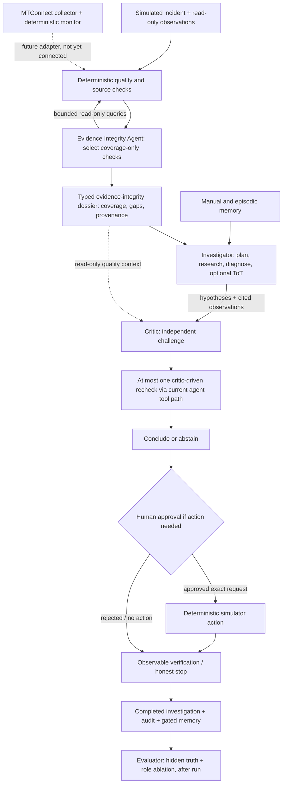

# Future Work 3 — independent Evidence Integrity Agent (third agent)

**Status: DESIGN ONLY / NOT IMPLEMENTED (2026-11-03).** No third agent, new tool, provider, graph stage, API call, new permission, or live-MTConnect-to-investigator adapter is created by this document. The current two model-driven roles are the Investigator and Critic. This is the preferred *first bounded three-agent increment*, not approval to build a six-agent chain. Do not merge the design as if its proposed runtime contracts already exist.

## Decision

Add a dedicated **Evidence Integrity Agent** when the core incident-first line-wide evidence packet and the existing two-role investigation have reproducible baselines, and when a measured integrity/coverage error justifies another model role. Its assignment is **data reliability and completeness**, *not* general evidence retrieval or root-cause reasoning. This narrows the earlier conceptual "Cohere Evidence Agent" slot: manual/SOP retrieval and episodic-memory recall remain with the Investigator; reranking is not inherently an agent. No specific model or provider is chosen today.

The third role must exhibit bounded independent agency: given an incident and a blind source/coverage view, it can choose **which allowed coverage observation to request next**, receive and examine the result, and either stop with a complete report or declare an unresolved gap. Merely wrapping a deterministic JSON parser in an LLM is **not** enough to justify an agent. All numerical validity checks remain deterministic.

## Ownership and strict non-overlap

| Role | Sole decision objective | Input | Allowed decision | Forbidden output/authority |
| --- | --- | --- | --- | --- |
| **Evidence Integrity Agent (NEW, planned)** | Can this incident's available data be trusted, attributed, and compared across the relevant line/time window? | Incident trigger, *observed* source/channel metadata, timestamps, coverage, deterministic quality flags; **no other model's hypotheses** | Choose bounded extra *read-only coverage* queries; identify unresolved gaps and affected source/channel/time windows | No diagnosis, suspect/root-cause ranking, competing hypotheses, repair, action confidence, manual/episodic belief evaluation, human approval, execution or simulator truth |
| **Investigator (existing)** | What causal explanation best fits reliable observations, and what further diagnostic check or bounded intervention is justified? | Incident, integrity dossier, existing observation tools, manual and episodic recall | Hypothesize (optional ToT), choose diagnostic tools, interpret, recommend/abstain | No ability to reclassify invalid data as valid or approve its own action |
| **Critic (existing)** | Where does the Investigator's hypothesis or conclusion contradict evidence or lack discriminating support? | Investigator's hypotheses, actual evidence, integrity dossier as read-only context | Typed challenge, favoured *existing* hypothesis, suggested discriminating check (one bounded recheck through the existing stage when enabled) | No modifying dossier quality flags, no independent repair approval or execution, no rewriting provenance or ground truth |

The same raw observation may be **read** by multiple roles; ownership of **decisions** does not overlap. Deterministic monitor is still a non-LLM alert detector; deterministic evidence validator remains non-LLM; evaluator remains a separate post-run authority. Those are not additional "agents."

### Enforced isolation, not prompt-only rules

1. The new role starts **before the Investigator creates hypotheses**. Its view contains no `Hypothesis`, `CritiqueResult`, `AgentConclusion`, `Diagnosis`, memory belief, or hidden-fault/scoring field. It must not see the Investigator's internal reasoning.
2. Its provider receives a **separate allowlist** of *read-only coverage* operations. Initially: `get_time`, `list_machines`, `get_readings`, `get_sensor_trend`, `get_sensor_summary`, `get_factory_readings`, `get_events`, and `get_inspections`, constrained by machine, line, and time window. Do **not** offer `wait`, `search_manual`, `recall_memories`, `propose_action`, `get_proposals`, or `execute_action`. Other tools require an explicit separate permission review.
3. The agent **may request evidence**, but code executes the tool, validates the tool result, assigns evidence IDs, checks timestamps/units/availability/gaps/sequence and duplicates, and decides which quality findings are established. A model's assertion cannot turn missing into zero, stale into current, unknown units into known, or a guessed root cause into fact.
4. It is limited to a preconfigured **small number of extra queries** and an explicit time/model-call budget. At exhaustion, it must return an incomplete dossier/abstain, not loop indefinitely. A failed model call records `unavailable` and leaves the Investigator a code-generated quality summary, not a fabricated success.
5. The Investigator may select further **hypothesis-directed** observation calls afterward, but it cannot edit the source-integrity report. The Critic gets the identical source facts and quality findings and cannot silently reinterpret integrity flags.
6. During the first increment, do **not** invoke the Evidence Integrity Agent again from the critic's recheck. A separate future ablation would be required to justify a return edge.
7. The live collector, monitor and watchdog remain independent and read-only; their records are **not** directly accessible to today's Investigation graph. A shared observation adapter and incident snapshot contract must be implemented and tested before any live pilot uses this role.

## Target three-agent data flow



The real live-data handoff remains **future-only**. No autonomous physical machine action is permitted; an actual manufacturer pilot is read-only/shadow-mode and delivers a recommendation/technician notification only.

## Proposed Pydantic handoff contracts (design, not imports/code deployed)

Use the existing `capstone.contracts.Contract` convention (frozen, extra fields forbidden) at implementation. Schemas below are illustrative and intentionally **carry references, not guessed observations**:

```python
from typing import Literal
from pydantic import Field
from capstone.contracts import Contract

QualityKind = Literal[
    "missing", "unavailable", "stale", "gap", "duplicate", "out_of_order",
    "unknown_unit", "clock_mismatch", "conflicting_sources",
    "insufficient_line_coverage",
]
Readiness = Literal["adequate", "degraded", "insufficient", "unavailable"]

class CoverageRequest(Contract):
    # Agent decision; trusted code enforces bounded names, arguments and window.
    tool_name: Literal[
        "get_time", "list_machines", "get_readings", "get_sensor_trend",
        "get_sensor_summary", "get_factory_readings", "get_events",
        "get_inspections",
    ]
    arguments: dict
    coverage_gap_id: str = Field(min_length=1)
    question: str = Field(min_length=1)  # Why this fills a data gap; not why a machine failed.

class QualityFinding(Contract):
    # Created/verified by deterministic code, NEVER declared true by a model.
    id: str = Field(min_length=1)
    kind: QualityKind
    source_id: str = Field(min_length=1)
    channel_id: str | None = None
    machine_id: str | None = None
    from_tick: int | None = Field(default=None, ge=0)
    to_tick: int | None = Field(default=None, ge=0)
    evidence_ids: tuple[str, ...] = ()
    check_id: str = Field(min_length=1)  # deterministic rule that established finding

class CoverageSlice(Contract):
    source_id: str = Field(min_length=1)
    machine_id: str | None = None
    channel_id: str = Field(min_length=1)
    expected_window: str = Field(min_length=1)
    observed_evidence_ids: tuple[str, ...] = ()
    status: Literal["present", "partial", "missing", "unknown"]
    # Quality is not converted into a confidence/probability.

class EvidenceIntegrityReport(Contract):
    incident_id: str = Field(min_length=1)
    evidence_ids: tuple[str, ...]  # all must resolve to observable provenance
    coverage: tuple[CoverageSlice, ...]
    findings: tuple[QualityFinding, ...]  # trusted checks only
    requested_checks: tuple[CoverageRequest, ...] = ()
    unresolved_gap_ids: tuple[str, ...] = ()
    readiness: Readiness  # computed from explicit rules, never model intuition
    agent_outcome: Literal["completed", "budget_exhausted", "unavailable"]

class InvestigatorHandoff(Contract):
    incident_id: str = Field(min_length=1)
    integrity_report_id: str = Field(min_length=1)
    available_evidence_ids: tuple[str, ...]
    # Source evidence, not Integrity Agent causes, suspect rankings or proposed repairs.

class CriticQualityContext(Contract):
    integrity_report_id: str = Field(min_length=1)
    finding_ids: tuple[str, ...]
    # Add to existing Critic view; do NOT redefine or replace CritiqueResult.
```

Implementation detail: the agent should propose **only** `CoverageRequest`s; trusted code constructs `QualityFinding`, `CoverageSlice`, and `readiness`, then validates all references. `CoverageRequest.arguments` must be validated against the existing per-tool Pydantic schemas and independently checked for allowed time/machine bounds. All new contracts can be narrowed further at implementation.

## Entry gates and tests before implementation or adoption

- **Baseline first:** current Investigator + Critic, with and without the incident-first line-wide packet, evaluated on matched seeds and controlled identical conditions. New agent then compared to that baseline, not just against Investigator alone.
- **Independent agency test:** provide a broken/missing cross-machine channel and a complete case. The third role must choose a useful bounded coverage request for the first and stop without unnecessary requests on the second. A hardcoded deterministic collector summary **alone** is not a new agent.
- **No overlapping reasoning test:** attempts to emit diagnoses, suspect rankings, proposed repairs, hypotheses, critic verdicts or memory claims fail schema/allowlist/AST guard checks. The third role never receives the Investigator's hypothesis or Critic's result.
- **Provenance test:** unavailable stays missing; stale records, sequence gaps, duplicates, clock shifts, out-of-order arrival and conflicting units are not silently called valid; every finding names a deterministic check and genuine source evidence.
- **Authorization test:** tool calls outside the coverage allowlist, calls over bounds, `wait`, `propose_action`, `execute_action`, reading hidden truth, and approval bypass are all rejected in code.
- **Degraded operation test:** unavailable third-party model, invalid typed reply, excessive latency, empty data and exhausted query budget produce explicit statuses, preserve the valid evidence already captured and never block an honest Investigation termination.
- **Integration test:** existing `Pydantic Graph` stages remain in control; the new stage precedes diagnosis, records its own model calls, produces immutable typed handoffs, and obeys a single total budget.
- **Effectiveness:** measure source-gap detection, false-positive data-quality alerts, unnecessary extra queries, downstream root-cause/target correctness, justified abstention, critic correction rate, latency, cost and model outages. Hold the third role only if pre-registered thresholds show **incremental** benefit without materially worse diagnostic errors.
- **No premature live claims:** synthetic tests and public MTConnect demonstrations do not prove Haas compatibility, factory network access, approved poll rates, unit mapping, or physical repair success. Pilot authorization and an evidence adapter are separate prerequisites.

## Implementation order when approved later

1. Add a *deterministic* line-wide incident snapshot and source-quality/coverage computation with the existing simulator tools.
2. Benchmark the deterministic-only packet. If it already solves the coverage problem, **do not build a model agent for appearances**.
3. Add a separate Evidence Integrity Agent (model client, typed `CoverageRequest`, bounded read-only tool provider, audit records) and the `EvidenceIntegrityReport` builder.
4. Add `integrity` as a stage before the existing `plan`/`investigate` stages in `agent/investigation.py`; do not restructure critic, recheck, approval, verification or learning.
5. Run the matched two-role-vs-three-role ablation and update the evaluator inventory/rubric and `docs/PROGRESS.md`. Only then consider broader specialists from the existing six-provider future-work plan.

This design deliberately prevents the three agents from all answering "what broke?" in different words. Their three decisions are **Can I trust the evidence? → What is the cause? → What did the cause-finding miss?**
