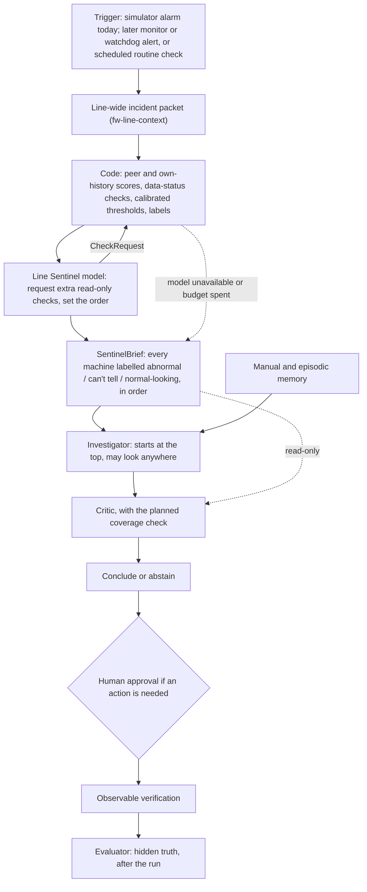

# Future Work 3 — the Line Sentinel (third agent)

**Status: DESIGN ONLY / NOT IMPLEMENTED (2026-11-03).** This document creates no
third agent, tool, provider, graph stage, API call or permission, and no adapter
from the live MTConnect collector to the investigation. Today there are two
model-driven roles, the Investigator and the Critic. The proposed contracts
below are illustrative and do not exist in the code.

An earlier draft of this document (same pull request) proposed a separate
*Evidence Integrity Agent*. Its data-trust checks are kept here, as
deterministic code inside the Sentinel rather than as a fourth role. See
[What changed from the earlier draft](#what-changed-from-the-earlier-draft).

## Decision

Add one third role, the **Line Sentinel**. It decides **where and when** an
investigation should start, and **whether the data there can be trusted**. It
never decides what is wrong. It hands the Investigator a ranked brief of the
whole line, and the Investigator starts from the top of it.

The three roles then answer three different questions:

1. **Line Sentinel:** where and when should we look, and can we trust what we see there?
2. **Investigator:** what is wrong there, and what should be checked or done next?
3. **Critic:** is that conclusion justified, and was enough of the line examined?

## Why this role: the evidence on `main`

The 57 archived master-run episodes in
[`benchmarks/2026-11-01-tot13-pairs/`](benchmarks/2026-11-01-tot13-pairs/) and
[`benchmarks/2026-11-02-audited-known-cases/`](benchmarks/2026-11-02-audited-known-cases/),
grouped by case type. The grouping is a rough keyword match of each conclusion
against the true fault, not the official labels, but the pattern is clear:

| Case type | Plausible | Wrong | No answer |
| --- | --- | --- | --- |
| The alarmed machine is the faulty one (bearing, servo, hydraulic) | 19 | 2 | 5 |
| Wrong setting, no alarm on the faulty machine (KA-05, KA-06) | **0** | 6 | 3 |
| Decoy alarm, real fault elsewhere (KA-09) | **0** | 3 | 1 |

- The Investigator does well once it is pointed at the right machine. It failed
  every time the faulty machine was not the one that alarmed.
- The cause is in the code: `detect_anomaly` in `capstone/agent/monitor.py`
  stops at the **first** alarm and hands that machine to the investigation. In
  KA-09 the first alarm is a harmless spike on CNC-03, and all four runs called
  it transient without looking at CNC-07, where the real faults were.
- The Critic did not close the gap: confirmed-correct counts were the same with
  it on and off (3/12 vs 3/12, and 6/13 vs 6/11). A reviewer can only judge the
  evidence it is shown, and nobody had gathered evidence from the right machine.
- No run has yet shown a data-trust failure: the degraded-case matrix (D2,
  `evals/degraded.json`) has not run live. So data trust is part of the
  Sentinel's job, done by code, and not a separate agent, until a run shows a
  gap the Sentinel does not cover.

So the gap sits **before** the investigation starts, and neither current agent
can fill it.

## Roles and boundaries

| Role | Its one decision | Sees | May | May not |
| --- | --- | --- | --- | --- |
| **Line Sentinel** (planned) | Which machines and time window should the investigation start from, and can their data be trusted? | The trigger, the line-wide incident packet, per-machine scores and data-status flags computed by code, monitor and watchdog alerts. **No other agent's hypotheses.** | Request a bounded number of extra read-only checks; set the order of machines | Name a cause or fault type, rank causes, propose a repair, call a machine healthy without data, change a label code computed, see hidden truth, approve or execute anything, run continuously |
| **Investigator** (existing) | What is wrong, and what to check or do next | The Sentinel brief, existing tools, manual and episodic memory | As today; starts at the top of the brief but **may look at any machine** | Change the brief |
| **Critic** (existing) | Is the conclusion justified, and was enough of the line examined? | Hypotheses, evidence, the brief (read-only) | As today, including the planned [coverage check](MVP_SCOPE.md#fw-critic-coverage) | Change the brief |

The brief **suggests** where to look; it does not lock the Investigator in. If
it did, a wrong pick by the Sentinel would recreate the first-alarm problem one
step earlier. The deterministic monitor, the watchdog, the evidence checks and
the evaluator stay plain code and are not agents.

## When it runs: it never monitors

The model never polls readings. The always-on part is plain code. The Sentinel
is woken, once per incident, by:

1. **A deterministic alert.** In the simulator today, that is the alarm that
   `detect_anomaly` finds. Later, alerts from `capstone.monitoring` (condition,
   threshold, status change, stale, unavailable) and `silent` alerts from
   `capstone.watchdog`.
2. **A scheduled routine check** (`ROUTINE_CHECK`, `machine_id=None`). This is
   how silent degradation gets a look without any alarm.

It has its own small budget inside the investigation's single total budget, and
stops when the budget runs out. Creating, scheduling and de-duplicating
incidents belongs to [Future Work 5 dispatch](MVP_SCOPE.md#fw-proactive), not to
the Sentinel.

## Calibrating "unusual"

"Unusual" is decided by deterministic code with calibrated thresholds, before
any model is involved. The model never sets or overrides a threshold.

- **Two comparisons per machine and channel.** Against its **peers** (the same
  channel on the other machines over the same window) and against **its own
  recent past** (the window before the trigger). A wrong setting can look
  normal against the machine's own history but stand out against its peers; a
  slow drift can look normal against peers but stand out against its own past.
- **Like with like.** Compare only readings taken in the same operating
  context: machine status or mode, job or operation, and spindle speed or load
  where observed. An idle machine is not unusual because it is cooler than a
  cutting one. With too few comparable peers, the peer score is empty.
- **A simple, explainable score.** For example, how many typical spreads a
  value sits from the peer median (median and median absolute deviation). No
  learned model; anyone can recompute the score from the cited readings.
- **Lasting, not passing.** A change counts only when it stays past the
  threshold for a minimum number of ticks, with hysteresis like the monitor's
  edge-triggered alerts. This is what separates KA-09's passing spike on CNC-03
  from a lasting change on CNC-07.
- **Thresholds come from normal runs only.** Calibrate on normal-operation
  seeds kept apart from the evaluation seeds, and set each threshold to hold
  false incidents on normal runs at or below a chosen rate. Never tune on the
  known-answer cases being scored; that would leak the answers.
- **Versioned.** Each set of thresholds gets a `calibration_id`, recorded with
  every brief and run (thresholds, seeds used, date), so a result can be
  reproduced.
- **Missing is not normal.** No history, too few peers, or any data problem on
  the channel in the window (missing, unavailable, stale, gap, duplicate, out of
  order, unknown unit, clock mismatch, conflicting sources) labels that channel
  **can't tell**, never normal. These are the checks the earlier draft gave to
  a separate agent.
- **Real machines need their own calibration.** Simulator thresholds do not
  transfer to a shop. A pilot recalibrates from that shop's own normal data;
  manufacturer limits stay absolute bounds, separate from peer baselines.

Each machine then gets one label, computed by code from its channels:
**abnormal** (a lasting unusual change on at least one channel), **can't tell**
(no lasting change, but at least one relevant channel is untrusted or lacks a
baseline) or **normal-looking**.

## What the model decides, and what code decides

- **Code** computes every score, data-status flag and label, executes every
  tool call, assigns evidence IDs and enforces the time window.
- **The model** decides two things:
  1. **Which extra read-only checks to request** when the picture is unclear,
     for example a longer trend window on one channel, or events on a
     neighbour. Code runs the check and recomputes the labels.
  2. **The order of machines.** It may move a machine up, for example an
     upstream machine whose change started earlier, using the line topology
     and timing as a lead, not as causal proof. Every move cites evidence IDs.
- **No free text.** The model returns only check requests, an order and cited
  evidence IDs, so it has no field in which to name a cause.

Whether the model's choices add anything over code alone is exactly what arms
D and E below test. If they do not, the model layer is not built.

## Allowed tools

Read-only, bounded by machine, line and a time window that ends at the current
simulation time: `get_time`, `list_machines`, `get_readings`,
`get_sensor_trend`, `get_sensor_summary`, `get_factory_readings`, `get_events`,
`get_inspections`. **Not offered:** `wait`, `search_manual`,
`recall_memories`, `propose_action`, `get_proposals`, `execute_action`. Any
other tool needs its own permission review.

This is enforced in code, not in the prompt: a separate tool allowlist, strict
schemas, and an import-guard test like the one on `capstone/monitoring`.

## Data flow



Live machines stay future work: the MTConnect collector, monitor and watchdog
are not connected to the investigation, and a manufacturer pilot stays
read-only, with recommendations to a technician only.

## Proposed contracts (illustrative, not in the code)

Use the existing `capstone.contracts.Contract` convention (frozen, extra fields
forbidden):

```python
from typing import Literal
from pydantic import Field
from capstone.contracts import Contract

DataIssue = Literal[
    "missing",
    "unavailable",
    "stale",
    "gap",
    "duplicate",
    "out_of_order",
    "unknown_unit",
    "clock_mismatch",
    "conflicting_sources",
    "baseline_unavailable",
]
MachineLabel = Literal["abnormal", "cant_tell", "normal_looking"]


class CheckRequest(Contract):
    # The model's only request type: one more read-only check. Code validates
    # the arguments against the tool's own schema and the time window.
    tool_name: Literal[
        "get_time",
        "list_machines",
        "get_readings",
        "get_sensor_trend",
        "get_sensor_summary",
        "get_factory_readings",
        "get_events",
        "get_inspections",
    ]
    arguments: dict
    machine_id: str | None = None


class ChannelScore(Contract):
    # Computed by code, never by the model.
    machine_id: str = Field(min_length=1)
    channel: str = Field(min_length=1)
    from_tick: int = Field(ge=0)
    to_tick: int = Field(ge=0)
    peer_score: float | None = None  # None: too few comparable peers
    own_score: float | None = None  # None: no history before the window
    sustained_ticks: int = Field(ge=0)
    issues: tuple[DataIssue, ...] = ()
    evidence_ids: tuple[str, ...] = ()


class MachineEntry(Contract):
    machine_id: str = Field(min_length=1)
    label: MachineLabel  # computed by code
    since_tick: int | None = None  # first tick of the lasting change
    scores: tuple[ChannelScore, ...]
    ordered_by: Literal["code", "model"]
    cited_evidence_ids: tuple[str, ...] = ()  # required when ordered_by="model"


class SentinelBrief(Contract):
    incident_id: str = Field(min_length=1)
    trigger: str = Field(min_length=1)
    as_of_tick: int = Field(ge=0)
    calibration_id: str = Field(min_length=1)
    machines: tuple[MachineEntry, ...]  # every machine on the line, in order
    requested_checks: tuple[CheckRequest, ...] = ()
    outcome: Literal["completed", "budget_exhausted", "model_unavailable"]
```

`machines` lists **every** machine on the line, not a top-N cut, so nothing is
dropped silently. The brief goes into investigation state; the Investigator and
the Critic both read the same brief.

## Evaluation: two new arms

This extends the [alarm-centred vs line-wide comparison](MVP_SCOPE.md#fw-scope-comparison)
(arms A, B and C), on the same frozen seeds, settings and budgets:

| Arm | What runs |
| --- | --- |
| A | Today: first alarm wins |
| B | Line-wide incident packet |
| C | B plus the critic's coverage check |
| **D** | B plus a **code-only** Sentinel brief (scores, labels, code order; no model) |
| **E** | D plus the **Sentinel model** (extra checks and ordering) |

- **The brief can be scored on its own**, in seconds, before any
  investigation runs: is the faulty machine ranked first; how many ticks after
  the fault started was it labelled abnormal; how many false incidents on
  normal runs. That makes the Sentinel cheap to tune and test.
- **Keep the model layer (E) only if** it beats D on KA-05, KA-06 and KA-09
  (faulty machine ranked first, and a correct downstream diagnosis) without
  more false incidents or unnecessary checks on the false-alarm controls KA-07
  and KA-08, and without breaking the cases where the alarmed machine is the
  faulty one. If D already does as well, do not build E.
- Report the Sentinel's own time and model calls apart from the
  investigation's: 31 of the 57 runs already ended on a timeout or a model
  outage, so the Sentinel must not add to that.

## Tests before adoption

- **Baseline first.** Follow the [line-wide scope order](MVP_SCOPE.md#fw-line-scope):
  pin A, build B and evaluate it. Build the Sentinel only if B still misses
  machines that never alarmed.
- **Calibration:** thresholds come only from normal-operation seeds; the false
  incident rate on normal runs is reported; evaluation seeds are never used
  for tuning.
- **No causes:** the model's output schema has no field for a cause, fault
  type, repair or confidence; anything else is rejected.
- **Data trust:** missing stays missing; stale, gaps, duplicates, out-of-order
  rows, clock shifts and unknown units give **can't tell**, never
  normal-looking.
- **Permissions:** calls outside the allowlist, reads past the current time,
  `wait`, `propose_action`, `execute_action` and hidden truth are rejected in
  code.
- **Fallback:** an unavailable model, an invalid reply, a slow reply or a spent
  budget hands over the code-only brief with its outcome recorded; the
  investigation is never blocked.
- **Not a cage:** the Investigator can still query machines below the top of
  the brief.
- **No premature live claims:** synthetic tests and the public MTConnect demo
  do not prove Haas compatibility, factory network access, approved poll
  rates, unit mapping or repair success.

## Implementation order, when approved

1. The [line-wide incident packet](MVP_SCOPE.md#fw-line-context) in the
   `observe` stage, and its A/B evaluation (already planned).
2. Code only: scores, data-status checks and calibration on normal seeds, then
   the code-only brief (arm D). Score the briefs on their own against the
   truth, then run arm D end to end.
3. Only if D still misses: the Sentinel model (arm E): a model client, the
   `CheckRequest` type, an allowlisted read-only tool provider and audit
   records, run as a `sentinel` stage between `observe` and `plan` in
   `agent/investigation.py`. Critic, recheck, approval, verification and
   memory stay as they are.
4. The matched D/E evaluation; then update the evaluator inventory and rubric
   and `docs/PROGRESS.md`.
5. Live data, later: after [telemetry replay](MVP_SCOPE.md#fw-telemetry-replay),
   the monitor's alerts become triggers, and a pilot stays read-only.

## How it fits the rest of the future work

- [Line-wide context](MVP_SCOPE.md#fw-line-context): the Sentinel builds on its
  incident packet and replaces nothing in it.
- [Critic coverage check](MVP_SCOPE.md#fw-critic-coverage): stays. It checks
  coverage after the fact; the Sentinel sets it up before. They are measured
  separately (arms C and D).
- [Telemetry replay](MVP_SCOPE.md#fw-telemetry-replay) and
  [Future Work 5](MVP_SCOPE.md#fw-proactive): the deterministic monitor is the
  always-on part and FW5 owns incident dispatch; the Sentinel is woken by them.
- [Rapid triage](MVP_SCOPE.md#fw-rapid-triage): triage reports preliminary
  causes; the Sentinel never does. The brief can be triage's starting point.
- [Degraded data](MVP_SCOPE.md#fw-degraded-data): the D2 matrix tests the
  **can't tell** label. If a live degraded run later shows a data-trust gap
  the Sentinel does not cover, reconsider a separate integrity role then.
- [Specialist roles](MVP_SCOPE.md#fw-specialist-roles): the larger
  multi-provider workflow stays a long-term option, after this.

## What changed from the earlier draft

The earlier draft of this pull request proposed an **Evidence Integrity
Agent**. It was folded into the Sentinel because:

- its own entry gate required a demonstrated data-integrity gap, and no run
  has shown one yet, while the where-to-look gap is measured (0 of 13);
- its quality checks were deterministic by design, so they work as code inside
  the Sentinel without a model of their own;
- it forbade ranking machines, which is the decision the runs show is missing;
- running two model stages before the Investigator would lengthen a chain that
  already times out in over half of the runs.

Kept from it: the model may only request checks while code establishes every
finding; enforced isolation (allowlist, schemas, guard tests); explicit
degraded outcomes with a code-only fallback; the list of data-quality checks;
and the rule not to build a model layer if code alone performs as well.

## Research basis

- [Towards a Science of Scaling Agent Systems](https://arxiv.org/abs/2512.08296):
  coordination between agents helps work that splits into independent parts
  and hurts long sequential chains. The Sentinel runs before the
  investigation chain rather than adding a step inside it.
- [LLM-as-an-Investigator](https://arxiv.org/abs/2606.13220): premature
  commitment to a wrong hypothesis as the central failure, which the
  first-alarm handover causes here.
